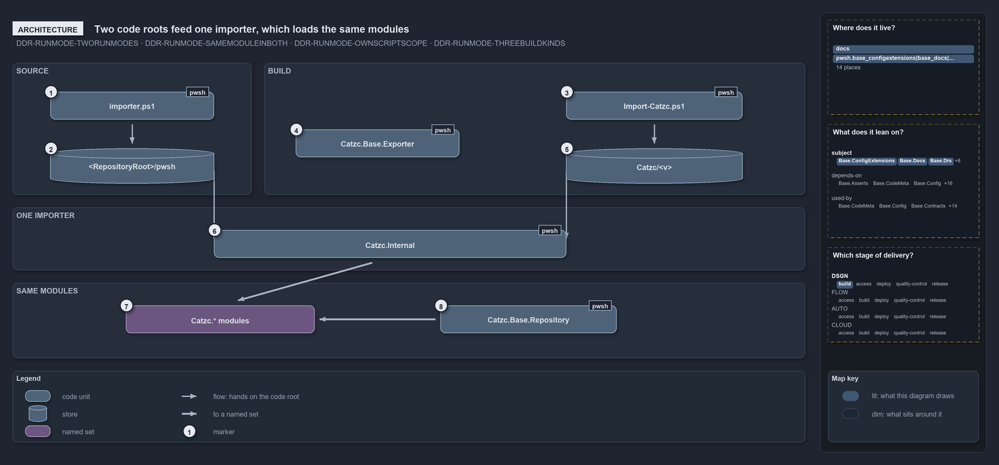

---
catzc:
  edges:
    cites:
      - DDR-RUNMODE-TWORUNMODES
      - DDR-RUNMODE-SAMEMODULEINBOTH
      - DDR-RUNMODE-OWNSCRIPTSCOPE
      - DDR-RUNMODE-THREEBUILDKINDS
---

# Two code roots feed one importer, which loads the same modules

```text
Two code roots feed one importer, which loads the same modules.

1  importer.ps1                  the source-mode entry script at the repository root
2  <RepositoryRoot>/pwsh   the source-mode code root
3  Import-Catzc.ps1              the build-mode entry script inside every package
4  Catzc.Base.Exporter           builds the package from the source tree, before any load
5  Catzc/<v>                     the build-mode code root, a versioned package folder
6  Catzc.Internal                the one importer, the same in both modes
7  Catzc.* modules               the same modules in both modes, one script scope each
8  Catzc.Base.Repository         hands each module the code root it finds its files under

Supports DDR-RUNMODE-TWORUNMODES, DDR-RUNMODE-SAMEMODULEINBOTH, DDR-RUNMODE-OWNSCRIPTSCOPE and DDR-RUNMODE-THREEBUILDKINDS (architecture lens).
```

The two run modes of cats differ only in where the code root sits: source mode loads straight from the repository, and build mode loads from
a built `Catzc` package. Each mode has its own entry script and its own code root, and from there on everything is shared: the code root is
handed on to one importer, which loads one set of modules, and those modules find their own files through the same code root. That is why a
build is a second run mode of the same modules, and not a second product.

```yml drawio
description:
  The source tree and a built package are two code roots, each with its own entry script, that feed one importer; it loads the same modules
  in both modes, and each module finds its files through the code root it is handed.
about:
  adrs: [DDR-RUNMODE-TWORUNMODES, DDR-RUNMODE-SAMEMODULEINBOTH, DDR-RUNMODE-OWNSCRIPTSCOPE, DDR-RUNMODE-THREEBUILDKINDS]
  lens: architecture
content:
  title: Two code roots feed one importer, which loads the same modules
  kind: explanation
  flow: left-to-right
  relation: hands on the code root
  theme: dark
  bands:
    - { id: band-source, label: SOURCE }
    - { id: band-build, label: BUILD }
    - { id: band-importer, label: ONE IMPORTER }
    - { id: band-modules, label: SAME MODULES }
  glyphs:
    - { id: g-importer, kind: code, label: importer.ps1, in: band-source }
    - { id: g-source-root, kind: store, label: <RepositoryRoot>/pwsh, in: band-source }
    - { id: g-import-catzc, kind: code, label: Import-Catzc.ps1, in: band-build }
    - { id: g-exporter, kind: code, label: Catzc.Base.Exporter, in: band-build }
    - { id: g-bundle-root, kind: store, label: Catzc/<v>, in: band-build }
    - { id: g-internal, kind: code, label: Catzc.Internal, in: band-importer }
    - { id: g-modules, kind: set, label: Catzc.* modules, in: band-modules }
    - { id: g-repository, kind: code, label: Catzc.Base.Repository, in: band-modules }
  edges:
    - { from: g-importer, to: g-source-root, kind: flow, label: "" }
    - { from: g-import-catzc, to: g-bundle-root, kind: flow, label: "" }
    - { from: g-source-root, to: g-internal, kind: flow, label: "" }
    - { from: g-bundle-root, to: g-internal, kind: flow, label: "" }
    - { from: g-internal, to: g-modules, kind: thick, label: "" }
    - { from: g-repository, to: g-modules, kind: thick, label: "" }
  markers:
    - { at: g-importer, number: 1 }
    - { at: g-source-root, number: 2 }
    - { at: g-import-catzc, number: 3 }
    - { at: g-exporter, number: 4 }
    - { at: g-bundle-root, number: 5 }
    - { at: g-internal, number: 6 }
    - { at: g-modules, number: 7 }
    - { at: g-repository, number: 8 }
  legend: auto
  minimaps:
    code-locations:
      - cell: docs/-/.
        by:
          - docs/drs/design/dora-explains.md
          - docs/drs/design/run-modes.md
          - docs/drs/glossary.md
          - docs/drs/index.md
          - docs/references/pwsh/catzc-base-config-extensions/Test-ConfigValidators.ps1.md
          - docs/references/pwsh/catzc-base-docs/private/Get-CatsModules.ps1.md
          - docs/references/pwsh/catzc-base-globs/Get-ModuleGlobSet.ps1.md
          - docs/references/pwsh/catzc-base-module-system/Copy-CatzcModule.ps1.md
          - docs/references/pwsh/catzc-base-module-system/Get-FunctionDependency.ps1.md
          - docs/references/pwsh/catzc-base-module-system/Get-InternalAssetDependency.ps1.md
          - docs/references/pwsh/catzc-base-module-system/Get-ModuleFunction.ps1.md
          - docs/references/pwsh/catzc-base-module-system/New-Importer.ps1.md
          - docs/references/pwsh/catzc-base-module-system/Sync-GeneratedFile.ps1.md
          - docs/references/pwsh/catzc-base-module-system/Test-FunctionDependency.ps1.md
          - docs/references/pwsh/catzc-base-quality-gates/Test-BuildArtifact.ps1.md
          - docs/references/pwsh/catzc-base-quality-gates/tests/Test-CatzcBuild.Parity.Tests.ps1.md
          - docs/references/pwsh/catzc-base-quality-gates/tests/Test-CatzcBuild.ScopeIsolation.Tests.ps1.md
          - docs/references/pwsh/catzc-base-repository/Assert-SourceTree.ps1.md
          - docs/references/pwsh/catzc-base-repository/Get-CatzcModuleRoot.ps1.md
          - docs/references/pwsh/catzc-base-root-config/Build-RootConfig.ps1.md
          - docs/references/pwsh/catzc-base-types-system/Clear-ModuleTypeCache.ps1.md
          - docs/references/pwsh/catzc-base-types-system/Get-CSharpTypeDependency.ps1.md
          - docs/references/pwsh/catzc-base-types-system/Invoke-BuildForVsCode.ps1.md
          - docs/references/pwsh/catzc-base-vendor/Install-VendorModule.ps1.md
          - docs/references/pwsh/catzc-base-vendor/Remove-VendorModules.ps1.md
          - docs/references/pwsh/internal/Catzc.Internal.Builder.psm1.md
          - docs/references/pwsh/internal/assets/Import-Catzc.ps1.md
          - DDR-RUNMODE-OWNSCRIPTSCOPE
          - DDR-RUNMODE-SAMEMODULEINBOTH
          - DDR-RUNMODE-THREEBUILDKINDS
          - DDR-RUNMODE-TWORUNMODES
      - cell: pwsh/Catzc.Base.ConfigExtensions/.
        by: [pwsh/Catzc.Base.ConfigExtensions/Test-ConfigValidators.ps1, DDR-RUNMODE-SAMEMODULEINBOTH]
      - cell: pwsh/Catzc.Base.Docs/configs
        by: [pwsh/Catzc.Base.Docs/configs/glossary.yml, DDR-RUNMODE-TWORUNMODES]
      - cell: pwsh/Catzc.Base.Docs/private
        by: [pwsh/Catzc.Base.Docs/private/Get-CatsModules.ps1, DDR-RUNMODE-SAMEMODULEINBOTH]
      - cell: pwsh/Catzc.Base.Drs/configs
        by:
          - pwsh/Catzc.Base.Drs/configs/drs.yml
          - DDR-RUNMODE-OWNSCRIPTSCOPE
          - DDR-RUNMODE-SAMEMODULEINBOTH
          - DDR-RUNMODE-THREEBUILDKINDS
          - DDR-RUNMODE-TWORUNMODES
      - cell: pwsh/Catzc.Base.Globs/.
        by:
          - pwsh/Catzc.Base.Globs/Get-ModuleGlobSet.ps1
          - DDR-RUNMODE-OWNSCRIPTSCOPE
          - DDR-RUNMODE-SAMEMODULEINBOTH
          - DDR-RUNMODE-THREEBUILDKINDS
          - DDR-RUNMODE-TWORUNMODES
      - cell: pwsh/Catzc.Base.ModuleSystem/.
        by:
          - pwsh/Catzc.Base.ModuleSystem/Copy-CatzcModule.ps1
          - pwsh/Catzc.Base.ModuleSystem/Get-FunctionDependency.ps1
          - pwsh/Catzc.Base.ModuleSystem/Get-InternalAssetDependency.ps1
          - pwsh/Catzc.Base.ModuleSystem/Get-ModuleFunction.ps1
          - pwsh/Catzc.Base.ModuleSystem/New-Importer.ps1
          - pwsh/Catzc.Base.ModuleSystem/Sync-GeneratedFile.ps1
          - pwsh/Catzc.Base.ModuleSystem/Test-FunctionDependency.ps1
          - DDR-RUNMODE-OWNSCRIPTSCOPE
          - DDR-RUNMODE-SAMEMODULEINBOTH
          - DDR-RUNMODE-THREEBUILDKINDS
          - DDR-RUNMODE-TWORUNMODES
      - cell: pwsh/Catzc.Base.QualityGates/.
        by: [pwsh/Catzc.Base.QualityGates/Test-BuildArtifact.ps1, DDR-RUNMODE-SAMEMODULEINBOTH]
      - cell: pwsh/Catzc.Base.QualityGates/tests
        by:
          - pwsh/Catzc.Base.QualityGates/tests/Test-CatzcBuild.Parity.Tests.ps1
          - pwsh/Catzc.Base.QualityGates/tests/Test-CatzcBuild.ScopeIsolation.Tests.ps1
          - DDR-RUNMODE-OWNSCRIPTSCOPE
          - DDR-RUNMODE-SAMEMODULEINBOTH
      - cell: pwsh/Catzc.Base.Repository/.
        by:
          - pwsh/Catzc.Base.Repository/Assert-SourceTree.ps1
          - pwsh/Catzc.Base.Repository/Get-CatzcModuleRoot.ps1
          - DDR-RUNMODE-OWNSCRIPTSCOPE
          - DDR-RUNMODE-SAMEMODULEINBOTH
          - DDR-RUNMODE-THREEBUILDKINDS
          - DDR-RUNMODE-TWORUNMODES
      - cell: pwsh/Catzc.Base.RootConfig/.
        by:
          - pwsh/Catzc.Base.RootConfig/Build-RootConfig.ps1
          - DDR-RUNMODE-OWNSCRIPTSCOPE
          - DDR-RUNMODE-SAMEMODULEINBOTH
          - DDR-RUNMODE-THREEBUILDKINDS
          - DDR-RUNMODE-TWORUNMODES
      - cell: pwsh/Catzc.Base.TypesSystem/.
        by:
          - pwsh/Catzc.Base.TypesSystem/Build-AgentHook.ps1
          - pwsh/Catzc.Base.TypesSystem/Clear-ModuleTypeCache.ps1
          - pwsh/Catzc.Base.TypesSystem/Get-CSharpTypeDependency.ps1
          - pwsh/Catzc.Base.TypesSystem/Invoke-BuildForVSCode.ps1
          - DDR-RUNMODE-OWNSCRIPTSCOPE
          - DDR-RUNMODE-SAMEMODULEINBOTH
          - DDR-RUNMODE-THREEBUILDKINDS
          - DDR-RUNMODE-TWORUNMODES
      - cell: pwsh/Catzc.Base.Vendor/.
        by:
          - pwsh/Catzc.Base.Vendor/Install-VendorModule.ps1
          - pwsh/Catzc.Base.Vendor/Remove-VendorModules.ps1
          - DDR-RUNMODE-OWNSCRIPTSCOPE
          - DDR-RUNMODE-SAMEMODULEINBOTH
          - DDR-RUNMODE-THREEBUILDKINDS
          - DDR-RUNMODE-TWORUNMODES
      - cell: pwsh/Catzc.Internal.Assets/.
        by:
          - pwsh/.internal/assets/Import-Catzc.ps1
          - DDR-RUNMODE-OWNSCRIPTSCOPE
          - DDR-RUNMODE-SAMEMODULEINBOTH
          - DDR-RUNMODE-THREEBUILDKINDS
          - DDR-RUNMODE-TWORUNMODES
    module-neighbourhood:
      - cell: subject/Catzc.Base.ConfigExtensions
        by: [pwsh/Catzc.Base.ConfigExtensions/Test-ConfigValidators.ps1, DDR-RUNMODE-SAMEMODULEINBOTH]
      - cell: subject/Catzc.Base.Docs
        by:
          - pwsh/Catzc.Base.Docs/configs/glossary.yml
          - pwsh/Catzc.Base.Docs/private/Get-CatsModules.ps1
          - DDR-RUNMODE-SAMEMODULEINBOTH
          - DDR-RUNMODE-TWORUNMODES
      - cell: subject/Catzc.Base.Drs
        by:
          - pwsh/Catzc.Base.Drs/configs/drs.yml
          - DDR-RUNMODE-OWNSCRIPTSCOPE
          - DDR-RUNMODE-SAMEMODULEINBOTH
          - DDR-RUNMODE-THREEBUILDKINDS
          - DDR-RUNMODE-TWORUNMODES
      - cell: subject/Catzc.Base.Globs
        by:
          - pwsh/Catzc.Base.Globs/Get-ModuleGlobSet.ps1
          - DDR-RUNMODE-OWNSCRIPTSCOPE
          - DDR-RUNMODE-SAMEMODULEINBOTH
          - DDR-RUNMODE-THREEBUILDKINDS
          - DDR-RUNMODE-TWORUNMODES
      - cell: subject/Catzc.Base.ModuleSystem
        by:
          - pwsh/Catzc.Base.ModuleSystem/Copy-CatzcModule.ps1
          - pwsh/Catzc.Base.ModuleSystem/Get-FunctionDependency.ps1
          - pwsh/Catzc.Base.ModuleSystem/Get-InternalAssetDependency.ps1
          - pwsh/Catzc.Base.ModuleSystem/Get-ModuleFunction.ps1
          - pwsh/Catzc.Base.ModuleSystem/New-Importer.ps1
          - pwsh/Catzc.Base.ModuleSystem/Sync-GeneratedFile.ps1
          - pwsh/Catzc.Base.ModuleSystem/Test-FunctionDependency.ps1
          - DDR-RUNMODE-OWNSCRIPTSCOPE
          - DDR-RUNMODE-SAMEMODULEINBOTH
          - DDR-RUNMODE-THREEBUILDKINDS
          - DDR-RUNMODE-TWORUNMODES
      - cell: subject/Catzc.Base.QualityGates
        by:
          - pwsh/Catzc.Base.QualityGates/Test-BuildArtifact.ps1
          - pwsh/Catzc.Base.QualityGates/tests/Test-CatzcBuild.Parity.Tests.ps1
          - pwsh/Catzc.Base.QualityGates/tests/Test-CatzcBuild.ScopeIsolation.Tests.ps1
          - DDR-RUNMODE-OWNSCRIPTSCOPE
          - DDR-RUNMODE-SAMEMODULEINBOTH
      - cell: subject/Catzc.Base.Repository
        by:
          - pwsh/Catzc.Base.Repository/Assert-SourceTree.ps1
          - pwsh/Catzc.Base.Repository/Get-CatzcModuleRoot.ps1
          - DDR-RUNMODE-OWNSCRIPTSCOPE
          - DDR-RUNMODE-SAMEMODULEINBOTH
          - DDR-RUNMODE-THREEBUILDKINDS
          - DDR-RUNMODE-TWORUNMODES
      - cell: subject/Catzc.Base.RootConfig
        by:
          - pwsh/Catzc.Base.RootConfig/Build-RootConfig.ps1
          - DDR-RUNMODE-OWNSCRIPTSCOPE
          - DDR-RUNMODE-SAMEMODULEINBOTH
          - DDR-RUNMODE-THREEBUILDKINDS
          - DDR-RUNMODE-TWORUNMODES
      - cell: subject/Catzc.Base.TypesSystem
        by:
          - pwsh/Catzc.Base.TypesSystem/Build-AgentHook.ps1
          - pwsh/Catzc.Base.TypesSystem/Clear-ModuleTypeCache.ps1
          - pwsh/Catzc.Base.TypesSystem/Get-CSharpTypeDependency.ps1
          - pwsh/Catzc.Base.TypesSystem/Invoke-BuildForVSCode.ps1
          - DDR-RUNMODE-OWNSCRIPTSCOPE
          - DDR-RUNMODE-SAMEMODULEINBOTH
          - DDR-RUNMODE-THREEBUILDKINDS
          - DDR-RUNMODE-TWORUNMODES
      - cell: subject/Catzc.Base.Vendor
        by:
          - pwsh/Catzc.Base.Vendor/Install-VendorModule.ps1
          - pwsh/Catzc.Base.Vendor/Remove-VendorModules.ps1
          - DDR-RUNMODE-OWNSCRIPTSCOPE
          - DDR-RUNMODE-SAMEMODULEINBOTH
          - DDR-RUNMODE-THREEBUILDKINDS
          - DDR-RUNMODE-TWORUNMODES
      - cell: subject/Catzc.Internal.Assets
        by:
          - pwsh/.internal/assets/Import-Catzc.ps1
          - DDR-RUNMODE-OWNSCRIPTSCOPE
          - DDR-RUNMODE-SAMEMODULEINBOTH
          - DDR-RUNMODE-THREEBUILDKINDS
          - DDR-RUNMODE-TWORUNMODES
    axis:
      - cell: DSGN/build
        by: [DDR-RUNMODE-OWNSCRIPTSCOPE, DDR-RUNMODE-SAMEMODULEINBOTH, DDR-RUNMODE-THREEBUILDKINDS, DDR-RUNMODE-TWORUNMODES]
layout:
  band-source: { x: 20, y: 84, w: 380, h: 210 }
  band-build: { x: 420, y: 84, w: 860, h: 210 }
  band-importer: { x: 20, y: 314, w: 1260, h: 100 }
  band-modules: { x: 20, y: 434, w: 1260, h: 120 }
  g-importer: { x: 80, y: 130, w: 260, h: 44 }
  g-source-root: { x: 80, y: 220, w: 260, h: 56 }
  g-import-catzc: { x: 900, y: 130, w: 280, h: 44 }
  g-exporter: { x: 470, y: 190, w: 260, h: 44 }
  g-bundle-root: { x: 900, y: 220, w: 280, h: 56 }
  g-internal: { x: 340, y: 350, w: 560, h: 44 }
  g-modules: { x: 200, y: 470, w: 300, h: 44 }
  g-repository: { x: 700, y: 470, w: 280, h: 44 }
```



## Walkthrough

1. **importer.ps1.** The source-mode entry script sits at the repository root and is dot-sourced (`. ./importer.ps1`). It is a small
   generated shim: it sets `$env:RepositoryRoot` to its own folder and hands the whole load to the importer, which takes that folder's
   `pwsh/` as the code root.
2. **`<RepositoryRoot>/pwsh`.** The source-mode code root is the repository's `pwsh/` folder, where each module is a folder of one-function
   `.ps1` files. When nothing presets the code root, the importer sets `CatzcModulesRoot` to this folder.
3. **Import-Catzc.ps1.** The build-mode entry script ships inside every package. It sets `CatzcModulesRoot` to its own folder and runs the
   importer in its bundle mode. The package's `Catzc.psm1` dot-sources this file, so `Import-Module Catzc` and dot-sourcing the file set up
   the same session.
4. **Catzc.Base.Exporter.** The exporter turns the source tree into a package. It holds `Build-Modules`, which builds it, and
   `Install-Catzc` and `Export-Catzc`, which put a build where it can be loaded. It stands apart from the arrows because it works before any
   load: it writes the package that a later load reads, and never hands a code root to the importer itself.
5. **`Catzc/<v>`.** The build-mode code root is a versioned package folder. Each module in it is a generated `.psd1` manifest and one merged
   `<Module>.functions.ps1`. The DDR names three kinds of build root by where the folder lives: temporary, installed and saved.
6. **Catzc.Internal.** The one importer is the same in both modes. Its shared modules evict any catzc module loaded from the other root,
   load the active root, and then assert that nothing from another root is left.
7. **Catzc.\* modules.** The modules are the same in both modes: the same names, the same public and private functions, the same configs and
   assets. Each one is its own PowerShell module with its own script scope, even inside the one package.
8. **Catzc.Base.Repository.** The modules find their own files only through the code root, using `Get-CatzcModuleRoot` from this module,
   never through the folder their source file sits in. The same module holds `Get-CatzcRunMode`, which reads the mode back from the code
   root.

## Why it holds

- Cats runs in exactly two modes: source mode loads from `pwsh/` and is entered by `importer.ps1`, and build mode loads from a built package
  and is entered by its `Import-Catzc.ps1` (DDR-RUNMODE-TWORUNMODES).
- Every module works in both modes and is the same module in both; only its form on disk differs (DDR-RUNMODE-SAMEMODULEINBOTH).
- The package `Catzc` is a container, not a scope, so no module ever shares `$script:` state with another (DDR-RUNMODE-OWNSCRIPTSCOPE).
- Build mode has three kinds of root, told apart by where the code root lives, and every kind loads through the same importer
  (DDR-RUNMODE-THREEBUILDKINDS). A NuGet package from `Export-Catzc -To nuget` is a distribution file, not a code root, until it is
  installed or saved.

## See also

- [Run modes: source mode and build mode](../../drs/design/run-modes.md) — the decision this article explains.
- The other lenses on the same modes: [meta](where-code-loads-from-decides-the-mode.md),
  [implementation](shims-set-roots-mode-read-back.md), [operations](one-entry-script-per-mode.md) and
  [governance](which-run-mode-rules-have-a-gate.md).
- [The design explanations](index.md) · [How to read the diagrams](../index.md#how-to-read-the-diagrams)
