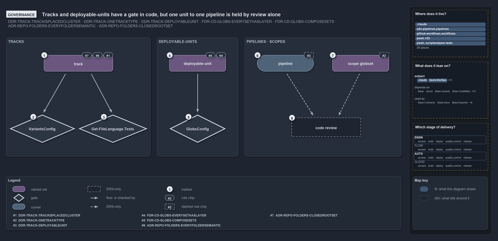

# Tracks and deployable-units have a gate in code, but one unit to one pipeline is held by review alone

```text
Tracks and deployable-units are checked in code; one unit to one pipeline is held by review alone.

1  track                   one root folder, one class, one tech-stack, subscribed to only
2  VariantsConfig          validates the tracks variant on load
3  Get-FileLanguage.Tests  integrity tests over the real repository's tracks and languages
4  deployable-unit         every globset declares its layer; composition is acyclic
5  GlobsConfig             checks layers, keys and compose references on load
6  pipeline                one unit binds one CD pipeline; a CI pipeline binds its track's set
7  scope globset           a cross-cutting slice is a scope over tracks, never a new root
8  code review             the only check of the pipeline rule and the scope rule

Supports DDR-TRACK-TRACKISPLACEDCLUSTER, DDR-TRACK-ONETRACKTYPE, DDR-TRACK-DEPLOYABLEUNIT, FDR-CD-GLOBS-EVERYSETHASLAYER,
FDR-CD-GLOBS-COMPOSESETS, ADR-REPO-FOLDERS-EVERYFOLDERSEMANTIC and ADR-REPO-FOLDERS-CLOSEDROOTSET (governance lens).
```

The tracks DDR sets rules at three levels: what a track is, how a deployable-unit is composed, and how a pipeline binds a unit. Cats checks
the first two in code, when the configuration loads and in integrity tests. The rule that binds one unit to one pipeline, and the rule that
a cross-cutting slice is a scope rather than a new track, have no check in code: code review holds them.

```yml drawio
description:
  Tracks and deployable-units are checked in code, by the variants config, an integrity test over the real repository and the globs config
  on load; the rules that one unit binds one pipeline and that a scope is no new track are held by code review alone.
about:
  adrs:
    - DDR-TRACK-TRACKISPLACEDCLUSTER
    - DDR-TRACK-ONETRACKTYPE
    - DDR-TRACK-DEPLOYABLEUNIT
    - FDR-CD-GLOBS-EVERYSETHASLAYER
    - FDR-CD-GLOBS-COMPOSESETS
    - ADR-REPO-FOLDERS-EVERYFOLDERSEMANTIC
    - ADR-REPO-FOLDERS-CLOSEDROOTSET
  lens: governance
content:
  title: Tracks and deployable-units have a gate in code, but one unit to one pipeline is held by review alone
  kind: explanation
  flow: left-to-right
  theme: dark
  bands:
    - { id: band-tracks, label: TRACKS }
    - { id: band-units, label: DEPLOYABLE-UNITS }
    - { id: band-pipelines, label: PIPELINES · SCOPES }
  glyphs:
    - { id: g-track, kind: set, label: track, in: band-tracks }
    - { id: g-variants-config, kind: gate, label: VariantsConfig, in: band-tracks }
    - { id: g-language-tests, kind: gate, label: Get-FileLanguage.Tests, in: band-tracks }
    - { id: g-unit, kind: set, label: deployable-unit, in: band-units }
    - { id: g-globs-config, kind: gate, label: GlobsConfig, in: band-units }
    - { id: g-pipeline, kind: runner, label: pipeline, in: band-pipelines }
    - { id: g-scope, kind: set, label: scope globset, in: band-pipelines }
    - { id: g-review, kind: drsonly, label: code review, in: band-pipelines }
  edges:
    - { from: g-track, to: g-variants-config, kind: flow, label: "" }
    - { from: g-track, to: g-language-tests, kind: flow, label: "" }
    - { from: g-unit, to: g-globs-config, kind: flow, label: "" }
    - { from: g-pipeline, to: g-review, kind: adr, label: "" }
    - { from: g-scope, to: g-review, kind: adr, label: "" }
  markers:
    - { at: g-track, number: 1 }
    - { at: g-variants-config, number: 2 }
    - { at: g-language-tests, number: 3 }
    - { at: g-unit, number: 4 }
    - { at: g-globs-config, number: 5 }
    - { at: g-pipeline, number: 6 }
    - { at: g-scope, number: 7 }
    - { at: g-review, number: 8 }
  chips:
    - { at: g-track, kind: rule, rule: DDR-TRACK-TRACKISPLACEDCLUSTER }
    - { at: g-track, kind: rule, rule: ADR-REPO-FOLDERS-EVERYFOLDERSEMANTIC }
    - { at: g-track, kind: rule, rule: ADR-REPO-FOLDERS-CLOSEDROOTSET }
    - { at: g-unit, kind: rule, rule: FDR-CD-GLOBS-EVERYSETHASLAYER }
    - { at: g-unit, kind: rule, rule: FDR-CD-GLOBS-COMPOSESETS }
    - { at: g-pipeline, kind: rule, rule: DDR-TRACK-DEPLOYABLEUNIT, gated: false }
    - { at: g-scope, kind: rule, rule: DDR-TRACK-ONETRACKTYPE, gated: false }
  legend: auto
  minimaps: [code-locations, module-neighbourhood, axis]
layout:
  band-tracks: { x: 20, y: 104, w: 460, h: 380 }
  band-units: { x: 500, y: 104, w: 260, h: 380 }
  band-pipelines: { x: 780, y: 104, w: 500, h: 380 }
  g-track: { x: 140, y: 160, w: 220, h: 52 }
  g-variants-config: { x: 30, y: 350, w: 210, h: 90 }
  g-language-tests: { x: 250, y: 350, w: 220, h: 90 }
  g-unit: { x: 540, y: 160, w: 180, h: 52 }
  g-globs-config: { x: 540, y: 350, w: 180, h: 90 }
  g-pipeline: { x: 820, y: 160, w: 180, h: 52 }
  g-scope: { x: 1060, y: 160, w: 180, h: 52 }
  g-review: { x: 930, y: 360, w: 220, h: 60 }
```



## Walkthrough

1. **track.** A track is one root folder, named by it, with `out/` excepted; it carries one class (core, external port, adapter or
   verification), owns one tech-stack made of file languages, and is subscribed to only through module dependencies or its globset
   projection. Every root folder git tracks a file under names a track, and the root set is closed.
2. **VariantsConfig.** Validates the `tracks` variant in `variants.yml` on load: each root is one folder segment, never `out`, and owned by
   one track, and each class is one of the four.
3. **Get-FileLanguage.Tests.** Integrity tests over the real repository: every root folder with tracked files is a declared track, every
   language a track declares is registered, and every live file of a track is written in one of the track's declared languages, so a second
   tech-stack fails the build.
4. **deployable-unit.** Every globset declares its layer, `deployable-unit` or `loose-fileset`, and `compose:` references declared sets
   without a cycle.
5. **GlobsConfig.** Checks the units on load: the layer each declares (`module` is rejected as derived-only), no unknown keys, and every
   `compose:` reference resolved, acyclically. `Test-GlobSetIndependence` adds that no two units select a common file on their own
   contribution.
6. **pipeline.** One unit binds one CD pipeline, widening to two only when a DEPLOY stage splits out of CD; a CI pipeline that verifies a
   whole track binds that track's own set.
7. **scope globset.** A cross-cutting slice is a scope over tracks, never a new root. `GlobsConfig` accepts a scope as a `loose-fileset`,
   and that layer is exempt from the independence check.
8. **code review.** The only check of the pipeline rule and the scope rule. `globs.yml` lets any layer carry `pipeline:`, and the gates on
   the trigger check a bound pipeline's paths, not the shape of the binding. Today six globsets bind six distinct pipelines, so one to one
   holds by fact.

## Why it holds

- A track is one root folder, named by it, and every root folder is a track, the gitignored `out/` included (DDR-TRACK-TRACKISPLACEDCLUSTER,
  ADR-REPO-FOLDERS-EVERYFOLDERSEMANTIC); the root set is closed (ADR-REPO-FOLDERS-CLOSEDROOTSET).
- Each track carries one class, and a cross-cutting slice is a scope, not a track (DDR-TRACK-ONETRACKTYPE).
- A track owns one tech-stack, and a tech-stack is a set of file languages (DDR-TRACK-ONETECHSTACK, DDR-TRACK-FILELANGUAGE).
- Tracks are subscribed to, never path-coupled (DDR-TRACK-SUBSCRIBABLENOTPATHCOUPLED).
- Every globset declares its layer, and composition is acyclic (FDR-CD-GLOBS-EVERYSETHASLAYER, FDR-CD-GLOBS-COMPOSESETS).
- Units bind pipelines one to one (DDR-TRACK-DEPLOYABLEUNIT).

## Where the code and the decision record differ

- The tracks DDR's enforcement list names the folders ADR, the globset registry, the gates on dependencies and code review, but not the
  `tracks` variant, its load-time validation, or the integrity tests that now check rules 1, 2, 3 and 6.
- The folders ADR names `go/` and `python/` as amendments to the closed root set, but not `bash/`, which the tracks DDR and `variants.yml`
  declare as a track.

## See also

- [Tracks — the repository's root concerns](../../drs/design/tracks.md) — the decision this article explains.
- The other lenses on the same model: [meta](one-unit-one-pipeline.md), [architecture](units-not-tracks-own-the-pipelines.md),
  [implementation](globs-yml-pipeline-field-is-the-binding.md) and [operations](a-push-fires-only-touched-pipelines.md).
- [The design explanations](index.md) · [How to read the diagrams](../index.md#how-to-read-the-diagrams)
