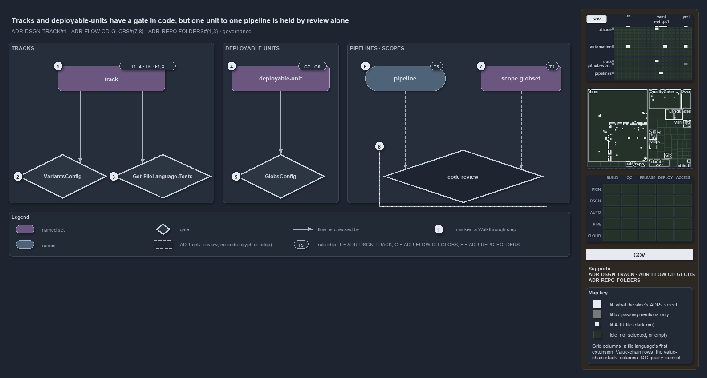

# Tracks and deployable-units have a gate in code, but one unit to one pipeline is held by review alone

```text
Tracks and deployable-units are checked in code; one unit to one pipeline is held by review alone.

1  track                   one root folder, one class, one tech-stack, subscribed to only
2  VariantsConfig          validates the tracks variant on load
3  Get-FileLanguage.Tests  integrity tests over the real repository's tracks and languages
4  deployable-unit         every globset declares its layer; composition is acyclic
5  GlobsConfig             checks layers, keys and compose references on load
6  pipeline                one unit binds one CD pipeline; a CI pipeline binds its track's set
7  scope globset           a cross-cutting slice is a scope over tracks, never a new root
8  code review             the only check of the pipeline rule and the scope rule

Supports ADR-DSGN-TRACK#1, #2, #3, #4, #5 and #6 (governance lens).
```

The tracks ADR sets rules at three levels: what a track is, how a deployable-unit is composed, and how a pipeline binds a unit. Cats checks
the first two in code, when the configuration loads and in integrity tests. The rule that binds one unit to one pipeline, and the rule that
a cross-cutting slice is a scope rather than a new track, have no check in code: code review holds them.



The diagram is described element by element in [its asset description](.assets/unit-to-pipeline-rule-is-review-only/diagram.drawio.md).

## Walkthrough

1. **track.** A track is one root folder, named by it, with `out/` excepted; it carries one class (core, external port, adapter or
   verification), owns one tech-stack made of file languages, and is subscribed to only through module dependencies or its globset
   projection. Every root folder git tracks a file under names a track, and the root set is closed.
2. **VariantsConfig.** Validates the `tracks` variant in `variants.yml` on load: each root is one folder segment, never `out`, and owned by
   one track, and each class is one of the four.
3. **Get-FileLanguage.Tests.** Integrity tests over the real repository: every root folder with tracked files is a declared track, every
   language a track declares is registered, and every live file of a track is written in one of the track's declared languages, so a second
   tech-stack fails the build.
4. **deployable-unit.** Every globset declares its layer, `deployable-unit` or `loose-fileset`, and `compose:` references declared sets
   without a cycle.
5. **GlobsConfig.** Checks the units on load: the layer each declares (`module` is rejected as derived-only), no unknown keys, and every
   `compose:` reference resolved, acyclically. `Test-GlobSetIndependence` adds that no two units select a common file on their own
   contribution.
6. **pipeline.** One unit binds one CD pipeline, widening to two only when a DEPLOY stage splits out of CD; a CI pipeline that verifies a
   whole track binds that track's own set.
7. **scope globset.** A cross-cutting slice is a scope over tracks, never a new root. `GlobsConfig` accepts a scope as a `loose-fileset`,
   and that layer is exempt from the independence check.
8. **code review.** The only check of the pipeline rule and the scope rule. `globs.yml` lets any layer carry `pipeline:`, and the gates on
   the trigger check a bound pipeline's paths, not the shape of the binding. Today six globsets bind six distinct pipelines, so one to one
   holds by fact.

## Why it holds

- A track is one root folder, named by it, and every tracked root folder except `out/` is a track (ADR-DSGN-TRACK#1, ADR-REPO-FOLDERS#1);
  the root set is closed (ADR-REPO-FOLDERS#3).
- Each track carries one class, and a cross-cutting slice is a scope, not a track (ADR-DSGN-TRACK#2).
- A track owns one tech-stack, and a tech-stack is a set of file languages (ADR-DSGN-TRACK#3, ADR-DSGN-TRACK#6).
- Tracks are subscribed to, never path-coupled (ADR-DSGN-TRACK#4).
- Every globset declares its layer, and composition is acyclic (ADR-FLOW-CD-GLOBS#7, ADR-FLOW-CD-GLOBS#8).
- Units bind pipelines one to one (ADR-DSGN-TRACK#5).

## Where the code and the ADR differ

- The tracks ADR's enforcement list names the folders ADR, the globset registry, the gates on dependencies and code review, but not the
  `tracks` variant, its load-time validation, or the integrity tests that now check rules 1, 2, 3 and 6.
- The folders ADR names `go/` and `python/` as amendments to the closed root set, but not `bash/`, which the tracks ADR and `variants.yml`
  declare as a track.

## See also

- [Tracks — the repository's root concerns](../../adr/design/tracks.md) — the decision this article explains.
- The other lenses on the same model: [meta](one-unit-one-pipeline.md), [architecture](units-not-tracks-own-the-pipelines.md),
  [implementation](globs-yml-pipeline-field-is-the-binding.md) and [operations](a-push-fires-only-touched-pipelines.md).
- [The design explanations](index.md) · [How to read the diagrams](../index.md#how-to-read-the-diagrams)
