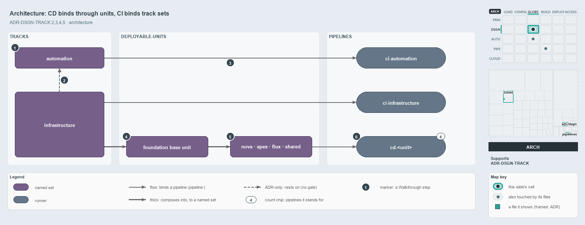

---
catzc:
  derived:
    path: docs/explanation/design/units-not-tracks-own-the-pipelines.md
    kind: explanation
    body_sha: fac580a0ca23
    adrs:
      - ADR-DSGN-TRACK#2
      - ADR-DSGN-TRACK#3
      - ADR-DSGN-TRACK#4
      - ADR-DSGN-TRACK#5
---

# CD pipelines bind through deployable-units, while CI pipelines bind the track sets directly

```text
The four CD pipelines bind deployable-units; the two CI pipelines bind the track sets themselves.

1  automation                   the core track, a loose-fileset over automation/**
2  infrastructure rests on it   the adapter track rests on the core, never the reverse
3  automation -> ci-automation  the track set carries pipeline: itself, with no unit between
4  foundation base unit         a reduced composition of infrastructure; binds no pipeline
5  nova, apex, flux, shared     four configured units, each composing the base unit
6  cd-<unit>                    the four CD pipelines, one per unit

Supports ADR-DSGN-TRACK#2, #3, #4 and #5 (architecture lens).
```

Cats is one repository made of tracks, the root concerns such as `automation` and `infrastructure`. A track does not ship by itself: what
ships is a deployable-unit, and each pipeline is the delivery machine of what it binds. The four CD pipelines bind deployable-units, as the
tracks ADR asks, but the two CI pipelines bind the `automation` and `infrastructure` track sets themselves, with no whole-track unit in
between.



The diagram is described element by element in
[its asset description](../../.assets/explanation/adr-dsgn-track--units-not-tracks-own-the-pipelines--architecture.drawio.md).

## Walkthrough

1. **automation.** The core track: it defines the internal ports every other track rests on. In `globs.yml` it is a globset of the
   `loose-fileset` layer that selects `automation/**`. Of the eleven tracks cats declares, only `automation` and `infrastructure` have a
   globset of their own.
2. **infrastructure rests on automation.** `infrastructure` is an adapter track: it rests on `automation` for context and execution, never
   the reverse, and `ci-infrastructure` runs automation commands such as `Assert-BicepTemplate` and `Build-Bicep`. No gate checks this
   direction between tracks; the gates on module dependencies check edges between modules only.
3. **automation binds ci-automation.** The `automation` track set carries `pipeline: ci-automation` itself. The same holds for
   `infrastructure` and `ci-infrastructure`. A CI pipeline binds the track's own projection, so a track and its CI pipeline meet without a
   deployable-unit between them.
4. **foundation base unit.** The deployable-unit `template-azure-subscription-foundation` is a reduced composition of the infrastructure
   track: the foundation template plus the shared Bicep modules, without any deployment configuration. It binds no pipeline of its own.
5. **nova · apex · flux · shared.** Four configured deployable-units. Each composes the base unit and adds its own configuration: one
   customer's configuration subfolder, or, for `shared`, the configuration-root files.
6. **`cd-<unit>`.** Stands for the four CD pipelines `cd-nova`, `cd-apex`, `cd-flux` and `cd-shared`, one per unit.

## Why it holds

- A track is a named root concern carrying one class: `automation` is core, `infrastructure` an adapter (ADR-DSGN-TRACK#2).
- Adapters rest on the core and never the other way round (ADR-DSGN-TRACK#3).
- A consumer binds a track only through module dependencies or the track's globset projection, never by matching its paths by hand
  (ADR-DSGN-TRACK#4).
- A deployable-unit is a whole track or a reduced composition, and units bind pipelines one to one (ADR-DSGN-TRACK#5).

Scopes such as `markdown-scope` and `repository` select across tracks and own no root; they bind no pipeline, so they have no place in this
picture. The `templates` loose-fileset binds none either.

## Where the code and the ADR differ

- The tracks ADR says a pipeline binds a track only through the deployable-unit that is that track, and names `ci-automation` as that case.
  The globset ADR says a CI pipeline binds a loose-fileset track's projection, and `globs.yml` follows it: both track sets are
  `loose-fileset`, not `deployable-unit`, and carry `pipeline:` themselves.
- The tracks ADR says the gates on the dependency graph enforce the one-directional core and adapter dependency; those gates check module
  edges only, and nothing checks the direction between tracks.

## See also

- [Tracks — the repository's root concerns](../../adr/design/tracks.md) — the decision this article explains.
- The other lenses on the same model: [meta](one-unit-one-pipeline.md), [implementation](globs-yml-pipeline-field-is-the-binding.md),
  [operations](a-push-fires-only-touched-pipelines.md) and [governance](unit-to-pipeline-rule-is-review-only.md).
- [The design explanations](index.md) · [How to read the diagrams](../index.md#how-to-read-the-diagrams)
