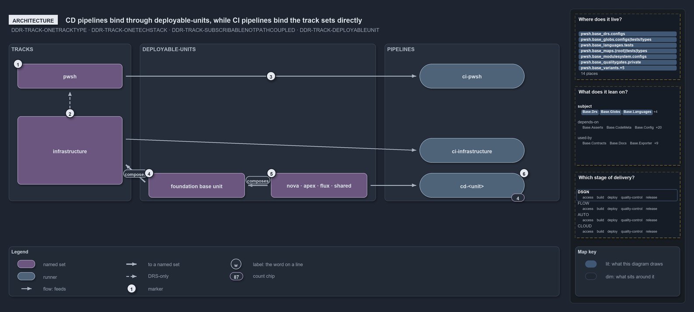

---
catzc:
  warning: "Header is generated by Format-FileMeta via Format-Code; do not change it"
  edges:
    cites:
      - DDR-TRACK-ONETRACKTYPE
      - DDR-TRACK-ONETECHSTACK
      - DDR-TRACK-SUBSCRIBABLENOTPATHCOUPLED
      - DDR-TRACK-DEPLOYABLEUNIT
    drs_total: 4
---

# CD pipelines bind through deployable-units, while CI pipelines bind the track sets directly

```text
The four CD pipelines bind deployable-units; the two CI pipelines bind the track sets themselves.

1  pwsh                         the core track, a loose-fileset over pwsh/**
2  infrastructure rests on it   the adapter track rests on the core, never the reverse
3  pwsh -> ci-pwsh              the track set carries pipeline: itself, with no unit between
4  foundation base unit         a reduced composition of infrastructure; binds no pipeline
5  nova, apex, flux, shared     four configured units, each composing the base unit
6  cd-<unit>                    the four CD pipelines, one per unit

Supports DDR-TRACK-ONETRACKTYPE, DDR-TRACK-ONETECHSTACK, DDR-TRACK-SUBSCRIBABLENOTPATHCOUPLED and DDR-TRACK-DEPLOYABLEUNIT (architecture lens).
```

Cats is one repository made of tracks, the root concerns such as `pwsh` and `infrastructure`. A track does not ship by itself: what ships is
a deployable-unit, and each pipeline is the delivery machine of what it binds. The four CD pipelines bind deployable-units, and the two CI
pipelines bind the `pwsh` and `infrastructure` track sets themselves, with no whole-track unit in between; the tracks DDR and the globset
FDR both say so.

```yml drawio
description:
  The four CD pipelines bind deployable-units composed from the infrastructure track, while the two CI pipelines bind the pwsh and
  infrastructure track sets directly, with no unit between them.
about:
  adrs: [DDR-TRACK-ONETRACKTYPE, DDR-TRACK-ONETECHSTACK, DDR-TRACK-SUBSCRIBABLENOTPATHCOUPLED, DDR-TRACK-DEPLOYABLEUNIT]
  lens: architecture
content:
  title: CD pipelines bind through deployable-units, while CI pipelines bind the track sets directly
  kind: explanation
  flow: left-to-right
  relation: binds a pipeline (pipeline:)
  theme: dark
  bands:
    - { id: band-tracks, label: TRACKS }
    - { id: band-units, label: DEPLOYABLE-UNITS }
    - { id: band-pipelines, label: PIPELINES }
  glyphs:
    - { id: s-automation, kind: set, label: pwsh, in: band-tracks }
    - { id: s-infrastructure, kind: set, label: infrastructure, in: band-tracks }
    - { id: s-base, kind: set, label: foundation base unit, in: band-units }
    - { id: s-units, kind: set, label: nova · apex · flux · shared, in: band-units }
    - { id: r-ci-automation, kind: runner, label: ci-pwsh, in: band-pipelines }
    - { id: r-ci-infrastructure, kind: runner, label: ci-infrastructure, in: band-pipelines }
    - { id: r-cd, kind: runner, label: cd-<unit>, in: band-pipelines }
  edges:
    - { from: s-automation, to: r-ci-automation, kind: flow, label: "" }
    - { from: s-infrastructure, to: r-ci-infrastructure, kind: flow, label: "" }
    - { from: s-infrastructure, to: s-base, kind: thick, label: "" }
    - { from: s-base, to: s-units, kind: thick, label: "" }
    - { from: s-units, to: r-cd, kind: flow, label: "" }
    - { from: s-infrastructure, to: s-automation, kind: adr, label: "" }
  markers:
    - { at: s-automation, number: 1 }
    - { at: s-infrastructure->s-automation, number: 2 }
    - { at: s-automation->r-ci-automation, number: 3 }
    - { at: s-base, number: 4 }
    - { at: s-units, number: 5 }
    - { at: r-cd, number: 6 }
  chips:
    - { at: r-cd, kind: count, text: "4" }
  legend: auto
  minimaps:
    code-locations:
      - cell: docs/-/.
        by:
          - docs/drs/design/dora-explains.md
          - docs/drs/design/tracks.md
          - docs/drs/glossary.md
          - docs/drs/index.md
          - docs/how-to/pwsh/manual-test-plan/repository-conventions.md
          - docs/references/note-file-kind.md
          - docs/references/pwsh/catzc-base-globs/configs/globs.yml.md
          - docs/references/pwsh/catzc-base-languages/tests/Get-FileLanguage.Tests.ps1.md
          - docs/references/pwsh/catzc-base-maps.md
          - docs/references/pwsh/catzc-base-maps/Export-WorldMapPdf.ps1.md
          - docs/references/pwsh/catzc-base-maps/Get-TrackPlacementMinimapData.ps1.md
          - docs/references/pwsh/catzc-base-maps/Get-ValueChainHighlight.ps1.md
          - docs/references/pwsh/catzc-base-maps/Get-WorldMap.ps1.md
          - docs/references/pwsh/catzc-base-maps/Get-WorldMapHighlight.ps1.md
          - docs/references/pwsh/catzc-base-maps/Test-WorldMap.ps1.md
          - docs/references/pwsh/catzc-base-maps/tests/Get-WorldMap.Tests.ps1.md
          - docs/references/pwsh/catzc-base-maps/tests/Test-WorldMap.Tests.ps1.md
          - docs/references/pwsh/catzc-base-maps/types/MapCell.cs.md
          - docs/references/pwsh/catzc-base-maps/types/WorldMapBuilder.cs.md
          - docs/references/pwsh/catzc-base-maps/types/WorldMapPdf.cs.md
          - docs/references/pwsh/catzc-base-quality-gates/private/Get-LanguageTestFolders.ps1.md
          - docs/references/pwsh/catzc-base-variants/Get-PathModule.ps1.md
          - docs/references/pwsh/catzc-base-variants/Get-Track.ps1.md
          - docs/references/pwsh/catzc-base-variants/Get-TrackPlace.ps1.md
          - docs/references/pwsh/catzc-base-variants/configs/variants.yml.md
          - docs/references/pwsh/catzc-base-variants/types/VariantTrack.cs.md
          - docs/references/pwsh/catzc-base-variants/types/VariantsConfig.cs.md
          - DDR-TRACK-DEPLOYABLEUNIT
          - DDR-TRACK-ONETECHSTACK
          - DDR-TRACK-ONETRACKTYPE
          - DDR-TRACK-SUBSCRIBABLENOTPATHCOUPLED
      - cell: pwsh/Catzc.Base.Drs/configs
        by:
          - pwsh/Catzc.Base.Drs/configs/drs.yml
          - DDR-TRACK-DEPLOYABLEUNIT
          - DDR-TRACK-ONETECHSTACK
          - DDR-TRACK-ONETRACKTYPE
          - DDR-TRACK-SUBSCRIBABLENOTPATHCOUPLED
      - cell: pwsh/Catzc.Base.Globs/configs
        by: [pwsh/Catzc.Base.Globs/configs/globs.yml, DDR-TRACK-DEPLOYABLEUNIT]
      - cell: pwsh/Catzc.Base.Globs/tests/types
        by: [pwsh/Catzc.Base.Globs/tests/types/GlobsConfig.Tests.ps1, DDR-TRACK-DEPLOYABLEUNIT]
      - cell: pwsh/Catzc.Base.Languages/tests
        by: [pwsh/Catzc.Base.Languages/tests/Get-FileLanguage.Tests.ps1, DDR-TRACK-ONETECHSTACK]
      - cell: pwsh/Catzc.Base.Maps/.
        by:
          - pwsh/Catzc.Base.Maps/Export-WorldMapPdf.ps1
          - pwsh/Catzc.Base.Maps/Get-TrackPlacementMinimapData.ps1
          - pwsh/Catzc.Base.Maps/Get-ValueChainHighlight.ps1
          - pwsh/Catzc.Base.Maps/Get-WorldMap.ps1
          - pwsh/Catzc.Base.Maps/Get-WorldMapHighlight.ps1
          - pwsh/Catzc.Base.Maps/Test-WorldMap.ps1
          - DDR-TRACK-DEPLOYABLEUNIT
          - DDR-TRACK-ONETECHSTACK
          - DDR-TRACK-ONETRACKTYPE
          - DDR-TRACK-SUBSCRIBABLENOTPATHCOUPLED
      - cell: pwsh/Catzc.Base.Maps/tests
        by: [pwsh/Catzc.Base.Maps/tests/Get-WorldMap.Tests.ps1, pwsh/Catzc.Base.Maps/tests/Test-WorldMap.Tests.ps1, DDR-TRACK-ONETECHSTACK]
      - cell: pwsh/Catzc.Base.Maps/types
        by:
          - pwsh/Catzc.Base.Maps/types/MapCell.cs
          - pwsh/Catzc.Base.Maps/types/WorldMapBuilder.cs
          - pwsh/Catzc.Base.Maps/types/WorldMapPdf.cs
          - DDR-TRACK-ONETECHSTACK
      - cell: pwsh/Catzc.Base.ModuleSystem/configs
        by: [pwsh/Catzc.Base.ModuleSystem/configs/glossary.yml, DDR-TRACK-DEPLOYABLEUNIT, DDR-TRACK-ONETECHSTACK]
      - cell: pwsh/Catzc.Base.QualityGates/private
        by: [pwsh/Catzc.Base.QualityGates/private/Get-LanguageTestFolders.ps1, DDR-TRACK-ONETRACKTYPE]
      - cell: pwsh/Catzc.Base.Variants/.
        by:
          - pwsh/Catzc.Base.Variants/Get-PathModule.ps1
          - pwsh/Catzc.Base.Variants/Get-Track.ps1
          - pwsh/Catzc.Base.Variants/Get-TrackPlace.ps1
          - DDR-TRACK-DEPLOYABLEUNIT
          - DDR-TRACK-ONETECHSTACK
          - DDR-TRACK-ONETRACKTYPE
          - DDR-TRACK-SUBSCRIBABLENOTPATHCOUPLED
      - cell: pwsh/Catzc.Base.Variants/configs
        by:
          - pwsh/Catzc.Base.Variants/configs/variants.yml
          - DDR-TRACK-DEPLOYABLEUNIT
          - DDR-TRACK-ONETECHSTACK
          - DDR-TRACK-ONETRACKTYPE
          - DDR-TRACK-SUBSCRIBABLENOTPATHCOUPLED
      - cell: pwsh/Catzc.Base.Variants/tests
        by: [pwsh/Catzc.Base.Variants/tests/Get-PathModule.Tests.ps1, DDR-TRACK-ONETECHSTACK]
      - cell: pwsh/Catzc.Base.Variants/tests/types
        by: [pwsh/Catzc.Base.Variants/tests/types/ModuleTypesConfig.Tests.ps1, DDR-TRACK-ONETECHSTACK]
      - cell: pwsh/Catzc.Base.Variants/types
        by:
          - pwsh/Catzc.Base.Variants/types/ModulePlace.cs
          - pwsh/Catzc.Base.Variants/types/ModuleTypeEntry.cs
          - pwsh/Catzc.Base.Variants/types/ModuleTypesConfig.cs
          - pwsh/Catzc.Base.Variants/types/PathModule.cs
          - pwsh/Catzc.Base.Variants/types/VariantTrack.cs
          - pwsh/Catzc.Base.Variants/types/VariantsConfig.cs
          - DDR-TRACK-DEPLOYABLEUNIT
          - DDR-TRACK-ONETECHSTACK
          - DDR-TRACK-ONETRACKTYPE
          - DDR-TRACK-SUBSCRIBABLENOTPATHCOUPLED
    module-neighbourhood:
      - cell: subject/Catzc.Base.Drs
        by:
          - pwsh/Catzc.Base.Drs/configs/drs.yml
          - DDR-TRACK-DEPLOYABLEUNIT
          - DDR-TRACK-ONETECHSTACK
          - DDR-TRACK-ONETRACKTYPE
          - DDR-TRACK-SUBSCRIBABLENOTPATHCOUPLED
      - cell: subject/Catzc.Base.Globs
        by: [pwsh/Catzc.Base.Globs/configs/globs.yml, pwsh/Catzc.Base.Globs/tests/types/GlobsConfig.Tests.ps1, DDR-TRACK-DEPLOYABLEUNIT]
      - cell: subject/Catzc.Base.Languages
        by: [pwsh/Catzc.Base.Languages/tests/Get-FileLanguage.Tests.ps1, DDR-TRACK-ONETECHSTACK]
      - cell: subject/Catzc.Base.Maps
        by:
          - pwsh/Catzc.Base.Maps/Export-WorldMapPdf.ps1
          - pwsh/Catzc.Base.Maps/Get-TrackPlacementMinimapData.ps1
          - pwsh/Catzc.Base.Maps/Get-ValueChainHighlight.ps1
          - pwsh/Catzc.Base.Maps/Get-WorldMap.ps1
          - pwsh/Catzc.Base.Maps/Get-WorldMapHighlight.ps1
          - pwsh/Catzc.Base.Maps/Test-WorldMap.ps1
          - pwsh/Catzc.Base.Maps/tests/Get-WorldMap.Tests.ps1
          - pwsh/Catzc.Base.Maps/tests/Test-WorldMap.Tests.ps1
          - pwsh/Catzc.Base.Maps/types/MapCell.cs
          - pwsh/Catzc.Base.Maps/types/WorldMapBuilder.cs
          - pwsh/Catzc.Base.Maps/types/WorldMapPdf.cs
          - DDR-TRACK-DEPLOYABLEUNIT
          - DDR-TRACK-ONETECHSTACK
          - DDR-TRACK-ONETRACKTYPE
          - DDR-TRACK-SUBSCRIBABLENOTPATHCOUPLED
      - cell: subject/Catzc.Base.ModuleSystem
        by: [pwsh/Catzc.Base.ModuleSystem/configs/glossary.yml, DDR-TRACK-DEPLOYABLEUNIT, DDR-TRACK-ONETECHSTACK]
      - cell: subject/Catzc.Base.QualityGates
        by: [pwsh/Catzc.Base.QualityGates/private/Get-LanguageTestFolders.ps1, DDR-TRACK-ONETRACKTYPE]
      - cell: subject/Catzc.Base.Variants
        by:
          - pwsh/Catzc.Base.Variants/Get-PathModule.ps1
          - pwsh/Catzc.Base.Variants/Get-Track.ps1
          - pwsh/Catzc.Base.Variants/Get-TrackPlace.ps1
          - pwsh/Catzc.Base.Variants/configs/variants.yml
          - pwsh/Catzc.Base.Variants/tests/Get-PathModule.Tests.ps1
          - pwsh/Catzc.Base.Variants/tests/types/ModuleTypesConfig.Tests.ps1
          - pwsh/Catzc.Base.Variants/types/ModulePlace.cs
          - pwsh/Catzc.Base.Variants/types/ModuleTypeEntry.cs
          - pwsh/Catzc.Base.Variants/types/ModuleTypesConfig.cs
          - pwsh/Catzc.Base.Variants/types/PathModule.cs
          - pwsh/Catzc.Base.Variants/types/VariantTrack.cs
          - pwsh/Catzc.Base.Variants/types/VariantsConfig.cs
          - DDR-TRACK-DEPLOYABLEUNIT
          - DDR-TRACK-ONETECHSTACK
          - DDR-TRACK-ONETRACKTYPE
          - DDR-TRACK-SUBSCRIBABLENOTPATHCOUPLED
    axis:
      - cell: DSGN/*
        by: [DDR-TRACK-DEPLOYABLEUNIT, DDR-TRACK-ONETECHSTACK, DDR-TRACK-ONETRACKTYPE, DDR-TRACK-SUBSCRIBABLENOTPATHCOUPLED]
layout:
  band-tracks: { x: 20, y: 84, w: 280, h: 360 }
  band-units: { x: 320, y: 84, w: 540, h: 360 }
  band-pipelines: { x: 880, y: 84, w: 400, h: 360 }
  s-automation: { x: 40, y: 130, w: 240, h: 56 }
  s-infrastructure: { x: 40, y: 250, w: 240, h: 156 }
  s-base: { x: 340, y: 380, w: 220, h: 56 }
  s-units: { x: 620, y: 380, w: 220, h: 56 }
  r-ci-automation: { x: 960, y: 130, w: 240, h: 56 }
  r-ci-infrastructure: { x: 960, y: 300, w: 240, h: 56 }
  r-cd: { x: 960, y: 380, w: 240, h: 56 }
```



## Walkthrough

1. **pwsh.** The core track: it defines the internal ports every other track rests on. In `globs.yml` it is a globset of the `loose-fileset`
   layer that selects `pwsh/**`. Of the eleven tracks cats declares, only `pwsh` and `infrastructure` have a globset of their own.
2. **infrastructure rests on pwsh.** `infrastructure` is an adapter track: it rests on `pwsh` for context and execution, never the reverse,
   and `ci-infrastructure` runs automation commands such as `Assert-BicepTemplate` and `Build-Bicep`. No gate checks this direction between
   tracks; the gates on module dependencies check edges between modules only.
3. **pwsh binds ci-pwsh.** The `pwsh` track set carries `pipeline: ci-pwsh` itself. The same holds for `infrastructure` and
   `ci-infrastructure`. A CI pipeline binds the track's own projection, so a track and its CI pipeline meet without a deployable-unit
   between them.
4. **foundation base unit.** The deployable-unit `template-azure-subscription-foundation` is a reduced composition of the infrastructure
   track: the foundation template plus the shared Bicep modules, without any deployment configuration. It binds no pipeline of its own.
5. **nova · apex · flux · shared.** Four configured deployable-units. Each composes the base unit and adds its own configuration: one
   customer's configuration subfolder, or, for `shared`, the configuration-root files.
6. **`cd-<unit>`.** Stands for the four CD pipelines `cd-nova`, `cd-apex`, `cd-flux` and `cd-shared`, one per unit.

## Why it holds

- A track is a named root concern carrying one class: `pwsh` is core, `infrastructure` an adapter (DDR-TRACK-ONETRACKTYPE).
- Adapters rest on the core and never the other way round (DDR-TRACK-ONETECHSTACK).
- A consumer binds a track only through module dependencies or the track's globset projection, never by matching its paths by hand
  (DDR-TRACK-SUBSCRIBABLENOTPATHCOUPLED).
- A deployable-unit is a whole track or a reduced composition, and units bind pipelines one to one (DDR-TRACK-DEPLOYABLEUNIT).

Scopes such as `markdown-scope` and `repository` select across tracks and own no root; they bind no pipeline, so they have no place in this
picture. The `templates` loose-fileset binds none either.

## Where the code and the decision record differ

The tracks DDR says the gates on the dependency graph enforce the one-directional core and adapter dependency; those gates check module
edges only, and nothing checks the direction between tracks.

## See also

- [Tracks — the repository's root concerns](../../drs/design/tracks.md) — the decision this article explains.
- The other lenses on the same model: [meta](one-unit-one-pipeline.md), [implementation](globs-yml-pipeline-field-is-the-binding.md),
  [operations](a-push-fires-only-touched-pipelines.md) and [governance](unit-to-pipeline-rule-is-review-only.md).
- [The design explanations](index.md) · [How to read the diagrams](../index.md#how-to-read-the-diagrams)
