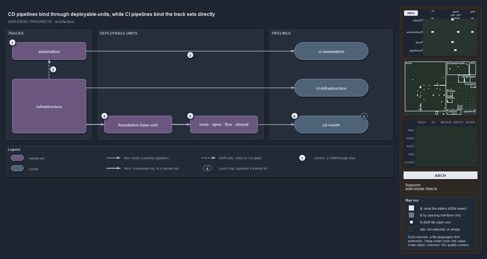

# CD pipelines bind through deployable-units, while CI pipelines bind the track sets directly

```text
The four CD pipelines bind deployable-units; the two CI pipelines bind the track sets themselves.

1  pwsh                         the core track, a loose-fileset over pwsh/**
2  infrastructure rests on it   the adapter track rests on the core, never the reverse
3  pwsh -> ci-pwsh              the track set carries pipeline: itself, with no unit between
4  foundation base unit         a reduced composition of infrastructure; binds no pipeline
5  nova, apex, flux, shared     four configured units, each composing the base unit
6  cd-<unit>                    the four CD pipelines, one per unit

Supports DDR-TRACK-ONETRACKTYPE, DDR-TRACK-ONETECHSTACK, DDR-TRACK-SUBSCRIBABLENOTPATHCOUPLED and DDR-TRACK-DEPLOYABLEUNIT (architecture lens).
```

Cats is one repository made of tracks, the root concerns such as `pwsh` and `infrastructure`. A track does not ship by itself: what ships is
a deployable-unit, and each pipeline is the delivery machine of what it binds. The four CD pipelines bind deployable-units, and the two CI
pipelines bind the `pwsh` and `infrastructure` track sets themselves, with no whole-track unit in between; the tracks ADR and the globset
ADR both say so.



## Walkthrough

1. **pwsh.** The core track: it defines the internal ports every other track rests on. In `globs.yml` it is a globset of the `loose-fileset`
   layer that selects `pwsh/**`. Of the eleven tracks cats declares, only `pwsh` and `infrastructure` have a globset of their own.
2. **infrastructure rests on pwsh.** `infrastructure` is an adapter track: it rests on `pwsh` for context and execution, never the reverse,
   and `ci-infrastructure` runs automation commands such as `Assert-BicepTemplate` and `Build-Bicep`. No gate checks this direction between
   tracks; the gates on module dependencies check edges between modules only.
3. **pwsh binds ci-pwsh.** The `pwsh` track set carries `pipeline: ci-pwsh` itself. The same holds for `infrastructure` and
   `ci-infrastructure`. A CI pipeline binds the track's own projection, so a track and its CI pipeline meet without a deployable-unit
   between them.
4. **foundation base unit.** The deployable-unit `template-azure-subscription-foundation` is a reduced composition of the infrastructure
   track: the foundation template plus the shared Bicep modules, without any deployment configuration. It binds no pipeline of its own.
5. **nova · apex · flux · shared.** Four configured deployable-units. Each composes the base unit and adds its own configuration: one
   customer's configuration subfolder, or, for `shared`, the configuration-root files.
6. **`cd-<unit>`.** Stands for the four CD pipelines `cd-nova`, `cd-apex`, `cd-flux` and `cd-shared`, one per unit.

## Why it holds

- A track is a named root concern carrying one class: `pwsh` is core, `infrastructure` an adapter (DDR-TRACK-ONETRACKTYPE).
- Adapters rest on the core and never the other way round (DDR-TRACK-ONETECHSTACK).
- A consumer binds a track only through module dependencies or the track's globset projection, never by matching its paths by hand
  (DDR-TRACK-SUBSCRIBABLENOTPATHCOUPLED).
- A deployable-unit is a whole track or a reduced composition, and units bind pipelines one to one (DDR-TRACK-DEPLOYABLEUNIT).

Scopes such as `markdown-scope` and `repository` select across tracks and own no root; they bind no pipeline, so they have no place in this
picture. The `templates` loose-fileset binds none either.

## Where the code and the decision record differ

The tracks ADR says the gates on the dependency graph enforce the one-directional core and adapter dependency; those gates check module
edges only, and nothing checks the direction between tracks.

## See also

- [Tracks — the repository's root concerns](../../drs/design/tracks.md) — the decision this article explains.
- The other lenses on the same model: [meta](one-unit-one-pipeline.md), [implementation](globs-yml-pipeline-field-is-the-binding.md),
  [operations](a-push-fires-only-touched-pipelines.md) and [governance](unit-to-pipeline-rule-is-review-only.md).
- [The design explanations](index.md) · [How to read the diagrams](../index.md#how-to-read-the-diagrams)
