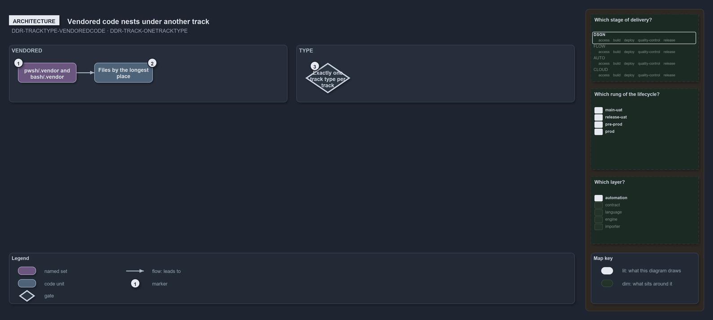

---
catzc:
  warning: "Experimental: this article merges two rules into one and holds nothing beyond what they say"
  edges:
    cites:
      - DDR-TRACKTYPE-VENDOREDCODE
      - DDR-TRACK-ONETRACKTYPE
---

# Vendored code is nested under another tracks root and every track has one type

This article is one rule: [DDR-TRACKTYPE-VENDOREDCODE](../../drs/design/track-types.md#rule-ddr-tracktype-vendoredcode) and
[DDR-TRACK-ONETRACKTYPE](../../drs/design/tracks.md#rule-ddr-track-onetracktype) merged into one. It holds nothing beyond what those two
rules say.

A track of vendored code holds code written by a third party that the repository does not author, such as `pwsh/.vendor` and `bash/.vendor`;
it is nested under another track's root and gets its files by the longest place. Every track has exactly one track type, stated once and
carrying no second classification beside it.

