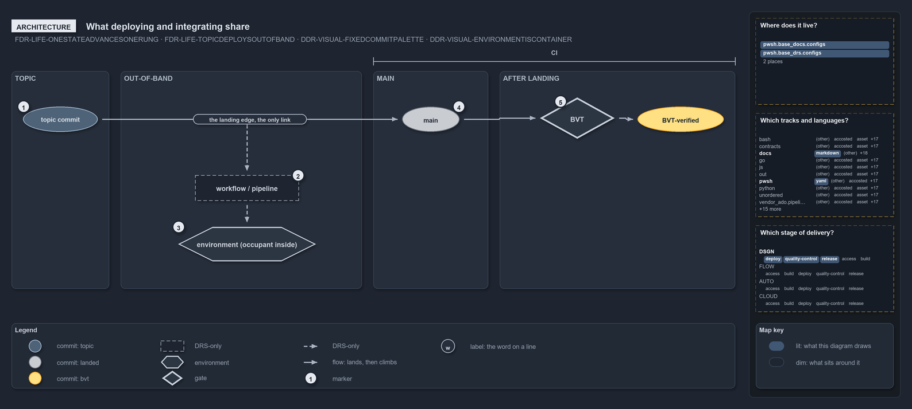

# What deploying and integrating share

```text
What deploying and integrating share.

1  topic commit          brown, off main; both paths start here
2  workflow / pipeline   deploys the topic commit; DRS-only, no code runs it
3  environment           the deploy target; its occupant stays brown
4  main                  landing on main is the integration; the commit turns grey
5  BVT                   produces the BVT-verified commit, yellow
6  the landing edge      the only link between the two paths is their start

Supports FDR-LIFE-ONESTATEADVANCESONERUNG and FDR-LIFE-TOPICDEPLOYSOUTOFBAND, and DDR-VISUAL-FIXEDCOMMITPALETTE
and DDR-VISUAL-ENVIRONMENTISCONTAINER (architecture lens).
```

Cats keeps two events apart that are easy to blur: deploying a commit and integrating it. A commit on a topic branch can reach an
environment through a workflow or pipeline without ever reaching main, and that deploy is not an integration. Seen as architecture, the two
paths have exactly one part in common, the topic commit itself, and nothing on the deploy path feeds main, the BVT or the commit's place on
the promotion ladder.

```yml drawio
description:
  "The deploy path and the integration path share only the topic commit: a workflow deploys it to an environment out of band, and landing it
  on main starts the integration that ends in the build validation verified commit."
about:
  rules:
    - FDR-LIFE-ONESTATEADVANCESONERUNG
    - FDR-LIFE-TOPICDEPLOYSOUTOFBAND
    - DDR-VISUAL-FIXEDCOMMITPALETTE
    - DDR-VISUAL-ENVIRONMENTISCONTAINER
  lens: architecture
content:
  title: What deploying and integrating share
  kind: explanation
  flow: left-to-right
  relation: lands, then climbs
  states: true
  theme: dark
  bands:
    - { id: band-topic, label: TOPIC }
    - { id: band-out-of-band, label: OUT-OF-BAND }
    - { id: band-main, label: MAIN }
    - { id: band-landing, label: AFTER LANDING }
  spans:
    - id: span-integration
      label: CI
      over: [band-main, band-landing]
  glyphs:
    - { id: c-topic, kind: commit, label: topic commit, in: band-topic, state: topic }
    - { id: a-workflow, kind: drsonly, label: workflow / pipeline, in: band-out-of-band }
    - { id: e-environment, kind: env, label: environment (occupant inside), in: band-out-of-band }
    - { id: c-main, kind: commit, label: main, in: band-main, state: landed }
    - { id: g-validation, kind: gate, label: BVT, in: band-landing }
    - { id: c-verified, kind: commit, label: BVT-verified, in: band-landing }
  edges:
    - { from: c-topic, to: a-workflow, kind: record, label: "" }
    - { from: a-workflow, to: e-environment, kind: record, label: "" }
    - { from: c-topic, to: c-main, kind: flow, label: "the landing edge, the only link" }
    - { from: c-main, to: g-validation, kind: flow, label: "" }
    - { from: g-validation, to: c-verified, kind: flow, label: "" }
  markers:
    - { at: c-topic, number: 1 }
    - { at: a-workflow, number: 2 }
    - { at: e-environment, number: 3 }
    - { at: c-main, number: 4 }
    - { at: g-validation, number: 5 }
  legend: auto
  minimaps: [code-locations, grid, axis]
layout:
  band-topic: { x: 20, y: 108, w: 170, h: 380 }
  band-out-of-band: { x: 210, y: 108, w: 420, h: 380 }
  band-main: { x: 650, y: 108, w: 200, h: 380 }
  band-landing: { x: 870, y: 108, w: 410, h: 380 }
  c-topic: { x: 40, y: 170, w: 130, h: 44 }
  a-workflow: { x: 340, y: 290, w: 180, h: 44 }
  e-environment: { x: 310, y: 380, w: 240, h: 60 }
  c-main: { x: 700, y: 170, w: 100, h: 44 }
  g-validation: { x: 940, y: 154, w: 130, h: 72 }
  c-verified: { x: 1110, y: 170, w: 150, h: 44 }
```



## Walkthrough

1. **Topic commit.** A commit that still lives on a topic branch. It is brown, the development colour, which is never an integrated mainline
   state. Both paths start here: it can land on main, and a workflow can read it to deploy.
2. **Workflow or pipeline.** The FDR allows a workflow or pipeline to deploy a topic commit directly, for a hotfix or an experiment. No
   pipeline or workflow in the repository does this today, so the workflow and both of its edges are DRS-only.
3. **Environment.** The deploy target. The environment is a neutral container, and the commit inside it is its occupant in its own state
   colour. After an out-of-band deploy the occupant stays brown: deployed, but not integrated. The FDR names no particular environment for
   this deploy.
4. **Main.** Landing on main is the integration. The commit turns grey, and only from here can it climb the ladder.
5. **BVT.** The BVT takes the landed commit and produces the BVT-verified commit, yellow, with an immutable versioned artifact. A commit
   climbs one rung at a time and never moves backward.
6. **The landing edge.** The only link between the two paths is the topic commit they start from. The landing edge passes over the
   out-of-band band without touching it, and no edge leads from the deploy path to main or the BVT.

## Why it holds

- A topic commit can be deployed out-of-band by a workflow without integrating into main; the deploy is not an integration and confers no
  promotion state on the mainline (FDR-LIFE-TOPICDEPLOYSOUTOFBAND).
- A commit holds one lifecycle state at a time and advances one rung along the ladder, topic, landed on main, BVT-verified and onward, or
  leaves it (FDR-LIFE-ONESTATEADVANCESONERUNG).
- The commit colours are fixed: brown is a development commit, grey is integrated onto main, and yellow is past the BVT with an immutable
  artifact (DDR-VISUAL-FIXEDCOMMITPALETTE).
- An environment box is a neutral container, and the commit inside it carries its own state colour (DDR-VISUAL-ENVIRONMENTISCONTAINER).

## Where the code and the decision record differ

- FDR-LIFE-TOPICDEPLOYSOUTOFBAND allows a workflow or pipeline to deploy a topic commit, but no pipeline or workflow in cats does: every
  `Deploy_*` stage runs only when the source branch is `refs/heads/main`.
- DDR-VISUAL lets the BVT accept a brown commit as well as a grey one; the integration path here follows the commit after it lands.

## See also

- [The commit lifecycle](../../drs/flow/commit-lifecycle.md) — the decision this article explains.
- [Visual design](../../drs/design/visual-design.md) — the commit colours and the neutral environment.
- The other lenses on the same deploy: [meta](how-deploying-differs-from-integrating.md), [implementation](where-a-deploy-stage-may-run.md),
  [operations](what-triggers-a-deploy.md) and [governance](which-deploy-rules-have-a-gate.md).
- [The design explanations](index.md) · [How to read the diagrams](../index.md#how-to-read-the-diagrams)
