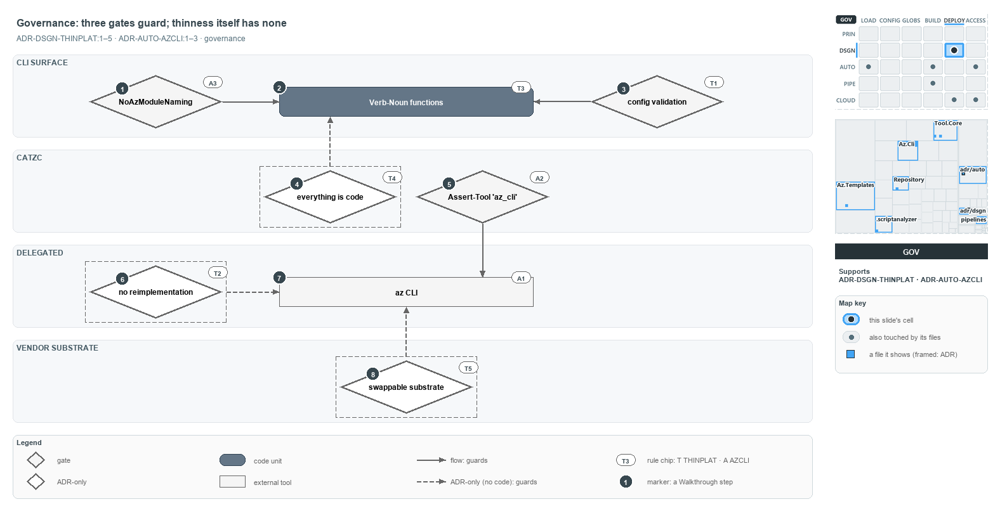

# docs/explanation/design/what-keeps-the-platform-thin.md

`Three gates guard the CLI and az, but nothing checks that cats stays thin`

```text
Three gates guard the CLI and az, but nothing checks that cats stays thin.

1  NoAzModuleNaming      gate: no function named like an Az PowerShell cmdlet
2  Verb-Noun functions   the CLI surface consumers bind to
3  config validation     gate: the configuration is checked before the functions act
4  everything is code    ADR-only: one living version in the repository
5  Assert-Tool 'az_cli'  gate: the installed az matches its pin
6  no reimplementation   ADR-only: call the vendor's tools, never rebuild them
7  az CLI                the default for every Azure operation
8  swappable substrate   ADR-only: the vendor could change behind the CLI

Supports ADR-DSGN-THINPLAT#1, #2, #3, #4 and #5, and ADR-AUTO-AZCLI#1, #2 and #3 (governance lens).
```

Each rule that shapes cats as a thin platform constrains either the CLI surface or the vendor call behind it. Three of those rules have a
gate that stops the flow when they break: the function naming, the configuration, and the az version pin. The rules that make the platform
thin in the first place (no reimplementation, everything as code, a swappable substrate) have no code behind them and are held by review
alone.



The diagram is described element by element in
[its asset description](../../.assets/explanation/adr-dsgn-thinplat--what-keeps-the-platform-thin--governance.drawio.md).

## Walkthrough

1. **NoAzModuleNaming.** A custom PSScriptAnalyzer rule that flags any function named like an Az PowerShell cmdlet (`Verb-Az<Noun>`),
   allowing only the `Azure`, `AzCli` and `AzBicep` prefixes. It runs inside `Test-Automation` on every devbox run and in CI, and the
   analyzer map credits it to ADR-AUTO-AZCLI#3.
2. **Verb-Noun functions.** The CLI surface: the public functions are the only thing a consumer binds to. The code delivers that surface,
   but no gate checks that consumers bind to nothing else.
3. **Config validation.** The configuration the functions read is checked before they act. The `AzureConfig` type validates `azure.yml` when
   it loads, a template's `options.yml` throws on a bad key, and an az session whose subscription `azure.yml` does not declare throws before
   anything deploys.
4. **Everything is code.** The ADR requires the automation, configs, tool versions and vendor bindings to live as one living version in the
   repository. No dedicated check holds it, and the Thinnest Viable Platform test ("if a wiki page would do, we do not build a function") is
   a review question too.
5. **Assert-Tool 'az_cli'.** The tooling contract. `Invoke-AzCli`, `Connect-AzCli` and `Assert-AzCliBicep` assert the `az_cli` pin from
   `tools.yml` at run time, and `Build-Bicep` also asserts the Bicep CLI meets `bicep_min_version` before it builds.
6. **No reimplementation.** The platform calls the vendor's own tools and never rebuilds them, for example through SDK assemblies. No gate
   checks it.
7. **az CLI.** The default for every Azure operation, wrapped by `Invoke-AzCli` over `Invoke-Executable`. The code does it, but no gate
   checks that a caller uses az rather than something else.
8. **Swappable substrate.** The vendor sits behind the CLI and could change without reshaping a consumer's API. Azure is the only substrate
   today, so nothing exercises the swap.

## Why it holds

- The conventions over Azure are owned by the platform and live in its configuration (ADR-DSGN-THINPLAT#1).
- Thin is delegation, not reimplementation (ADR-DSGN-THINPLAT#2).
- The `Verb-Noun` functions and their configuration are the platform's API (ADR-DSGN-THINPLAT#3).
- Everything the platform covers is code, in one living version (ADR-DSGN-THINPLAT#4).
- The substrate is swappable, and the consequential choices stay in the consumer's configuration (ADR-DSGN-THINPLAT#5).
- az is the default for Azure operations (ADR-AUTO-AZCLI#1), a function that calls az asserts `Assert-Tool 'az_cli'` first
  (ADR-AUTO-AZCLI#2), and automation code never imports `Az.*` (ADR-AUTO-AZCLI#3).

## Where the code and the ADR differ

- The analyzer map credits `NoAzModuleNaming` to ADR-AUTO-AZCLI#3, which forbids `Import-Module Az.*`, but the rule checks function names,
  not imports. Its comment also names a `Verb-AzBicep*` prefix, while the real Bicep checks are named `*-AzCliBicep`.
- The pipeline step template still offers `Mode: azps` (AzurePowerShell@5), and the CI pipeline exercises it, beside ADR-AUTO-AZCLI's
  az-first rule.
- The ADR says consumers call `Get-Azure*` and `New-*` verbs; the only `New-*` function in the Azure modules is `New-AdoPullRequest`, and
  the deploy verbs are `Build-Bicep` and `Deploy-Bicep`.
- `Get-AdoAuthorizationHeader` calls az without asserting `Assert-Tool 'az_cli'`, which ADR-AUTO-AZCLI#2 asks of every function that calls
  az.

## See also

- [Thin platforms](../../adr/design/thin-platforms.md) — the decision this article explains.
- [Prefer Az CLI over Az PowerShell modules](../../adr/automation/powershell/prefer-az-cli.md) — the az-first rules.
- The other lenses on the same platform: [meta](bind-to-one-cli-delegate-the-rest.md),
  [architecture](every-vendor-call-leaves-through-az.md), [implementation](deploy-bicep-delegates-to-az.md) and
  [operations](same-deploy-bicep-on-both-sides.md).
- [The design explanations](index.md) · [How to read the diagrams](../index.md#how-to-read-the-diagrams)
