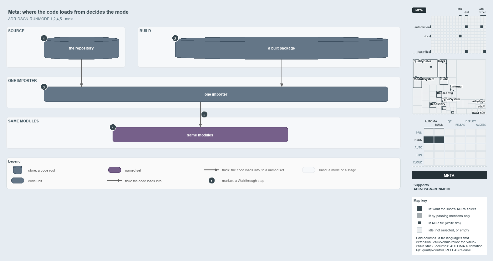

---
catzc:
  derived:
    path: docs/explanation/design/where-code-loads-from-decides-the-mode.md
    kind: explanation
    language: markdown
    filetype: md
    track: docs
    body_sha: c603138d451b
    adrs:
      - ADR-DSGN-RUNMODE#{1,2,4,5}
    links:
      - docs/.assets/explanation/adr-dsgn-runmode--where-code-loads-from-decides-the-mode--meta.drawio.md
      - docs/.assets/explanation/adr-dsgn-runmode--where-code-loads-from-decides-the-mode--meta.drawio.png
      - docs/adr/design/run-modes.md
      - docs/explanation/design/index.md
      - docs/explanation/design/one-entry-script-per-mode.md
      - docs/explanation/design/shims-set-roots-mode-read-back.md
      - docs/explanation/design/two-roots-one-importer-same-modules.md
      - docs/explanation/design/which-run-mode-rules-have-a-gate.md
      - docs/explanation/index.md#how-to-read-the-diagrams
---

# Where the code loads from decides the run mode

```text
Where the code loads from decides the run mode; nothing stores it.

1  the repository   source mode: every module read in place, one function per file
2  a built package  build mode: the same modules from a package in one of four kinds of place
3  one importer     the one load sequence both modes run
4  same modules     identical in both modes, each with its own script scope
5  the invariant    the mode follows from the code root and the two modes never coexist

Supports ADR-DSGN-RUNMODE#1, #2, #4 and #5 (meta lens).
```

Run modes are the two ways cats loads its one set of modules: from the repository, where developers edit one function per file, and from a
built package, which ships to other machines. Both ways go through one importer into the same modules. Nothing records which mode a session
is in. The place the code was loaded from is the answer, so the mode can never disagree with what actually loaded.



The diagram is described element by element in
[its asset description](../../.assets/explanation/adr-dsgn-runmode--where-code-loads-from-decides-the-mode--meta.drawio.md).

## Walkthrough

1. **The repository.** Source mode reads every module in place from the repository, one function per file. This is the form for the people
   who edit the code.
2. **A built package.** Build mode reads the same modules from a package. The ADR names four kinds of place a package can sit: temporary,
   cached, installed and saved. Code makes the temporary, installed and saved kinds; the cached kind has no code yet.
3. **One importer.** Both modes run the same load sequence: preferences, vendored modules, types and accelerators, then modules.
4. **Same modules.** Each module is identical in both modes, with the same name, functions, configs and assets, and each keeps its own
   script scope.
5. **The invariant.** The mode follows from where the code was loaded from and is never stored, and the two modes never coexist in one
   session.

## Why it holds

- Cats runs in exactly two modes, source and build, each entered by its own entry script (ADR-DSGN-RUNMODE#1).
- Every module is the same module in both modes; only its form on disk differs (ADR-DSGN-RUNMODE#2).
- The mode is derived from the code root, never stored (ADR-DSGN-RUNMODE#4).
- Entering one mode removes every module of the other, so the two never coexist (ADR-DSGN-RUNMODE#5).

## Where the code and the ADR differ

The ADR names a cached kind of build root, kept outside the repository and reused per commit, but no code makes or reads one.

## See also

- [Run modes: source mode and build mode](../../adr/design/run-modes.md) — the decision this article explains.
- The other lenses on the same modes: [architecture](two-roots-one-importer-same-modules.md),
  [implementation](shims-set-roots-mode-read-back.md), [operations](one-entry-script-per-mode.md) and
  [governance](which-run-mode-rules-have-a-gate.md).
- [The design explanations](index.md) · [How to read the diagrams](../index.md#how-to-read-the-diagrams)
