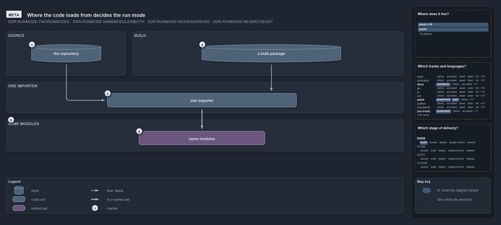

---
catzc:
  warning: "Header is generated by Format-FileMeta via Format-Code; do not change it"
  edges:
    cites:
      - DDR-RUNMODE-TWORUNMODES
      - DDR-RUNMODE-SAMEMODULEINBOTH
      - DDR-RUNMODE-MODEISDERIVED
      - DDR-RUNMODE-NEVERCOEXIST
    drs_total: 4
---

# Where the code loads from decides the run mode

```text
Where the code loads from decides the run mode; nothing stores it.

1  the repository   source mode: every module read in place, one function per file
2  a built package  build mode: the same modules from a package in one of three kinds of place
3  one importer     the one load sequence both modes run
4  same modules     identical in both modes, each with its own script scope
5  the invariant    the mode follows from the code root and the two modes never coexist

Supports DDR-RUNMODE-TWORUNMODES, DDR-RUNMODE-SAMEMODULEINBOTH, DDR-RUNMODE-MODEISDERIVED and DDR-RUNMODE-NEVERCOEXIST (meta lens).
```

Run modes are the two ways cats loads its one set of modules: from the repository, where developers edit one function per file, and from a
built package, which ships to other machines. Both ways go through one importer into the same modules. Nothing records which mode a session
is in. The place the code was loaded from is the answer, so the mode can never disagree with what actually loaded.

```yml drawio
description:
  The repository and a built package are the two places the code loads from; both go through one importer into the same modules, and the
  place it loaded from is the run mode, which nothing stores.
about:
  adrs: [DDR-RUNMODE-TWORUNMODES, DDR-RUNMODE-SAMEMODULEINBOTH, DDR-RUNMODE-MODEISDERIVED, DDR-RUNMODE-NEVERCOEXIST]
  lens: meta
content:
  title: Where the code loads from decides the run mode
  kind: explanation
  flow: top-to-bottom
  relation: the code loads into
  theme: dark
  bands:
    - { id: band-source, label: SOURCE }
    - { id: band-build, label: BUILD }
    - { id: band-importer, label: ONE IMPORTER }
    - { id: band-modules, label: SAME MODULES }
  glyphs:
    - { id: g-repository, kind: store, label: the repository, in: band-source }
    - { id: g-package, kind: store, label: a built package, in: band-build }
    - { id: g-importer, kind: code, label: one importer, in: band-importer }
    - { id: g-modules, kind: set, label: same modules, in: band-modules }
  edges:
    - { from: g-repository, to: g-importer, kind: flow, label: "" }
    - { from: g-package, to: g-importer, kind: flow, label: "" }
    - { from: g-importer, to: g-modules, kind: thick, label: "" }
  markers:
    - { at: g-repository, number: 1 }
    - { at: g-package, number: 2 }
    - { at: g-importer, number: 3 }
    - { at: g-modules, number: 4 }
    - { at: band-modules, number: 5 }
  legend: auto
  minimaps:
    code-locations:
      - cell: docs/-/.
        by:
          - docs/drs/design/dora-explains.md
          - docs/drs/design/run-modes.md
          - docs/drs/glossary.md
          - docs/drs/index.md
          - docs/references/pwsh/catzc-base-config-extensions/Test-ConfigValidators.ps1.md
          - docs/references/pwsh/catzc-base-docs/private/Get-CatsModules.ps1.md
          - docs/references/pwsh/catzc-base-globs/Get-ModuleGlobSet.ps1.md
          - docs/references/pwsh/catzc-base-module-system/Copy-CatzcModule.ps1.md
          - docs/references/pwsh/catzc-base-module-system/Get-FunctionDependency.ps1.md
          - docs/references/pwsh/catzc-base-module-system/Get-InternalAssetDependency.ps1.md
          - docs/references/pwsh/catzc-base-module-system/Get-ModuleFunction.ps1.md
          - docs/references/pwsh/catzc-base-module-system/New-Importer.ps1.md
          - docs/references/pwsh/catzc-base-module-system/Sync-GeneratedFile.ps1.md
          - docs/references/pwsh/catzc-base-module-system/Test-FunctionDependency.ps1.md
          - docs/references/pwsh/catzc-base-quality-gates/Test-BuildArtifact.ps1.md
          - docs/references/pwsh/catzc-base-quality-gates/tests/Test-CatzcBuild.Parity.Tests.ps1.md
          - docs/references/pwsh/catzc-base-repository/Assert-SourceTree.ps1.md
          - docs/references/pwsh/catzc-base-repository/Get-CatzcModuleRoot.ps1.md
          - docs/references/pwsh/catzc-base-repository/Get-CatzcRunMode.ps1.md
          - docs/references/pwsh/catzc-base-root-config/Build-RootConfig.ps1.md
          - docs/references/pwsh/catzc-base-types-system/Clear-ModuleTypeCache.ps1.md
          - docs/references/pwsh/catzc-base-types-system/Get-CSharpTypeDependency.ps1.md
          - docs/references/pwsh/catzc-base-types-system/Invoke-BuildForVsCode.ps1.md
          - docs/references/pwsh/catzc-base-vendor/Install-VendorModule.ps1.md
          - docs/references/pwsh/catzc-base-vendor/Remove-VendorModules.ps1.md
          - docs/references/pwsh/internal/Catzc.Internal.Builder.psm1.md
          - docs/references/pwsh/internal/Catzc.Internal.Importer.psm1.md
          - docs/references/pwsh/internal/Catzc.Internal.TestKit.psm1.md
          - docs/references/pwsh/internal/assets/Import-Catzc.ps1.md
          - DDR-RUNMODE-MODEISDERIVED
          - DDR-RUNMODE-NEVERCOEXIST
          - DDR-RUNMODE-SAMEMODULEINBOTH
          - DDR-RUNMODE-TWORUNMODES
      - cell: pwsh/Catzc.Base.ConfigExtensions/.
        by: [pwsh/Catzc.Base.ConfigExtensions/Test-ConfigValidators.ps1, DDR-RUNMODE-SAMEMODULEINBOTH]
      - cell: pwsh/Catzc.Base.Docs/configs
        by: [pwsh/Catzc.Base.Docs/configs/glossary.yml, DDR-RUNMODE-TWORUNMODES]
      - cell: pwsh/Catzc.Base.Docs/private
        by: [pwsh/Catzc.Base.Docs/private/Get-CatsModules.ps1, DDR-RUNMODE-SAMEMODULEINBOTH]
      - cell: pwsh/Catzc.Base.Drs/configs
        by:
          - pwsh/Catzc.Base.Drs/configs/drs.yml
          - DDR-RUNMODE-MODEISDERIVED
          - DDR-RUNMODE-NEVERCOEXIST
          - DDR-RUNMODE-SAMEMODULEINBOTH
          - DDR-RUNMODE-TWORUNMODES
      - cell: pwsh/Catzc.Base.Globs/.
        by:
          - pwsh/Catzc.Base.Globs/Get-ModuleGlobSet.ps1
          - DDR-RUNMODE-MODEISDERIVED
          - DDR-RUNMODE-NEVERCOEXIST
          - DDR-RUNMODE-SAMEMODULEINBOTH
          - DDR-RUNMODE-TWORUNMODES
      - cell: pwsh/Catzc.Base.ModuleSystem/.
        by:
          - pwsh/Catzc.Base.ModuleSystem/Copy-CatzcModule.ps1
          - pwsh/Catzc.Base.ModuleSystem/Get-FunctionDependency.ps1
          - pwsh/Catzc.Base.ModuleSystem/Get-InternalAssetDependency.ps1
          - pwsh/Catzc.Base.ModuleSystem/Get-ModuleFunction.ps1
          - pwsh/Catzc.Base.ModuleSystem/New-Importer.ps1
          - pwsh/Catzc.Base.ModuleSystem/Sync-GeneratedFile.ps1
          - pwsh/Catzc.Base.ModuleSystem/Test-FunctionDependency.ps1
          - DDR-RUNMODE-MODEISDERIVED
          - DDR-RUNMODE-NEVERCOEXIST
          - DDR-RUNMODE-SAMEMODULEINBOTH
          - DDR-RUNMODE-TWORUNMODES
      - cell: pwsh/Catzc.Base.QualityGates/.
        by: [pwsh/Catzc.Base.QualityGates/Test-BuildArtifact.ps1, DDR-RUNMODE-SAMEMODULEINBOTH]
      - cell: pwsh/Catzc.Base.QualityGates/tests
        by: [pwsh/Catzc.Base.QualityGates/tests/Test-CatzcBuild.Parity.Tests.ps1, DDR-RUNMODE-SAMEMODULEINBOTH]
      - cell: pwsh/Catzc.Base.Repository/.
        by:
          - pwsh/Catzc.Base.Repository/Assert-SourceTree.ps1
          - pwsh/Catzc.Base.Repository/Get-CatzcModuleRoot.ps1
          - pwsh/Catzc.Base.Repository/Get-CatzcRunMode.ps1
          - DDR-RUNMODE-MODEISDERIVED
          - DDR-RUNMODE-NEVERCOEXIST
          - DDR-RUNMODE-SAMEMODULEINBOTH
          - DDR-RUNMODE-TWORUNMODES
      - cell: pwsh/Catzc.Base.RootConfig/.
        by:
          - pwsh/Catzc.Base.RootConfig/Build-RootConfig.ps1
          - DDR-RUNMODE-MODEISDERIVED
          - DDR-RUNMODE-NEVERCOEXIST
          - DDR-RUNMODE-SAMEMODULEINBOTH
          - DDR-RUNMODE-TWORUNMODES
      - cell: pwsh/Catzc.Base.TypesSystem/.
        by:
          - pwsh/Catzc.Base.TypesSystem/Build-AgentHook.ps1
          - pwsh/Catzc.Base.TypesSystem/Clear-ModuleTypeCache.ps1
          - pwsh/Catzc.Base.TypesSystem/Get-CSharpTypeDependency.ps1
          - pwsh/Catzc.Base.TypesSystem/Invoke-BuildForVSCode.ps1
          - DDR-RUNMODE-MODEISDERIVED
          - DDR-RUNMODE-NEVERCOEXIST
          - DDR-RUNMODE-SAMEMODULEINBOTH
          - DDR-RUNMODE-TWORUNMODES
      - cell: pwsh/Catzc.Base.Vendor/.
        by:
          - pwsh/Catzc.Base.Vendor/Install-VendorModule.ps1
          - pwsh/Catzc.Base.Vendor/Remove-VendorModules.ps1
          - DDR-RUNMODE-MODEISDERIVED
          - DDR-RUNMODE-NEVERCOEXIST
          - DDR-RUNMODE-SAMEMODULEINBOTH
          - DDR-RUNMODE-TWORUNMODES
      - cell: pwsh/Catzc.Internal.Assets/.
        by:
          - pwsh/.internal/assets/Import-Catzc.ps1
          - DDR-RUNMODE-MODEISDERIVED
          - DDR-RUNMODE-NEVERCOEXIST
          - DDR-RUNMODE-SAMEMODULEINBOTH
          - DDR-RUNMODE-TWORUNMODES
      - cell: pwsh/Catzc.Internal.Tests/.
        by: [pwsh/.internal/tests/New-FakeRepositoryRoot.Tests.ps1, DDR-RUNMODE-MODEISDERIVED]
    grid:
      - cell: docs/markdown
        by:
          - docs/drs/design/dora-explains.md
          - docs/drs/design/run-modes.md
          - docs/drs/glossary.md
          - docs/drs/index.md
          - docs/references/pwsh/catzc-base-config-extensions/Test-ConfigValidators.ps1.md
          - docs/references/pwsh/catzc-base-docs/private/Get-CatsModules.ps1.md
          - docs/references/pwsh/catzc-base-globs/Get-ModuleGlobSet.ps1.md
          - docs/references/pwsh/catzc-base-module-system/Copy-CatzcModule.ps1.md
          - docs/references/pwsh/catzc-base-module-system/Get-FunctionDependency.ps1.md
          - docs/references/pwsh/catzc-base-module-system/Get-InternalAssetDependency.ps1.md
          - docs/references/pwsh/catzc-base-module-system/Get-ModuleFunction.ps1.md
          - docs/references/pwsh/catzc-base-module-system/New-Importer.ps1.md
          - docs/references/pwsh/catzc-base-module-system/Sync-GeneratedFile.ps1.md
          - docs/references/pwsh/catzc-base-module-system/Test-FunctionDependency.ps1.md
          - docs/references/pwsh/catzc-base-quality-gates/Test-BuildArtifact.ps1.md
          - docs/references/pwsh/catzc-base-quality-gates/tests/Test-CatzcBuild.Parity.Tests.ps1.md
          - docs/references/pwsh/catzc-base-repository/Assert-SourceTree.ps1.md
          - docs/references/pwsh/catzc-base-repository/Get-CatzcModuleRoot.ps1.md
          - docs/references/pwsh/catzc-base-repository/Get-CatzcRunMode.ps1.md
          - docs/references/pwsh/catzc-base-root-config/Build-RootConfig.ps1.md
          - docs/references/pwsh/catzc-base-types-system/Clear-ModuleTypeCache.ps1.md
          - docs/references/pwsh/catzc-base-types-system/Get-CSharpTypeDependency.ps1.md
          - docs/references/pwsh/catzc-base-types-system/Invoke-BuildForVsCode.ps1.md
          - docs/references/pwsh/catzc-base-vendor/Install-VendorModule.ps1.md
          - docs/references/pwsh/catzc-base-vendor/Remove-VendorModules.ps1.md
          - docs/references/pwsh/internal/Catzc.Internal.Builder.psm1.md
          - docs/references/pwsh/internal/Catzc.Internal.Importer.psm1.md
          - docs/references/pwsh/internal/Catzc.Internal.TestKit.psm1.md
          - docs/references/pwsh/internal/assets/Import-Catzc.ps1.md
          - DDR-RUNMODE-MODEISDERIVED
          - DDR-RUNMODE-NEVERCOEXIST
          - DDR-RUNMODE-SAMEMODULEINBOTH
          - DDR-RUNMODE-TWORUNMODES
      - cell: pwsh/powershell
        by:
          - pwsh/.internal/assets/Import-Catzc.ps1
          - pwsh/.internal/tests/New-FakeRepositoryRoot.Tests.ps1
          - pwsh/Catzc.Base.ConfigExtensions/Test-ConfigValidators.ps1
          - pwsh/Catzc.Base.Docs/private/Get-CatsModules.ps1
          - pwsh/Catzc.Base.Globs/Get-ModuleGlobSet.ps1
          - pwsh/Catzc.Base.ModuleSystem/Copy-CatzcModule.ps1
          - pwsh/Catzc.Base.ModuleSystem/Get-FunctionDependency.ps1
          - pwsh/Catzc.Base.ModuleSystem/Get-InternalAssetDependency.ps1
          - pwsh/Catzc.Base.ModuleSystem/Get-ModuleFunction.ps1
          - pwsh/Catzc.Base.ModuleSystem/New-Importer.ps1
          - pwsh/Catzc.Base.ModuleSystem/Sync-GeneratedFile.ps1
          - pwsh/Catzc.Base.ModuleSystem/Test-FunctionDependency.ps1
          - pwsh/Catzc.Base.QualityGates/Test-BuildArtifact.ps1
          - pwsh/Catzc.Base.QualityGates/tests/Test-CatzcBuild.Parity.Tests.ps1
          - pwsh/Catzc.Base.Repository/Assert-SourceTree.ps1
          - pwsh/Catzc.Base.Repository/Get-CatzcModuleRoot.ps1
          - pwsh/Catzc.Base.Repository/Get-CatzcRunMode.ps1
          - pwsh/Catzc.Base.RootConfig/Build-RootConfig.ps1
          - pwsh/Catzc.Base.TypesSystem/Build-AgentHook.ps1
          - pwsh/Catzc.Base.TypesSystem/Clear-ModuleTypeCache.ps1
          - pwsh/Catzc.Base.TypesSystem/Get-CSharpTypeDependency.ps1
          - pwsh/Catzc.Base.TypesSystem/Invoke-BuildForVSCode.ps1
          - pwsh/Catzc.Base.Vendor/Install-VendorModule.ps1
          - pwsh/Catzc.Base.Vendor/Remove-VendorModules.ps1
          - DDR-RUNMODE-MODEISDERIVED
          - DDR-RUNMODE-NEVERCOEXIST
          - DDR-RUNMODE-SAMEMODULEINBOTH
          - DDR-RUNMODE-TWORUNMODES
      - cell: pwsh/yaml
        by:
          - pwsh/Catzc.Base.Docs/configs/glossary.yml
          - pwsh/Catzc.Base.Drs/configs/drs.yml
          - DDR-RUNMODE-MODEISDERIVED
          - DDR-RUNMODE-NEVERCOEXIST
          - DDR-RUNMODE-SAMEMODULEINBOTH
          - DDR-RUNMODE-TWORUNMODES
      - cell: (no track)/powershell
        by: [importer.ps1, DDR-RUNMODE-MODEISDERIVED, DDR-RUNMODE-NEVERCOEXIST, DDR-RUNMODE-SAMEMODULEINBOTH, DDR-RUNMODE-TWORUNMODES]
      - cell: (no track)/(other)
        by:
          - .gitattributes
          - .gitignore
          - DDR-RUNMODE-MODEISDERIVED
          - DDR-RUNMODE-NEVERCOEXIST
          - DDR-RUNMODE-SAMEMODULEINBOTH
          - DDR-RUNMODE-TWORUNMODES
    axis:
      - cell: DSGN/build
        by: [DDR-RUNMODE-MODEISDERIVED, DDR-RUNMODE-NEVERCOEXIST, DDR-RUNMODE-SAMEMODULEINBOTH, DDR-RUNMODE-TWORUNMODES]
layout:
  band-source: { x: 20, y: 84, w: 380, h: 140 }
  band-build: { x: 420, y: 84, w: 860, h: 140 }
  band-importer: { x: 20, y: 244, w: 1260, h: 100 }
  band-modules: { x: 20, y: 364, w: 1260, h: 100 }
  g-repository: { x: 100, y: 125, w: 220, h: 56 }
  g-package: { x: 640, y: 125, w: 440, h: 56 }
  g-importer: { x: 340, y: 280, w: 600, h: 44 }
  g-modules: { x: 440, y: 400, w: 400, h: 44 }
```



## Walkthrough

1. **The repository.** Source mode reads every module in place from the repository, one function per file. This is the form for the people
   who edit the code.
2. **A built package.** Build mode reads the same modules from a package. The DDR names three kinds of place a package can sit: temporary,
   installed and saved, and code makes all three.
3. **One importer.** Both modes run the same load sequence: preferences, vendored modules, types and accelerators, then modules.
4. **Same modules.** Each module is identical in both modes, with the same name, functions, configs and assets, and each keeps its own
   script scope.
5. **The invariant.** The mode follows from where the code was loaded from and is never stored, and the two modes never coexist in one
   session.

## Why it holds

- Cats runs in exactly two modes, source and build, each entered by its own entry script (DDR-RUNMODE-TWORUNMODES).
- Every module is the same module in both modes; only its form on disk differs (DDR-RUNMODE-SAMEMODULEINBOTH).
- The mode is derived from the code root, never stored (DDR-RUNMODE-MODEISDERIVED).
- Entering one mode removes every module of the other, so the two never coexist (DDR-RUNMODE-NEVERCOEXIST).

## See also

- [Run modes: source mode and build mode](../../drs/design/run-modes.md) — the decision this article explains.
- The other lenses on the same modes: [architecture](two-roots-one-importer-same-modules.md),
  [implementation](shims-set-roots-mode-read-back.md), [operations](one-entry-script-per-mode.md) and
  [governance](which-run-mode-rules-have-a-gate.md).
- [The design explanations](index.md) · [How to read the diagrams](../index.md#how-to-read-the-diagrams)
