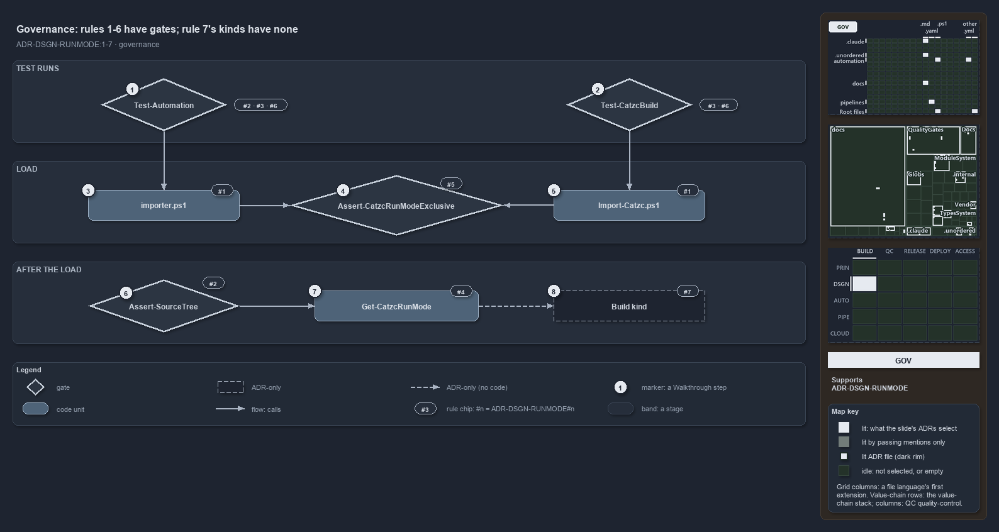

---
catzc:
  derived:
    path: docs/explanation/design/which-run-mode-rules-have-a-gate.md
    folder: docs/explanation/design
    name: which-run-mode-rules-have-a-gate
    filetype: md
    kind: explanation
    language: markdown
    track: docs
    body_sha: "6ae87099e7a9"
    adrs:
      - ADR-AUTO-ASSETDEP#1
      - ADR-DSGN-RUNMODE
    links:
      - docs/.assets/explanation/adr-dsgn-runmode--which-run-mode-rules-have-a-gate--governance.drawio.md
      - docs/.assets/explanation/adr-dsgn-runmode--which-run-mode-rules-have-a-gate--governance.drawio.png
      - docs/adr/design/run-modes.md
      - docs/explanation/design/index.md
      - docs/explanation/design/one-entry-script-per-mode.md
      - docs/explanation/design/shims-set-roots-mode-read-back.md
      - docs/explanation/design/two-roots-one-importer-same-modules.md
      - docs/explanation/design/where-code-loads-from-decides-the-mode.md
      - docs/explanation/index.md#how-to-read-the-diagrams
---

# Run-mode rules 1 to 6 each have a gate; the build kinds of rule 7 have none

```text
Run-mode rules 1 to 6 each have a gate; the build kinds of rule 7 have none.

1  Test-Automation               the source run: rules 2, 3 and 6
2  Test-CatzcBuild               the build run: rules 3 and 6
3  importer.ps1                  the source-mode entry: rule 1
4  Assert-CatzcRunModeExclusive  the last load step: rule 5
5  Import-Catzc.ps1              the build-mode entry: rule 1
6  Assert-SourceTree             source-tree tools fail fast in a build: rule 2
7  Get-CatzcRunMode              derives the mode from the code root: rule 4
8  Build kind                    four kinds of build root, derived by nothing: rule 7

Supports ADR-DSGN-RUNMODE#1, #2, #3, #4, #5, #6 and #7 (governance lens).
```

The run-modes ADR makes seven rules about how cats loads its modules from source and from a built package. Six of them are checked by code:
two test runs, two asserts, and the tests behind the mode function. The seventh, which names four kinds of build root, is held by the ADR
alone, because no code tells the kinds apart. A reader who wants to know which run-mode promises are enforced finds the gate for each rule
here.



The diagram is described element by element in
[its asset description](../../.assets/explanation/adr-dsgn-runmode--which-run-mode-rules-have-a-gate--governance.drawio.md).

## Walkthrough

1. **Test-Automation.** The source run loads every test worker through `importer.ps1`. It runs the whole body of tests, including the parity
   test, which checks that each built module's public and private function sets equal its source folder's, and which carries the
   `source-only` tag. It also runs the scope-isolation test, which proves that two modules never see each other's `$script:` value.
2. **Test-CatzcBuild.** The build run builds the tested modules, then loads every test worker through the build's `Import-Catzc.ps1`. It
   runs the same test files, skipping only those tagged `source-only`, so the scope-isolation test's in-session check runs in the build as
   well.
3. **importer.ps1.** The source-mode entry script. It is the first of the two entry points that rule 1 names.
4. **Assert-CatzcRunModeExclusive.** Both entry scripts end in the same importer, and the importer's last step is this assert. It throws
   when any loaded catzc module comes from outside the active code root. Its own tests, and an L2 test that switches a session between two
   roots and back, check it.
5. **Import-Catzc.ps1.** The build-mode entry script, the second entry point of rule 1. The package's `Catzc.psm1` dot-sources it, so
   `Import-Module Catzc` enters the same way.
6. **Assert-SourceTree.** Tools that work on the source tree call this assert first. It calls `Get-CatzcRunMode` and throws in a build, so
   such a tool fails fast instead of reading the wrong tree.
7. **Get-CatzcRunMode.** The mode is derived from the code root: `source` when it is the repository's `automation/` folder, `build` anywhere
   else. Its tests run in both runs.
8. **Build kind.** The ADR names four kinds of build root (temporary, cached, installed and saved) and says the kind is derived from the
   code root like the mode itself. No code derives a kind, and no gate checks one.

## Why it holds

- Cats runs in exactly two modes, each with its own entry script (ADR-DSGN-RUNMODE#1). Both test runs load their workers through those entry
  scripts.
- Every module is the same module in both modes (ADR-DSGN-RUNMODE#2). The parity test and `Assert-SourceTree` check it, and the analyzer
  rule `Measure-NoScriptRootAnchor` keeps module code from anchoring on its own file's folder.
- Each module keeps its own script scope in both modes (ADR-DSGN-RUNMODE#3). The scope-isolation test checks it.
- The mode is derived, never stored (ADR-DSGN-RUNMODE#4). `Get-CatzcRunMode` derives it, and its tests check the derivation.
- The two modes never coexist in one session (ADR-DSGN-RUNMODE#5). `Assert-CatzcRunModeExclusive` checks it at the end of every load.
- Both modes are tested by the same tests, and a test leaves the build run only through the `source-only` tag (ADR-DSGN-RUNMODE#6).
- Build mode has four kinds of root, derived from the code root (ADR-DSGN-RUNMODE#7). Nothing checks this rule.

## Where the code and the ADR differ

- The ADR says the kind of build root is derived like the mode, but `Get-CatzcRunMode` answers only `source` or `build`, and the cached kind
  has no code at all.
- The ADR names `build-catzc.ps1` as a third build-mode entry, but the repository has no such file.
- The ADR says switching is tested from source to build, from build to source, each mode twice and in a longer alternation, each time
  asserting the derived mode. The switch test uses two fixture roots instead, and checks eviction and a fresh script scope, but not the
  derived mode.
- The ADR's load banner, `Write-CatzcLoadBanner`, does not exist, so no gate checks it.
- `Measure-NoScriptRootAnchor` cites the internal-asset-dependencies rule (ADR-AUTO-ASSETDEP#1), not a run-mode rule; the two agree.

## See also

- [Run modes: source mode and build mode](../../adr/design/run-modes.md) — the decision this article explains.
- The other lenses on the same modes: [meta](where-code-loads-from-decides-the-mode.md),
  [architecture](two-roots-one-importer-same-modules.md), [implementation](shims-set-roots-mode-read-back.md) and
  [operations](one-entry-script-per-mode.md).
- [The design explanations](index.md) · [How to read the diagrams](../index.md#how-to-read-the-diagrams)
