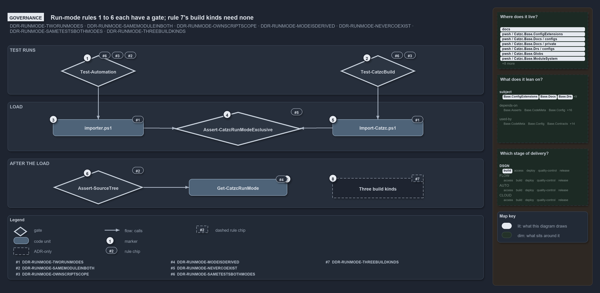

# Run-mode rules 1 to 6 each have a gate; rule 7's build kinds need none

```text
Run-mode rules 1 to 6 each have a gate; rule 7's build kinds need none.

1  Test-Automation               the source run: rules 2, 3 and 6
2  Test-CatzcBuild               the build run: rules 3 and 6
3  importer.ps1                  the source-mode entry: rule 1
4  Assert-CatzcRunModeExclusive  the last load step: rule 5
5  Import-Catzc.ps1              the build-mode entry: rule 1
6  Assert-SourceTree             source-tree tools fail fast in a build: rule 2
7  Get-CatzcRunMode              derives the mode from the code root: rule 4
8  Three build kinds             temporary, installed and saved, told apart by place: rule 7

Supports DDR-RUNMODE-TWORUNMODES, DDR-RUNMODE-SAMEMODULEINBOTH, DDR-RUNMODE-OWNSCRIPTSCOPE, DDR-RUNMODE-MODEISDERIVED, DDR-RUNMODE-NEVERCOEXIST, DDR-RUNMODE-SAMETESTSBOTHMODES and DDR-RUNMODE-THREEBUILDKINDS (governance lens).
```

The run-modes DDR makes seven rules about how cats loads its modules from source and from a built package. Six of them are checked by code:
two test runs, two asserts, and the tests behind the mode function. The seventh names three kinds of build root, which the place of the code
root tells apart, so no gate is needed. A reader who wants to know which run-mode promises are enforced finds the gate for each rule here.



## Walkthrough

1. **Test-Automation.** The source run loads every test worker through `importer.ps1`. It runs the whole body of tests, including the parity
   test, which checks that each built module's public and private function sets equal its source folder's, and which carries the
   `source-only` tag. It also runs the scope-isolation test, which proves that two modules never see each other's `$script:` value.
2. **Test-CatzcBuild.** The build run builds the tested modules, then loads every test worker through the build's `Import-Catzc.ps1`. It
   runs the same test files, skipping only those tagged `source-only`, so the scope-isolation test's in-session check runs in the build as
   well.
3. **importer.ps1.** The source-mode entry script. It is the first of the two entry points that rule 1 names.
4. **Assert-CatzcRunModeExclusive.** Both entry scripts end in the same importer, and the importer's last step is this assert. It throws
   when any loaded catzc module comes from outside the active code root. Its own tests, and an L2 test that switches a session between two
   roots and back, check it.
5. **Import-Catzc.ps1.** The build-mode entry script, the second entry point of rule 1. The package's `Catzc.psm1` dot-sources it, so
   `Import-Module Catzc` enters the same way.
6. **Assert-SourceTree.** Tools that work on the source tree call this assert first. It calls `Get-CatzcRunMode` and throws in a build, so
   such a tool fails fast instead of reading the wrong tree.
7. **Get-CatzcRunMode.** The mode is derived from the code root: `source` when it is the repository's `pwsh/` folder, `build` anywhere else.
   Its tests run in both runs.
8. **Three build kinds.** The DDR names three kinds of build root, temporary, installed and saved, told apart by where the code root lives.
   The kind is never stored and no function reports it, since nothing needs it, so the rule needs no gate.

## Why it holds

- Cats runs in exactly two modes, each with its own entry script (DDR-RUNMODE-TWORUNMODES). Both test runs load their workers through those
  entry scripts.
- Every module is the same module in both modes (DDR-RUNMODE-SAMEMODULEINBOTH). The parity test and `Assert-SourceTree` check it, and the
  analyzer rule `Measure-NoScriptRootAnchor` keeps module code from anchoring on its own file's folder.
- Each module keeps its own script scope in both modes (DDR-RUNMODE-OWNSCRIPTSCOPE). The scope-isolation test checks it.
- The mode is derived, never stored (DDR-RUNMODE-MODEISDERIVED). `Get-CatzcRunMode` derives it, and its tests check the derivation.
- The two modes never coexist in one session (DDR-RUNMODE-NEVERCOEXIST). `Assert-CatzcRunModeExclusive` checks it at the end of every load.
- Both modes are tested by the same tests, and a test leaves the build run only through the `source-only` tag
  (DDR-RUNMODE-SAMETESTSBOTHMODES).
- Build mode has three kinds of root, told apart by where the code root lives (DDR-RUNMODE-THREEBUILDKINDS). No code reports the kind.

## Where the code and the decision record differ

- The DDR says switching is tested from source to build, from build to source, each mode twice and in a longer alternation, each time
  asserting the derived mode. The switch test uses two fixture roots instead, and checks eviction and a fresh script scope, but not the
  derived mode.
- `Measure-NoScriptRootAnchor` cites ADR-PWSH-PWD-MODULELOCATESCONTENT and the internal-asset-dependencies rule
  (ADR-AUTO-ASSETDEP-INTERNALASSETDEPENDENCY), not a run-mode rule; the rules agree.

## See also

- [Run modes: source mode and build mode](../../drs/design/run-modes.md) — the decision this article explains.
- The other lenses on the same modes: [meta](where-code-loads-from-decides-the-mode.md),
  [architecture](two-roots-one-importer-same-modules.md), [implementation](shims-set-roots-mode-read-back.md) and
  [operations](one-entry-script-per-mode.md).
- [The design explanations](index.md) · [How to read the diagrams](../index.md#how-to-read-the-diagrams)
