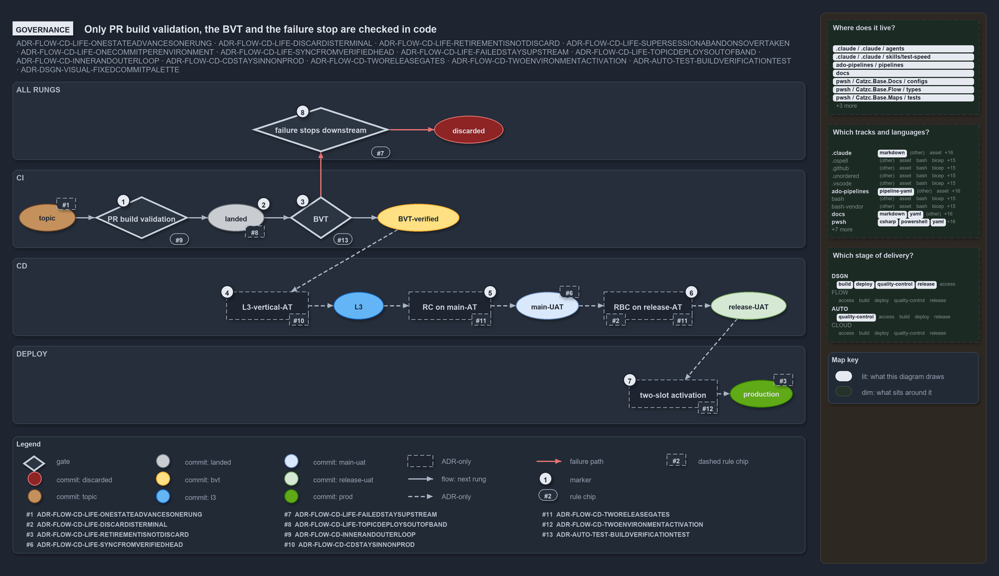

# Only PR build validation, the BVT and the failure stop are checked in code

```text
Three rung checks run in code: PR build validation, the BVT and the failure stop; the rest are ADR-only.

1  PR build validation       the inner CI gate before a topic commit merges
2  landed                    the merged commit; an out-of-band topic deploy is not an integration
3  BVT                       discards automatically; checked on main, the built artifact included
4  L3-vertical-AT            automated acceptance testing in an on-demand environment; ADR-only
5  RC on main-AT             the manual gate at main-uat; ADR-only
6  RBC on release-AT         the manual gate at release-uat; ADR-only
7  two-slot activation       stage inactive in pre-prod, then activate live; an actuation, ADR-only
8  failure stops downstream  each Deploy_* stage runs only when the stage before it succeeded

Supports ADR-FLOW-CD-LIFE-ONESTATEADVANCESONERUNG, ADR-FLOW-CD-LIFE-DISCARDISTERMINAL, ADR-FLOW-CD-LIFE-RETIREMENTISNOTDISCARD, ADR-FLOW-CD-LIFE-SUPERSESSIONABANDONSOVERTAKEN, ADR-FLOW-CD-LIFE-ONECOMMITPERENVIRONMENT, ADR-FLOW-CD-LIFE-SYNCFROMVERIFIEDHEAD, ADR-FLOW-CD-LIFE-FAILEDSTAYSUPSTREAM, ADR-FLOW-CD-LIFE-TOPICDEPLOYSOUTOFBAND, ADR-FLOW-CD-INNERANDOUTERLOOP, ADR-FLOW-CD-CDSTAYSINNONPROD, ADR-FLOW-CD-TWORELEASEGATES, ADR-FLOW-CD-TWOENVIRONMENTACTIVATION, ADR-AUTO-TEST-BUILDVERIFICATIONTEST and ADR-DSGN-VISUAL-FIXEDCOMMITPALETTE (governance lens).
```

Every rung of the commit ladder has an ADR rule and a gate that decides whether a commit climbs it. Lined up in ladder order, with the
commit state each one grants beside it, the gates split cleanly into those a pipeline in cats actually runs and those that exist only in the
ADRs. Three checks exist in code: PR build validation, the BVT, and the stop that keeps a failed stage from reaching the next one. Every
gate from L3 up to production is stated by the ADRs and enforced by nothing yet.



## Walkthrough

1. **PR build validation.** The inner CI gate runs before a topic commit may merge. Every CI and CD pipeline runs on pull requests to
   `main`, and `build-validation.yml` binds six globsets (automation, infrastructure, shared, nova, apex, flux) as build validations on
   `main`, blocking by default.
2. **Landed.** The merged commit is grey. Its rule says an out-of-band deploy of a topic commit is not an integration; the CD deploys in
   code run only on `refs/heads/main`, so no out-of-band topic deploy path exists to check.
3. **BVT.** The BVT discards automatically. `ci-pwsh` runs `Test-Automation -Level 2 -EnforceTimings` and, on main, `Test-BuildArtifact`,
   the built-artifact check the ADR makes part of the BVT; `ci-infrastructure` runs `Test-Automation -Suite infrastructure`.
4. **L3-vertical-AT.** The automated acceptance testing in an on-demand environment discards automatically when it fails. No pipeline runs
   it.
5. **RC on main-AT.** The manual gate at `main-uat` certifies its occupant, the commit that was the BVT-verified head when it went in, which
   is the stable point upstream integrators sync from.
6. **RBC on release-AT.** The manual gate at `release-uat` discards a commit by hand when it rejects it.
7. **Two-slot activation.** DEPLOY-Prod stages the artifact inactive in `pre-prod`, then activates it live. It is an actuation, not a gate,
   and the production occupant it replaces retires rather than being discarded.
8. **Failure stops downstream.** The one cross-rung rule that code checks: each CD `Deploy_*` stage depends on the stage before it and runs
   only when that stage succeeded. It holds between template stages, not between environment rungs, and nothing records the stopped commit
   as discarded.

## Why it holds

- A commit holds one state at a time and only climbs; a new attempt is a new commit (ADR-FLOW-CD-LIFE-ONESTATEADVANCESONERUNG).
- Discard is rejection at a named stage: BVT and L3 discard automatically, `release-uat` by hand at RBC
  (ADR-FLOW-CD-LIFE-DISCARDISTERMINAL).
- Retirement is a successful end of life, never a discard (ADR-FLOW-CD-LIFE-RETIREMENTISNOTDISCARD).
- Supersession abandons a still-valid commit without rejecting it, so no gate decides it (ADR-FLOW-CD-LIFE-SUPERSESSIONABANDONSOVERTAKEN).
- Each always-on environment holds one occupant, and no gate checks it (ADR-FLOW-CD-LIFE-ONECOMMITPERENVIRONMENT).
- The BVT-verified server head is the stable integration point, and the same commit goes into `main-uat` first
  (ADR-FLOW-CD-LIFE-SYNCFROMVERIFIEDHEAD).
- A commit that fails a stage cannot go downstream (ADR-FLOW-CD-LIFE-FAILEDSTAYSUPSTREAM).
- An out-of-band deploy of a topic commit is not an integration (ADR-FLOW-CD-LIFE-TOPICDEPLOYSOUTOFBAND).
- PR build validation is the inner CI gate (ADR-FLOW-CD-INNERANDOUTERLOOP); L3 runs in CD (ADR-FLOW-CD-CDSTAYSINNONPROD); RC and RBC are the
  manual gates (ADR-FLOW-CD-TWORELEASEGATES); deploy-to-prod is a two-environment activation (ADR-FLOW-CD-TWOENVIRONMENTACTIVATION).
- The BVT includes the built-artifact checks of `Test-BuildArtifact` (ADR-AUTO-TEST-BUILDVERIFICATIONTEST).
- The commit colours are the locked palette (ADR-DSGN-VISUAL-FIXEDCOMMITPALETTE).

## Where the code and the ADR differ

- No pipeline runs L3, and no RC or RBC gate, no inactive staging in `pre-prod`, and no out-of-band topic deploy path exists.
- The failure stop holds only between template stages, and no code records a discard.

## See also

- [The commit lifecycle](../../adr/flow/commit-lifecycle.md) — the decision this article explains.
- [The CI discipline and the promotion flow](../../adr/flow/cd-discipline-and-promotion-flow.md) ·
  [Test automation](../../adr/automation/test-automation.md) · [Visual design](../../adr/design/visual-design.md)
- The other lenses on the same lifecycle: [meta](one-way-climb-three-endings.md), [architecture](four-domains-promote-one-artifact.md),
  [implementation](code-wires-only-the-first-rungs.md) and [operations](engineer-merges-pipelines-do-the-rest.md).
- [The design explanations](index.md) · [How to read the diagrams](../index.md#how-to-read-the-diagrams)
