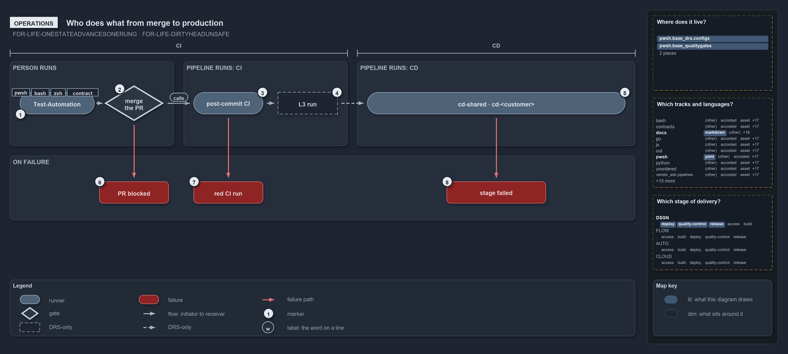

# Who does what from merge to production

```text
Who does what from merge to production.

1  Test-Automation           the engineer runs the tests on the devbox, then opens a pull request
2  merge the PR              clears only when PR build validation is green
3  post-commit CI            ci-pwsh, ci-infrastructure and the expected-failures run on main
4  L3 run                    the FDR's slow system tests after CI; no pipeline step yet
5  cd-shared, cd-<customer>  the CD pipelines: their own CI stage, then the Deploy_* stages
6  PR blocked                build validation is red, so the pull request cannot merge
7  red CI run                the BVT discard; nothing records it, and it stops no deploy
8  stage failed              the later Deploy_* stages skip

Supports FDR-LIFE-ONESTATEADVANCESONERUNG and FDR-LIFE-DIRTYHEADUNSAFE (operations lens).
```

A person moves a commit through the first rungs of the cats lifecycle by hand: they run `Test-Automation` on the devbox and merge the pull
request once its build validation is green. Azure DevOps pipelines run everything after the merge. When a rung fails, what the person sees
is a red result: a blocked pull request, a red CI run, or a failed deploy stage.

```yml drawio
description:
  An engineer runs the tests and merges once the pull request build validation is green; the pipelines run everything after the merge, and
  each failed rung shows the person a red result.
about:
  rules: [FDR-LIFE-ONESTATEADVANCESONERUNG, FDR-LIFE-DIRTYHEADUNSAFE]
  lens: operations
content:
  title: Who does what from merge to production
  kind: explanation
  flow: left-to-right
  theme: dark
  bands:
    - { id: band-person, label: PERSON RUNS }
    - { id: band-integration, label: "PIPELINE RUNS: CI" }
    - { id: band-delivery, label: "PIPELINE RUNS: CD" }
    - { id: band-failure, label: ON FAILURE }
  spans:
    - id: span-integration
      label: CI
      over: [band-person, band-integration]
    - id: span-delivery
      label: CD
      over: [band-delivery]
  glyphs:
    - { id: r-test, kind: runner, label: Test-Automation, in: band-person }
    - { id: g-merge, kind: gate, label: merge the PR, in: band-person }
    - { id: r-post-commit, kind: runner, label: post-commit CI, in: band-integration }
    - { id: a-level-three, kind: drsonly, label: L3 run, in: band-integration }
    - { id: r-deliver, kind: runner, label: cd-shared · cd-<customer>, in: band-delivery }
    - { id: f-blocked, kind: failure, label: PR blocked, in: band-failure }
    - { id: f-red, kind: failure, label: red CI run, in: band-failure }
    - { id: f-stage, kind: failure, label: stage failed, in: band-failure }
  edges:
    - { from: r-test, to: g-merge, kind: flow, label: "" }
    - { from: g-merge, to: r-post-commit, kind: flow, label: calls }
    - { from: r-post-commit, to: a-level-three, kind: record, label: "" }
    - { from: a-level-three, to: r-deliver, kind: record, label: "" }
    - { from: g-merge, to: f-blocked, kind: fail, label: "" }
    - { from: r-post-commit, to: f-red, kind: fail, label: "" }
    - { from: r-deliver, to: f-stage, kind: fail, label: "" }
  markers:
    - { at: r-test, number: 1 }
    - { at: g-merge, number: 2 }
    - { at: r-post-commit, number: 3 }
    - { at: a-level-three, number: 4 }
    - { at: r-deliver, number: 5 }
    - { at: f-blocked, number: 6 }
    - { at: f-red, number: 7 }
    - { at: f-stage, number: 8 }
  legend: auto
  minimaps: [code-locations, grid, axis]
layout:
  band-person: { x: 20, y: 108, w: 330, h: 170 }
  band-integration: { x: 370, y: 108, w: 330, h: 170 }
  band-delivery: { x: 720, y: 108, w: 560, h: 170 }
  band-failure: { x: 20, y: 298, w: 1260, h: 130 }
  r-test: { x: 40, y: 170, w: 150, h: 44 }
  g-merge: { x: 210, y: 156, w: 120, h: 72 }
  r-post-commit: { x: 390, y: 170, w: 140, h: 44 }
  a-level-three: { x: 560, y: 170, w: 120, h: 44 }
  r-deliver: { x: 740, y: 170, w: 520, h: 44 }
  f-blocked: { x: 200, y: 350, w: 140, h: 44 }
  f-red: { x: 390, y: 350, w: 140, h: 44 }
  f-stage: { x: 900, y: 350, w: 200, h: 44 }
```



## Walkthrough

1. **Test-Automation.** The engineer runs the tests on the devbox, then opens a pull request to `main`. The devbox and the pipeline run the
   same tiers, so a failure surfaces on the devbox first.
2. **Merge the PR.** The merge clears only when PR build validation is green; build validations on `main` block by default. The merge starts
   both the post-commit CI and the CD pipelines on `main`.
3. **Post-commit CI.** `ci-pwsh` and `ci-infrastructure`, plus `ci-pwsh-expected-failures`, run again on the merged commit.
4. **L3 run.** The FDR places the slow L3 system tests after CI, in the CD pipeline's post-commit path. No pipeline step runs them yet.
5. **`cd-shared` and `cd-<customer>`.** The CD pipelines run on `main`: their own CI stage, then the `Deploy_*` stages in order, into the
   Azure DevOps environment `<customer>-<env>[-<slot>]` (`shared-<env>` for `cd-shared`). The deploys are reference shapes until real
   service connections and a non-placeholder `azure.yml` exist.
6. **PR blocked.** Build validation is red, so the pull request cannot merge.
7. **Red CI run.** The BVT discard. Nothing in code records it, and a red `ci-pwsh` or `ci-infrastructure` run stops nothing downstream:
   each CD pipeline's own CI stage is what gates its deploys.
8. **Stage failed.** Later `Deploy_*` stages skip, because each runs only when the stage before it succeeded. `-SubscriptionIdAssertIs`
   fails a mis-wired service connection: the deploy throws when the az session targets another subscription, and `Deploy-Bicep` throws in a
   pipeline when the GUID is missing.

A new attempt is a new commit: the engineer fixes forward with a new pull request and never re-runs a commit downward. RC, RBC and the
`pre-prod` activation have no runnable step in this repository.

## Why it holds

- A commit only climbs, and a new attempt is a new commit (FDR-LIFE-ONESTATEADVANCESONERUNG).
- A commit that fails a stage cannot go downstream (FDR-LIFE-DIRTYHEADUNSAFE).
- `Test-Automation` and its tiers run on the devbox and in the pipeline, and must agree (ADR-AUTO-PARITY-CHECKEDEQUALLY).
- PR build validation is the inner CI gate; the L3 outer loop runs post-commit (FDR-CD-INNERANDOUTERLOOP).

## Where the code and the decision record differ

- Nothing records a BVT discard.
- No L3, RC, RBC or `pre-prod` activation step exists to run.

## See also

- [The commit lifecycle](../../drs/flow/commit-lifecycle.md) — the decision this article explains.
- [The CI discipline and the promotion flow](../../drs/flow/cd-discipline-and-promotion-flow.md) — the gates and pipelines.
- The other lenses on the same lifecycle: [meta](how-a-commit-climbs-the-ladder.md), [architecture](how-one-build-reaches-production.md),
  [implementation](which-ladder-rungs-the-pipelines-wire.md) and [governance](which-ladder-rungs-have-a-gate-in-code.md).
- [The design explanations](index.md) · [How to read the diagrams](../index.md#how-to-read-the-diagrams)
