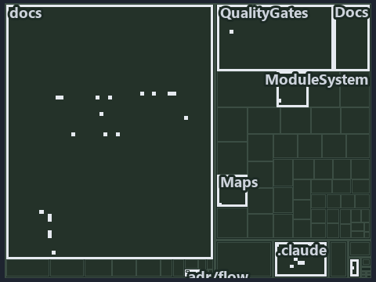

---
catzc:
  immutable:
    with_body_sha: "403eda2b2b0a"
    repo_status: locked
    path: docs/explanation/.assets/tree/adr-flow-cd--ci-budget-is-the-only-quality-gate--governance.tree.md
    source: docs/explanation/.assets/adr-flow-cd--ci-budget-is-the-only-quality-gate--governance.drawio.png
    role: asset-description
    language: markdown
    filetype: md
    track: docs
    tracktype: documentation
---

# The CI budget is the only promotion rule a quality gate checks: the tree minimap

```text
Which files cite ADR-FLOW-CD and ADR-FLOW-CD-TYPE: every file of the world map is a tile, grouped by top-level folder.
27 files lit in 9 groups.
```



This is the tree minimap in the sidebar of the governance diagram of [The CI budget is the only promotion rule a quality gate checks][28],
which explains [ADR-FLOW-CD][1] and [ADR-FLOW-CD-TYPE][2]. It lights every file that cites those codes, grouped by folder, so it shows which
files carry the decision. Each lit group has its reason below, naming the code that selects it.

## What the minimap shows

The tree draws every file of the world map as a tile, grouped by top-level folder (under `automation/` by module, under `docs/adr/` by ADR
domain), and lights 27 files in 9 groups, filled in ink. A lit ADR file has a white rim; a file lit only by passing mentions is a lighter
ink. Every other tile is idle, a grey box: a file the slide's ADR codes do not select.

- docs (docs/ outside docs/adr/): 15 lit files
- adr/flow (docs/adr/flow): 3 lit files
- .claude: 2 lit files
- adr/* (the files directly in docs/adr/): 2 lit files
- Docs (pwsh/Catzc.Base.Docs): 1 lit file
- Maps (pwsh/Catzc.Base.Maps): 1 lit file
- ModuleSystem (pwsh/Catzc.Base.ModuleSystem): 1 lit file
- QualityGates (pwsh/Catzc.Base.QualityGates): 1 lit file
- pipelines: 1 lit file

## Why each group is lit

### docs (docs/ outside docs/adr/, 15 lit files)

The group holds the files of docs/ outside docs/adr/; each sits in its world-map cell and is lit by:

- [docs/references/pwsh/catzc-azure-devops-buildvalidation/Get-AdoBuildValidations.ps1.md][3], in the cell docs × markdown: selected by
  [ADR-FLOW-CD-TYPE][2]: the file cites it at line 15 (text).
- [docs/references/pwsh/catzc-azure-devops-buildvalidation/Register-AdoBuildValidation.ps1.md][4], in the cell docs × markdown: selected by
  [ADR-FLOW-CD-TYPE][2]: the file cites it at line 16 (text).
- [docs/references/pwsh/catzc-azure-devops-buildvalidation/configs/build-validation.yml.md][5], in the cell docs × markdown: selected by
  [ADR-FLOW-CD-TYPE][2]: the file cites it at line 12 (text).
- [docs/references/pwsh/catzc-azure-devops-buildvalidation/private/Get-BuildValidationPathFilter.ps1.md][6], in the cell docs × markdown:
  selected by [ADR-FLOW-CD-TYPE][2]: the file cites it at line 19 (text).
- [docs/references/pwsh/catzc-azure-devops-buildvalidation/types/BuildValidationConfig.cs.md][7], in the cell docs × markdown: selected by
  [ADR-FLOW-CD-TYPE][2]: the file cites it at line 13 (text).
- [docs/references/pwsh/catzc-azure-devops-buildvalidation/types/BuildValidationEntry.cs.md][8], in the cell docs × markdown: selected by
  [ADR-FLOW-CD-TYPE][2]: the file cites it at line 12 (text).
- [docs/references/pwsh/catzc-azure-devops/New-AdoPullRequest.ps1.md][9], in the cell docs × markdown: selected by [ADR-FLOW-CD-TYPE][2]:
  the file cites it at line 14 (text).
- [docs/references/pwsh/catzc-azure-templates/Set-BicepTemplateConfiguration.ps1.md][10], in the cell docs × markdown: selected by
  [ADR-FLOW-CD-TYPE][2]: the file cites it at line 26 (text).
- [docs/references/pwsh/catzc-base-docs/configs/adrs.yml.md][11], in the cell docs × markdown: selected by [ADR-FLOW-CD][1]: the file cites
  it at line 40 (text).
- [docs/references/pwsh/catzc-base-docs/types/AdrsConfig.cs.md][12], in the cell docs × markdown: selected by [ADR-FLOW-CD][1]: the file
  cites it at line 28 (text), line 29 (text), line 57 (text) and line 58 (text).
- [docs/references/pwsh/catzc-base-docs/types/GlossaryConcept.cs.md][13], in the cell docs × markdown: selected by [ADR-FLOW-CD][1]: the
  file cites it at line 34 (text).
- [docs/references/pwsh/catzc-base-maps/Get-ValueChainHighlight.ps1.md][14], in the cell docs × markdown: selected by [ADR-FLOW-CD][1]: the
  file cites it at line 37 (text).
- [docs/references/pwsh/catzc-base-maps/Get-WorldMapHighlight.ps1.md][15], in the cell docs × markdown: selected by [ADR-FLOW-CD][1]: the
  file cites it at line 54 (text).
- [docs/references/pipelines/cd-shared.yaml.md][16], in the cell docs × markdown: selected by [ADR-FLOW-CD-TYPE][2]: the file cites it at
  line 12 (text).
- [docs/references/pipelines/ci-infrastructure.yaml.md][17], in the cell docs × markdown: selected by [ADR-FLOW-CD-TYPE][2]: the file cites
  it at line 12 (text).

### adr/flow (docs/adr/flow, 3 lit files)

The group holds the files of docs/adr/flow; each sits in its world-map cell and is lit by:

- [docs/adr/flow/cd-discipline-and-promotion-flow.md][1], in the cell docs × markdown: selected by [ADR-FLOW-CD][1]: the ADR's own file.
- [docs/adr/flow/dora-explains.md][18], in the cell docs × markdown: selected by [ADR-FLOW-CD][1]: the file cites it at line 11 (text);
  selected by [ADR-FLOW-CD-TYPE][2]: the file cites it at line 67 (text).
- [docs/adr/flow/pipeline-types.md][2], in the cell docs × markdown: selected by [ADR-FLOW-CD-TYPE][2]: the ADR's own file.

### .claude (2 lit files)

The group holds the files of .claude; each sits in its world-map cell and is lit by:

- [.claude/CLAUDE.md][19], in the cell .claude × markdown: selected by [ADR-FLOW-CD][1]: the file cites it at line 55 (text).
- [.claude/plans/plan-module-kinds-tracks.md][20], in the cell .claude × markdown: selected by [ADR-FLOW-CD-TYPE][2]: the file cites it at
  line 546 (text) and line 549 (text).

### adr/* (the files directly in docs/adr/, 2 lit files)

The group holds the files of the files directly in docs/adr/; each sits in its world-map cell and is lit by:

- [docs/adr/glossary.md][21], in the cell docs × markdown: selected by [ADR-FLOW-CD][1]: the file cites it at line 497 (text) and line 510
  (text).
- [docs/adr/index.md][22], in the cell docs × markdown: selected by [ADR-FLOW-CD][1]: the file cites it at line 129 (text); selected by
  [ADR-FLOW-CD-TYPE][2]: the file cites it at line 132 (text).

### Docs (pwsh/Catzc.Base.Docs, 1 lit file)

The group holds the files of pwsh/Catzc.Base.Docs; each sits in its world-map cell and is lit by:

- [pwsh/Catzc.Base.Docs/configs/adrs.yml][23], in the cell automation × yaml: selected by [ADR-FLOW-CD][1]: the file cites it at line 97
  (text); selected by [ADR-FLOW-CD-TYPE][2]: the file cites it at line 100 (text).

### Maps (pwsh/Catzc.Base.Maps, 1 lit file)

The group holds the files of pwsh/Catzc.Base.Maps; each sits in its world-map cell and is lit by:

- [pwsh/Catzc.Base.Maps/tests/Get-WorldMapHighlight.Tests.ps1][24], in the cell automation × powershell: selected by [ADR-FLOW-CD][1]: the
  file cites it at line 70 (text) and line 71 (text).

### ModuleSystem (pwsh/Catzc.Base.ModuleSystem, 1 lit file)

The group holds the files of pwsh/Catzc.Base.ModuleSystem; each sits in its world-map cell and is lit by:

- [pwsh/Catzc.Base.ModuleSystem/configs/glossary.yml][25], in the cell automation × yaml: selected by [ADR-FLOW-CD][1]: the file cites it at
  line 18 (text).

### QualityGates (pwsh/Catzc.Base.QualityGates, 1 lit file)

The group holds the files of pwsh/Catzc.Base.QualityGates; each sits in its world-map cell and is lit by:

- [pwsh/Catzc.Base.QualityGates/configs/glossary.yml][26], in the cell automation × yaml: selected by [ADR-FLOW-CD][1]: the file cites it at
  line 58 (text).

### pipelines (1 lit file)

The group holds the files of pipelines; each sits in its world-map cell and is lit by:

- [pipelines/ci-automation.yaml][27], in the cell pipelines × pipeline-yaml: selected by [ADR-FLOW-CD][1]: a pipeline that cites nothing
  itself carries its globset's citations, which cite it at `pwsh/Catzc.Base.Docs/configs/adrs.yml` line 97 (text),
  `pwsh/Catzc.Base.Maps/tests/Get-WorldMapHighlight.Tests.ps1` line 70 (text), `pwsh/Catzc.Base.Maps/tests/Get-WorldMapHighlight.Tests.ps1`
  line 71 (text), `pwsh/Catzc.Base.ModuleSystem/configs/glossary.yml` line 18 (text) and `pwsh/Catzc.Base.QualityGates/configs/glossary.yml`
  line 58 (text); selected by [ADR-FLOW-CD-TYPE][2]: a pipeline that cites nothing itself carries its globset's citations, which cite it at
  `pwsh/Catzc.Base.Docs/configs/adrs.yml` line 100 (text).

## Keywords

- [world map][29]
- [track][30]
- [file language][31]
- [cell][32]
- [lit cell][33]
- [.claude][34]: a track
- [automation][34]: a track
- [docs][34]: a track
- [pipelines][34]: a track
- [markdown][35]: a file language
- [pipeline-yaml][35]: a file language
- [powershell][35]: a file language
- [yaml][35]: a file language

Terms the cited ADRs define:

- [gate][36], defined by [ADR-FLOW-CD#13][37]
- [release candidate][38], defined by [ADR-FLOW-CD#14][39]

[1]: ../../../../adr/flow/cd-discipline-and-promotion-flow.md
[2]: ../../../../adr/flow/pipeline-types.md
[3]: ../../../../references/pwsh/catzc-azure-devops-buildvalidation/Get-AdoBuildValidations.ps1.md
[4]: ../../../../references/pwsh/catzc-azure-devops-buildvalidation/Register-AdoBuildValidation.ps1.md
[5]: ../../../../references/pwsh/catzc-azure-devops-buildvalidation/configs/build-validation.yml.md
[6]: ../../../../references/pwsh/catzc-azure-devops-buildvalidation/private/Get-BuildValidationPathFilter.ps1.md
[7]: ../../../../references/pwsh/catzc-azure-devops-buildvalidation/types/BuildValidationConfig.cs.md
[8]: ../../../../references/pwsh/catzc-azure-devops-buildvalidation/types/BuildValidationEntry.cs.md
[9]: ../../../../references/pwsh/catzc-azure-devops/New-AdoPullRequest.ps1.md
[10]: ../../../../references/pwsh/catzc-azure-templates/Set-BicepTemplateConfiguration.ps1.md
[11]: ../../../../references/pwsh/catzc-base-docs/configs/adrs.yml.md
[12]: ../../../../references/pwsh/catzc-base-docs/types/AdrsConfig.cs.md
[13]: ../../../../references/pwsh/catzc-base-docs/types/GlossaryConcept.cs.md
[14]: ../../../../references/pwsh/catzc-base-maps/Get-ValueChainHighlight.ps1.md
[15]: ../../../../references/pwsh/catzc-base-maps/Get-WorldMapHighlight.ps1.md
[16]: ../../../../references/pipelines/cd-shared.yaml.md
[17]: ../../../../references/pipelines/ci-infrastructure.yaml.md
[18]: ../../../../adr/flow/dora-explains.md
[19]: ../../../../../.claude/CLAUDE.md
[20]: ../../../../../.claude/plans/plan-module-kinds-tracks.md
[21]: ../../../../adr/glossary.md
[22]: ../../../../adr/index.md
[23]: ../../../../../pwsh/Catzc.Base.Docs/configs/adrs.yml
[24]: ../../../../../pwsh/Catzc.Base.Maps/tests/Get-WorldMapHighlight.Tests.ps1
[25]: ../../../../../pwsh/Catzc.Base.ModuleSystem/configs/glossary.yml
[26]: ../../../../../pwsh/Catzc.Base.QualityGates/configs/glossary.yml
[27]: ../../../../../pipelines/ci-automation.yaml
[28]: ../../ci-budget-is-the-only-quality-gate.md
[29]: ../../../../adr/glossary.md#world-map
[30]: ../../../../adr/glossary.md#track
[31]: ../../../../adr/glossary.md#file-language
[32]: ../../../../adr/glossary.md#cell
[33]: ../../../../adr/glossary.md#lit-cell
[34]: ../../../../../pwsh/Catzc.Base.Variants/configs/variants.yml
[35]: ../../../../../pwsh/Catzc.Base.Languages/configs/languages.yml
[36]: ../../../../adr/glossary.md#gate
[37]: ../../../../adr/flow/cd-discipline-and-promotion-flow.md#rule-adr-flow-cd13
[38]: ../../../../adr/glossary.md#release-candidate
[39]: ../../../../adr/flow/cd-discipline-and-promotion-flow.md#rule-adr-flow-cd14
