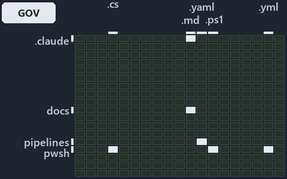

---
catzc:
  immutable:
    with_body_sha: c87f3d98861f
    repo_status: locked
    path: docs/explanation/flow/.assets/drift-is-gated-generation-is-adr-only/grid.md
    source: docs/explanation/flow/.assets/drift-is-gated-generation-is-adr-only/diagram.drawio.png
    role: asset-description
    language: markdown
    filetype: md
    track: docs
    tracktype: documentation
---

# Three gates check the projection, while generation is held by the ADR alone: the world-map minimap

```text
Where the files that cite ADR-AUTO-TEST and ADR-FLOW-CD-GLOBS sit in the repository: tracks down, file languages across.
7 of 342 cells lit, holding 519 files.
```



This is the world-map minimap in the sidebar of the governance diagram of [Three gates check the projection, while generation is held by the
ADR alone][521], which explains [ADR-AUTO-TEST][1] and [ADR-FLOW-CD-GLOBS][2]. It lights every cell of the world map that holds a file
citing those codes, so it shows where the decision lives in the repository. Each lit cell has its reason below, naming the code that selects
it.

## What the minimap shows

The grid crosses the 18 tracks (rows) with the 19 file languages (columns) of the world map and lights 7 cells, filled in ink. A cell lit
only by passing mentions (citations in body comments, not in a file's header or text) is touched: a lighter ink. Every other cell is idle, a
grey box: it holds files the slide's ADR codes do not select, or no file at all (288 of the 342 cells hold none). The minimap shows where
the slide sits, not how many files a cell holds; the world-map PDFs show the counts.

- .claude × markdown: 15 lit of 89 files
- docs × markdown: 419 lit of 2767 files
- pipelines × pipeline-yaml: 3 lit of 14 files
- pwsh × csharp: 3 lit of 293 files
- pwsh × powershell: 67 lit of 1651 files
- pwsh × yaml: 11 lit of 115 files
- Root files × powershell: 1 lit of 1 file

## Key

A lit row prints its track's name; a lit column prints a short code, the first extension of its file language:

- `.cs`: csharp
- `.md`: markdown
- `.yaml`: pipeline-yaml
- `.ps1`: powershell
- `.yml`: yaml

## Why each cell is lit

### .claude × markdown (15 lit files)

Placed: the root folder `.claude/` names the track .claude ([ADR-DSGN-TRACK-TRACKISPLACEDCLUSTER][3]); the extension `.md` names the file
language markdown ([ADR-DSGN-TRACK-FILELANGUAGE][3]). Lit ([ADR-DSGN-TRACK-LITCELL][3]) by:

- [.claude/CLAUDE.md][4]: selected by [ADR-AUTO-TEST][1]: the file cites it at line 54 (text); selected by [ADR-FLOW-CD-GLOBS][2]: the file
  cites it at line 55 (text).
- [.claude/agents/test-optimization.md][5]: selected by [ADR-AUTO-TEST][1]: the file cites it at line 5 (text).
- [.claude/plans/decisions-2026-10-16.md][6]: selected by [ADR-AUTO-TEST][1]: the file cites it at line 80 (text) and line 83 (text).
- [.claude/plans/plan-adr-code-language.md][7]: selected by [ADR-AUTO-TEST][1]: the file cites it at line 216 (text) and line 227 (text);
  selected by [ADR-FLOW-CD-GLOBS][2]: the file cites it at line 126 (text), line 127 (text), line 128 (text), line 181 (text) and line 184
  (text).
- [.claude/plans/plan-assert-wait.md][8]: selected by [ADR-AUTO-TEST][1]: the file cites it at line 47 (text).
- [.claude/plans/plan-automation-word-residue.md][9]: selected by [ADR-AUTO-TEST][1]: the file cites it at line 369 (text).
- [.claude/plans/plan-explanation-drift-gaps.md][10]: selected by [ADR-AUTO-TEST][1]: the file cites it at line 102 (text), line 177 (text),
  line 182 (text), line 183 (text), line 183 (text), line 184 (text) and line 185 (text); selected by [ADR-FLOW-CD-GLOBS][2]: the file cites
  it at line 36 (text), line 61 (text), line 99 (text), line 112 (text) and line 184 (text).
- [.claude/plans/plan-layers-vocabulary-rename-contracts.md][11]: selected by [ADR-AUTO-TEST][1]: the file cites it at line 208 (text).
- [.claude/plans/plan-promotion-ladder.md][12]: selected by [ADR-FLOW-CD-GLOBS][2]: the file cites it at line 12 (text), line 35 (text) and
  line 87 (text).
- [.claude/plans/prompt-promotion-ladder-1-build.md][13]: selected by [ADR-FLOW-CD-GLOBS][2]: the file cites it at line 21 (text).
- [.claude/plans/task-loose-ends.md][14]: selected by [ADR-FLOW-CD-GLOBS][2]: the file cites it at line 59 (text).
- [.claude/plans/task-test-run-budget.md][15]: selected by [ADR-AUTO-TEST][1]: the file cites it at line 92 (text).
- [.claude/plans/value-of-plan.md][16]: selected by [ADR-FLOW-CD-GLOBS][2]: the file cites it at line 34 (text).
- [.claude/skills/catzc-module/SKILL.md][17]: selected by [ADR-AUTO-TEST][1]: the file cites it at line 29 (text) and line 42 (text).
- [.claude/skills/test-speed/SKILL.md][18]: selected by [ADR-AUTO-TEST][1]: the file cites it at line 4 (text), line 26 (text), line 27
  (text), line 28 (text), line 29 (text), line 30 (text), line 31 (text), line 43 (text), line 44 (text), line 45 (text), line 47 (text),
  line 47 (text) and line 50 (text).

### docs × markdown (419 lit files)

Placed: the root folder `docs/` names the track docs ([ADR-DSGN-TRACK-TRACKISPLACEDCLUSTER][3]); the extension `.md` names the file language
markdown ([ADR-DSGN-TRACK-FILELANGUAGE][3]). Lit ([ADR-DSGN-TRACK-LITCELL][3]) by:

- [docs/adr/automation/dora-explains.md][19]: selected by [ADR-AUTO-TEST][1]: the file cites it at line 140 (text).
- [docs/adr/automation/test-automation.md][1]: selected by [ADR-AUTO-TEST][1]: the ADR's own file.
- [docs/adr/flow/dora-explains.md][20]: selected by [ADR-FLOW-CD-GLOBS][2]: the file cites it at line 11 (text) and line 92 (text).
- [docs/adr/flow/durable-sha-globs.md][2]: selected by [ADR-FLOW-CD-GLOBS][2]: the ADR's own file.
- [docs/adr/glossary.md][21]: selected by [ADR-AUTO-TEST][1]: the file cites it at line 543 (text), line 601 (text), line 623 (text), line
  758 (text), line 826 (text), line 844 (text), line 856 (text), line 870 (text), line 892 (text), line 906 (text), line 917 (text) and line
  937 (text).
- [docs/adr/index.md][22]: selected by [ADR-AUTO-TEST][1]: the file cites it at line 156 (text); selected by [ADR-FLOW-CD-GLOBS][2]: the
  file cites it at line 129 (text) and line 133 (text).
- [docs/how-to/automation/apply-environment-approvals.md][23]: selected by [ADR-FLOW-CD-GLOBS][2]: the file cites it at line 4 (text).
- [docs/how-to/getting-started/pwsh/run-tests-and-checks.md][24]: selected by [ADR-AUTO-TEST][1]: the file cites it at line 31 (text).
- [docs/how-to/pwsh/manual-test-plan.md][25]: selected by [ADR-AUTO-TEST][1]: the file cites it at line 54 (text) and line 60 (text).
- [docs/how-to/pwsh/manual-test-plan/azure.md][26]: selected by [ADR-AUTO-TEST][1]: the file cites it at line 15 (text) and line 67 (text).
- [docs/how-to/pwsh/manual-test-plan/pipelines-and-globs.md][27]: selected by [ADR-FLOW-CD-GLOBS][2]: the file cites it at line 16 (text).
- [docs/how-to/pwsh/manual-test-plan/test-harness.md][28]: selected by [ADR-AUTO-TEST][1]: the file cites it at line 15 (text).
- [docs/references/.assets/automation/catzc-base-execution/invoke-executable-two-paths-one-bounded.drawio.verify.md][29]: selected by
  [ADR-AUTO-TEST][1]: the file cites it at line 44 (text).
- [docs/references/.assets/automation/catzc-base-globs/protected-module-skip-by-hash.drawio.verify.md][30]: selected by
  [ADR-FLOW-CD-GLOBS][2]: the file cites it at line 55 (text) and line 55 (text).
- [docs/references/.assets/automation/catzc-base-modulesystem/module-graph-declared-vs-observed.drawio.verify.md][31]: selected by
  [ADR-AUTO-TEST][1]: the file cites it at line 53 (text) and line 53 (text).
- [docs/references/.assets/automation/catzc-base-qualitygates/test-automation-one-run-pipeline.drawio.verify.md][32]: selected by
  [ADR-AUTO-TEST][1]: the file cites it at line 18 (text), line 20 (text), line 49 (text), line 49 (text), line 49 (text) and line 62
  (text).
- [docs/references/pipelines/cd-apex.yaml.md][33]: selected by [ADR-FLOW-CD-GLOBS][2]: the file cites it at line 31 (text).
- [docs/references/pipelines/cd-flux.yaml.md][34]: selected by [ADR-FLOW-CD-GLOBS][2]: the file cites it at line 30 (text).
- [docs/references/pipelines/cd-nova.yaml.md][35]: selected by [ADR-FLOW-CD-GLOBS][2]: the file cites it at line 30 (text).
- [docs/references/pipelines/cd-shared.yaml.md][36]: selected by [ADR-FLOW-CD-GLOBS][2]: the file cites it at line 22 (text).
- [docs/references/pipelines/ci-automation.yaml.md][37]: selected by [ADR-AUTO-TEST][1]: the file cites it at line 94 (text); selected by
  [ADR-FLOW-CD-GLOBS][2]: the file cites it at line 12 (text).
- [docs/references/pipelines/ci-infrastructure.yaml.md][38]: selected by [ADR-AUTO-TEST][1]: the file cites it at line 22 (text); selected
  by [ADR-FLOW-CD-GLOBS][2]: the file cites it at line 13 (text).
- [docs/references/pipelines/github-workflows/ci-automation.yml.md][39]: selected by [ADR-FLOW-CD-GLOBS][2]: the file cites it at line 12
  (text).
- [docs/references/pwsh/catzc-azure-devops-buildvalidation/Get-AdoBuildValidations.ps1.md][40]: selected by [ADR-FLOW-CD-GLOBS][2]: the file
  cites it at line 17 (text).
- [docs/references/pwsh/catzc-azure-devops-buildvalidation/Register-AdoBuildValidation.ps1.md][41]: selected by [ADR-FLOW-CD-GLOBS][2]: the
  file cites it at line 14 (text) and line 74 (text).
- [docs/references/pwsh/catzc-azure-devops-buildvalidation/Unregister-AdoBuildValidation.ps1.md][42]: selected by [ADR-FLOW-CD-GLOBS][2]:
  the file cites it at line 15 (text).
- [docs/references/pwsh/catzc-azure-devops-buildvalidation/configs/build-validation.yml.md][43]: selected by [ADR-FLOW-CD-GLOBS][2]: the
  file cites it at line 15 (text).
- [docs/references/pwsh/catzc-azure-devops-buildvalidation/private/Get-BuildValidationPathFilter.ps1.md][44]: selected by
  [ADR-FLOW-CD-GLOBS][2]: the file cites it at line 16 (text).
- [docs/references/pwsh/catzc-azure-devops-buildvalidation/tests/types/BuildValidationConfig.Tests.ps1.md][45]: selected by
  [ADR-AUTO-TEST][1]: the file cites it at line 24 (text).
- [docs/references/pwsh/catzc-azure-devops/Sync-AdoEnvironmentApprovals.ps1.md][46]: selected by [ADR-FLOW-CD-GLOBS][2]: the file cites it
  at line 15 (text).
- [docs/references/pwsh/catzc-azure-devops/Test-Pipelines.ps1.md][47]: selected by [ADR-AUTO-TEST][1]: the file cites it at line 16 (text).
- [docs/references/pwsh/catzc-azure-devops/configs/identity-tokens.yml.md][48]: selected by [ADR-AUTO-TEST][1]: the file cites it at line 12
  (text).
- [docs/references/pwsh/catzc-azure-devops/tests/Get-AdoYamlFiles.Tests.ps1.md][49]: selected by [ADR-AUTO-TEST][1]: the file cites it at
  line 24 (text).
- [docs/references/pwsh/catzc-azure-templates/Get-BicepTemplatesOutputRoot.ps1.md][50]: selected by [ADR-AUTO-TEST][1]: the file cites it at
  line 18 (text).
- [docs/references/pwsh/catzc-azure-templates/tests/Assert-BicepTemplate.Tests.ps1.md][51]: selected by [ADR-AUTO-TEST][1]: the file cites
  it at line 26 (text).
- [docs/references/pwsh/catzc-azure-templates/tests/Build-Bicep.Integrity.Tests.ps1.md][52]: selected by [ADR-AUTO-TEST][1]: the file cites
  it at line 18 (text), line 20 (text) and line 23 (text).
- [docs/references/pwsh/catzc-azure-templates/tests/Build-Bicep.L2.Tests.ps1.md][53]: selected by [ADR-AUTO-TEST][1]: the file cites it at
  line 28 (text) and line 36 (text).
- [docs/references/pwsh/catzc-azure-templates/tests/Build-Bicep.SampleCustomer.Tests.ps1.md][54]: selected by [ADR-AUTO-TEST][1]: the file
  cites it at line 15 (text), line 15 (text), line 27 (text) and line 39 (text).
- [docs/references/pwsh/catzc-azure-templates/tests/Build-Bicep.SampleIndexed.Tests.ps1.md][55]: selected by [ADR-AUTO-TEST][1]: the file
  cites it at line 15 (text), line 15 (text) and line 35 (text).
- [docs/references/pwsh/catzc-azure-templates/tests/Build-Bicep.SampleSubscription.Tests.ps1.md][56]: selected by [ADR-AUTO-TEST][1]: the
  file cites it at line 13 (text), line 13 (text), line 25 (text) and line 37 (text).
- [docs/references/pwsh/catzc-azure-templates/tests/Build-Bicep.SampleWithModule.Tests.ps1.md][57]: selected by [ADR-AUTO-TEST][1]: the file
  cites it at line 15 (text), line 15 (text), line 27 (text) and line 39 (text).
- [docs/references/pwsh/catzc-azure-templates/tests/Build-Bicep.SampleWithPrepost.Tests.ps1.md][58]: selected by [ADR-AUTO-TEST][1]: the
  file cites it at line 21 (text) and line 30 (text).
- [docs/references/pwsh/catzc-azure-templates/tests/Build-Bicep.Tests.ps1.md][59]: selected by [ADR-AUTO-TEST][1]: the file cites it at line
  15 (text), line 15 (text), line 25 (text) and line 35 (text).
- [docs/references/pwsh/catzc-azure-templates/tests/Deploy-Bicep.SampleSubscription.Tests.ps1.md][60]: selected by [ADR-AUTO-TEST][1]: the
  file cites it at line 22 (text), line 40 (text) and line 49 (text).
- [docs/references/pwsh/catzc-azure-templates/tests/Deploy-Bicep.Tests.ps1.md][61]: selected by [ADR-AUTO-TEST][1]: the file cites it at
  line 57 (text), line 57 (text) and line 67 (text).
- [docs/references/pwsh/catzc-azure-templates/tests/Get-BicepDeploymentContext.Tests.ps1.md][62]: selected by [ADR-AUTO-TEST][1]: the file
  cites it at line 15 (text), line 15 (text), line 26 (text) and line 56 (text).
- [docs/references/pwsh/catzc-azure-templates/tests/Get-BicepParameterModel.Shipped.Tests.ps1.md][63]: selected by [ADR-AUTO-TEST][1]: the
  file cites it at line 19 (text), line 22 (text), line 25 (text), line 30 (text) and line 39 (text).
- [docs/references/pwsh/catzc-azure-templates/tests/Get-BicepParameterModel.Tests.ps1.md][64]: selected by [ADR-AUTO-TEST][1]: the file
  cites it at line 13 (text).
- [docs/references/pwsh/catzc-azure-templates/tests/Get-BicepParameterViolations.Tests.ps1.md][65]: selected by [ADR-AUTO-TEST][1]: the file
  cites it at line 13 (text).
- [docs/references/pwsh/catzc-azure-templates/tests/Get-BicepResourceGroupName.Tests.ps1.md][66]: selected by [ADR-AUTO-TEST][1]: the file
  cites it at line 13 (text) and line 13 (text).
- [docs/references/pwsh/catzc-azure-templates/tests/Get-BicepResourceName.Tests.ps1.md][67]: selected by [ADR-AUTO-TEST][1]: the file cites
  it at line 17 (text) and line 17 (text).
- [docs/references/pwsh/catzc-azure-templates/tests/Get-BicepTemplate.Tests.ps1.md][68]: selected by [ADR-AUTO-TEST][1]: the file cites it
  at line 13 (text) and line 13 (text).
- [docs/references/pwsh/catzc-azure-templates/tests/Get-BicepTemplateConfiguration.Tests.ps1.md][69]: selected by [ADR-AUTO-TEST][1]: the
  file cites it at line 15 (text) and line 15 (text).
- [docs/references/pwsh/catzc-azure-templates/tests/Get-BicepTemplateCustomers.Tests.ps1.md][70]: selected by [ADR-AUTO-TEST][1]: the file
  cites it at line 13 (text), line 13 (text), line 23 (text) and line 23 (text).
- [docs/references/pwsh/catzc-azure-templates/tests/Get-BicepTemplateNames.Tests.ps1.md][71]: selected by [ADR-AUTO-TEST][1]: the file cites
  it at line 13 (text) and line 13 (text).
- [docs/references/pwsh/catzc-azure-templates/tests/Get-BicepTemplateSlots.Tests.ps1.md][72]: selected by [ADR-AUTO-TEST][1]: the file cites
  it at line 13 (text), line 13 (text), line 32 (text) and line 32 (text).
- [docs/references/pwsh/catzc-azure-templates/tests/Get-BicepTemplates.Tests.ps1.md][73]: selected by [ADR-AUTO-TEST][1]: the file cites it
  at line 17 (text) and line 17 (text).
- [docs/references/pwsh/catzc-azure-templates/tests/Get-BicepTrackTagNameSet.Tests.ps1.md][74]: selected by [ADR-AUTO-TEST][1]: the file
  cites it at line 13 (text) and line 13 (text).
- [docs/references/pwsh/catzc-azure-templates/tests/Resolve-BicepParameterAddresses.Tests.ps1.md][75]: selected by [ADR-AUTO-TEST][1]: the
  file cites it at line 12 (text).
- [docs/references/pwsh/catzc-azure-templates/tests/Set-BicepTemplateConfiguration.Tests.ps1.md][76]: selected by [ADR-AUTO-TEST][1]: the
  file cites it at line 57 (text).
- [docs/references/pwsh/catzc-azure-templates/tests/types/BicepShortName.Tests.ps1.md][77]: selected by [ADR-AUTO-TEST][1]: the file cites
  it at line 16 (text).
- [docs/references/pwsh/catzc-azure/Test-AzureNetworkPlan.ps1.md][78]: selected by [ADR-AUTO-TEST][1]: the file cites it at line 14 (text).
- [docs/references/pwsh/catzc-azure/configs/identity-tokens.yml.md][79]: selected by [ADR-AUTO-TEST][1]: the file cites it at line 13
  (text).
- [docs/references/pwsh/catzc-azure/tests/Get-AzureBicepMinVersion.Tests.ps1.md][80]: selected by [ADR-AUTO-TEST][1]: the file cites it at
  line 13 (text) and line 13 (text).
- [docs/references/pwsh/catzc-azure/tests/Get-AzureCustomer.Tests.ps1.md][81]: selected by [ADR-AUTO-TEST][1]: the file cites it at line 13
  (text).
- [docs/references/pwsh/catzc-azure/tests/Get-AzureCustomers.Tests.ps1.md][82]: selected by [ADR-AUTO-TEST][1]: the file cites it at line 13
  (text) and line 13 (text).
- [docs/references/pwsh/catzc-azure/tests/Get-AzureEnvironment.Tests.ps1.md][83]: selected by [ADR-AUTO-TEST][1]: the file cites it at line
  13 (text) and line 13 (text).
- [docs/references/pwsh/catzc-azure/tests/Get-AzureSubscription.Tests.ps1.md][84]: selected by [ADR-AUTO-TEST][1]: the file cites it at line
  13 (text) and line 13 (text).
- [docs/references/pwsh/catzc-azure/tests/Get-AzureSubscriptionEnvironment.Tests.ps1.md][85]: selected by [ADR-AUTO-TEST][1]: the file cites
  it at line 13 (text) and line 13 (text).
- [docs/references/pwsh/catzc-azure/tests/Test-AzureNetworkPlan.Tests.ps1.md][86]: selected by [ADR-AUTO-TEST][1]: the file cites it at line
  14 (text).
- [docs/references/pwsh/catzc-azure/tests/types/AzureConfig.Tests.ps1.md][87]: selected by [ADR-AUTO-TEST][1]: the file cites it at line 15
  (text) and line 16 (text).
- [docs/references/pwsh/catzc-azure/tests/types/NetworkConfig.Tests.ps1.md][88]: selected by [ADR-AUTO-TEST][1]: the file cites it at line
  14 (text) and line 15 (text).
- [docs/references/pwsh/catzc-base-config/tests/Config-Conventions.Tests.ps1.md][89]: selected by [ADR-AUTO-TEST][1]: the file cites it at
  line 22 (text).
- [docs/references/pwsh/catzc-base-config/tests/Get-Config.Tests.ps1.md][90]: selected by [ADR-AUTO-TEST][1]: the file cites it at line 12
  (text), line 23 (text), line 26 (text) and line 44 (text).
- [docs/references/pwsh/catzc-base-config/tests/Get-ConfigValue.Tests.ps1.md][91]: selected by [ADR-AUTO-TEST][1]: the file cites it at line
  22 (text).
- [docs/references/pwsh/catzc-base-configextensions/Test-ConfigValidators.ps1.md][92]: selected by [ADR-AUTO-TEST][1]: the file cites it at
  line 14 (text).
- [docs/references/pwsh/catzc-base-configextensions/tests/Invoke-ConfigValidator.Tests.ps1.md][93]: selected by [ADR-AUTO-TEST][1]: the file
  cites it at line 12 (text).
- [docs/references/pwsh/catzc-base-configextensions/tests/Test-ConfigValidators.Tests.ps1.md][94]: selected by [ADR-AUTO-TEST][1]: the file
  cites it at line 13 (text).
- [docs/references/pwsh/catzc-base-contracts/Test-Contracts.ps1.md][95]: selected by [ADR-AUTO-TEST][1]: the file cites it at line 16
  (text).
- [docs/references/pwsh/catzc-base-contracts/tests/Build-ContractReference.Tests.ps1.md][96]: selected by [ADR-AUTO-TEST][1]: the file cites
  it at line 14 (text).
- [docs/references/pwsh/catzc-base-contracts/tests/ConvertTo-ContractNoteMarkdown.Tests.ps1.md][97]: selected by [ADR-AUTO-TEST][1]: the
  file cites it at line 15 (text).
- [docs/references/pwsh/catzc-base-contracts/tests/Get-ContractAssetNote.Tests.ps1.md][98]: selected by [ADR-AUTO-TEST][1]: the file cites
  it at line 14 (text).
- [docs/references/pwsh/catzc-base-contracts/tests/Get-ContractFreezeFindings.Tests.ps1.md][99]: selected by [ADR-AUTO-TEST][1]: the file
  cites it at line 13 (text).
- [docs/references/pwsh/catzc-base-contracts/tests/Publish-ContractRelease.Tests.ps1.md][100]: selected by [ADR-AUTO-TEST][1]: the file
  cites it at line 14 (text).
- [docs/references/pwsh/catzc-base-contracts/tests/Test-Contracts.Tests.ps1.md][101]: selected by [ADR-AUTO-TEST][1]: the file cites it at
  line 15 (text) and line 17 (text).
- [docs/references/pwsh/catzc-base-docs.md][102]: selected by [ADR-AUTO-TEST][1]: the file cites it at line 32 (text).
- [docs/references/pwsh/catzc-base-docs/Test-AdrEngineNeutrality.ps1.md][103]: selected by [ADR-AUTO-TEST][1]: the file cites it at line 14
  (text).
- [docs/references/pwsh/catzc-base-docs/Test-AdrRegistry.ps1.md][104]: selected by [ADR-AUTO-TEST][1]: the file cites it at line 14 (text).
- [docs/references/pwsh/catzc-base-docs/Test-AgentDefinitions.ps1.md][105]: selected by [ADR-AUTO-TEST][1]: the file cites it at line 14
  (text).
- [docs/references/pwsh/catzc-base-docs/Test-GeneratedReadmes.ps1.md][106]: selected by [ADR-AUTO-TEST][1]: the file cites it at line 14
  (text).
- [docs/references/pwsh/catzc-base-docs/Test-Glossary.ps1.md][107]: selected by [ADR-AUTO-TEST][1]: the file cites it at line 25 (text).
- [docs/references/pwsh/catzc-base-docs/configs/adr-checks.yml.md][108]: selected by [ADR-AUTO-TEST][1]: the file cites it at line 16
  (text).
- [docs/references/pwsh/catzc-base-docs/private/Get-GlossaryRuleStatements.ps1.md][109]: selected by [ADR-AUTO-TEST][1]: the file cites it
  at line 29 (text).
- [docs/references/pwsh/catzc-base-docs/tests/Build-Glossary.Tests.ps1.md][110]: selected by [ADR-AUTO-TEST][1]: the file cites it at line
  14 (text).
- [docs/references/pwsh/catzc-base-docs/tests/ConvertTo-AdrDomainDiagram.Tests.ps1.md][111]: selected by [ADR-AUTO-TEST][1]: the file cites
  it at line 12 (text).
- [docs/references/pwsh/catzc-base-docs/tests/Get-AdrCitationGraphViolations.Tests.ps1.md][112]: selected by [ADR-AUTO-TEST][1]: the file
  cites it at line 13 (text).
- [docs/references/pwsh/catzc-base-docs/tests/Get-AdrCitationMap.Tests.ps1.md][113]: selected by [ADR-AUTO-TEST][1]: the file cites it at
  line 14 (text).
- [docs/references/pwsh/catzc-base-docs/tests/Get-AdrDomainEdges.Tests.ps1.md][114]: selected by [ADR-AUTO-TEST][1]: the file cites it at
  line 13 (text).
- [docs/references/pwsh/catzc-base-docs/tests/Get-AdrDoraCoverageViolations.Tests.ps1.md][115]: selected by [ADR-AUTO-TEST][1]: the file
  cites it at line 13 (text).
- [docs/references/pwsh/catzc-base-docs/tests/Get-AdrFileIndex.Tests.ps1.md][116]: selected by [ADR-AUTO-TEST][1]: the file cites it at line
  13 (text).
- [docs/references/pwsh/catzc-base-docs/tests/Get-AdrRuleSet.Tests.ps1.md][117]: selected by [ADR-AUTO-TEST][1]: the file cites it at line
  13 (text) and line 22 (text).
- [docs/references/pwsh/catzc-base-docs/tests/Get-AdrRuleSummaryLines.Tests.ps1.md][118]: selected by [ADR-AUTO-TEST][1]: the file cites it
  at line 12 (text).
- [docs/references/pwsh/catzc-base-docs/tests/Get-AgentFrontMatter.Tests.ps1.md][119]: selected by [ADR-AUTO-TEST][1]: the file cites it at
  line 12 (text).
- [docs/references/pwsh/catzc-base-docs/tests/Get-CatsRuleEnforcers.Tests.ps1.md][120]: selected by [ADR-AUTO-TEST][1]: the file cites it at
  line 14 (text).
- [docs/references/pwsh/catzc-base-docs/tests/Get-ClaudeMdAgentNames.Tests.ps1.md][121]: selected by [ADR-AUTO-TEST][1]: the file cites it
  at line 12 (text).
- [docs/references/pwsh/catzc-base-docs/tests/Get-Glossary.Tests.ps1.md][122]: selected by [ADR-AUTO-TEST][1]: the file cites it at line 16
  (text).
- [docs/references/pwsh/catzc-base-docs/tests/Get-GlossaryAnchorViolations.Tests.ps1.md][123]: selected by [ADR-AUTO-TEST][1]: the file
  cites it at line 16 (text).
- [docs/references/pwsh/catzc-base-docs/tests/Get-GlossaryDefinitionViolations.Tests.ps1.md][124]: selected by [ADR-AUTO-TEST][1]: the file
  cites it at line 15 (text).
- [docs/references/pwsh/catzc-base-docs/tests/Get-GlossaryEnforcementViolations.Tests.ps1.md][125]: selected by [ADR-AUTO-TEST][1]: the file
  cites it at line 16 (text).
- [docs/references/pwsh/catzc-base-docs/tests/Get-GlossaryFormViolations.Tests.ps1.md][126]: selected by [ADR-AUTO-TEST][1]: the file cites
  it at line 15 (text).
- [docs/references/pwsh/catzc-base-docs/tests/Get-GlossaryPhrasingViolations.Tests.ps1.md][127]: selected by [ADR-AUTO-TEST][1]: the file
  cites it at line 16 (text).
- [docs/references/pwsh/catzc-base-docs/tests/Get-GlossaryRuleStatements.Tests.ps1.md][128]: selected by [ADR-AUTO-TEST][1]: the file cites
  it at line 14 (text).
- [docs/references/pwsh/catzc-base-docs/tests/Get-GlossarySourceViolations.Tests.ps1.md][129]: selected by [ADR-AUTO-TEST][1]: the file
  cites it at line 15 (text).
- [docs/references/pwsh/catzc-base-docs/tests/Get-GlossarySources.Tests.ps1.md][130]: selected by [ADR-AUTO-TEST][1]: the file cites it at
  line 16 (text).
- [docs/references/pwsh/catzc-base-docs/tests/Resolve-AdrLinkTarget.Tests.ps1.md][131]: selected by [ADR-AUTO-TEST][1]: the file cites it at
  line 13 (text).
- [docs/references/pwsh/catzc-base-docs/tests/Test-AdrEngineNeutrality.Tests.ps1.md][132]: selected by [ADR-AUTO-TEST][1]: the file cites it
  at line 13 (text).
- [docs/references/pwsh/catzc-base-docs/tests/Test-AdrRegistry.Tests.ps1.md][133]: selected by [ADR-AUTO-TEST][1]: the file cites it at line
  8 (text) and line 13 (text).
- [docs/references/pwsh/catzc-base-docs/tests/Test-AgentDefinitions.Tests.ps1.md][134]: selected by [ADR-AUTO-TEST][1]: the file cites it at
  line 13 (text).
- [docs/references/pwsh/catzc-base-docs/tests/Test-GeneratedReadmes.Tests.ps1.md][135]: selected by [ADR-AUTO-TEST][1]: the file cites it at
  line 13 (text).
- [docs/references/pwsh/catzc-base-docs/tests/Test-Glossary.Tests.ps1.md][136]: selected by [ADR-AUTO-TEST][1]: the file cites it at line 25
  (text) and line 26 (text).
- [docs/references/pwsh/catzc-base-docs/tests/Update-AdrCitation.Tests.ps1.md][137]: selected by [ADR-AUTO-TEST][1]: the file cites it at
  line 13 (text).
- [docs/references/pwsh/catzc-base-docs/tests/types/AdrChecksConfig.Tests.ps1.md][138]: selected by [ADR-AUTO-TEST][1]: the file cites it at
  line 12 (text).
- [docs/references/pwsh/catzc-base-docs/tests/types/AdrDomainEdge.Tests.ps1.md][139]: selected by [ADR-AUTO-TEST][1]: the file cites it at
  line 12 (text).
- [docs/references/pwsh/catzc-base-docs/tests/types/AgentEntry.Tests.ps1.md][140]: selected by [ADR-AUTO-TEST][1]: the file cites it at line
  13 (text).
- [docs/references/pwsh/catzc-base-docs/tests/types/AgentsConfig.Tests.ps1.md][141]: selected by [ADR-AUTO-TEST][1]: the file cites it at
  line 13 (text).
- [docs/references/pwsh/catzc-base-docs/tests/types/CheckModes.Tests.ps1.md][142]: selected by [ADR-AUTO-TEST][1]: the file cites it at line
  13 (text).
- [docs/references/pwsh/catzc-base-docs/tests/types/GlossaryConfig.Tests.ps1.md][143]: selected by [ADR-AUTO-TEST][1]: the file cites it at
  line 15 (text).
- [docs/references/pwsh/catzc-base-docs/tests/types/GlossaryEntry.Tests.ps1.md][144]: selected by [ADR-AUTO-TEST][1]: the file cites it at
  line 13 (text).
- [docs/references/pwsh/catzc-base-docs/types/AdrChecksConfig.cs.md][145]: selected by [ADR-AUTO-TEST][1]: the file cites it at line 23
  (text).
- [docs/references/pwsh/catzc-base-docs/types/AdrsConfig.cs.md][146]: selected by [ADR-FLOW-CD-GLOBS][2]: the file cites it at line 28
  (text), line 29 (text), line 57 (text) and line 58 (text).
- [docs/references/pwsh/catzc-base-docs/types/CheckMode.cs.md][147]: selected by [ADR-AUTO-TEST][1]: the file cites it at line 15 (text).
- [docs/references/pwsh/catzc-base-docs/types/GlossaryConcept.cs.md][148]: selected by [ADR-AUTO-TEST][1]: the file cites it at line 33
  (text).
- [docs/references/pwsh/catzc-base-execution/Invoke-Executable.ps1.md][149]: selected by [ADR-AUTO-TEST][1]: the file cites it at line 136
  (text).
- [docs/references/pwsh/catzc-base-execution/invoke-executable-two-paths-one-bounded.drawio.md][150]: selected by [ADR-AUTO-TEST][1]: the
  file cites it at line 95 (text).
- [docs/references/pwsh/catzc-base-execution/tests/Find-Executable.Tests.ps1.md][151]: selected by [ADR-AUTO-TEST][1]: the file cites it at
  line 14 (text).
- [docs/references/pwsh/catzc-base-execution/tests/Get-ExecutableVersion.Tests.ps1.md][152]: selected by [ADR-AUTO-TEST][1]: the file cites
  it at line 13 (text).
- [docs/references/pwsh/catzc-base-execution/tests/Resolve-EngineExecutable.Tests.ps1.md][153]: selected by [ADR-AUTO-TEST][1]: the file
  cites it at line 13 (text).
- [docs/references/pwsh/catzc-base-execution/tests/Resolve-ToolExecutable.Tests.ps1.md][154]: selected by [ADR-AUTO-TEST][1]: the file cites
  it at line 14 (text).
- [docs/references/pwsh/catzc-base-execution/tests/types/CliRunner.Tests.ps1.md][155]: selected by [ADR-AUTO-TEST][1]: the file cites it at
  line 13 (text).
- [docs/references/pwsh/catzc-base-execution/tests/types/ExecutableProbe.Tests.ps1.md][156]: selected by [ADR-AUTO-TEST][1]: the file cites
  it at line 12 (text).
- [docs/references/pwsh/catzc-base-execution/tests/types/ToolConfig.Tests.ps1.md][157]: selected by [ADR-AUTO-TEST][1]: the file cites it at
  line 13 (text).
- [docs/references/pwsh/catzc-base-execution/tests/types/ToolsConfig.Tests.ps1.md][158]: selected by [ADR-AUTO-TEST][1]: the file cites it
  at line 12 (text), line 21 (text) and line 23 (text).
- [docs/references/pwsh/catzc-base-exporter/Get-CatzcContentHash.ps1.md][159]: selected by [ADR-FLOW-CD-GLOBS][2]: the file cites it at line
  14 (text).
- [docs/references/pwsh/catzc-base-exporter/tests/Assert-CatzcBundle.Tests.ps1.md][160]: selected by [ADR-AUTO-TEST][1]: the file cites it
  at line 14 (text).
- [docs/references/pwsh/catzc-base-exporter/tests/Install-Catzc.Tests.ps1.md][161]: selected by [ADR-AUTO-TEST][1]: the file cites it at
  line 12 (text).
- [docs/references/pwsh/catzc-base-exporter/tests/New-CatzcNuGetPackage.Tests.ps1.md][162]: selected by [ADR-AUTO-TEST][1]: the file cites
  it at line 14 (text) and line 16 (text).
- [docs/references/pwsh/catzc-base-files/tests/Get-GitChangedPath.Tests.ps1.md][163]: selected by [ADR-AUTO-TEST][1]: the file cites it at
  line 12 (text).
- [docs/references/pwsh/catzc-base-globs.md][164]: selected by [ADR-AUTO-TEST][1]: the file cites it at line 42 (text); selected by
  [ADR-FLOW-CD-GLOBS][2]: the file cites it at line 27 (text).
- [docs/references/pwsh/catzc-base-globs/Get-ChangedGlobSet.ps1.md][165]: selected by [ADR-FLOW-CD-GLOBS][2]: the file cites it at line 15
  (text) and line 27 (text).
- [docs/references/pwsh/catzc-base-globs/Get-GlobSet.ps1.md][166]: selected by [ADR-FLOW-CD-GLOBS][2]: the file cites it at line 14 (text).
- [docs/references/pwsh/catzc-base-globs/Get-GlobSetChangeRange.ps1.md][167]: selected by [ADR-FLOW-CD-GLOBS][2]: the file cites it at line
  26 (text).
- [docs/references/pwsh/catzc-base-globs/Get-GlobSetFile.ps1.md][168]: selected by [ADR-FLOW-CD-GLOBS][2]: the file cites it at line 14
  (text) and line 16 (text).
- [docs/references/pwsh/catzc-base-globs/Get-GlobSetHash.ps1.md][169]: selected by [ADR-FLOW-CD-GLOBS][2]: the file cites it at line 20
  (text).
- [docs/references/pwsh/catzc-base-globs/Get-GlobSetTrigger.ps1.md][170]: selected by [ADR-FLOW-CD-GLOBS][2]: the file cites it at line 15
  (text), line 29 (text) and line 30 (text).
- [docs/references/pwsh/catzc-base-globs/Get-MarkerBlastRadius.ps1.md][171]: selected by [ADR-FLOW-CD-GLOBS][2]: the file cites it at line
  14 (text).
- [docs/references/pwsh/catzc-base-globs/Get-ModuleGlobSet.ps1.md][172]: selected by [ADR-FLOW-CD-GLOBS][2]: the file cites it at line 58
  (text), line 61 (text) and line 109 (text).
- [docs/references/pwsh/catzc-base-globs/Get-TrackedFile.ps1.md][173]: selected by [ADR-FLOW-CD-GLOBS][2]: the file cites it at line 15
  (text).
- [docs/references/pwsh/catzc-base-globs/Test-AdoPipelineTriggerGlob.ps1.md][174]: selected by [ADR-AUTO-TEST][1]: the file cites it at line
  21 (text); selected by [ADR-FLOW-CD-GLOBS][2]: the file cites it at line 24 (text) and line 25 (text).
- [docs/references/pwsh/catzc-base-globs/Test-GitHubWorkflowTriggerGlob.ps1.md][175]: selected by [ADR-AUTO-TEST][1]: the file cites it at
  line 21 (text); selected by [ADR-FLOW-CD-GLOBS][2]: the file cites it at line 24 (text) and line 25 (text).
- [docs/references/pwsh/catzc-base-globs/Test-GlobSetAffected.ps1.md][176]: selected by [ADR-FLOW-CD-GLOBS][2]: the file cites it at line 17
  (text) and line 20 (text).
- [docs/references/pwsh/catzc-base-globs/Test-GlobSetIndependence.ps1.md][177]: selected by [ADR-AUTO-TEST][1]: the file cites it at line 23
  (text); selected by [ADR-FLOW-CD-GLOBS][2]: the file cites it at line 18 (text), line 56 (text) and line 66 (text).
- [docs/references/pwsh/catzc-base-globs/Test-GlobSetTriggerCoverage.ps1.md][178]: selected by [ADR-AUTO-TEST][1]: the file cites it at line
  14 (text); selected by [ADR-FLOW-CD-GLOBS][2]: the file cites it at line 15 (text).
- [docs/references/pwsh/catzc-base-globs/configs/globs.yml.md][179]: selected by [ADR-FLOW-CD-GLOBS][2]: the file cites it at line 12
  (text), line 17 (text), line 25 (text), line 27 (text), line 41 (text), line 71 (text) and line 85 (text).
- [docs/references/pwsh/catzc-base-globs/private/Get-ChangedFile.ps1.md][180]: selected by [ADR-FLOW-CD-GLOBS][2]: the file cites it at line
  14 (text).
- [docs/references/pwsh/catzc-base-globs/private/Get-GlobSetMember.ps1.md][181]: selected by [ADR-FLOW-CD-GLOBS][2]: the file cites it at
  line 14 (text).
- [docs/references/pwsh/catzc-base-globs/private/Get-PipelineTrigger.ps1.md][182]: selected by [ADR-FLOW-CD-GLOBS][2]: the file cites it at
  line 16 (text).
- [docs/references/pwsh/catzc-base-globs/private/Test-GlobListEqual.ps1.md][183]: selected by [ADR-FLOW-CD-GLOBS][2]: the file cites it at
  line 18 (text).
- [docs/references/pwsh/catzc-base-globs/protected-module-skip-by-hash.drawio.md][184]: selected by [ADR-FLOW-CD-GLOBS][2]: the file cites
  it at line 33 (text), line 108 (text) and line 108 (text).
- [docs/references/pwsh/catzc-base-globs/tests/Get-ChangedFile.Tests.ps1.md][185]: selected by [ADR-FLOW-CD-GLOBS][2]: the file cites it at
  line 13 (text).
- [docs/references/pwsh/catzc-base-globs/tests/Get-ChangedGlobSet.Tests.ps1.md][186]: selected by [ADR-AUTO-TEST][1]: the file cites it at
  line 22 (text); selected by [ADR-FLOW-CD-GLOBS][2]: the file cites it at line 12 (text).
- [docs/references/pwsh/catzc-base-globs/tests/Get-GlobSet.Tests.ps1.md][187]: selected by [ADR-AUTO-TEST][1]: the file cites it at line 13
  (text).
- [docs/references/pwsh/catzc-base-globs/tests/Get-GlobSetFile.Tests.ps1.md][188]: selected by [ADR-FLOW-CD-GLOBS][2]: the file cites it at
  line 12 (text) and line 13 (text).
- [docs/references/pwsh/catzc-base-globs/tests/Get-GlobSetHash.Tests.ps1.md][189]: selected by [ADR-FLOW-CD-GLOBS][2]: the file cites it at
  line 13 (text).
- [docs/references/pwsh/catzc-base-globs/tests/Get-GlobSetMember.Tests.ps1.md][190]: selected by [ADR-FLOW-CD-GLOBS][2]: the file cites it
  at line 12 (text).
- [docs/references/pwsh/catzc-base-globs/tests/Get-GlobSetTrigger.Tests.ps1.md][191]: selected by [ADR-FLOW-CD-GLOBS][2]: the file cites it
  at line 12 (text).
- [docs/references/pwsh/catzc-base-globs/tests/Get-ModuleGlobSet.Tests.ps1.md][192]: selected by [ADR-AUTO-TEST][1]: the file cites it at
  line 23 (text).
- [docs/references/pwsh/catzc-base-globs/tests/Get-PipelineTrigger.Tests.ps1.md][193]: selected by [ADR-FLOW-CD-GLOBS][2]: the file cites it
  at line 12 (text).
- [docs/references/pwsh/catzc-base-globs/tests/Get-TrackedFile.Tests.ps1.md][194]: selected by [ADR-FLOW-CD-GLOBS][2]: the file cites it at
  line 11 (text).
- [docs/references/pwsh/catzc-base-globs/tests/GlobSet-Independence.Tests.ps1.md][195]: selected by [ADR-FLOW-CD-GLOBS][2]: the file cites
  it at line 12 (text).
- [docs/references/pwsh/catzc-base-globs/tests/GlobSetTrigger-Coverage.Tests.ps1.md][196]: selected by [ADR-AUTO-TEST][1]: the file cites it
  at line 13 (text); selected by [ADR-FLOW-CD-GLOBS][2]: the file cites it at line 12 (text).
- [docs/references/pwsh/catzc-base-globs/tests/PipelineTrigger-Integrity.Tests.ps1.md][197]: selected by [ADR-FLOW-CD-GLOBS][2]: the file
  cites it at line 13 (text).
- [docs/references/pwsh/catzc-base-globs/tests/Test-AdoPipelineTriggerGlob.Tests.ps1.md][198]: selected by [ADR-AUTO-TEST][1]: the file
  cites it at line 12 (text).
- [docs/references/pwsh/catzc-base-globs/tests/Test-GitHubWorkflowTriggerGlob.Tests.ps1.md][199]: selected by [ADR-AUTO-TEST][1]: the file
  cites it at line 12 (text) and line 14 (text).
- [docs/references/pwsh/catzc-base-globs/tests/Test-GlobSetAffected.Tests.ps1.md][200]: selected by [ADR-AUTO-TEST][1]: the file cites it at
  line 22 (text).
- [docs/references/pwsh/catzc-base-globs/tests/Test-GlobSetIndependence.Tests.ps1.md][201]: selected by [ADR-AUTO-TEST][1]: the file cites
  it at line 12 (text) and line 15 (text); selected by [ADR-FLOW-CD-GLOBS][2]: the file cites it at line 13 (text).
- [docs/references/pwsh/catzc-base-globs/tests/Test-GlobSetTriggerCoverage.Tests.ps1.md][202]: selected by [ADR-AUTO-TEST][1]: the file
  cites it at line 12 (text).
- [docs/references/pwsh/catzc-base-globs/tests/types/GlobPattern.Tests.ps1.md][203]: selected by [ADR-FLOW-CD-GLOBS][2]: the file cites it
  at line 11 (text) and line 13 (text).
- [docs/references/pwsh/catzc-base-globs/tests/types/GlobSet.Tests.ps1.md][204]: selected by [ADR-FLOW-CD-GLOBS][2]: the file cites it at
  line 12 (text) and line 14 (text).
- [docs/references/pwsh/catzc-base-globs/tests/types/GlobsConfig.Tests.ps1.md][205]: selected by [ADR-AUTO-TEST][1]: the file cites it at
  line 35 (text); selected by [ADR-FLOW-CD-GLOBS][2]: the file cites it at line 14 (text), line 16 (text) and line 25 (text).
- [docs/references/pwsh/catzc-base-globs/types/Aspect.cs.md][206]: selected by [ADR-FLOW-CD-GLOBS][2]: the file cites it at line 19 (text).
- [docs/references/pwsh/catzc-base-globs/types/DurableHash.cs.md][207]: selected by [ADR-FLOW-CD-GLOBS][2]: the file cites it at line 11
  (text) and line 17 (text).
- [docs/references/pwsh/catzc-base-globs/types/GlobPattern.cs.md][208]: selected by [ADR-FLOW-CD-GLOBS][2]: the file cites it at line 17
  (text), line 18 (text) and line 19 (text).
- [docs/references/pwsh/catzc-base-globs/types/GlobSet.cs.md][209]: selected by [ADR-FLOW-CD-GLOBS][2]: the file cites it at line 13 (text),
  line 15 (text), line 16 (text), line 22 (text), line 25 (text), line 27 (text), line 30 (text), line 38 (text), line 47 (text), line 65
  (text), line 82 (text), line 92 (text), line 116 (text) and line 124 (text).
- [docs/references/pwsh/catzc-base-globs/types/GlobsConfig.cs.md][210]: selected by [ADR-FLOW-CD-GLOBS][2]: the file cites it at line 13
  (text), line 17 (text), line 20 (text) and line 39 (text).
- [docs/references/pwsh/catzc-base-languages.md][211]: selected by [ADR-AUTO-TEST][1]: the file cites it at line 37 (text).
- [docs/references/pwsh/catzc-base-languages/tests/ConvertFrom-BatsJunit.Tests.ps1.md][212]: selected by [ADR-AUTO-TEST][1]: the file cites
  it at line 13 (text).
- [docs/references/pwsh/catzc-base-languages/tests/ConvertFrom-PytestJunit.Tests.ps1.md][213]: selected by [ADR-AUTO-TEST][1]: the file
  cites it at line 12 (text).
- [docs/references/pwsh/catzc-base-languages/tests/Get-EngineContract.Tests.ps1.md][214]: selected by [ADR-AUTO-TEST][1]: the file cites it
  at line 13 (text).
- [docs/references/pwsh/catzc-base-languages/tests/Invoke-BashTest.Tests.ps1.md][215]: selected by [ADR-AUTO-TEST][1]: the file cites it at
  line 11 (text).
- [docs/references/pwsh/catzc-base-languages/tests/Invoke-GoTest.Tests.ps1.md][216]: selected by [ADR-AUTO-TEST][1]: the file cites it at
  line 11 (text).
- [docs/references/pwsh/catzc-base-languages/tests/Invoke-PythonTest.Tests.ps1.md][217]: selected by [ADR-AUTO-TEST][1]: the file cites it
  at line 11 (text).
- [docs/references/pwsh/catzc-base-languages/tests/New-GoWorkspace.Tests.ps1.md][218]: selected by [ADR-AUTO-TEST][1]: the file cites it at
  line 11 (text).
- [docs/references/pwsh/catzc-base-languages/tests/New-PythonProject.Tests.ps1.md][219]: selected by [ADR-AUTO-TEST][1]: the file cites it
  at line 13 (text).
- [docs/references/pwsh/catzc-base-languages/types/BashTestResult.cs.md][220]: selected by [ADR-AUTO-TEST][1]: the file cites it at line 18
  (text).
- [docs/references/pwsh/catzc-base-languages/types/GoTestResult.cs.md][221]: selected by [ADR-AUTO-TEST][1]: the file cites it at line 18
  (text).
- [docs/references/pwsh/catzc-base-languages/types/PythonTestResult.cs.md][222]: selected by [ADR-AUTO-TEST][1]: the file cites it at line
  19 (text).
- [docs/references/pwsh/catzc-base-maps/Get-ValueChainHighlight.ps1.md][223]: selected by [ADR-AUTO-TEST][1]: the file cites it at line 43
  (text); selected by [ADR-FLOW-CD-GLOBS][2]: the file cites it at line 37 (text).
- [docs/references/pwsh/catzc-base-maps/Get-WorldMapHighlight.ps1.md][224]: selected by [ADR-FLOW-CD-GLOBS][2]: the file cites it at line 54
  (text).
- [docs/references/pwsh/catzc-base-maps/Test-ValueChainMap.ps1.md][225]: selected by [ADR-AUTO-TEST][1]: the file cites it at line 14
  (text).
- [docs/references/pwsh/catzc-base-maps/Test-WorldMap.ps1.md][226]: selected by [ADR-AUTO-TEST][1]: the file cites it at line 14 (text).
- [docs/references/pwsh/catzc-base-maps/tests/Get-ValueChainHighlight.Tests.ps1.md][227]: selected by [ADR-AUTO-TEST][1]: the file cites it
  at line 14 (text).
- [docs/references/pwsh/catzc-base-maps/tests/Get-ValueChainMap.Tests.ps1.md][228]: selected by [ADR-AUTO-TEST][1]: the file cites it at
  line 13 (text).
- [docs/references/pwsh/catzc-base-maps/tests/Test-ValueChainMap.Tests.ps1.md][229]: selected by [ADR-AUTO-TEST][1]: the file cites it at
  line 15 (text) and line 17 (text).
- [docs/references/pwsh/catzc-base-maps/tests/Test-WorldMap.Tests.ps1.md][230]: selected by [ADR-AUTO-TEST][1]: the file cites it at line 15
  (text) and line 17 (text).
- [docs/references/pwsh/catzc-base-maps/tests/types/ValueChainHighlight.Tests.ps1.md][231]: selected by [ADR-AUTO-TEST][1]: the file cites
  it at line 14 (text).
- [docs/references/pwsh/catzc-base-maps/tests/types/ValueChainMap.Tests.ps1.md][232]: selected by [ADR-AUTO-TEST][1]: the file cites it at
  line 13 (text).
- [docs/references/pwsh/catzc-base-modulesystem.md][233]: selected by [ADR-AUTO-TEST][1]: the file cites it at line 34 (text).
- [docs/references/pwsh/catzc-base-modulesystem/Get-FunctionDependency.ps1.md][234]: selected by [ADR-AUTO-TEST][1]: the file cites it at
  line 58 (text).
- [docs/references/pwsh/catzc-base-modulesystem/Test-CheckedInBinaries.ps1.md][235]: selected by [ADR-AUTO-TEST][1]: the file cites it at
  line 14 (text).
- [docs/references/pwsh/catzc-base-modulesystem/Test-FolderConventions.ps1.md][236]: selected by [ADR-AUTO-TEST][1]: the file cites it at
  line 14 (text).
- [docs/references/pwsh/catzc-base-modulesystem/Test-FunctionDependency.ps1.md][237]: selected by [ADR-AUTO-TEST][1]: the file cites it at
  line 21 (text).
- [docs/references/pwsh/catzc-base-modulesystem/Test-InternalAssetDependency.ps1.md][238]: selected by [ADR-AUTO-TEST][1]: the file cites it
  at line 14 (text).
- [docs/references/pwsh/catzc-base-modulesystem/Test-ModuleCycles.ps1.md][239]: selected by [ADR-AUTO-TEST][1]: the file cites it at line 14
  (text).
- [docs/references/pwsh/catzc-base-modulesystem/Test-ModuleDependency.ps1.md][240]: selected by [ADR-AUTO-TEST][1]: the file cites it at
  line 16 (text).
- [docs/references/pwsh/catzc-base-modulesystem/configs/artifacts.yml.md][241]: selected by [ADR-AUTO-TEST][1]: the file cites it at line 14
  (text).
- [docs/references/pwsh/catzc-base-modulesystem/module-graph-declared-vs-observed.drawio.md][242]: selected by [ADR-AUTO-TEST][1]: the file
  cites it at line 39 (text), line 41 (text), line 104 (text) and line 104 (text).
- [docs/references/pwsh/catzc-base-modulesystem/private/Get-UncoveredInternalAssetDependency.ps1.md][243]: selected by [ADR-AUTO-TEST][1]:
  the file cites it at line 19 (text).
- [docs/references/pwsh/catzc-base-modulesystem/tests/Get-InternalAssetDependency.Integrity.Tests.ps1.md][244]: selected by
  [ADR-AUTO-TEST][1]: the file cites it at line 13 (text).
- [docs/references/pwsh/catzc-base-modulesystem/tests/Get-InternalAssetDependency.Tests.ps1.md][245]: selected by [ADR-AUTO-TEST][1]: the
  file cites it at line 15 (text).
- [docs/references/pwsh/catzc-base-modulesystem/tests/Get-UncoveredInternalAssetDependency.Tests.ps1.md][246]: selected by
  [ADR-AUTO-TEST][1]: the file cites it at line 17 (text).
- [docs/references/pwsh/catzc-base-modulesystem/tests/Test-CheckedInBinaries.Tests.ps1.md][247]: selected by [ADR-AUTO-TEST][1]: the file
  cites it at line 13 (text) and line 22 (text).
- [docs/references/pwsh/catzc-base-modulesystem/tests/Test-FolderConventions.Tests.ps1.md][248]: selected by [ADR-AUTO-TEST][1]: the file
  cites it at line 13 (text).
- [docs/references/pwsh/catzc-base-modulesystem/tests/Test-FunctionDependency.Tests.ps1.md][249]: selected by [ADR-AUTO-TEST][1]: the file
  cites it at line 13 (text).
- [docs/references/pwsh/catzc-base-modulesystem/tests/Test-InternalAssetDependency.Tests.ps1.md][250]: selected by [ADR-AUTO-TEST][1]: the
  file cites it at line 13 (text).
- [docs/references/pwsh/catzc-base-modulesystem/tests/Test-ModuleCycles.Tests.ps1.md][251]: selected by [ADR-AUTO-TEST][1]: the file cites
  it at line 12 (text).
- [docs/references/pwsh/catzc-base-modulesystem/tests/Test-ModuleDependency.Tests.ps1.md][252]: selected by [ADR-AUTO-TEST][1]: the file
  cites it at line 14 (text).
- [docs/references/pwsh/catzc-base-modulesystem/types/ArtifactsConfig.cs.md][253]: selected by [ADR-AUTO-TEST][1]: the file cites it at line
  13 (text).
- [docs/references/pwsh/catzc-base-objects/tests/types/ConsoleText.Tests.ps1.md][254]: selected by [ADR-AUTO-TEST][1]: the file cites it at
  line 14 (text).
- [docs/references/pwsh/catzc-base-objects/tests/types/DictionaryRecord.Tests.ps1.md][255]: selected by [ADR-AUTO-TEST][1]: the file cites
  it at line 15 (text).
- [docs/references/pwsh/catzc-base-overlay/tests/Overlay.Fixture.ps1.md][256]: selected by [ADR-AUTO-TEST][1]: the file cites it at line 13
  (text).
- [docs/references/pwsh/catzc-base-qualitygates/Get-TestTargetSkipReason.ps1.md][257]: selected by [ADR-AUTO-TEST][1]: the file cites it at
  line 15 (text) and line 17 (text).
- [docs/references/pwsh/catzc-base-qualitygates/Invoke-TestFile.ps1.md][258]: selected by [ADR-AUTO-TEST][1]: the file cites it at line 21
  (text), line 30 (text), line 34 (text), line 39 (text) and line 40 (text).
- [docs/references/pwsh/catzc-base-qualitygates/Test-AnalyzerAdrMap.ps1.md][259]: selected by [ADR-AUTO-TEST][1]: the file cites it at line
  14 (text).
- [docs/references/pwsh/catzc-base-qualitygates/Test-Automation.ps1.md][260]: selected by [ADR-AUTO-TEST][1]: the file cites it at line 20
  (text), line 32 (text), line 33 (text), line 96 (text), line 110 (text), line 216 (text) and line 226 (text); selected by
  [ADR-FLOW-CD-GLOBS][2]: the file cites it at line 97 (text).
- [docs/references/pwsh/catzc-base-qualitygates/Test-BuildArtifact.ps1.md][261]: selected by [ADR-AUTO-TEST][1]: the file cites it at line
  15 (text) and line 16 (text).
- [docs/references/pwsh/catzc-base-qualitygates/Test-CatzcBuild.ps1.md][262]: selected by [ADR-AUTO-TEST][1]: the file cites it at line 14
  (text), line 22 (text) and line 47 (text).
- [docs/references/pwsh/catzc-base-qualitygates/Test-Change.ps1.md][263]: selected by [ADR-AUTO-TEST][1]: the file cites it at line 15
  (text).
- [docs/references/pwsh/catzc-base-qualitygates/Test-Comments.ps1.md][264]: selected by [ADR-AUTO-TEST][1]: the file cites it at line 14
  (text).
- [docs/references/pwsh/catzc-base-qualitygates/Test-ConfigIdentityHygiene.ps1.md][265]: selected by [ADR-AUTO-TEST][1]: the file cites it
  at line 26 (text).
- [docs/references/pwsh/catzc-base-qualitygates/Test-FileMeta.ps1.md][266]: selected by [ADR-AUTO-TEST][1]: the file cites it at line 16
  (text).
- [docs/references/pwsh/catzc-base-qualitygates/Test-FileMetaProcessors.ps1.md][267]: selected by [ADR-AUTO-TEST][1]: the file cites it at
  line 17 (text).
- [docs/references/pwsh/catzc-base-qualitygates/Test-Formatting.ps1.md][268]: selected by [ADR-AUTO-TEST][1]: the file cites it at line 14
  (text).
- [docs/references/pwsh/catzc-base-qualitygates/Test-GeneratedFiles.ps1.md][269]: selected by [ADR-AUTO-TEST][1]: the file cites it at line
  14 (text).
- [docs/references/pwsh/catzc-base-qualitygates/Test-Links.ps1.md][270]: selected by [ADR-AUTO-TEST][1]: the file cites it at line 24
  (text).
- [docs/references/pwsh/catzc-base-qualitygates/Test-LogicTestIdentity.ps1.md][271]: selected by [ADR-AUTO-TEST][1]: the file cites it at
  line 21 (text) and line 28 (text).
- [docs/references/pwsh/catzc-base-qualitygates/Test-ManagedGuids.ps1.md][272]: selected by [ADR-AUTO-TEST][1]: the file cites it at line 14
  (text).
- [docs/references/pwsh/catzc-base-qualitygates/Test-ManualTestPlan.ps1.md][273]: selected by [ADR-AUTO-TEST][1]: the file cites it at line
  14 (text) and line 18 (text).
- [docs/references/pwsh/catzc-base-qualitygates/Test-MarkdownTitle.ps1.md][274]: selected by [ADR-AUTO-TEST][1]: the file cites it at line
  18 (text).
- [docs/references/pwsh/catzc-base-qualitygates/Test-Markdownlint.ps1.md][275]: selected by [ADR-AUTO-TEST][1]: the file cites it at line 20
  (text).
- [docs/references/pwsh/catzc-base-qualitygates/Test-ParameterConsistency.ps1.md][276]: selected by [ADR-AUTO-TEST][1]: the file cites it at
  line 16 (text).
- [docs/references/pwsh/catzc-base-qualitygates/Test-Plans.ps1.md][277]: selected by [ADR-AUTO-TEST][1]: the file cites it at line 30
  (text).
- [docs/references/pwsh/catzc-base-qualitygates/Test-ScriptAnalyzer.ps1.md][278]: selected by [ADR-AUTO-TEST][1]: the file cites it at line
  23 (text).
- [docs/references/pwsh/catzc-base-qualitygates/Test-ShippedConfigs.ps1.md][279]: selected by [ADR-AUTO-TEST][1]: the file cites it at line
  14 (text).
- [docs/references/pwsh/catzc-base-qualitygates/Test-SourceConventions.ps1.md][280]: selected by [ADR-AUTO-TEST][1]: the file cites it at
  line 14 (text) and line 39 (text).
- [docs/references/pwsh/catzc-base-qualitygates/Test-Spelling.ps1.md][281]: selected by [ADR-AUTO-TEST][1]: the file cites it at line 17
  (text).
- [docs/references/pwsh/catzc-base-qualitygates/Test-Terminology.ps1.md][282]: selected by [ADR-AUTO-TEST][1]: the file cites it at line 27
  (text).
- [docs/references/pwsh/catzc-base-qualitygates/Test-TestTitles.ps1.md][283]: selected by [ADR-AUTO-TEST][1]: the file cites it at line 14
  (text) and line 18 (text).
- [docs/references/pwsh/catzc-base-qualitygates/configs/generated-files.yml.md][284]: selected by [ADR-AUTO-TEST][1]: the file cites it at
  line 11 (text).
- [docs/references/pwsh/catzc-base-qualitygates/configs/source-conventions.yml.md][285]: selected by [ADR-AUTO-TEST][1]: the file cites it
  at line 42 (text).
- [docs/references/pwsh/catzc-base-qualitygates/configs/terminology.yml.md][286]: selected by [ADR-AUTO-TEST][1]: the file cites it at line
  42 (text).
- [docs/references/pwsh/catzc-base-qualitygates/configs/test-policy.yml.md][287]: selected by [ADR-AUTO-TEST][1]: the file cites it at line
  11 (text).
- [docs/references/pwsh/catzc-base-qualitygates/private/Assert-TestTagGate.ps1.md][288]: selected by [ADR-AUTO-TEST][1]: the file cites it
  at line 15 (text).
- [docs/references/pwsh/catzc-base-qualitygates/private/Enter-SystemTestLock.ps1.md][289]: selected by [ADR-AUTO-TEST][1]: the file cites it
  at line 15 (text) and line 19 (text).
- [docs/references/pwsh/catzc-base-qualitygates/private/Enter-TestRunLocation.ps1.md][290]: selected by [ADR-AUTO-TEST][1]: the file cites
  it at line 14 (text).
- [docs/references/pwsh/catzc-base-qualitygates/private/Get-GeneratedFileGenerator.ps1.md][291]: selected by [ADR-AUTO-TEST][1]: the file
  cites it at line 15 (text).
- [docs/references/pwsh/catzc-base-qualitygates/private/Get-GuidScanFiles.ps1.md][292]: selected by [ADR-FLOW-CD-GLOBS][2]: the file cites
  it at line 15 (text).
- [docs/references/pwsh/catzc-base-qualitygates/private/Get-LanguageTestOutcomes.ps1.md][293]: selected by [ADR-AUTO-TEST][1]: the file
  cites it at line 20 (text).
- [docs/references/pwsh/catzc-base-qualitygates/private/Get-LiveIdentityTokens.ps1.md][294]: selected by [ADR-AUTO-TEST][1]: the file cites
  it at line 30 (text).
- [docs/references/pwsh/catzc-base-qualitygates/private/Get-LogicTestIdentityFinding.ps1.md][295]: selected by [ADR-AUTO-TEST][1]: the file
  cites it at line 19 (text).
- [docs/references/pwsh/catzc-base-qualitygates/private/Get-ModuleProtectionIdentity.ps1.md][296]: selected by [ADR-FLOW-CD-GLOBS][2]: the
  file cites it at line 80 (text).
- [docs/references/pwsh/catzc-base-qualitygates/private/Get-NeutralCodeFinding.ps1.md][297]: selected by [ADR-AUTO-TEST][1]: the file cites
  it at line 14 (text).
- [docs/references/pwsh/catzc-base-qualitygates/private/Get-TestOptOutExclusion.ps1.md][298]: selected by [ADR-AUTO-TEST][1]: the file cites
  it at line 15 (text).
- [docs/references/pwsh/catzc-base-qualitygates/private/Get-TestRunLocationEntry.ps1.md][299]: selected by [ADR-AUTO-TEST][1]: the file
  cites it at line 14 (text).
- [docs/references/pwsh/catzc-base-qualitygates/private/Invoke-BuildArtifactProbe.ps1.md][300]: selected by [ADR-AUTO-TEST][1]: the file
  cites it at line 15 (text).
- [docs/references/pwsh/catzc-base-qualitygates/private/Invoke-TestAutomationWorkers.ps1.md][301]: selected by [ADR-AUTO-TEST][1]: the file
  cites it at line 16 (text) and line 21 (text).
- [docs/references/pwsh/catzc-base-qualitygates/private/Invoke-TestRun.ps1.md][302]: selected by [ADR-AUTO-TEST][1]: the file cites it at
  line 14 (text), line 23 (text), line 222 (text) and line 302 (text).
- [docs/references/pwsh/catzc-base-qualitygates/private/New-PesterRunConfiguration.ps1.md][303]: selected by [ADR-AUTO-TEST][1]: the file
  cites it at line 18 (text).
- [docs/references/pwsh/catzc-base-qualitygates/private/New-TestAutomationShardScript.ps1.md][304]: selected by [ADR-AUTO-TEST][1]: the file
  cites it at line 18 (text), line 62 (text) and line 121 (text).
- [docs/references/pwsh/catzc-base-qualitygates/private/Resolve-TestRunMaxLevel.ps1.md][305]: selected by [ADR-AUTO-TEST][1]: the file cites
  it at line 15 (text) and line 24 (text).
- [docs/references/pwsh/catzc-base-qualitygates/private/Resolve-TestSuite.ps1.md][306]: selected by [ADR-AUTO-TEST][1]: the file cites it at
  line 15 (text); selected by [ADR-FLOW-CD-GLOBS][2]: the file cites it at line 17 (text).
- [docs/references/pwsh/catzc-base-qualitygates/private/Select-TestRunFiles.ps1.md][307]: selected by [ADR-AUTO-TEST][1]: the file cites it
  at line 23 (text).
- [docs/references/pwsh/catzc-base-qualitygates/private/Split-TestAutomationFiles.ps1.md][308]: selected by [ADR-AUTO-TEST][1]: the file
  cites it at line 26 (text) and line 30 (text).
- [docs/references/pwsh/catzc-base-qualitygates/private/Test-TestRunOverBudget.ps1.md][309]: selected by [ADR-AUTO-TEST][1]: the file cites
  it at line 15 (text).
- [docs/references/pwsh/catzc-base-qualitygates/private/Write-TestAutomationHeader.ps1.md][310]: selected by [ADR-AUTO-TEST][1]: the file
  cites it at line 37 (text).
- [docs/references/pwsh/catzc-base-qualitygates/private/Write-TestAutomationReport.ps1.md][311]: selected by [ADR-AUTO-TEST][1]: the file
  cites it at line 52 (text).
- [docs/references/pwsh/catzc-base-qualitygates/private/Write-TestOptOutExclusion.ps1.md][312]: selected by [ADR-AUTO-TEST][1]: the file
  cites it at line 18 (text).
- [docs/references/pwsh/catzc-base-qualitygates/test-automation-one-run-pipeline.drawio.md][313]: selected by [ADR-AUTO-TEST][1]: the file
  cites it at line 21 (text), line 25 (text), line 28 (text), line 96 (text), line 96 (text), line 96 (text) and line 101 (text).
- [docs/references/pwsh/catzc-base-qualitygates/tests/Build-EnglishDictionary.Tests.ps1.md][314]: selected by [ADR-AUTO-TEST][1]: the file
  cites it at line 12 (text).
- [docs/references/pwsh/catzc-base-qualitygates/tests/ConvertTo-PesterRunTarget.Tests.ps1.md][315]: selected by [ADR-AUTO-TEST][1]: the file
  cites it at line 13 (text).
- [docs/references/pwsh/catzc-base-qualitygates/tests/Format-Code.Tests.ps1.md][316]: selected by [ADR-AUTO-TEST][1]: the file cites it at
  line 11 (text), line 13 (text) and line 60 (text).
- [docs/references/pwsh/catzc-base-qualitygates/tests/Format-Links.Tests.ps1.md][317]: selected by [ADR-AUTO-TEST][1]: the file cites it at
  line 14 (text).
- [docs/references/pwsh/catzc-base-qualitygates/tests/Format-Types.Tests.ps1.md][318]: selected by [ADR-AUTO-TEST][1]: the file cites it at
  line 12 (text) and line 14 (text).
- [docs/references/pwsh/catzc-base-qualitygates/tests/Get-AnalyzerAdrCoverage.Tests.ps1.md][319]: selected by [ADR-AUTO-TEST][1]: the file
  cites it at line 13 (text).
- [docs/references/pwsh/catzc-base-qualitygates/tests/Get-BashTestCases.Tests.ps1.md][320]: selected by [ADR-AUTO-TEST][1]: the file cites
  it at line 13 (text).
- [docs/references/pwsh/catzc-base-qualitygates/tests/Get-ChangeCheckPlan.Tests.ps1.md][321]: selected by [ADR-AUTO-TEST][1]: the file cites
  it at line 12 (text).
- [docs/references/pwsh/catzc-base-qualitygates/tests/Get-ChangeTestFile.Tests.ps1.md][322]: selected by [ADR-AUTO-TEST][1]: the file cites
  it at line 12 (text).
- [docs/references/pwsh/catzc-base-qualitygates/tests/Get-EngineSetFinding.Tests.ps1.md][323]: selected by [ADR-AUTO-TEST][1]: the file
  cites it at line 12 (text).
- [docs/references/pwsh/catzc-base-qualitygates/tests/Get-FixtureIdentityTokens.Tests.ps1.md][324]: selected by [ADR-AUTO-TEST][1]: the file
  cites it at line 14 (text).
- [docs/references/pwsh/catzc-base-qualitygates/tests/Get-FormatEngineStamp.Tests.ps1.md][325]: selected by [ADR-AUTO-TEST][1]: the file
  cites it at line 12 (text).
- [docs/references/pwsh/catzc-base-qualitygates/tests/Get-FormatScope.Tests.ps1.md][326]: selected by [ADR-AUTO-TEST][1]: the file cites it
  at line 12 (text).
- [docs/references/pwsh/catzc-base-qualitygates/tests/Get-GoTestCases.Tests.ps1.md][327]: selected by [ADR-AUTO-TEST][1]: the file cites it
  at line 15 (text).
- [docs/references/pwsh/catzc-base-qualitygates/tests/Get-LanguageTestExecutable.Tests.ps1.md][328]: selected by [ADR-AUTO-TEST][1]: the
  file cites it at line 13 (text).
- [docs/references/pwsh/catzc-base-qualitygates/tests/Get-LanguageTestFolders.Tests.ps1.md][329]: selected by [ADR-AUTO-TEST][1]: the file
  cites it at line 14 (text).
- [docs/references/pwsh/catzc-base-qualitygates/tests/Get-LanguageTestOutcomes.Tests.ps1.md][330]: selected by [ADR-AUTO-TEST][1]: the file
  cites it at line 13 (text).
- [docs/references/pwsh/catzc-base-qualitygates/tests/Get-LiveIdentityTokens.Tests.ps1.md][331]: selected by [ADR-AUTO-TEST][1]: the file
  cites it at line 14 (text).
- [docs/references/pwsh/catzc-base-qualitygates/tests/Get-NeutralCodeFinding.Tests.ps1.md][332]: selected by [ADR-AUTO-TEST][1]: the file
  cites it at line 13 (text).
- [docs/references/pwsh/catzc-base-qualitygates/tests/Get-ParameterTypeConflict.Tests.ps1.md][333]: selected by [ADR-AUTO-TEST][1]: the file
  cites it at line 12 (text).
- [docs/references/pwsh/catzc-base-qualitygates/tests/Get-PythonCheckScope.Tests.ps1.md][334]: selected by [ADR-AUTO-TEST][1]: the file
  cites it at line 13 (text).
- [docs/references/pwsh/catzc-base-qualitygates/tests/Get-PythonTestCases.Tests.ps1.md][335]: selected by [ADR-AUTO-TEST][1]: the file cites
  it at line 13 (text).
- [docs/references/pwsh/catzc-base-qualitygates/tests/Get-RepositoryGuids.Tests.ps1.md][336]: selected by [ADR-AUTO-TEST][1]: the file cites
  it at line 21 (text).
- [docs/references/pwsh/catzc-base-qualitygates/tests/Get-TestAutomationTestPaths.Tests.ps1.md][337]: selected by [ADR-AUTO-TEST][1]: the
  file cites it at line 13 (text).
- [docs/references/pwsh/catzc-base-qualitygates/tests/Get-TestFileModule.Tests.ps1.md][338]: selected by [ADR-AUTO-TEST][1]: the file cites
  it at line 12 (text).
- [docs/references/pwsh/catzc-base-qualitygates/tests/Get-TestRunContext.Tests.ps1.md][339]: selected by [ADR-AUTO-TEST][1]: the file cites
  it at line 12 (text).
- [docs/references/pwsh/catzc-base-qualitygates/tests/Get-TestRunFile.Tests.ps1.md][340]: selected by [ADR-AUTO-TEST][1]: the file cites it
  at line 12 (text).
- [docs/references/pwsh/catzc-base-qualitygates/tests/Get-TestTagViolations.Tests.ps1.md][341]: selected by [ADR-AUTO-TEST][1]: the file
  cites it at line 13 (text).
- [docs/references/pwsh/catzc-base-qualitygates/tests/Invoke-BicepFormat.Tests.ps1.md][342]: selected by [ADR-AUTO-TEST][1]: the file cites
  it at line 11 (text) and line 13 (text).
- [docs/references/pwsh/catzc-base-qualitygates/tests/Invoke-DotnetFormat.Tests.ps1.md][343]: selected by [ADR-AUTO-TEST][1]: the file cites
  it at line 11 (text) and line 13 (text).
- [docs/references/pwsh/catzc-base-qualitygates/tests/Invoke-Gofmt.Tests.ps1.md][344]: selected by [ADR-AUTO-TEST][1]: the file cites it at
  line 11 (text) and line 13 (text).
- [docs/references/pwsh/catzc-base-qualitygates/tests/Invoke-ImprintStep.Tests.ps1.md][345]: selected by [ADR-AUTO-TEST][1]: the file cites
  it at line 12 (text).
- [docs/references/pwsh/catzc-base-qualitygates/tests/Invoke-Prettier.Tests.ps1.md][346]: selected by [ADR-AUTO-TEST][1]: the file cites it
  at line 11 (text) and line 13 (text).
- [docs/references/pwsh/catzc-base-qualitygates/tests/Invoke-PythonWorkspaceTool.Tests.ps1.md][347]: selected by [ADR-AUTO-TEST][1]: the
  file cites it at line 12 (text).
- [docs/references/pwsh/catzc-base-qualitygates/tests/Invoke-RuffFormat.Tests.ps1.md][348]: selected by [ADR-AUTO-TEST][1]: the file cites
  it at line 11 (text) and line 13 (text).
- [docs/references/pwsh/catzc-base-qualitygates/tests/Invoke-TestFile.Tests.ps1.md][349]: selected by [ADR-AUTO-TEST][1]: the file cites it
  at line 21 (text), line 27 (text), line 36 (text) and line 41 (text).
- [docs/references/pwsh/catzc-base-qualitygates/tests/Language.Bridge.ps1.md][350]: selected by [ADR-AUTO-TEST][1]: the file cites it at
  line 18 (text), line 23 (text) and line 25 (text).
- [docs/references/pwsh/catzc-base-qualitygates/tests/ManualTestPlan-Coverage.Tests.ps1.md][351]: selected by [ADR-AUTO-TEST][1]: the file
  cites it at line 12 (text) and line 14 (text).
- [docs/references/pwsh/catzc-base-qualitygates/tests/Measure-QualityGates.Tests.ps1.md][352]: selected by [ADR-AUTO-TEST][1]: the file
  cites it at line 13 (text).
- [docs/references/pwsh/catzc-base-qualitygates/tests/New-TestAutomationShardScript.Tests.ps1.md][353]: selected by [ADR-AUTO-TEST][1]: the
  file cites it at line 13 (text).
- [docs/references/pwsh/catzc-base-qualitygates/tests/New-TestRunFinalManifest.Tests.ps1.md][354]: selected by [ADR-AUTO-TEST][1]: the file
  cites it at line 21 (text).
- [docs/references/pwsh/catzc-base-qualitygates/tests/Save-TestDurationHistory.Tests.ps1.md][355]: selected by [ADR-AUTO-TEST][1]: the file
  cites it at line 12 (text).
- [docs/references/pwsh/catzc-base-qualitygates/tests/Select-TestShardAssignment.Tests.ps1.md][356]: selected by [ADR-AUTO-TEST][1]: the
  file cites it at line 12 (text).
- [docs/references/pwsh/catzc-base-qualitygates/tests/Split-CachedFile.Tests.ps1.md][357]: selected by [ADR-AUTO-TEST][1]: the file cites it
  at line 13 (text).
- [docs/references/pwsh/catzc-base-qualitygates/tests/Test-AnalyzerAdrMap.Tests.ps1.md][358]: selected by [ADR-AUTO-TEST][1]: the file cites
  it at line 12 (text).
- [docs/references/pwsh/catzc-base-qualitygates/tests/Test-Automation.Tests.ps1.md][359]: selected by [ADR-AUTO-TEST][1]: the file cites it
  at line 12 (text).
- [docs/references/pwsh/catzc-base-qualitygates/tests/Test-BuildArtifact.Tests.ps1.md][360]: selected by [ADR-AUTO-TEST][1]: the file cites
  it at line 12 (text).
- [docs/references/pwsh/catzc-base-qualitygates/tests/Test-Change.Tests.ps1.md][361]: selected by [ADR-AUTO-TEST][1]: the file cites it at
  line 14 (text).
- [docs/references/pwsh/catzc-base-qualitygates/tests/Test-ConfigIdentityHygiene.Tests.ps1.md][362]: selected by [ADR-AUTO-TEST][1]: the
  file cites it at line 13 (text) and line 14 (text).
- [docs/references/pwsh/catzc-base-qualitygates/tests/Test-FileMetaProcessors.Tests.ps1.md][363]: selected by [ADR-AUTO-TEST][1]: the file
  cites it at line 12 (text).
- [docs/references/pwsh/catzc-base-qualitygates/tests/Test-Formatting.Tests.ps1.md][364]: selected by [ADR-AUTO-TEST][1]: the file cites it
  at line 11 (text), line 13 (text) and line 24 (text).
- [docs/references/pwsh/catzc-base-qualitygates/tests/Test-GeneratedFiles.Tests.ps1.md][365]: selected by [ADR-AUTO-TEST][1]: the file cites
  it at line 12 (text).
- [docs/references/pwsh/catzc-base-qualitygates/tests/Test-Links.Tests.ps1.md][366]: selected by [ADR-AUTO-TEST][1]: the file cites it at
  line 13 (text) and line 15 (text).
- [docs/references/pwsh/catzc-base-qualitygates/tests/Test-Links.Untracked.Tests.ps1.md][367]: selected by [ADR-AUTO-TEST][1]: the file
  cites it at line 14 (text).
- [docs/references/pwsh/catzc-base-qualitygates/tests/Test-LogicTestIdentity.Tests.ps1.md][368]: selected by [ADR-AUTO-TEST][1]: the file
  cites it at line 13 (text), line 16 (text) and line 17 (text).
- [docs/references/pwsh/catzc-base-qualitygates/tests/Test-ManagedGuids.Tests.ps1.md][369]: selected by [ADR-AUTO-TEST][1]: the file cites
  it at line 12 (text).
- [docs/references/pwsh/catzc-base-qualitygates/tests/Test-ManualTestPlan.Tests.ps1.md][370]: selected by [ADR-AUTO-TEST][1]: the file cites
  it at line 13 (text).
- [docs/references/pwsh/catzc-base-qualitygates/tests/Test-Markdownlint.Tests.ps1.md][371]: selected by [ADR-AUTO-TEST][1]: the file cites
  it at line 13 (text) and line 15 (text).
- [docs/references/pwsh/catzc-base-qualitygates/tests/Test-ParameterConsistency.Tests.ps1.md][372]: selected by [ADR-AUTO-TEST][1]: the file
  cites it at line 11 (text) and line 14 (text).
- [docs/references/pwsh/catzc-base-qualitygates/tests/Test-PythonLint.Tests.ps1.md][373]: selected by [ADR-AUTO-TEST][1]: the file cites it
  at line 11 (text), line 13 (text) and line 23 (text).
- [docs/references/pwsh/catzc-base-qualitygates/tests/Test-ShellScripts.Tests.ps1.md][374]: selected by [ADR-AUTO-TEST][1]: the file cites
  it at line 11 (text), line 14 (text) and line 23 (text).
- [docs/references/pwsh/catzc-base-qualitygates/tests/Test-ShippedConfigs.Tests.ps1.md][375]: selected by [ADR-AUTO-TEST][1]: the file cites
  it at line 12 (text).
- [docs/references/pwsh/catzc-base-qualitygates/tests/Test-SourceConventions.Tests.ps1.md][376]: selected by [ADR-AUTO-TEST][1]: the file
  cites it at line 13 (text).
- [docs/references/pwsh/catzc-base-qualitygates/tests/Test-Spelling.Tests.ps1.md][377]: selected by [ADR-AUTO-TEST][1]: the file cites it at
  line 24 (text) and line 26 (text).
- [docs/references/pwsh/catzc-base-qualitygates/tests/Test-TestTitles.Tests.ps1.md][378]: selected by [ADR-AUTO-TEST][1]: the file cites it
  at line 13 (text).
- [docs/references/pwsh/catzc-base-qualitygates/tests/TestTitle-TemplateTokens.Tests.ps1.md][379]: selected by [ADR-AUTO-TEST][1]: the file
  cites it at line 12 (text) and line 16 (text).
- [docs/references/pwsh/catzc-base-qualitygates/tests/Write-TestRunFailures.Tests.ps1.md][380]: selected by [ADR-AUTO-TEST][1]: the file
  cites it at line 13 (text).
- [docs/references/pwsh/catzc-base-qualitygates/tests/types/EngineSetCheck.Tests.ps1.md][381]: selected by [ADR-AUTO-TEST][1]: the file
  cites it at line 13 (text).
- [docs/references/pwsh/catzc-base-qualitygates/tests/types/SpellingOracle.Tests.ps1.md][382]: selected by [ADR-AUTO-TEST][1]: the file
  cites it at line 21 (text).
- [docs/references/pwsh/catzc-base-qualitygates/types/IdentityTokenRule.cs.md][383]: selected by [ADR-AUTO-TEST][1]: the file cites it at
  line 13 (text).
- [docs/references/pwsh/catzc-base-qualitygates/types/SourceConventionsConfig.cs.md][384]: selected by [ADR-AUTO-TEST][1]: the file cites it
  at line 18 (text).
- [docs/references/pwsh/catzc-base-qualitygates/types/TestPolicyConfig.cs.md][385]: selected by [ADR-AUTO-TEST][1]: the file cites it at
  line 12 (text).
- [docs/references/pwsh/catzc-base-reports/Write-QualityGateReport.ps1.md][386]: selected by [ADR-AUTO-TEST][1]: the file cites it at line
  14 (text).
- [docs/references/pwsh/catzc-base-reports/configs/reports.yml.md][387]: selected by [ADR-AUTO-TEST][1]: the file cites it at line 12
  (text).
- [docs/references/pwsh/catzc-base-reports/tests/Write-QualityGateReport.Tests.ps1.md][388]: selected by [ADR-AUTO-TEST][1]: the file cites
  it at line 13 (text) and line 14 (text).
- [docs/references/pwsh/catzc-base-reports/types/ReportsConfig.cs.md][389]: selected by [ADR-AUTO-TEST][1]: the file cites it at line 14
  (text).
- [docs/references/pwsh/catzc-base-repository/tests/Get-RepositoryFile.Tests.ps1.md][390]: selected by [ADR-AUTO-TEST][1]: the file cites it
  at line 12 (text).
- [docs/references/pwsh/catzc-base-repository/tests/Get-RepositoryFolder.Tests.ps1.md][391]: selected by [ADR-AUTO-TEST][1]: the file cites
  it at line 12 (text).
- [docs/references/pwsh/catzc-base-repository/tests/types/ParsedScripts.Tests.ps1.md][392]: selected by [ADR-AUTO-TEST][1]: the file cites
  it at line 12 (text).
- [docs/references/pwsh/catzc-base-repository/tests/types/SyntaxSearch.Tests.ps1.md][393]: selected by [ADR-AUTO-TEST][1]: the file cites it
  at line 12 (text).
- [docs/references/pwsh/catzc-base-rootconfig.md][394]: selected by [ADR-AUTO-TEST][1]: the file cites it at line 48 (text).
- [docs/references/pwsh/catzc-base-rootconfig/Test-RootAnalyzerSettings.ps1.md][395]: selected by [ADR-AUTO-TEST][1]: the file cites it at
  line 14 (text).
- [docs/references/pwsh/catzc-base-rootconfig/Test-RootConfigFiles.ps1.md][396]: selected by [ADR-AUTO-TEST][1]: the file cites it at line
  14 (text).
- [docs/references/pwsh/catzc-base-rootconfig/tests/Build-RootConfig.Tests.ps1.md][397]: selected by [ADR-AUTO-TEST][1]: the file cites it
  at line 45 (text) and line 56 (text).
- [docs/references/pwsh/catzc-base-rootconfig/tests/Get-RootConfigRenderedFile.Tests.ps1.md][398]: selected by [ADR-AUTO-TEST][1]: the file
  cites it at line 13 (text).
- [docs/references/pwsh/catzc-base-rootconfig/tests/Test-RootAnalyzerSettings.Tests.ps1.md][399]: selected by [ADR-AUTO-TEST][1]: the file
  cites it at line 12 (text).
- [docs/references/pwsh/catzc-base-rootconfig/tests/Test-RootConfigFiles.Tests.ps1.md][400]: selected by [ADR-AUTO-TEST][1]: the file cites
  it at line 13 (text).
- [docs/references/pwsh/catzc-base-rootconfig/tests/Test-RootConfigIntegrity.Tests.ps1.md][401]: selected by [ADR-AUTO-TEST][1]: the file
  cites it at line 12 (text).
- [docs/references/pwsh/catzc-base-timeouts/types/TestTiers.cs.md][402]: selected by [ADR-AUTO-TEST][1]: the file cites it at line 12 (text)
  and line 13 (text).
- [docs/references/pwsh/catzc-base-typessystem/Test-ShippedTypes.ps1.md][403]: selected by [ADR-AUTO-TEST][1]: the file cites it at line 14
  (text).
- [docs/references/pwsh/catzc-base-typessystem/tests/Assert-LoadedTypesCurrent.Tests.ps1.md][404]: selected by [ADR-AUTO-TEST][1]: the file
  cites it at line 12 (text) and line 13 (text).
- [docs/references/pwsh/catzc-base-typessystem/tests/Test-ConsoleReadyType.Tests.ps1.md][405]: selected by [ADR-AUTO-TEST][1]: the file
  cites it at line 13 (text).
- [docs/references/pwsh/catzc-base-typessystem/tests/Test-LoadedTypesCurrent.Tests.ps1.md][406]: selected by [ADR-AUTO-TEST][1]: the file
  cites it at line 12 (text) and line 14 (text).
- [docs/references/pwsh/catzc-base-typessystem/tests/Test-ShippedTypes.Tests.ps1.md][407]: selected by [ADR-AUTO-TEST][1]: the file cites it
  at line 13 (text).
- [docs/references/pwsh/catzc-tooling-core/Remove-SystemInstallation.ps1.md][408]: selected by [ADR-AUTO-TEST][1]: the file cites it at line
  19 (text).
- [docs/references/pwsh/catzc-tooling-core/tests/Assert-Tool.Tests.ps1.md][409]: selected by [ADR-AUTO-TEST][1]: the file cites it at line
  13 (text).
- [docs/references/pwsh/catzc-tooling-core/tests/Assert-ToolVersion.Tests.ps1.md][410]: selected by [ADR-AUTO-TEST][1]: the file cites it at
  line 15 (text).
- [docs/references/pwsh/catzc-tooling-core/tests/Get-ToolConfig.Tests.ps1.md][411]: selected by [ADR-AUTO-TEST][1]: the file cites it at
  line 21 (text).
- [docs/references/pwsh/catzc-tooling-core/tests/Get-ToolInstallOrder.Tests.ps1.md][412]: selected by [ADR-AUTO-TEST][1]: the file cites it
  at line 15 (text) and line 26 (text).
- [docs/references/pwsh/catzc-tooling-core/tests/Remove-LinuxToolInstall.Tests.ps1.md][413]: selected by [ADR-AUTO-TEST][1]: the file cites
  it at line 12 (text).
- [docs/references/pwsh/catzc-tooling-core/tests/Remove-MacToolInstall.Tests.ps1.md][414]: selected by [ADR-AUTO-TEST][1]: the file cites it
  at line 12 (text).
- [docs/references/pwsh/catzc-tooling-core/tests/Test-ExpectedPackageManager.Tests.ps1.md][415]: selected by [ADR-AUTO-TEST][1]: the file
  cites it at line 11 (text) and line 20 (text).
- [docs/references/pwsh/catzc-tooling-core/tests/Write-ToolProbeReport.Tests.ps1.md][416]: selected by [ADR-AUTO-TEST][1]: the file cites it
  at line 12 (text).
- [docs/references/pwsh/catzc-tooling-inspiration/tests/Get-Inspiration.Tests.ps1.md][417]: selected by [ADR-AUTO-TEST][1]: the file cites
  it at line 12 (text).
- [docs/references/pwsh/catzc-tooling-inspiration/tests/Resolve-InspirationRoot.Tests.ps1.md][418]: selected by [ADR-AUTO-TEST][1]: the file
  cites it at line 12 (text).
- [docs/references/pwsh/catzc-tooling-inspiration/tests/types/InspirationConfig.Tests.ps1.md][419]: selected by [ADR-AUTO-TEST][1]: the file
  cites it at line 12 (text).
- [docs/references/pwsh/catzc-tooling-inspiration/tests/types/InspirationRoot.Tests.ps1.md][420]: selected by [ADR-AUTO-TEST][1]: the file
  cites it at line 12 (text).
- [docs/references/pwsh/catzc-tooling-keyhandler/private/Select-SupportedKeyHandler.ps1.md][421]: selected by [ADR-AUTO-TEST][1]: the file
  cites it at line 15 (text).
- [docs/references/pwsh/catzc-tooling-keyhandler/tests/Import-PSReadLineKeyHandlerSet.Tests.ps1.md][422]: selected by [ADR-AUTO-TEST][1]:
  the file cites it at line 15 (text).
- [docs/references/pwsh/catzc-tooling-keyhandler/tests/Select-SupportedKeyHandler.Tests.ps1.md][423]: selected by [ADR-AUTO-TEST][1]: the
  file cites it at line 13 (text).
- [docs/references/pwsh/catzc-tooling-provisioning/Uninstall-Chocolatey.ps1.md][424]: selected by [ADR-AUTO-TEST][1]: the file cites it at
  line 38 (text).
- [docs/references/pwsh/catzc-tooling-provisioning/tests/Get-PackageTreePlan.Tests.ps1.md][425]: selected by [ADR-AUTO-TEST][1]: the file
  cites it at line 12 (text).
- [docs/references/pwsh/catzc-tooling-provisioning/tests/Get-ToolsStatus.Tests.ps1.md][426]: selected by [ADR-AUTO-TEST][1]: the file cites
  it at line 14 (text).
- [docs/references/pwsh/catzc-tooling-provisioning/tests/Get-ZshInstallLayout.Tests.ps1.md][427]: selected by [ADR-AUTO-TEST][1]: the file
  cites it at line 12 (text) and line 13 (text).
- [docs/references/pwsh/catzc-tooling-provisioning/tests/Install-Zsh.Tests.ps1.md][428]: selected by [ADR-AUTO-TEST][1]: the file cites it
  at line 13 (text) and line 14 (text).
- [docs/references/pwsh/catzc-tooling-provisioning/tests/Uninstall-Chocolatey.Tests.ps1.md][429]: selected by [ADR-AUTO-TEST][1]: the file
  cites it at line 14 (text).
- [docs/references/pwsh/catzc-tooling-provisioning/tests/Uninstall-Zsh.Tests.ps1.md][430]: selected by [ADR-AUTO-TEST][1]: the file cites it
  at line 12 (text) and line 13 (text).
- [docs/references/pwsh/catzc-tooling-python/tests/Install-PipTool.Tests.ps1.md][431]: selected by [ADR-AUTO-TEST][1]: the file cites it at
  line 11 (text).
- [docs/references/pwsh/catzc-tooling-toolchain/tests/Install-BicepStandalone.Tests.ps1.md][432]: selected by [ADR-AUTO-TEST][1]: the file
  cites it at line 12 (text).
- [docs/references/pwsh/catzc-tooling-toolchain/tests/Update-BatsVendor.Tests.ps1.md][433]: selected by [ADR-AUTO-TEST][1]: the file cites
  it at line 13 (text).
- [docs/references/pwsh/internal/tests/Import-AllModules.Tests.ps1.md][434]: selected by [ADR-AUTO-TEST][1]: the file cites it at line 82
  (text).
- [docs/references/pwsh/internal/tests/Test-FolderConventions.Tests.ps1.md][435]: selected by [ADR-AUTO-TEST][1]: the file cites it at line
  12 (text).

### pipelines × pipeline-yaml (3 lit files)

Placed: the root folder `pipelines/` names the track pipelines ([ADR-DSGN-TRACK-TRACKISPLACEDCLUSTER][3]); the extension `.yaml` names the
file language pipeline-yaml ([ADR-DSGN-TRACK-FILELANGUAGE][3]). Lit ([ADR-DSGN-TRACK-LITCELL][3]) by:

- [pipelines/cd-shared.yaml][436]: selected by [ADR-FLOW-CD-GLOBS][2]: the file cites it at line 45 (body comment) (a passing mention only).
- [pipelines/ci-automation.yaml][437]: selected by [ADR-AUTO-TEST][1]: a pipeline that cites nothing itself carries its globset's citations,
  which cite it at `pwsh/.internal/tests/New-BuiltCatzcRoot.Tests.ps1` line 1 (text), `pwsh/.internal/tests/New-BuiltCatzcRoot.Tests.ps1`
  line 77 (text), `pwsh/.scriptanalyzer/tests/AnnounceStateChange.Tests.ps1` line 147 (text),
  `pwsh/Catzc.Azure.DevOps/tests/Test-Pipelines.Tests.ps1` line 42 (text), `pwsh/Catzc.Azure.DevOps/tests/Test-Pipelines.Tests.ps1` line 51
  (text), `pwsh/Catzc.Azure.Templates/tests/Get-BicepParameterModel.Shipped.Tests.ps1` line 5 (text),
  `pwsh/Catzc.Azure.Templates/tests/assets/Get-AzureResourceName.Content.yml` line 7 (header),
  `pwsh/Catzc.Base.Contracts/tests/Test-Contracts.Tests.ps1` line 26 (text), `pwsh/Catzc.Base.Contracts/tests/Test-Contracts.Tests.ps1` line
  46 (text), `pwsh/Catzc.Base.Contracts/tests/Test-Contracts.Tests.ps1` line 70 (text),
  `pwsh/Catzc.Base.Contracts/tests/Test-Contracts.Tests.ps1` line 197 (text), `pwsh/Catzc.Base.Docs/configs/adrs.yml` line 125 (text),
  `pwsh/Catzc.Base.Docs/configs/agents.yml` line 76 (text), `pwsh/Catzc.Base.Docs/configs/agents.yml` line 97 (text),
  `pwsh/Catzc.Base.Docs/configs/agents.yml` line 97 (text), `pwsh/Catzc.Base.Docs/configs/agents.yml` line 97 (text),
  `pwsh/Catzc.Base.Docs/configs/capabilities.yml` line 9 (text), `pwsh/Catzc.Base.Docs/configs/capabilities.yml` line 14 (text),
  `pwsh/Catzc.Base.Docs/configs/capabilities.yml` line 19 (text), `pwsh/Catzc.Base.Docs/configs/capabilities.yml` line 19 (text),
  `pwsh/Catzc.Base.Docs/configs/capabilities.yml` line 19 (text), `pwsh/Catzc.Base.Docs/configs/capabilities.yml` line 24 (text),
  `pwsh/Catzc.Base.Docs/tests/Get-AdrCitationGraphViolations.Tests.ps1` line 1 (text),
  `pwsh/Catzc.Base.Docs/tests/Get-AdrDoraCoverageViolations.Tests.ps1` line 1 (text),
  `pwsh/Catzc.Base.Docs/tests/Test-AdrEngineNeutrality.Tests.ps1` line 1 (text),
  `pwsh/Catzc.Base.Docs/tests/Test-AdrEngineNeutrality.Tests.ps1` line 124 (text), `pwsh/Catzc.Base.Docs/tests/Test-AdrRegistry.Tests.ps1`
  line 1 (text), `pwsh/Catzc.Base.Docs/tests/Test-AdrRegistry.Tests.ps1` line 210 (text),
  `pwsh/Catzc.Base.Docs/tests/Test-AgentDefinitions.Tests.ps1` line 53 (text), `pwsh/Catzc.Base.Docs/tests/Test-AgentDefinitions.Tests.ps1`
  line 181 (text), `pwsh/Catzc.Base.Docs/tests/Test-AgentDefinitions.Tests.ps1` line 190 (text),
  `pwsh/Catzc.Base.Docs/tests/Test-Glossary.Tests.ps1` line 43 (text), `pwsh/Catzc.Base.Docs/tests/Test-Glossary.Tests.ps1` line 85 (text),
  `pwsh/Catzc.Base.Docs/tests/assets/glossary/gadget/glossary.yml` line 1 (header),
  `pwsh/Catzc.Base.Docs/tests/assets/glossary/gadget/glossary.yml` line 6 (text),
  `pwsh/Catzc.Base.Docs/tests/assets/glossary/widget/glossary.yml` line 1 (header),
  `pwsh/Catzc.Base.Docs/tests/assets/glossary/widget/glossary.yml` line 8 (text),
  `pwsh/Catzc.Base.Docs/tests/assets/glossary/widget/glossary.yml` line 16 (text),
  `pwsh/Catzc.Base.Docs/tests/types/CapabilitiesConfig.Tests.ps1` line 1 (header),
  `pwsh/Catzc.Base.Engines/tests/assets/engine-cases/engine-start.yml` line 5 (header),
  `pwsh/Catzc.Base.Environment/tests/Set-PermanentEnvironmentVariable.Tests.ps1` line 1 (text),
  `pwsh/Catzc.Base.Execution/tests/Invoke-Executable.Tests.ps1` line 79 (text),
  `pwsh/Catzc.Base.Execution/tests/Invoke-Executable.Tests.ps1` line 79 (text),
  `pwsh/Catzc.Base.Globs/tests/Test-AdoPipelineTriggerGlob.Tests.ps1` line 15 (text),
  `pwsh/Catzc.Base.Globs/tests/Test-AdoPipelineTriggerGlob.Tests.ps1` line 26 (text),
  `pwsh/Catzc.Base.Globs/tests/Test-AdoPipelineTriggerGlob.Tests.ps1` line 38 (text),
  `pwsh/Catzc.Base.Globs/tests/Test-GitHubWorkflowTriggerGlob.Tests.ps1` line 14 (text),
  `pwsh/Catzc.Base.Globs/tests/Test-GitHubWorkflowTriggerGlob.Tests.ps1` line 21 (text),
  `pwsh/Catzc.Base.Globs/tests/Test-GitHubWorkflowTriggerGlob.Tests.ps1` line 32 (text),
  `pwsh/Catzc.Base.Globs/tests/Test-GlobSetIndependence.Tests.ps1` line 24 (text),
  `pwsh/Catzc.Base.Globs/tests/Test-GlobSetIndependence.Tests.ps1` line 32 (text),
  `pwsh/Catzc.Base.Globs/tests/Test-GlobSetIndependence.Tests.ps1` line 45 (text), `pwsh/Catzc.Base.Globs/tests/types/GlobsConfig.Tests.ps1`
  line 41 (text), `pwsh/Catzc.Base.Maps/tests/Test-ValueChainMap.Tests.ps1` line 37 (text),
  `pwsh/Catzc.Base.Maps/tests/Test-ValueChainMap.Tests.ps1` line 66 (text), `pwsh/Catzc.Base.Maps/tests/Test-ValueChainMap.Tests.ps1` line
  72 (text), `pwsh/Catzc.Base.Maps/tests/Test-ValueChainMap.Tests.ps1` line 80 (text), `pwsh/Catzc.Base.Maps/tests/Test-WorldMap.Tests.ps1`
  line 45 (text), `pwsh/Catzc.Base.Maps/tests/Test-WorldMap.Tests.ps1` line 96 (text), `pwsh/Catzc.Base.Maps/tests/Test-WorldMap.Tests.ps1`
  line 103 (text), `pwsh/Catzc.Base.Maps/tests/Test-WorldMap.Tests.ps1` line 111 (text),
  `pwsh/Catzc.Base.ModuleSystem/tests/Test-FunctionDependency.Tests.ps1` line 27 (text),
  `pwsh/Catzc.Base.ModuleSystem/tests/Test-FunctionDependency.Tests.ps1` line 33 (text),
  `pwsh/Catzc.Base.ModuleSystem/tests/Test-FunctionDependency.Tests.ps1` line 43 (text),
  `pwsh/Catzc.Base.ModuleSystem/tests/Test-ModuleDependency.Tests.ps1` line 16 (text),
  `pwsh/Catzc.Base.ModuleSystem/tests/Test-ModuleDependency.Tests.ps1` line 28 (text),
  `pwsh/Catzc.Base.Modules/tests/Get-CatzcModule.Tests.ps1` line 1 (header), `pwsh/Catzc.Base.QualityGates/configs/analyzer-adr-map.yml`
  line 15 (text), `pwsh/Catzc.Base.QualityGates/configs/glossary.yml` line 5 (text), `pwsh/Catzc.Base.QualityGates/configs/glossary.yml`
  line 21 (text), `pwsh/Catzc.Base.QualityGates/configs/glossary.yml` line 30 (text), `pwsh/Catzc.Base.QualityGates/configs/glossary.yml`
  line 40 (text), `pwsh/Catzc.Base.QualityGates/configs/glossary.yml` line 67 (text), `pwsh/Catzc.Base.QualityGates/configs/glossary.yml`
  line 82 (text), `pwsh/Catzc.Base.QualityGates/configs/glossary.yml` line 105 (text), `pwsh/Catzc.Base.QualityGates/configs/glossary.yml`
  line 117 (text), `pwsh/Catzc.Base.QualityGates/configs/glossary.yml` line 127 (text), `pwsh/Catzc.Base.QualityGates/configs/glossary.yml`
  line 137 (text), `pwsh/Catzc.Base.QualityGates/configs/glossary.yml` line 152 (text), `pwsh/Catzc.Base.QualityGates/configs/glossary.yml`
  line 166 (text), `pwsh/Catzc.Base.QualityGates/private/Resolve-TestSuite.ps1` line 11 (text),
  `pwsh/Catzc.Base.QualityGates/tests/Assert-TestTagGate.Tests.ps1` line 1 (text),
  `pwsh/Catzc.Base.QualityGates/tests/Enter-SystemTestLock.Tests.ps1` line 4 (text),
  `pwsh/Catzc.Base.QualityGates/tests/Format-FileMeta.Tests.ps1` line 95 (text),
  `pwsh/Catzc.Base.QualityGates/tests/Format-MarkdownTitle.Tests.ps1` line 51 (text),
  `pwsh/Catzc.Base.QualityGates/tests/Get-AnalyzerAdrCoverage.Tests.ps1` line 1 (text),
  `pwsh/Catzc.Base.QualityGates/tests/Get-NeutralCodeFinding.Tests.ps1` line 13 (text),
  `pwsh/Catzc.Base.QualityGates/tests/Get-NeutralCodeFinding.Tests.ps1` line 25 (text),
  `pwsh/Catzc.Base.QualityGates/tests/Get-NeutralCodeFinding.Tests.ps1` line 37 (text),
  `pwsh/Catzc.Base.QualityGates/tests/Get-NeutralCodeFinding.Tests.ps1` line 49 (text),
  `pwsh/Catzc.Base.QualityGates/tests/Get-NeutralCodeFinding.Tests.ps1` line 62 (text),
  `pwsh/Catzc.Base.QualityGates/tests/Get-NeutralCodeFinding.Tests.ps1` line 72 (text),
  `pwsh/Catzc.Base.QualityGates/tests/Get-NeutralCodeFinding.Tests.ps1` line 85 (text),
  `pwsh/Catzc.Base.QualityGates/tests/Get-TestBlockTag.Tests.ps1` line 21 (text),
  `pwsh/Catzc.Base.QualityGates/tests/Get-TestExcludeTag.Tests.ps1` line 19 (text),
  `pwsh/Catzc.Base.QualityGates/tests/Get-TestOptOutExclusion.Tests.ps1` line 1 (text),
  `pwsh/Catzc.Base.QualityGates/tests/Get-TestRuleTags.Tests.ps1` line 1 (text),
  `pwsh/Catzc.Base.QualityGates/tests/Get-TestTagViolations.Tests.ps1` line 2 (text),
  `pwsh/Catzc.Base.QualityGates/tests/Get-TestTagViolations.Tests.ps1` line 2 (text),
  `pwsh/Catzc.Base.QualityGates/tests/Get-TestTagViolations.Tests.ps1` line 100 (text),
  `pwsh/Catzc.Base.QualityGates/tests/Get-TestTargetSkipReason.Tests.ps1` line 1 (text),
  `pwsh/Catzc.Base.QualityGates/tests/Invoke-TestRun.Tests.ps1` line 151 (text),
  `pwsh/Catzc.Base.QualityGates/tests/Invoke-TestRun.Tests.ps1` line 176 (text),
  `pwsh/Catzc.Base.QualityGates/tests/Invoke-TestRun.Tests.ps1` line 249 (text),
  `pwsh/Catzc.Base.QualityGates/tests/Invoke-TestRun.Tests.ps1` line 264 (text),
  `pwsh/Catzc.Base.QualityGates/tests/Invoke-TestRun.Tests.ps1` line 264 (text),
  `pwsh/Catzc.Base.QualityGates/tests/Invoke-TestRun.Tests.ps1` line 304 (text),
  `pwsh/Catzc.Base.QualityGates/tests/Resolve-TestSuite.Tests.ps1` line 2 (text),
  `pwsh/Catzc.Base.QualityGates/tests/Resolve-TestSuite.Tests.ps1` line 13 (text),
  `pwsh/Catzc.Base.QualityGates/tests/Select-RuleTaggedFiles.Tests.ps1` line 1 (text),
  `pwsh/Catzc.Base.QualityGates/tests/Split-TestAutomationFiles.Tests.ps1` line 16 (text),
  `pwsh/Catzc.Base.QualityGates/tests/Test-Automation.Tests.ps1` line 13 (text),
  `pwsh/Catzc.Base.QualityGates/tests/Test-BuildArtifact.Tests.ps1` line 52 (text),
  `pwsh/Catzc.Base.QualityGates/tests/Test-BuildArtifact.Tests.ps1` line 61 (text),
  `pwsh/Catzc.Base.QualityGates/tests/Test-BuildArtifact.Tests.ps1` line 76 (text),
  `pwsh/Catzc.Base.QualityGates/tests/Test-CatzcBuild.Tests.ps1` line 1 (text),
  `pwsh/Catzc.Base.QualityGates/tests/Test-ConfigIdentityHygiene.Tests.ps1` line 48 (text),
  `pwsh/Catzc.Base.QualityGates/tests/Test-ConfigIdentityHygiene.Tests.ps1` line 52 (text),
  `pwsh/Catzc.Base.QualityGates/tests/Test-ConfigIdentityHygiene.Tests.ps1` line 70 (text),
  `pwsh/Catzc.Base.QualityGates/tests/Test-Formatting.Tests.ps1` line 25 (text),
  `pwsh/Catzc.Base.QualityGates/tests/Test-Formatting.Tests.ps1` line 32 (text),
  `pwsh/Catzc.Base.QualityGates/tests/Test-GeneratedFiles.Tests.ps1` line 20 (text),
  `pwsh/Catzc.Base.QualityGates/tests/Test-GeneratedFiles.Tests.ps1` line 26 (text),
  `pwsh/Catzc.Base.QualityGates/tests/Test-GeneratedFiles.Tests.ps1` line 40 (text),
  `pwsh/Catzc.Base.QualityGates/tests/Test-GeneratedFiles.Tests.ps1` line 64 (text),
  `pwsh/Catzc.Base.QualityGates/tests/Test-GeneratedFiles.Tests.ps1` line 77 (text),
  `pwsh/Catzc.Base.QualityGates/tests/Test-Links.Tests.ps1` line 19 (text), `pwsh/Catzc.Base.QualityGates/tests/Test-Links.Tests.ps1` line
  24 (text), `pwsh/Catzc.Base.QualityGates/tests/Test-Links.Tests.ps1` line 37 (text),
  `pwsh/Catzc.Base.QualityGates/tests/Test-LogicTestIdentity.Tests.ps1` line 36 (text),
  `pwsh/Catzc.Base.QualityGates/tests/Test-LogicTestIdentity.Tests.ps1` line 40 (text),
  `pwsh/Catzc.Base.QualityGates/tests/Test-LogicTestIdentity.Tests.ps1` line 45 (text),
  `pwsh/Catzc.Base.QualityGates/tests/Test-Markdownlint.Tests.ps1` line 19 (text),
  `pwsh/Catzc.Base.QualityGates/tests/Test-Markdownlint.Tests.ps1` line 29 (text),
  `pwsh/Catzc.Base.QualityGates/tests/Test-Markdownlint.Tests.ps1` line 39 (text), `pwsh/Catzc.Base.QualityGates/tests/Test-Plans.Tests.ps1`
  line 1 (text), `pwsh/Catzc.Base.QualityGates/tests/Test-PythonLint.Tests.ps1` line 26 (text),
  `pwsh/Catzc.Base.QualityGates/tests/Test-PythonTypes.Tests.ps1` line 24 (text),
  `pwsh/Catzc.Base.QualityGates/tests/Test-ScriptAnalyzer.Tests.ps1` line 32 (text),
  `pwsh/Catzc.Base.QualityGates/tests/Test-ScriptAnalyzer.Tests.ps1` line 41 (text),
  `pwsh/Catzc.Base.QualityGates/tests/Test-ScriptAnalyzer.Tests.ps1` line 53 (text),
  `pwsh/Catzc.Base.QualityGates/tests/Test-SourceConventions.Tests.ps1` line 89 (text),
  `pwsh/Catzc.Base.QualityGates/tests/Test-SourceConventions.Tests.ps1` line 100 (text),
  `pwsh/Catzc.Base.QualityGates/tests/Test-Spelling.Tests.ps1` line 20 (text), `pwsh/Catzc.Base.QualityGates/tests/Test-Spelling.Tests.ps1`
  line 29 (text), `pwsh/Catzc.Base.QualityGates/tests/Test-Spelling.Tests.ps1` line 43 (text),
  `pwsh/Catzc.Base.QualityGates/tests/Test-Spelling.Tests.ps1` line 53 (text),
  `pwsh/Catzc.Base.QualityGates/tests/Test-TestRunOverBudget.Tests.ps1` line 1 (text),
  `pwsh/Catzc.Base.QualityGates/tests/Write-TestAutomationRuleCoverage.Tests.ps1` line 1 (text),
  `pwsh/Catzc.Base.Reports/tests/Write-QualityGateReport.Tests.ps1` line 10 (text),
  `pwsh/Catzc.Base.Reports/tests/Write-QualityGateReport.Tests.ps1` line 20 (text),
  `pwsh/Catzc.Base.Reports/tests/Write-QualityGateReport.Tests.ps1` line 28 (text),
  `pwsh/Catzc.Base.Reports/tests/Write-QualityGateReport.Tests.ps1` line 39 (text),
  `pwsh/Catzc.Base.Reports/tests/Write-QualityGateReport.Tests.ps1` line 45 (text),
  `pwsh/Catzc.Base.Reports/tests/types/ReportsConfig.Tests.ps1` line 2 (text), `pwsh/Catzc.Base.Reports/tests/types/ReportsConfig.Tests.ps1`
  line 10 (text), `pwsh/Catzc.Base.Reports/tests/types/ReportsConfig.Tests.ps1` line 17 (text),
  `pwsh/Catzc.Base.RootConfig/assets/root/.markdownlint.yml` line 120 (body comment),
  `pwsh/Catzc.Tooling.Core/tests/Remove-SystemInstallation.Tests.ps1` line 1 (text),
  `pwsh/Catzc.Tooling.Core/tests/Test-ToolLocationManaged.Tests.ps1` line 74 (body comment) and
  `pwsh/Catzc.Tooling.KeyHandler/tests/Select-SupportedKeyHandler.Tests.ps1` line 1 (text); selected by [ADR-FLOW-CD-GLOBS][2]: a pipeline
  that cites nothing itself carries its globset's citations, which cite it at `pwsh/Catzc.Base.Docs/configs/adrs.yml` line 97 (text),
  `pwsh/Catzc.Base.Docs/configs/adrs.yml` line 101 (text), `pwsh/Catzc.Base.Globs/Test-GlobSetIndependence.ps1` line 42 (text),
  `pwsh/Catzc.Base.Globs/tests/GlobSet-Independence.Tests.ps1` line 2 (text), `pwsh/Catzc.Base.Globs/tests/GlobSet-Independence.Tests.ps1`
  line 4 (text), `pwsh/Catzc.Base.Globs/tests/types/GlobPattern.Tests.ps1` line 58 (text),
  `pwsh/Catzc.Base.Globs/tests/types/GlobSet.Tests.ps1` line 9 (text), `pwsh/Catzc.Base.Globs/tests/types/GlobsConfig.Tests.ps1` line 53
  (text), `pwsh/Catzc.Base.Globs/tests/types/GlobsConfig.Tests.ps1` line 66 (text),
  `pwsh/Catzc.Base.Globs/tests/types/GlobsConfig.Tests.ps1` line 77 (text), `pwsh/Catzc.Base.Globs/tests/types/GlobsConfig.Tests.ps1` line
  89 (text), `pwsh/Catzc.Base.Globs/types/GlobPattern.cs` line 23 (text), `pwsh/Catzc.Base.Globs/types/GlobPattern.cs` line 27 (text),
  `pwsh/Catzc.Base.Globs/types/GlobPattern.cs` line 31 (text), `pwsh/Catzc.Base.Globs/types/GlobPattern.cs` line 43 (text),
  `pwsh/Catzc.Base.Globs/types/GlobPattern.cs` line 47 (text), `pwsh/Catzc.Base.Globs/types/GlobPattern.cs` line 56 (text),
  `pwsh/Catzc.Base.Globs/types/GlobSet.cs` line 54 (text), `pwsh/Catzc.Base.Globs/types/GlobsConfig.cs` line 73 (text),
  `pwsh/Catzc.Base.Globs/types/GlobsConfig.cs` line 136 (text), `pwsh/Catzc.Base.Globs/types/GlobsConfig.cs` line 140 (text),
  `pwsh/Catzc.Base.Globs/types/GlobsConfig.cs` line 154 (text), `pwsh/Catzc.Base.Maps/tests/Get-WorldMapHighlight.Tests.ps1` line 70 (text),
  `pwsh/Catzc.Base.Maps/tests/Get-WorldMapHighlight.Tests.ps1` line 71 (text) and `pwsh/Catzc.Base.QualityGates/configs/terminology.yml`
  line 1076 (text).
- [pipelines/extends/cd-customer.yaml][438]: selected by [ADR-FLOW-CD-GLOBS][2]: the file cites it at line 21 (body comment) (a passing
  mention only).

### pwsh × csharp (3 lit files)

Placed: the root folder `pwsh/` names the track pwsh ([ADR-DSGN-TRACK-TRACKISPLACEDCLUSTER][3]); the extension `.cs` names the file language
csharp ([ADR-DSGN-TRACK-FILELANGUAGE][3]). Lit ([ADR-DSGN-TRACK-LITCELL][3]) by:

- [pwsh/Catzc.Base.Globs/types/GlobPattern.cs][439]: selected by [ADR-FLOW-CD-GLOBS][2]: the file cites it at line 23 (text), line 27
  (text), line 31 (text), line 43 (text), line 47 (text) and line 56 (text).
- [pwsh/Catzc.Base.Globs/types/GlobSet.cs][440]: selected by [ADR-FLOW-CD-GLOBS][2]: the file cites it at line 54 (text).
- [pwsh/Catzc.Base.Globs/types/GlobsConfig.cs][441]: selected by [ADR-FLOW-CD-GLOBS][2]: the file cites it at line 73 (text), line 136
  (text), line 140 (text) and line 154 (text).

### pwsh × powershell (67 lit files)

Placed: the root folder `pwsh/` names the track pwsh ([ADR-DSGN-TRACK-TRACKISPLACEDCLUSTER][3]); the extension `.ps1` names the file
language powershell ([ADR-DSGN-TRACK-FILELANGUAGE][3]). Lit ([ADR-DSGN-TRACK-LITCELL][3]) by:

- [pwsh/.internal/tests/New-BuiltCatzcRoot.Tests.ps1][442]: selected by [ADR-AUTO-TEST][1]: the file cites it at line 1 (text) and line 77
  (text).
- [pwsh/.scriptanalyzer/tests/AnnounceStateChange.Tests.ps1][443]: selected by [ADR-AUTO-TEST][1]: the file cites it at line 147 (text).
- [pwsh/Catzc.Azure.DevOps/tests/Test-Pipelines.Tests.ps1][444]: selected by [ADR-AUTO-TEST][1]: the file cites it at line 42 (text) and
  line 51 (text).
- [pwsh/Catzc.Azure.Templates/tests/Get-BicepParameterModel.Shipped.Tests.ps1][445]: selected by [ADR-AUTO-TEST][1]: the file cites it at
  line 5 (text).
- [pwsh/Catzc.Base.Contracts/tests/Test-Contracts.Tests.ps1][446]: selected by [ADR-AUTO-TEST][1]: the file cites it at line 26 (text), line
  46 (text), line 70 (text) and line 197 (text).
- [pwsh/Catzc.Base.Docs/tests/Get-AdrCitationGraphViolations.Tests.ps1][447]: selected by [ADR-AUTO-TEST][1]: the file cites it at line 1
  (text).
- [pwsh/Catzc.Base.Docs/tests/Get-AdrDoraCoverageViolations.Tests.ps1][448]: selected by [ADR-AUTO-TEST][1]: the file cites it at line 1
  (text).
- [pwsh/Catzc.Base.Docs/tests/Test-AdrEngineNeutrality.Tests.ps1][449]: selected by [ADR-AUTO-TEST][1]: the file cites it at line 1 (text)
  and line 124 (text).
- [pwsh/Catzc.Base.Docs/tests/Test-AdrRegistry.Tests.ps1][450]: selected by [ADR-AUTO-TEST][1]: the file cites it at line 1 (text) and line
  210 (text).
- [pwsh/Catzc.Base.Docs/tests/Test-AgentDefinitions.Tests.ps1][451]: selected by [ADR-AUTO-TEST][1]: the file cites it at line 53 (text),
  line 181 (text) and line 190 (text).
- [pwsh/Catzc.Base.Docs/tests/Test-Glossary.Tests.ps1][452]: selected by [ADR-AUTO-TEST][1]: the file cites it at line 43 (text) and line 85
  (text).
- [pwsh/Catzc.Base.Docs/tests/types/CapabilitiesConfig.Tests.ps1][453]: selected by [ADR-AUTO-TEST][1]: the file cites it at line 1
  (header).
- [pwsh/Catzc.Base.Environment/tests/Set-PermanentEnvironmentVariable.Tests.ps1][454]: selected by [ADR-AUTO-TEST][1]: the file cites it at
  line 1 (text).
- [pwsh/Catzc.Base.Execution/tests/Invoke-Executable.Tests.ps1][455]: selected by [ADR-AUTO-TEST][1]: the file cites it at line 79 (text)
  and line 79 (text).
- [pwsh/Catzc.Base.Globs/Test-GlobSetIndependence.ps1][456]: selected by [ADR-FLOW-CD-GLOBS][2]: the file cites it at line 42 (text).
- [pwsh/Catzc.Base.Globs/tests/GlobSet-Independence.Tests.ps1][457]: selected by [ADR-FLOW-CD-GLOBS][2]: the file cites it at line 2 (text)
  and line 4 (text).
- [pwsh/Catzc.Base.Globs/tests/Test-AdoPipelineTriggerGlob.Tests.ps1][458]: selected by [ADR-AUTO-TEST][1]: the file cites it at line 15
  (text), line 26 (text) and line 38 (text).
- [pwsh/Catzc.Base.Globs/tests/Test-GitHubWorkflowTriggerGlob.Tests.ps1][459]: selected by [ADR-AUTO-TEST][1]: the file cites it at line 14
  (text), line 21 (text) and line 32 (text).
- [pwsh/Catzc.Base.Globs/tests/Test-GlobSetIndependence.Tests.ps1][460]: selected by [ADR-AUTO-TEST][1]: the file cites it at line 24
  (text), line 32 (text) and line 45 (text).
- [pwsh/Catzc.Base.Globs/tests/types/GlobPattern.Tests.ps1][461]: selected by [ADR-FLOW-CD-GLOBS][2]: the file cites it at line 58 (text).
- [pwsh/Catzc.Base.Globs/tests/types/GlobSet.Tests.ps1][462]: selected by [ADR-FLOW-CD-GLOBS][2]: the file cites it at line 9 (text).
- [pwsh/Catzc.Base.Globs/tests/types/GlobsConfig.Tests.ps1][463]: selected by [ADR-AUTO-TEST][1]: the file cites it at line 41 (text);
  selected by [ADR-FLOW-CD-GLOBS][2]: the file cites it at line 53 (text), line 66 (text), line 77 (text) and line 89 (text).
- [pwsh/Catzc.Base.Maps/tests/Get-WorldMapHighlight.Tests.ps1][464]: selected by [ADR-FLOW-CD-GLOBS][2]: the file cites it at line 70 (text)
  and line 71 (text).
- [pwsh/Catzc.Base.Maps/tests/Test-ValueChainMap.Tests.ps1][465]: selected by [ADR-AUTO-TEST][1]: the file cites it at line 37 (text), line
  66 (text), line 72 (text) and line 80 (text).
- [pwsh/Catzc.Base.Maps/tests/Test-WorldMap.Tests.ps1][466]: selected by [ADR-AUTO-TEST][1]: the file cites it at line 45 (text), line 96
  (text), line 103 (text) and line 111 (text).
- [pwsh/Catzc.Base.ModuleSystem/tests/Test-FunctionDependency.Tests.ps1][467]: selected by [ADR-AUTO-TEST][1]: the file cites it at line 27
  (text), line 33 (text) and line 43 (text).
- [pwsh/Catzc.Base.ModuleSystem/tests/Test-ModuleDependency.Tests.ps1][468]: selected by [ADR-AUTO-TEST][1]: the file cites it at line 16
  (text) and line 28 (text).
- [pwsh/Catzc.Base.Modules/tests/Get-CatzcModule.Tests.ps1][469]: selected by [ADR-AUTO-TEST][1]: the file cites it at line 1 (header).
- [pwsh/Catzc.Base.QualityGates/private/Resolve-TestSuite.ps1][470]: selected by [ADR-AUTO-TEST][1]: the file cites it at line 11 (text).
- [pwsh/Catzc.Base.QualityGates/tests/Assert-TestTagGate.Tests.ps1][471]: selected by [ADR-AUTO-TEST][1]: the file cites it at line 1
  (text).
- [pwsh/Catzc.Base.QualityGates/tests/Enter-SystemTestLock.Tests.ps1][472]: selected by [ADR-AUTO-TEST][1]: the file cites it at line 4
  (text).
- [pwsh/Catzc.Base.QualityGates/tests/Format-FileMeta.Tests.ps1][473]: selected by [ADR-AUTO-TEST][1]: the file cites it at line 95 (text).
- [pwsh/Catzc.Base.QualityGates/tests/Format-MarkdownTitle.Tests.ps1][474]: selected by [ADR-AUTO-TEST][1]: the file cites it at line 51
  (text).
- [pwsh/Catzc.Base.QualityGates/tests/Get-AnalyzerAdrCoverage.Tests.ps1][475]: selected by [ADR-AUTO-TEST][1]: the file cites it at line 1
  (text).
- [pwsh/Catzc.Base.QualityGates/tests/Get-NeutralCodeFinding.Tests.ps1][476]: selected by [ADR-AUTO-TEST][1]: the file cites it at line 13
  (text), line 25 (text), line 37 (text), line 49 (text), line 62 (text), line 72 (text) and line 85 (text).
- [pwsh/Catzc.Base.QualityGates/tests/Get-TestBlockTag.Tests.ps1][477]: selected by [ADR-AUTO-TEST][1]: the file cites it at line 21 (text).
- [pwsh/Catzc.Base.QualityGates/tests/Get-TestExcludeTag.Tests.ps1][478]: selected by [ADR-AUTO-TEST][1]: the file cites it at line 19
  (text).
- [pwsh/Catzc.Base.QualityGates/tests/Get-TestOptOutExclusion.Tests.ps1][479]: selected by [ADR-AUTO-TEST][1]: the file cites it at line 1
  (text).
- [pwsh/Catzc.Base.QualityGates/tests/Get-TestRuleTags.Tests.ps1][480]: selected by [ADR-AUTO-TEST][1]: the file cites it at line 1 (text).
- [pwsh/Catzc.Base.QualityGates/tests/Get-TestTagViolations.Tests.ps1][481]: selected by [ADR-AUTO-TEST][1]: the file cites it at line 2
  (text), line 2 (text) and line 100 (text).
- [pwsh/Catzc.Base.QualityGates/tests/Get-TestTargetSkipReason.Tests.ps1][482]: selected by [ADR-AUTO-TEST][1]: the file cites it at line 1
  (text).
- [pwsh/Catzc.Base.QualityGates/tests/Invoke-TestRun.Tests.ps1][483]: selected by [ADR-AUTO-TEST][1]: the file cites it at line 151 (text),
  line 176 (text), line 249 (text), line 264 (text), line 264 (text) and line 304 (text).
- [pwsh/Catzc.Base.QualityGates/tests/Resolve-TestSuite.Tests.ps1][484]: selected by [ADR-AUTO-TEST][1]: the file cites it at line 2 (text)
  and line 13 (text).
- [pwsh/Catzc.Base.QualityGates/tests/Select-RuleTaggedFiles.Tests.ps1][485]: selected by [ADR-AUTO-TEST][1]: the file cites it at line 1
  (text).
- [pwsh/Catzc.Base.QualityGates/tests/Split-TestAutomationFiles.Tests.ps1][486]: selected by [ADR-AUTO-TEST][1]: the file cites it at line
  16 (text).
- [pwsh/Catzc.Base.QualityGates/tests/Test-Automation.Tests.ps1][487]: selected by [ADR-AUTO-TEST][1]: the file cites it at line 13 (text).
- [pwsh/Catzc.Base.QualityGates/tests/Test-BuildArtifact.Tests.ps1][488]: selected by [ADR-AUTO-TEST][1]: the file cites it at line 52
  (text), line 61 (text) and line 76 (text).
- [pwsh/Catzc.Base.QualityGates/tests/Test-CatzcBuild.Tests.ps1][489]: selected by [ADR-AUTO-TEST][1]: the file cites it at line 1 (text).
- [pwsh/Catzc.Base.QualityGates/tests/Test-ConfigIdentityHygiene.Tests.ps1][490]: selected by [ADR-AUTO-TEST][1]: the file cites it at line
  48 (text), line 52 (text) and line 70 (text).
- [pwsh/Catzc.Base.QualityGates/tests/Test-Formatting.Tests.ps1][491]: selected by [ADR-AUTO-TEST][1]: the file cites it at line 25 (text)
  and line 32 (text).
- [pwsh/Catzc.Base.QualityGates/tests/Test-GeneratedFiles.Tests.ps1][492]: selected by [ADR-AUTO-TEST][1]: the file cites it at line 20
  (text), line 26 (text), line 40 (text), line 64 (text) and line 77 (text).
- [pwsh/Catzc.Base.QualityGates/tests/Test-Links.Tests.ps1][493]: selected by [ADR-AUTO-TEST][1]: the file cites it at line 19 (text), line
  24 (text) and line 37 (text).
- [pwsh/Catzc.Base.QualityGates/tests/Test-LogicTestIdentity.Tests.ps1][494]: selected by [ADR-AUTO-TEST][1]: the file cites it at line 36
  (text), line 40 (text) and line 45 (text).
- [pwsh/Catzc.Base.QualityGates/tests/Test-Markdownlint.Tests.ps1][495]: selected by [ADR-AUTO-TEST][1]: the file cites it at line 19
  (text), line 29 (text) and line 39 (text).
- [pwsh/Catzc.Base.QualityGates/tests/Test-Plans.Tests.ps1][496]: selected by [ADR-AUTO-TEST][1]: the file cites it at line 1 (text).
- [pwsh/Catzc.Base.QualityGates/tests/Test-PythonLint.Tests.ps1][497]: selected by [ADR-AUTO-TEST][1]: the file cites it at line 26 (text).
- [pwsh/Catzc.Base.QualityGates/tests/Test-PythonTypes.Tests.ps1][498]: selected by [ADR-AUTO-TEST][1]: the file cites it at line 24 (text).
- [pwsh/Catzc.Base.QualityGates/tests/Test-ScriptAnalyzer.Tests.ps1][499]: selected by [ADR-AUTO-TEST][1]: the file cites it at line 32
  (text), line 41 (text) and line 53 (text).
- [pwsh/Catzc.Base.QualityGates/tests/Test-SourceConventions.Tests.ps1][500]: selected by [ADR-AUTO-TEST][1]: the file cites it at line 89
  (text) and line 100 (text).
- [pwsh/Catzc.Base.QualityGates/tests/Test-Spelling.Tests.ps1][501]: selected by [ADR-AUTO-TEST][1]: the file cites it at line 20 (text),
  line 29 (text), line 43 (text) and line 53 (text).
- [pwsh/Catzc.Base.QualityGates/tests/Test-TestRunOverBudget.Tests.ps1][502]: selected by [ADR-AUTO-TEST][1]: the file cites it at line 1
  (text).
- [pwsh/Catzc.Base.QualityGates/tests/Write-TestAutomationRuleCoverage.Tests.ps1][503]: selected by [ADR-AUTO-TEST][1]: the file cites it at
  line 1 (text).
- [pwsh/Catzc.Base.Reports/tests/Write-QualityGateReport.Tests.ps1][504]: selected by [ADR-AUTO-TEST][1]: the file cites it at line 10
  (text), line 20 (text), line 28 (text), line 39 (text) and line 45 (text).
- [pwsh/Catzc.Base.Reports/tests/types/ReportsConfig.Tests.ps1][505]: selected by [ADR-AUTO-TEST][1]: the file cites it at line 2 (text),
  line 10 (text) and line 17 (text).
- [pwsh/Catzc.Tooling.Core/tests/Remove-SystemInstallation.Tests.ps1][506]: selected by [ADR-AUTO-TEST][1]: the file cites it at line 1
  (text).
- [pwsh/Catzc.Tooling.Core/tests/Test-ToolLocationManaged.Tests.ps1][507]: selected by [ADR-AUTO-TEST][1]: the file cites it at line 74
  (body comment) (a passing mention only).
- [pwsh/Catzc.Tooling.KeyHandler/tests/Select-SupportedKeyHandler.Tests.ps1][508]: selected by [ADR-AUTO-TEST][1]: the file cites it at line
  1 (text).

### pwsh × yaml (11 lit files)

Placed: the root folder `pwsh/` names the track pwsh ([ADR-DSGN-TRACK-TRACKISPLACEDCLUSTER][3]); the extension `.yml` names the file
language yaml ([ADR-DSGN-TRACK-FILELANGUAGE][3]). Lit ([ADR-DSGN-TRACK-LITCELL][3]) by:

- [pwsh/Catzc.Azure.Templates/tests/assets/Get-AzureResourceName.Content.yml][509]: selected by [ADR-AUTO-TEST][1]: the file cites it at
  line 7 (header).
- [pwsh/Catzc.Base.Docs/configs/adrs.yml][510]: selected by [ADR-AUTO-TEST][1]: the file cites it at line 125 (text); selected by
  [ADR-FLOW-CD-GLOBS][2]: the file cites it at line 97 (text) and line 101 (text).
- [pwsh/Catzc.Base.Docs/configs/agents.yml][511]: selected by [ADR-AUTO-TEST][1]: the file cites it at line 76 (text), line 97 (text), line
  97 (text) and line 97 (text).
- [pwsh/Catzc.Base.Docs/configs/capabilities.yml][512]: selected by [ADR-AUTO-TEST][1]: the file cites it at line 9 (text), line 14 (text),
  line 19 (text), line 19 (text), line 19 (text) and line 24 (text).
- [pwsh/Catzc.Base.Docs/tests/assets/glossary/gadget/glossary.yml][513]: selected by [ADR-AUTO-TEST][1]: the file cites it at line 1
  (header) and line 6 (text).
- [pwsh/Catzc.Base.Docs/tests/assets/glossary/widget/glossary.yml][514]: selected by [ADR-AUTO-TEST][1]: the file cites it at line 1
  (header), line 8 (text) and line 16 (text).
- [pwsh/Catzc.Base.Engines/tests/assets/engine-cases/engine-start.yml][515]: selected by [ADR-AUTO-TEST][1]: the file cites it at line 5
  (header).
- [pwsh/Catzc.Base.QualityGates/configs/analyzer-adr-map.yml][516]: selected by [ADR-AUTO-TEST][1]: the file cites it at line 15 (text).
- [pwsh/Catzc.Base.QualityGates/configs/glossary.yml][517]: selected by [ADR-AUTO-TEST][1]: the file cites it at line 5 (text), line 21
  (text), line 30 (text), line 40 (text), line 67 (text), line 82 (text), line 105 (text), line 117 (text), line 127 (text), line 137
  (text), line 152 (text) and line 166 (text).
- [pwsh/Catzc.Base.QualityGates/configs/terminology.yml][518]: selected by [ADR-FLOW-CD-GLOBS][2]: the file cites it at line 1076 (text).
- [pwsh/Catzc.Base.RootConfig/assets/root/.markdownlint.yml][519]: selected by [ADR-AUTO-TEST][1]: the file cites it at line 120 (body
  comment) (a passing mention only).

### Root files × powershell (1 lit file)

Placed: each file sits directly in the repository root, so it is a root file ([ADR-DSGN-TRACK-ROOTFILE][3]); the extension `.ps1` names the
file language powershell ([ADR-DSGN-TRACK-FILELANGUAGE][3]). Lit ([ADR-DSGN-TRACK-LITCELL][3]) by:

- [importer.ps1][520]: selected by [ADR-AUTO-TEST][1]: a root file carries the citations of its owner module's files (files.yml), which cite
  it at `pwsh/.internal/tests/New-BuiltCatzcRoot.Tests.ps1` line 1 (text) and `pwsh/.internal/tests/New-BuiltCatzcRoot.Tests.ps1` line 77
  (text).

## Keywords

- [world map][522]
- [track][523]
- [file language][524]
- [cell][525]
- [lit cell][526]
- [root file][527]
- [.claude][528]: a track
- [docs][528]: a track
- [pipelines][528]: a track
- [pwsh][528]: a track
- [csharp][529]: a file language
- [markdown][529]: a file language
- [pipeline-yaml][529]: a file language
- [powershell][529]: a file language
- [yaml][529]: a file language

[1]: ../../../../adr/automation/test-automation.md
[2]: ../../../../adr/flow/durable-sha-globs.md
[3]: ../../../../adr/design/tracks.md
[4]: ../../../../../.claude/CLAUDE.md
[5]: ../../../../../.claude/agents/test-optimization.md
[6]: ../../../../../.claude/plans/decisions-2026-10-16.md
[7]: ../../../../../.claude/plans/plan-adr-code-language.md
[8]: ../../../../../.claude/plans/plan-assert-wait.md
[9]: ../../../../../.claude/plans/plan-automation-word-residue.md
[10]: ../../../../../.claude/plans/plan-explanation-drift-gaps.md
[11]: ../../../../../.claude/plans/plan-layers-vocabulary-rename-contracts.md
[12]: ../../../../../.claude/plans/plan-promotion-ladder.md
[13]: ../../../../../.claude/plans/prompt-promotion-ladder-1-build.md
[14]: ../../../../../.claude/plans/task-loose-ends.md
[15]: ../../../../../.claude/plans/task-test-run-budget.md
[16]: ../../../../../.claude/plans/value-of-plan.md
[17]: ../../../../../.claude/skills/catzc-module/SKILL.md
[18]: ../../../../../.claude/skills/test-speed/SKILL.md
[19]: ../../../../adr/automation/dora-explains.md
[20]: ../../../../adr/flow/dora-explains.md
[21]: ../../../../adr/glossary.md
[22]: ../../../../adr/index.md
[23]: ../../../../how-to/automation/apply-environment-approvals.md
[24]: ../../../../how-to/getting-started/pwsh/run-tests-and-checks.md
[25]: ../../../../how-to/pwsh/manual-test-plan.md
[26]: ../../../../how-to/pwsh/manual-test-plan/azure.md
[27]: ../../../../how-to/pwsh/manual-test-plan/pipelines-and-globs.md
[28]: ../../../../how-to/pwsh/manual-test-plan/test-harness.md
[29]: ../../../../references/.assets/automation/catzc-base-execution/invoke-executable-two-paths-one-bounded.drawio.verify.md
[30]: ../../../../references/.assets/automation/catzc-base-globs/protected-module-skip-by-hash.drawio.verify.md
[31]: ../../../../references/.assets/automation/catzc-base-modulesystem/module-graph-declared-vs-observed.drawio.verify.md
[32]: ../../../../references/.assets/automation/catzc-base-qualitygates/test-automation-one-run-pipeline.drawio.verify.md
[33]: ../../../../references/pipelines/cd-apex.yaml.md
[34]: ../../../../references/pipelines/cd-flux.yaml.md
[35]: ../../../../references/pipelines/cd-nova.yaml.md
[36]: ../../../../references/pipelines/cd-shared.yaml.md
[37]: ../../../../references/pipelines/ci-automation.yaml.md
[38]: ../../../../references/pipelines/ci-infrastructure.yaml.md
[39]: ../../../../references/pipelines/github-workflows/ci-automation.yml.md
[40]: ../../../../references/pwsh/catzc-azure-devops-buildvalidation/Get-AdoBuildValidations.ps1.md
[41]: ../../../../references/pwsh/catzc-azure-devops-buildvalidation/Register-AdoBuildValidation.ps1.md
[42]: ../../../../references/pwsh/catzc-azure-devops-buildvalidation/Unregister-AdoBuildValidation.ps1.md
[43]: ../../../../references/pwsh/catzc-azure-devops-buildvalidation/configs/build-validation.yml.md
[44]: ../../../../references/pwsh/catzc-azure-devops-buildvalidation/private/Get-BuildValidationPathFilter.ps1.md
[45]: ../../../../references/pwsh/catzc-azure-devops-buildvalidation/tests/types/BuildValidationConfig.Tests.ps1.md
[46]: ../../../../references/pwsh/catzc-azure-devops/Sync-AdoEnvironmentApprovals.ps1.md
[47]: ../../../../references/pwsh/catzc-azure-devops/Test-Pipelines.ps1.md
[48]: ../../../../references/pwsh/catzc-azure-devops/configs/identity-tokens.yml.md
[49]: ../../../../references/pwsh/catzc-azure-devops/tests/Get-AdoYamlFiles.Tests.ps1.md
[50]: ../../../../references/pwsh/catzc-azure-templates/Get-BicepTemplatesOutputRoot.ps1.md
[51]: ../../../../references/pwsh/catzc-azure-templates/tests/Assert-BicepTemplate.Tests.ps1.md
[52]: ../../../../references/pwsh/catzc-azure-templates/tests/Build-Bicep.Integrity.Tests.ps1.md
[53]: ../../../../references/pwsh/catzc-azure-templates/tests/Build-Bicep.L2.Tests.ps1.md
[54]: ../../../../references/pwsh/catzc-azure-templates/tests/Build-Bicep.SampleCustomer.Tests.ps1.md
[55]: ../../../../references/pwsh/catzc-azure-templates/tests/Build-Bicep.SampleIndexed.Tests.ps1.md
[56]: ../../../../references/pwsh/catzc-azure-templates/tests/Build-Bicep.SampleSubscription.Tests.ps1.md
[57]: ../../../../references/pwsh/catzc-azure-templates/tests/Build-Bicep.SampleWithModule.Tests.ps1.md
[58]: ../../../../references/pwsh/catzc-azure-templates/tests/Build-Bicep.SampleWithPrepost.Tests.ps1.md
[59]: ../../../../references/pwsh/catzc-azure-templates/tests/Build-Bicep.Tests.ps1.md
[60]: ../../../../references/pwsh/catzc-azure-templates/tests/Deploy-Bicep.SampleSubscription.Tests.ps1.md
[61]: ../../../../references/pwsh/catzc-azure-templates/tests/Deploy-Bicep.Tests.ps1.md
[62]: ../../../../references/pwsh/catzc-azure-templates/tests/Get-BicepDeploymentContext.Tests.ps1.md
[63]: ../../../../references/pwsh/catzc-azure-templates/tests/Get-BicepParameterModel.Shipped.Tests.ps1.md
[64]: ../../../../references/pwsh/catzc-azure-templates/tests/Get-BicepParameterModel.Tests.ps1.md
[65]: ../../../../references/pwsh/catzc-azure-templates/tests/Get-BicepParameterViolations.Tests.ps1.md
[66]: ../../../../references/pwsh/catzc-azure-templates/tests/Get-BicepResourceGroupName.Tests.ps1.md
[67]: ../../../../references/pwsh/catzc-azure-templates/tests/Get-BicepResourceName.Tests.ps1.md
[68]: ../../../../references/pwsh/catzc-azure-templates/tests/Get-BicepTemplate.Tests.ps1.md
[69]: ../../../../references/pwsh/catzc-azure-templates/tests/Get-BicepTemplateConfiguration.Tests.ps1.md
[70]: ../../../../references/pwsh/catzc-azure-templates/tests/Get-BicepTemplateCustomers.Tests.ps1.md
[71]: ../../../../references/pwsh/catzc-azure-templates/tests/Get-BicepTemplateNames.Tests.ps1.md
[72]: ../../../../references/pwsh/catzc-azure-templates/tests/Get-BicepTemplateSlots.Tests.ps1.md
[73]: ../../../../references/pwsh/catzc-azure-templates/tests/Get-BicepTemplates.Tests.ps1.md
[74]: ../../../../references/pwsh/catzc-azure-templates/tests/Get-BicepTrackTagNameSet.Tests.ps1.md
[75]: ../../../../references/pwsh/catzc-azure-templates/tests/Resolve-BicepParameterAddresses.Tests.ps1.md
[76]: ../../../../references/pwsh/catzc-azure-templates/tests/Set-BicepTemplateConfiguration.Tests.ps1.md
[77]: ../../../../references/pwsh/catzc-azure-templates/tests/types/BicepShortName.Tests.ps1.md
[78]: ../../../../references/pwsh/catzc-azure/Test-AzureNetworkPlan.ps1.md
[79]: ../../../../references/pwsh/catzc-azure/configs/identity-tokens.yml.md
[80]: ../../../../references/pwsh/catzc-azure/tests/Get-AzureBicepMinVersion.Tests.ps1.md
[81]: ../../../../references/pwsh/catzc-azure/tests/Get-AzureCustomer.Tests.ps1.md
[82]: ../../../../references/pwsh/catzc-azure/tests/Get-AzureCustomers.Tests.ps1.md
[83]: ../../../../references/pwsh/catzc-azure/tests/Get-AzureEnvironment.Tests.ps1.md
[84]: ../../../../references/pwsh/catzc-azure/tests/Get-AzureSubscription.Tests.ps1.md
[85]: ../../../../references/pwsh/catzc-azure/tests/Get-AzureSubscriptionEnvironment.Tests.ps1.md
[86]: ../../../../references/pwsh/catzc-azure/tests/Test-AzureNetworkPlan.Tests.ps1.md
[87]: ../../../../references/pwsh/catzc-azure/tests/types/AzureConfig.Tests.ps1.md
[88]: ../../../../references/pwsh/catzc-azure/tests/types/NetworkConfig.Tests.ps1.md
[89]: ../../../../references/pwsh/catzc-base-config/tests/Config-Conventions.Tests.ps1.md
[90]: ../../../../references/pwsh/catzc-base-config/tests/Get-Config.Tests.ps1.md
[91]: ../../../../references/pwsh/catzc-base-config/tests/Get-ConfigValue.Tests.ps1.md
[92]: ../../../../references/pwsh/catzc-base-configextensions/Test-ConfigValidators.ps1.md
[93]: ../../../../references/pwsh/catzc-base-configextensions/tests/Invoke-ConfigValidator.Tests.ps1.md
[94]: ../../../../references/pwsh/catzc-base-configextensions/tests/Test-ConfigValidators.Tests.ps1.md
[95]: ../../../../references/pwsh/catzc-base-contracts/Test-Contracts.ps1.md
[96]: ../../../../references/pwsh/catzc-base-contracts/tests/Build-ContractReference.Tests.ps1.md
[97]: ../../../../references/pwsh/catzc-base-contracts/tests/ConvertTo-ContractNoteMarkdown.Tests.ps1.md
[98]: ../../../../references/pwsh/catzc-base-contracts/tests/Get-ContractAssetNote.Tests.ps1.md
[99]: ../../../../references/pwsh/catzc-base-contracts/tests/Get-ContractFreezeFindings.Tests.ps1.md
[100]: ../../../../references/pwsh/catzc-base-contracts/tests/Publish-ContractRelease.Tests.ps1.md
[101]: ../../../../references/pwsh/catzc-base-contracts/tests/Test-Contracts.Tests.ps1.md
[102]: ../../../../references/pwsh/catzc-base-docs.md
[103]: ../../../../references/pwsh/catzc-base-docs/Test-AdrEngineNeutrality.ps1.md
[104]: ../../../../references/pwsh/catzc-base-docs/Test-AdrRegistry.ps1.md
[105]: ../../../../references/pwsh/catzc-base-docs/Test-AgentDefinitions.ps1.md
[106]: ../../../../references/pwsh/catzc-base-docs/Test-GeneratedReadmes.ps1.md
[107]: ../../../../references/pwsh/catzc-base-docs/Test-Glossary.ps1.md
[108]: ../../../../references/pwsh/catzc-base-docs/configs/adr-checks.yml.md
[109]: ../../../../references/pwsh/catzc-base-docs/private/Get-GlossaryRuleStatements.ps1.md
[110]: ../../../../references/pwsh/catzc-base-docs/tests/Build-Glossary.Tests.ps1.md
[111]: ../../../../references/pwsh/catzc-base-docs/tests/ConvertTo-AdrDomainDiagram.Tests.ps1.md
[112]: ../../../../references/pwsh/catzc-base-docs/tests/Get-AdrCitationGraphViolations.Tests.ps1.md
[113]: ../../../../references/pwsh/catzc-base-docs/tests/Get-AdrCitationMap.Tests.ps1.md
[114]: ../../../../references/pwsh/catzc-base-docs/tests/Get-AdrDomainEdges.Tests.ps1.md
[115]: ../../../../references/pwsh/catzc-base-docs/tests/Get-AdrDoraCoverageViolations.Tests.ps1.md
[116]: ../../../../references/pwsh/catzc-base-docs/tests/Get-AdrFileIndex.Tests.ps1.md
[117]: ../../../../references/pwsh/catzc-base-docs/tests/Get-AdrRuleSet.Tests.ps1.md
[118]: ../../../../references/pwsh/catzc-base-docs/tests/Get-AdrRuleSummaryLines.Tests.ps1.md
[119]: ../../../../references/pwsh/catzc-base-docs/tests/Get-AgentFrontMatter.Tests.ps1.md
[120]: ../../../../references/pwsh/catzc-base-docs/tests/Get-CatsRuleEnforcers.Tests.ps1.md
[121]: ../../../../references/pwsh/catzc-base-docs/tests/Get-ClaudeMdAgentNames.Tests.ps1.md
[122]: ../../../../references/pwsh/catzc-base-docs/tests/Get-Glossary.Tests.ps1.md
[123]: ../../../../references/pwsh/catzc-base-docs/tests/Get-GlossaryAnchorViolations.Tests.ps1.md
[124]: ../../../../references/pwsh/catzc-base-docs/tests/Get-GlossaryDefinitionViolations.Tests.ps1.md
[125]: ../../../../references/pwsh/catzc-base-docs/tests/Get-GlossaryEnforcementViolations.Tests.ps1.md
[126]: ../../../../references/pwsh/catzc-base-docs/tests/Get-GlossaryFormViolations.Tests.ps1.md
[127]: ../../../../references/pwsh/catzc-base-docs/tests/Get-GlossaryPhrasingViolations.Tests.ps1.md
[128]: ../../../../references/pwsh/catzc-base-docs/tests/Get-GlossaryRuleStatements.Tests.ps1.md
[129]: ../../../../references/pwsh/catzc-base-docs/tests/Get-GlossarySourceViolations.Tests.ps1.md
[130]: ../../../../references/pwsh/catzc-base-docs/tests/Get-GlossarySources.Tests.ps1.md
[131]: ../../../../references/pwsh/catzc-base-docs/tests/Resolve-AdrLinkTarget.Tests.ps1.md
[132]: ../../../../references/pwsh/catzc-base-docs/tests/Test-AdrEngineNeutrality.Tests.ps1.md
[133]: ../../../../references/pwsh/catzc-base-docs/tests/Test-AdrRegistry.Tests.ps1.md
[134]: ../../../../references/pwsh/catzc-base-docs/tests/Test-AgentDefinitions.Tests.ps1.md
[135]: ../../../../references/pwsh/catzc-base-docs/tests/Test-GeneratedReadmes.Tests.ps1.md
[136]: ../../../../references/pwsh/catzc-base-docs/tests/Test-Glossary.Tests.ps1.md
[137]: ../../../../references/pwsh/catzc-base-docs/tests/Update-AdrCitation.Tests.ps1.md
[138]: ../../../../references/pwsh/catzc-base-docs/tests/types/AdrChecksConfig.Tests.ps1.md
[139]: ../../../../references/pwsh/catzc-base-docs/tests/types/AdrDomainEdge.Tests.ps1.md
[140]: ../../../../references/pwsh/catzc-base-docs/tests/types/AgentEntry.Tests.ps1.md
[141]: ../../../../references/pwsh/catzc-base-docs/tests/types/AgentsConfig.Tests.ps1.md
[142]: ../../../../references/pwsh/catzc-base-docs/tests/types/CheckModes.Tests.ps1.md
[143]: ../../../../references/pwsh/catzc-base-docs/tests/types/GlossaryConfig.Tests.ps1.md
[144]: ../../../../references/pwsh/catzc-base-docs/tests/types/GlossaryEntry.Tests.ps1.md
[145]: ../../../../references/pwsh/catzc-base-docs/types/AdrChecksConfig.cs.md
[146]: ../../../../references/pwsh/catzc-base-docs/types/AdrsConfig.cs.md
[147]: ../../../../references/pwsh/catzc-base-docs/types/CheckMode.cs.md
[148]: ../../../../references/pwsh/catzc-base-docs/types/GlossaryConcept.cs.md
[149]: ../../../../references/pwsh/catzc-base-execution/Invoke-Executable.ps1.md
[150]: ../../../../references/pwsh/catzc-base-execution/invoke-executable-two-paths-one-bounded.drawio.md
[151]: ../../../../references/pwsh/catzc-base-execution/tests/Find-Executable.Tests.ps1.md
[152]: ../../../../references/pwsh/catzc-base-execution/tests/Get-ExecutableVersion.Tests.ps1.md
[153]: ../../../../references/pwsh/catzc-base-execution/tests/Resolve-EngineExecutable.Tests.ps1.md
[154]: ../../../../references/pwsh/catzc-base-execution/tests/Resolve-ToolExecutable.Tests.ps1.md
[155]: ../../../../references/pwsh/catzc-base-execution/tests/types/CliRunner.Tests.ps1.md
[156]: ../../../../references/pwsh/catzc-base-execution/tests/types/ExecutableProbe.Tests.ps1.md
[157]: ../../../../references/pwsh/catzc-base-execution/tests/types/ToolConfig.Tests.ps1.md
[158]: ../../../../references/pwsh/catzc-base-execution/tests/types/ToolsConfig.Tests.ps1.md
[159]: ../../../../references/pwsh/catzc-base-exporter/Get-CatzcContentHash.ps1.md
[160]: ../../../../references/pwsh/catzc-base-exporter/tests/Assert-CatzcBundle.Tests.ps1.md
[161]: ../../../../references/pwsh/catzc-base-exporter/tests/Install-Catzc.Tests.ps1.md
[162]: ../../../../references/pwsh/catzc-base-exporter/tests/New-CatzcNuGetPackage.Tests.ps1.md
[163]: ../../../../references/pwsh/catzc-base-files/tests/Get-GitChangedPath.Tests.ps1.md
[164]: ../../../../references/pwsh/catzc-base-globs.md
[165]: ../../../../references/pwsh/catzc-base-globs/Get-ChangedGlobSet.ps1.md
[166]: ../../../../references/pwsh/catzc-base-globs/Get-GlobSet.ps1.md
[167]: ../../../../references/pwsh/catzc-base-globs/Get-GlobSetChangeRange.ps1.md
[168]: ../../../../references/pwsh/catzc-base-globs/Get-GlobSetFile.ps1.md
[169]: ../../../../references/pwsh/catzc-base-globs/Get-GlobSetHash.ps1.md
[170]: ../../../../references/pwsh/catzc-base-globs/Get-GlobSetTrigger.ps1.md
[171]: ../../../../references/pwsh/catzc-base-globs/Get-MarkerBlastRadius.ps1.md
[172]: ../../../../references/pwsh/catzc-base-globs/Get-ModuleGlobSet.ps1.md
[173]: ../../../../references/pwsh/catzc-base-globs/Get-TrackedFile.ps1.md
[174]: ../../../../references/pwsh/catzc-base-globs/Test-AdoPipelineTriggerGlob.ps1.md
[175]: ../../../../references/pwsh/catzc-base-globs/Test-GitHubWorkflowTriggerGlob.ps1.md
[176]: ../../../../references/pwsh/catzc-base-globs/Test-GlobSetAffected.ps1.md
[177]: ../../../../references/pwsh/catzc-base-globs/Test-GlobSetIndependence.ps1.md
[178]: ../../../../references/pwsh/catzc-base-globs/Test-GlobSetTriggerCoverage.ps1.md
[179]: ../../../../references/pwsh/catzc-base-globs/configs/globs.yml.md
[180]: ../../../../references/pwsh/catzc-base-globs/private/Get-ChangedFile.ps1.md
[181]: ../../../../references/pwsh/catzc-base-globs/private/Get-GlobSetMember.ps1.md
[182]: ../../../../references/pwsh/catzc-base-globs/private/Get-PipelineTrigger.ps1.md
[183]: ../../../../references/pwsh/catzc-base-globs/private/Test-GlobListEqual.ps1.md
[184]: ../../../../references/pwsh/catzc-base-globs/protected-module-skip-by-hash.drawio.md
[185]: ../../../../references/pwsh/catzc-base-globs/tests/Get-ChangedFile.Tests.ps1.md
[186]: ../../../../references/pwsh/catzc-base-globs/tests/Get-ChangedGlobSet.Tests.ps1.md
[187]: ../../../../references/pwsh/catzc-base-globs/tests/Get-GlobSet.Tests.ps1.md
[188]: ../../../../references/pwsh/catzc-base-globs/tests/Get-GlobSetFile.Tests.ps1.md
[189]: ../../../../references/pwsh/catzc-base-globs/tests/Get-GlobSetHash.Tests.ps1.md
[190]: ../../../../references/pwsh/catzc-base-globs/tests/Get-GlobSetMember.Tests.ps1.md
[191]: ../../../../references/pwsh/catzc-base-globs/tests/Get-GlobSetTrigger.Tests.ps1.md
[192]: ../../../../references/pwsh/catzc-base-globs/tests/Get-ModuleGlobSet.Tests.ps1.md
[193]: ../../../../references/pwsh/catzc-base-globs/tests/Get-PipelineTrigger.Tests.ps1.md
[194]: ../../../../references/pwsh/catzc-base-globs/tests/Get-TrackedFile.Tests.ps1.md
[195]: ../../../../references/pwsh/catzc-base-globs/tests/GlobSet-Independence.Tests.ps1.md
[196]: ../../../../references/pwsh/catzc-base-globs/tests/GlobSetTrigger-Coverage.Tests.ps1.md
[197]: ../../../../references/pwsh/catzc-base-globs/tests/PipelineTrigger-Integrity.Tests.ps1.md
[198]: ../../../../references/pwsh/catzc-base-globs/tests/Test-AdoPipelineTriggerGlob.Tests.ps1.md
[199]: ../../../../references/pwsh/catzc-base-globs/tests/Test-GitHubWorkflowTriggerGlob.Tests.ps1.md
[200]: ../../../../references/pwsh/catzc-base-globs/tests/Test-GlobSetAffected.Tests.ps1.md
[201]: ../../../../references/pwsh/catzc-base-globs/tests/Test-GlobSetIndependence.Tests.ps1.md
[202]: ../../../../references/pwsh/catzc-base-globs/tests/Test-GlobSetTriggerCoverage.Tests.ps1.md
[203]: ../../../../references/pwsh/catzc-base-globs/tests/types/GlobPattern.Tests.ps1.md
[204]: ../../../../references/pwsh/catzc-base-globs/tests/types/GlobSet.Tests.ps1.md
[205]: ../../../../references/pwsh/catzc-base-globs/tests/types/GlobsConfig.Tests.ps1.md
[206]: ../../../../references/pwsh/catzc-base-globs/types/Aspect.cs.md
[207]: ../../../../references/pwsh/catzc-base-globs/types/DurableHash.cs.md
[208]: ../../../../references/pwsh/catzc-base-globs/types/GlobPattern.cs.md
[209]: ../../../../references/pwsh/catzc-base-globs/types/GlobSet.cs.md
[210]: ../../../../references/pwsh/catzc-base-globs/types/GlobsConfig.cs.md
[211]: ../../../../references/pwsh/catzc-base-languages.md
[212]: ../../../../references/pwsh/catzc-base-languages/tests/ConvertFrom-BatsJunit.Tests.ps1.md
[213]: ../../../../references/pwsh/catzc-base-languages/tests/ConvertFrom-PytestJunit.Tests.ps1.md
[214]: ../../../../references/pwsh/catzc-base-languages/tests/Get-EngineContract.Tests.ps1.md
[215]: ../../../../references/pwsh/catzc-base-languages/tests/Invoke-BashTest.Tests.ps1.md
[216]: ../../../../references/pwsh/catzc-base-languages/tests/Invoke-GoTest.Tests.ps1.md
[217]: ../../../../references/pwsh/catzc-base-languages/tests/Invoke-PythonTest.Tests.ps1.md
[218]: ../../../../references/pwsh/catzc-base-languages/tests/New-GoWorkspace.Tests.ps1.md
[219]: ../../../../references/pwsh/catzc-base-languages/tests/New-PythonProject.Tests.ps1.md
[220]: ../../../../references/pwsh/catzc-base-languages/types/BashTestResult.cs.md
[221]: ../../../../references/pwsh/catzc-base-languages/types/GoTestResult.cs.md
[222]: ../../../../references/pwsh/catzc-base-languages/types/PythonTestResult.cs.md
[223]: ../../../../references/pwsh/catzc-base-maps/Get-ValueChainHighlight.ps1.md
[224]: ../../../../references/pwsh/catzc-base-maps/Get-WorldMapHighlight.ps1.md
[225]: ../../../../references/pwsh/catzc-base-maps/Test-ValueChainMap.ps1.md
[226]: ../../../../references/pwsh/catzc-base-maps/Test-WorldMap.ps1.md
[227]: ../../../../references/pwsh/catzc-base-maps/tests/Get-ValueChainHighlight.Tests.ps1.md
[228]: ../../../../references/pwsh/catzc-base-maps/tests/Get-ValueChainMap.Tests.ps1.md
[229]: ../../../../references/pwsh/catzc-base-maps/tests/Test-ValueChainMap.Tests.ps1.md
[230]: ../../../../references/pwsh/catzc-base-maps/tests/Test-WorldMap.Tests.ps1.md
[231]: ../../../../references/pwsh/catzc-base-maps/tests/types/ValueChainHighlight.Tests.ps1.md
[232]: ../../../../references/pwsh/catzc-base-maps/tests/types/ValueChainMap.Tests.ps1.md
[233]: ../../../../references/pwsh/catzc-base-modulesystem.md
[234]: ../../../../references/pwsh/catzc-base-modulesystem/Get-FunctionDependency.ps1.md
[235]: ../../../../references/pwsh/catzc-base-modulesystem/Test-CheckedInBinaries.ps1.md
[236]: ../../../../references/pwsh/catzc-base-modulesystem/Test-FolderConventions.ps1.md
[237]: ../../../../references/pwsh/catzc-base-modulesystem/Test-FunctionDependency.ps1.md
[238]: ../../../../references/pwsh/catzc-base-modulesystem/Test-InternalAssetDependency.ps1.md
[239]: ../../../../references/pwsh/catzc-base-modulesystem/Test-ModuleCycles.ps1.md
[240]: ../../../../references/pwsh/catzc-base-modulesystem/Test-ModuleDependency.ps1.md
[241]: ../../../../references/pwsh/catzc-base-modulesystem/configs/artifacts.yml.md
[242]: ../../../../references/pwsh/catzc-base-modulesystem/module-graph-declared-vs-observed.drawio.md
[243]: ../../../../references/pwsh/catzc-base-modulesystem/private/Get-UncoveredInternalAssetDependency.ps1.md
[244]: ../../../../references/pwsh/catzc-base-modulesystem/tests/Get-InternalAssetDependency.Integrity.Tests.ps1.md
[245]: ../../../../references/pwsh/catzc-base-modulesystem/tests/Get-InternalAssetDependency.Tests.ps1.md
[246]: ../../../../references/pwsh/catzc-base-modulesystem/tests/Get-UncoveredInternalAssetDependency.Tests.ps1.md
[247]: ../../../../references/pwsh/catzc-base-modulesystem/tests/Test-CheckedInBinaries.Tests.ps1.md
[248]: ../../../../references/pwsh/catzc-base-modulesystem/tests/Test-FolderConventions.Tests.ps1.md
[249]: ../../../../references/pwsh/catzc-base-modulesystem/tests/Test-FunctionDependency.Tests.ps1.md
[250]: ../../../../references/pwsh/catzc-base-modulesystem/tests/Test-InternalAssetDependency.Tests.ps1.md
[251]: ../../../../references/pwsh/catzc-base-modulesystem/tests/Test-ModuleCycles.Tests.ps1.md
[252]: ../../../../references/pwsh/catzc-base-modulesystem/tests/Test-ModuleDependency.Tests.ps1.md
[253]: ../../../../references/pwsh/catzc-base-modulesystem/types/ArtifactsConfig.cs.md
[254]: ../../../../references/pwsh/catzc-base-objects/tests/types/ConsoleText.Tests.ps1.md
[255]: ../../../../references/pwsh/catzc-base-objects/tests/types/DictionaryRecord.Tests.ps1.md
[256]: ../../../../references/pwsh/catzc-base-overlay/tests/Overlay.Fixture.ps1.md
[257]: ../../../../references/pwsh/catzc-base-qualitygates/Get-TestTargetSkipReason.ps1.md
[258]: ../../../../references/pwsh/catzc-base-qualitygates/Invoke-TestFile.ps1.md
[259]: ../../../../references/pwsh/catzc-base-qualitygates/Test-AnalyzerAdrMap.ps1.md
[260]: ../../../../references/pwsh/catzc-base-qualitygates/Test-Automation.ps1.md
[261]: ../../../../references/pwsh/catzc-base-qualitygates/Test-BuildArtifact.ps1.md
[262]: ../../../../references/pwsh/catzc-base-qualitygates/Test-CatzcBuild.ps1.md
[263]: ../../../../references/pwsh/catzc-base-qualitygates/Test-Change.ps1.md
[264]: ../../../../references/pwsh/catzc-base-qualitygates/Test-Comments.ps1.md
[265]: ../../../../references/pwsh/catzc-base-qualitygates/Test-ConfigIdentityHygiene.ps1.md
[266]: ../../../../references/pwsh/catzc-base-qualitygates/Test-FileMeta.ps1.md
[267]: ../../../../references/pwsh/catzc-base-qualitygates/Test-FileMetaProcessors.ps1.md
[268]: ../../../../references/pwsh/catzc-base-qualitygates/Test-Formatting.ps1.md
[269]: ../../../../references/pwsh/catzc-base-qualitygates/Test-GeneratedFiles.ps1.md
[270]: ../../../../references/pwsh/catzc-base-qualitygates/Test-Links.ps1.md
[271]: ../../../../references/pwsh/catzc-base-qualitygates/Test-LogicTestIdentity.ps1.md
[272]: ../../../../references/pwsh/catzc-base-qualitygates/Test-ManagedGuids.ps1.md
[273]: ../../../../references/pwsh/catzc-base-qualitygates/Test-ManualTestPlan.ps1.md
[274]: ../../../../references/pwsh/catzc-base-qualitygates/Test-MarkdownTitle.ps1.md
[275]: ../../../../references/pwsh/catzc-base-qualitygates/Test-Markdownlint.ps1.md
[276]: ../../../../references/pwsh/catzc-base-qualitygates/Test-ParameterConsistency.ps1.md
[277]: ../../../../references/pwsh/catzc-base-qualitygates/Test-Plans.ps1.md
[278]: ../../../../references/pwsh/catzc-base-qualitygates/Test-ScriptAnalyzer.ps1.md
[279]: ../../../../references/pwsh/catzc-base-qualitygates/Test-ShippedConfigs.ps1.md
[280]: ../../../../references/pwsh/catzc-base-qualitygates/Test-SourceConventions.ps1.md
[281]: ../../../../references/pwsh/catzc-base-qualitygates/Test-Spelling.ps1.md
[282]: ../../../../references/pwsh/catzc-base-qualitygates/Test-Terminology.ps1.md
[283]: ../../../../references/pwsh/catzc-base-qualitygates/Test-TestTitles.ps1.md
[284]: ../../../../references/pwsh/catzc-base-qualitygates/configs/generated-files.yml.md
[285]: ../../../../references/pwsh/catzc-base-qualitygates/configs/source-conventions.yml.md
[286]: ../../../../references/pwsh/catzc-base-qualitygates/configs/terminology.yml.md
[287]: ../../../../references/pwsh/catzc-base-qualitygates/configs/test-policy.yml.md
[288]: ../../../../references/pwsh/catzc-base-qualitygates/private/Assert-TestTagGate.ps1.md
[289]: ../../../../references/pwsh/catzc-base-qualitygates/private/Enter-SystemTestLock.ps1.md
[290]: ../../../../references/pwsh/catzc-base-qualitygates/private/Enter-TestRunLocation.ps1.md
[291]: ../../../../references/pwsh/catzc-base-qualitygates/private/Get-GeneratedFileGenerator.ps1.md
[292]: ../../../../references/pwsh/catzc-base-qualitygates/private/Get-GuidScanFiles.ps1.md
[293]: ../../../../references/pwsh/catzc-base-qualitygates/private/Get-LanguageTestOutcomes.ps1.md
[294]: ../../../../references/pwsh/catzc-base-qualitygates/private/Get-LiveIdentityTokens.ps1.md
[295]: ../../../../references/pwsh/catzc-base-qualitygates/private/Get-LogicTestIdentityFinding.ps1.md
[296]: ../../../../references/pwsh/catzc-base-qualitygates/private/Get-ModuleProtectionIdentity.ps1.md
[297]: ../../../../references/pwsh/catzc-base-qualitygates/private/Get-NeutralCodeFinding.ps1.md
[298]: ../../../../references/pwsh/catzc-base-qualitygates/private/Get-TestOptOutExclusion.ps1.md
[299]: ../../../../references/pwsh/catzc-base-qualitygates/private/Get-TestRunLocationEntry.ps1.md
[300]: ../../../../references/pwsh/catzc-base-qualitygates/private/Invoke-BuildArtifactProbe.ps1.md
[301]: ../../../../references/pwsh/catzc-base-qualitygates/private/Invoke-TestAutomationWorkers.ps1.md
[302]: ../../../../references/pwsh/catzc-base-qualitygates/private/Invoke-TestRun.ps1.md
[303]: ../../../../references/pwsh/catzc-base-qualitygates/private/New-PesterRunConfiguration.ps1.md
[304]: ../../../../references/pwsh/catzc-base-qualitygates/private/New-TestAutomationShardScript.ps1.md
[305]: ../../../../references/pwsh/catzc-base-qualitygates/private/Resolve-TestRunMaxLevel.ps1.md
[306]: ../../../../references/pwsh/catzc-base-qualitygates/private/Resolve-TestSuite.ps1.md
[307]: ../../../../references/pwsh/catzc-base-qualitygates/private/Select-TestRunFiles.ps1.md
[308]: ../../../../references/pwsh/catzc-base-qualitygates/private/Split-TestAutomationFiles.ps1.md
[309]: ../../../../references/pwsh/catzc-base-qualitygates/private/Test-TestRunOverBudget.ps1.md
[310]: ../../../../references/pwsh/catzc-base-qualitygates/private/Write-TestAutomationHeader.ps1.md
[311]: ../../../../references/pwsh/catzc-base-qualitygates/private/Write-TestAutomationReport.ps1.md
[312]: ../../../../references/pwsh/catzc-base-qualitygates/private/Write-TestOptOutExclusion.ps1.md
[313]: ../../../../references/pwsh/catzc-base-qualitygates/test-automation-one-run-pipeline.drawio.md
[314]: ../../../../references/pwsh/catzc-base-qualitygates/tests/Build-EnglishDictionary.Tests.ps1.md
[315]: ../../../../references/pwsh/catzc-base-qualitygates/tests/ConvertTo-PesterRunTarget.Tests.ps1.md
[316]: ../../../../references/pwsh/catzc-base-qualitygates/tests/Format-Code.Tests.ps1.md
[317]: ../../../../references/pwsh/catzc-base-qualitygates/tests/Format-Links.Tests.ps1.md
[318]: ../../../../references/pwsh/catzc-base-qualitygates/tests/Format-Types.Tests.ps1.md
[319]: ../../../../references/pwsh/catzc-base-qualitygates/tests/Get-AnalyzerAdrCoverage.Tests.ps1.md
[320]: ../../../../references/pwsh/catzc-base-qualitygates/tests/Get-BashTestCases.Tests.ps1.md
[321]: ../../../../references/pwsh/catzc-base-qualitygates/tests/Get-ChangeCheckPlan.Tests.ps1.md
[322]: ../../../../references/pwsh/catzc-base-qualitygates/tests/Get-ChangeTestFile.Tests.ps1.md
[323]: ../../../../references/pwsh/catzc-base-qualitygates/tests/Get-EngineSetFinding.Tests.ps1.md
[324]: ../../../../references/pwsh/catzc-base-qualitygates/tests/Get-FixtureIdentityTokens.Tests.ps1.md
[325]: ../../../../references/pwsh/catzc-base-qualitygates/tests/Get-FormatEngineStamp.Tests.ps1.md
[326]: ../../../../references/pwsh/catzc-base-qualitygates/tests/Get-FormatScope.Tests.ps1.md
[327]: ../../../../references/pwsh/catzc-base-qualitygates/tests/Get-GoTestCases.Tests.ps1.md
[328]: ../../../../references/pwsh/catzc-base-qualitygates/tests/Get-LanguageTestExecutable.Tests.ps1.md
[329]: ../../../../references/pwsh/catzc-base-qualitygates/tests/Get-LanguageTestFolders.Tests.ps1.md
[330]: ../../../../references/pwsh/catzc-base-qualitygates/tests/Get-LanguageTestOutcomes.Tests.ps1.md
[331]: ../../../../references/pwsh/catzc-base-qualitygates/tests/Get-LiveIdentityTokens.Tests.ps1.md
[332]: ../../../../references/pwsh/catzc-base-qualitygates/tests/Get-NeutralCodeFinding.Tests.ps1.md
[333]: ../../../../references/pwsh/catzc-base-qualitygates/tests/Get-ParameterTypeConflict.Tests.ps1.md
[334]: ../../../../references/pwsh/catzc-base-qualitygates/tests/Get-PythonCheckScope.Tests.ps1.md
[335]: ../../../../references/pwsh/catzc-base-qualitygates/tests/Get-PythonTestCases.Tests.ps1.md
[336]: ../../../../references/pwsh/catzc-base-qualitygates/tests/Get-RepositoryGuids.Tests.ps1.md
[337]: ../../../../references/pwsh/catzc-base-qualitygates/tests/Get-TestAutomationTestPaths.Tests.ps1.md
[338]: ../../../../references/pwsh/catzc-base-qualitygates/tests/Get-TestFileModule.Tests.ps1.md
[339]: ../../../../references/pwsh/catzc-base-qualitygates/tests/Get-TestRunContext.Tests.ps1.md
[340]: ../../../../references/pwsh/catzc-base-qualitygates/tests/Get-TestRunFile.Tests.ps1.md
[341]: ../../../../references/pwsh/catzc-base-qualitygates/tests/Get-TestTagViolations.Tests.ps1.md
[342]: ../../../../references/pwsh/catzc-base-qualitygates/tests/Invoke-BicepFormat.Tests.ps1.md
[343]: ../../../../references/pwsh/catzc-base-qualitygates/tests/Invoke-DotnetFormat.Tests.ps1.md
[344]: ../../../../references/pwsh/catzc-base-qualitygates/tests/Invoke-Gofmt.Tests.ps1.md
[345]: ../../../../references/pwsh/catzc-base-qualitygates/tests/Invoke-ImprintStep.Tests.ps1.md
[346]: ../../../../references/pwsh/catzc-base-qualitygates/tests/Invoke-Prettier.Tests.ps1.md
[347]: ../../../../references/pwsh/catzc-base-qualitygates/tests/Invoke-PythonWorkspaceTool.Tests.ps1.md
[348]: ../../../../references/pwsh/catzc-base-qualitygates/tests/Invoke-RuffFormat.Tests.ps1.md
[349]: ../../../../references/pwsh/catzc-base-qualitygates/tests/Invoke-TestFile.Tests.ps1.md
[350]: ../../../../references/pwsh/catzc-base-qualitygates/tests/Language.Bridge.ps1.md
[351]: ../../../../references/pwsh/catzc-base-qualitygates/tests/ManualTestPlan-Coverage.Tests.ps1.md
[352]: ../../../../references/pwsh/catzc-base-qualitygates/tests/Measure-QualityGates.Tests.ps1.md
[353]: ../../../../references/pwsh/catzc-base-qualitygates/tests/New-TestAutomationShardScript.Tests.ps1.md
[354]: ../../../../references/pwsh/catzc-base-qualitygates/tests/New-TestRunFinalManifest.Tests.ps1.md
[355]: ../../../../references/pwsh/catzc-base-qualitygates/tests/Save-TestDurationHistory.Tests.ps1.md
[356]: ../../../../references/pwsh/catzc-base-qualitygates/tests/Select-TestShardAssignment.Tests.ps1.md
[357]: ../../../../references/pwsh/catzc-base-qualitygates/tests/Split-CachedFile.Tests.ps1.md
[358]: ../../../../references/pwsh/catzc-base-qualitygates/tests/Test-AnalyzerAdrMap.Tests.ps1.md
[359]: ../../../../references/pwsh/catzc-base-qualitygates/tests/Test-Automation.Tests.ps1.md
[360]: ../../../../references/pwsh/catzc-base-qualitygates/tests/Test-BuildArtifact.Tests.ps1.md
[361]: ../../../../references/pwsh/catzc-base-qualitygates/tests/Test-Change.Tests.ps1.md
[362]: ../../../../references/pwsh/catzc-base-qualitygates/tests/Test-ConfigIdentityHygiene.Tests.ps1.md
[363]: ../../../../references/pwsh/catzc-base-qualitygates/tests/Test-FileMetaProcessors.Tests.ps1.md
[364]: ../../../../references/pwsh/catzc-base-qualitygates/tests/Test-Formatting.Tests.ps1.md
[365]: ../../../../references/pwsh/catzc-base-qualitygates/tests/Test-GeneratedFiles.Tests.ps1.md
[366]: ../../../../references/pwsh/catzc-base-qualitygates/tests/Test-Links.Tests.ps1.md
[367]: ../../../../references/pwsh/catzc-base-qualitygates/tests/Test-Links.Untracked.Tests.ps1.md
[368]: ../../../../references/pwsh/catzc-base-qualitygates/tests/Test-LogicTestIdentity.Tests.ps1.md
[369]: ../../../../references/pwsh/catzc-base-qualitygates/tests/Test-ManagedGuids.Tests.ps1.md
[370]: ../../../../references/pwsh/catzc-base-qualitygates/tests/Test-ManualTestPlan.Tests.ps1.md
[371]: ../../../../references/pwsh/catzc-base-qualitygates/tests/Test-Markdownlint.Tests.ps1.md
[372]: ../../../../references/pwsh/catzc-base-qualitygates/tests/Test-ParameterConsistency.Tests.ps1.md
[373]: ../../../../references/pwsh/catzc-base-qualitygates/tests/Test-PythonLint.Tests.ps1.md
[374]: ../../../../references/pwsh/catzc-base-qualitygates/tests/Test-ShellScripts.Tests.ps1.md
[375]: ../../../../references/pwsh/catzc-base-qualitygates/tests/Test-ShippedConfigs.Tests.ps1.md
[376]: ../../../../references/pwsh/catzc-base-qualitygates/tests/Test-SourceConventions.Tests.ps1.md
[377]: ../../../../references/pwsh/catzc-base-qualitygates/tests/Test-Spelling.Tests.ps1.md
[378]: ../../../../references/pwsh/catzc-base-qualitygates/tests/Test-TestTitles.Tests.ps1.md
[379]: ../../../../references/pwsh/catzc-base-qualitygates/tests/TestTitle-TemplateTokens.Tests.ps1.md
[380]: ../../../../references/pwsh/catzc-base-qualitygates/tests/Write-TestRunFailures.Tests.ps1.md
[381]: ../../../../references/pwsh/catzc-base-qualitygates/tests/types/EngineSetCheck.Tests.ps1.md
[382]: ../../../../references/pwsh/catzc-base-qualitygates/tests/types/SpellingOracle.Tests.ps1.md
[383]: ../../../../references/pwsh/catzc-base-qualitygates/types/IdentityTokenRule.cs.md
[384]: ../../../../references/pwsh/catzc-base-qualitygates/types/SourceConventionsConfig.cs.md
[385]: ../../../../references/pwsh/catzc-base-qualitygates/types/TestPolicyConfig.cs.md
[386]: ../../../../references/pwsh/catzc-base-reports/Write-QualityGateReport.ps1.md
[387]: ../../../../references/pwsh/catzc-base-reports/configs/reports.yml.md
[388]: ../../../../references/pwsh/catzc-base-reports/tests/Write-QualityGateReport.Tests.ps1.md
[389]: ../../../../references/pwsh/catzc-base-reports/types/ReportsConfig.cs.md
[390]: ../../../../references/pwsh/catzc-base-repository/tests/Get-RepositoryFile.Tests.ps1.md
[391]: ../../../../references/pwsh/catzc-base-repository/tests/Get-RepositoryFolder.Tests.ps1.md
[392]: ../../../../references/pwsh/catzc-base-repository/tests/types/ParsedScripts.Tests.ps1.md
[393]: ../../../../references/pwsh/catzc-base-repository/tests/types/SyntaxSearch.Tests.ps1.md
[394]: ../../../../references/pwsh/catzc-base-rootconfig.md
[395]: ../../../../references/pwsh/catzc-base-rootconfig/Test-RootAnalyzerSettings.ps1.md
[396]: ../../../../references/pwsh/catzc-base-rootconfig/Test-RootConfigFiles.ps1.md
[397]: ../../../../references/pwsh/catzc-base-rootconfig/tests/Build-RootConfig.Tests.ps1.md
[398]: ../../../../references/pwsh/catzc-base-rootconfig/tests/Get-RootConfigRenderedFile.Tests.ps1.md
[399]: ../../../../references/pwsh/catzc-base-rootconfig/tests/Test-RootAnalyzerSettings.Tests.ps1.md
[400]: ../../../../references/pwsh/catzc-base-rootconfig/tests/Test-RootConfigFiles.Tests.ps1.md
[401]: ../../../../references/pwsh/catzc-base-rootconfig/tests/Test-RootConfigIntegrity.Tests.ps1.md
[402]: ../../../../references/pwsh/catzc-base-timeouts/types/TestTiers.cs.md
[403]: ../../../../references/pwsh/catzc-base-typessystem/Test-ShippedTypes.ps1.md
[404]: ../../../../references/pwsh/catzc-base-typessystem/tests/Assert-LoadedTypesCurrent.Tests.ps1.md
[405]: ../../../../references/pwsh/catzc-base-typessystem/tests/Test-ConsoleReadyType.Tests.ps1.md
[406]: ../../../../references/pwsh/catzc-base-typessystem/tests/Test-LoadedTypesCurrent.Tests.ps1.md
[407]: ../../../../references/pwsh/catzc-base-typessystem/tests/Test-ShippedTypes.Tests.ps1.md
[408]: ../../../../references/pwsh/catzc-tooling-core/Remove-SystemInstallation.ps1.md
[409]: ../../../../references/pwsh/catzc-tooling-core/tests/Assert-Tool.Tests.ps1.md
[410]: ../../../../references/pwsh/catzc-tooling-core/tests/Assert-ToolVersion.Tests.ps1.md
[411]: ../../../../references/pwsh/catzc-tooling-core/tests/Get-ToolConfig.Tests.ps1.md
[412]: ../../../../references/pwsh/catzc-tooling-core/tests/Get-ToolInstallOrder.Tests.ps1.md
[413]: ../../../../references/pwsh/catzc-tooling-core/tests/Remove-LinuxToolInstall.Tests.ps1.md
[414]: ../../../../references/pwsh/catzc-tooling-core/tests/Remove-MacToolInstall.Tests.ps1.md
[415]: ../../../../references/pwsh/catzc-tooling-core/tests/Test-ExpectedPackageManager.Tests.ps1.md
[416]: ../../../../references/pwsh/catzc-tooling-core/tests/Write-ToolProbeReport.Tests.ps1.md
[417]: ../../../../references/pwsh/catzc-tooling-inspiration/tests/Get-Inspiration.Tests.ps1.md
[418]: ../../../../references/pwsh/catzc-tooling-inspiration/tests/Resolve-InspirationRoot.Tests.ps1.md
[419]: ../../../../references/pwsh/catzc-tooling-inspiration/tests/types/InspirationConfig.Tests.ps1.md
[420]: ../../../../references/pwsh/catzc-tooling-inspiration/tests/types/InspirationRoot.Tests.ps1.md
[421]: ../../../../references/pwsh/catzc-tooling-keyhandler/private/Select-SupportedKeyHandler.ps1.md
[422]: ../../../../references/pwsh/catzc-tooling-keyhandler/tests/Import-PSReadLineKeyHandlerSet.Tests.ps1.md
[423]: ../../../../references/pwsh/catzc-tooling-keyhandler/tests/Select-SupportedKeyHandler.Tests.ps1.md
[424]: ../../../../references/pwsh/catzc-tooling-provisioning/Uninstall-Chocolatey.ps1.md
[425]: ../../../../references/pwsh/catzc-tooling-provisioning/tests/Get-PackageTreePlan.Tests.ps1.md
[426]: ../../../../references/pwsh/catzc-tooling-provisioning/tests/Get-ToolsStatus.Tests.ps1.md
[427]: ../../../../references/pwsh/catzc-tooling-provisioning/tests/Get-ZshInstallLayout.Tests.ps1.md
[428]: ../../../../references/pwsh/catzc-tooling-provisioning/tests/Install-Zsh.Tests.ps1.md
[429]: ../../../../references/pwsh/catzc-tooling-provisioning/tests/Uninstall-Chocolatey.Tests.ps1.md
[430]: ../../../../references/pwsh/catzc-tooling-provisioning/tests/Uninstall-Zsh.Tests.ps1.md
[431]: ../../../../references/pwsh/catzc-tooling-python/tests/Install-PipTool.Tests.ps1.md
[432]: ../../../../references/pwsh/catzc-tooling-toolchain/tests/Install-BicepStandalone.Tests.ps1.md
[433]: ../../../../references/pwsh/catzc-tooling-toolchain/tests/Update-BatsVendor.Tests.ps1.md
[434]: ../../../../references/pwsh/internal/tests/Import-AllModules.Tests.ps1.md
[435]: ../../../../references/pwsh/internal/tests/Test-FolderConventions.Tests.ps1.md
[436]: ../../../../../pipelines/cd-shared.yaml
[437]: ../../../../../pipelines/ci-automation.yaml
[438]: ../../../../../pipelines/extends/cd-customer.yaml
[439]: ../../../../../pwsh/Catzc.Base.Globs/types/GlobPattern.cs
[440]: ../../../../../pwsh/Catzc.Base.Globs/types/GlobSet.cs
[441]: ../../../../../pwsh/Catzc.Base.Globs/types/GlobsConfig.cs
[442]: ../../../../../pwsh/.internal/tests/New-BuiltCatzcRoot.Tests.ps1
[443]: ../../../../../pwsh/.scriptanalyzer/tests/AnnounceStateChange.Tests.ps1
[444]: ../../../../../pwsh/Catzc.Azure.DevOps/tests/Test-Pipelines.Tests.ps1
[445]: ../../../../../pwsh/Catzc.Azure.Templates/tests/Get-BicepParameterModel.Shipped.Tests.ps1
[446]: ../../../../../pwsh/Catzc.Base.Contracts/tests/Test-Contracts.Tests.ps1
[447]: ../../../../../pwsh/Catzc.Base.Docs/tests/Get-AdrCitationGraphViolations.Tests.ps1
[448]: ../../../../../pwsh/Catzc.Base.Docs/tests/Get-AdrDoraCoverageViolations.Tests.ps1
[449]: ../../../../../pwsh/Catzc.Base.Docs/tests/Test-AdrEngineNeutrality.Tests.ps1
[450]: ../../../../../pwsh/Catzc.Base.Docs/tests/Test-AdrRegistry.Tests.ps1
[451]: ../../../../../pwsh/Catzc.Base.Docs/tests/Test-AgentDefinitions.Tests.ps1
[452]: ../../../../../pwsh/Catzc.Base.Docs/tests/Test-Glossary.Tests.ps1
[453]: ../../../../../pwsh/Catzc.Base.Docs/tests/types/CapabilitiesConfig.Tests.ps1
[454]: ../../../../../pwsh/Catzc.Base.Environment/tests/Set-PermanentEnvironmentVariable.Tests.ps1
[455]: ../../../../../pwsh/Catzc.Base.Execution/tests/Invoke-Executable.Tests.ps1
[456]: ../../../../../pwsh/Catzc.Base.Globs/Test-GlobSetIndependence.ps1
[457]: ../../../../../pwsh/Catzc.Base.Globs/tests/GlobSet-Independence.Tests.ps1
[458]: ../../../../../pwsh/Catzc.Base.Globs/tests/Test-AdoPipelineTriggerGlob.Tests.ps1
[459]: ../../../../../pwsh/Catzc.Base.Globs/tests/Test-GitHubWorkflowTriggerGlob.Tests.ps1
[460]: ../../../../../pwsh/Catzc.Base.Globs/tests/Test-GlobSetIndependence.Tests.ps1
[461]: ../../../../../pwsh/Catzc.Base.Globs/tests/types/GlobPattern.Tests.ps1
[462]: ../../../../../pwsh/Catzc.Base.Globs/tests/types/GlobSet.Tests.ps1
[463]: ../../../../../pwsh/Catzc.Base.Globs/tests/types/GlobsConfig.Tests.ps1
[464]: ../../../../../pwsh/Catzc.Base.Maps/tests/Get-WorldMapHighlight.Tests.ps1
[465]: ../../../../../pwsh/Catzc.Base.Maps/tests/Test-ValueChainMap.Tests.ps1
[466]: ../../../../../pwsh/Catzc.Base.Maps/tests/Test-WorldMap.Tests.ps1
[467]: ../../../../../pwsh/Catzc.Base.ModuleSystem/tests/Test-FunctionDependency.Tests.ps1
[468]: ../../../../../pwsh/Catzc.Base.ModuleSystem/tests/Test-ModuleDependency.Tests.ps1
[469]: ../../../../../pwsh/Catzc.Base.Modules/tests/Get-CatzcModule.Tests.ps1
[470]: ../../../../../pwsh/Catzc.Base.QualityGates/private/Resolve-TestSuite.ps1
[471]: ../../../../../pwsh/Catzc.Base.QualityGates/tests/Assert-TestTagGate.Tests.ps1
[472]: ../../../../../pwsh/Catzc.Base.QualityGates/tests/Enter-SystemTestLock.Tests.ps1
[473]: ../../../../../pwsh/Catzc.Base.QualityGates/tests/Format-FileMeta.Tests.ps1
[474]: ../../../../../pwsh/Catzc.Base.QualityGates/tests/Format-MarkdownTitle.Tests.ps1
[475]: ../../../../../pwsh/Catzc.Base.QualityGates/tests/Get-AnalyzerAdrCoverage.Tests.ps1
[476]: ../../../../../pwsh/Catzc.Base.QualityGates/tests/Get-NeutralCodeFinding.Tests.ps1
[477]: ../../../../../pwsh/Catzc.Base.QualityGates/tests/Get-TestBlockTag.Tests.ps1
[478]: ../../../../../pwsh/Catzc.Base.QualityGates/tests/Get-TestExcludeTag.Tests.ps1
[479]: ../../../../../pwsh/Catzc.Base.QualityGates/tests/Get-TestOptOutExclusion.Tests.ps1
[480]: ../../../../../pwsh/Catzc.Base.QualityGates/tests/Get-TestRuleTags.Tests.ps1
[481]: ../../../../../pwsh/Catzc.Base.QualityGates/tests/Get-TestTagViolations.Tests.ps1
[482]: ../../../../../pwsh/Catzc.Base.QualityGates/tests/Get-TestTargetSkipReason.Tests.ps1
[483]: ../../../../../pwsh/Catzc.Base.QualityGates/tests/Invoke-TestRun.Tests.ps1
[484]: ../../../../../pwsh/Catzc.Base.QualityGates/tests/Resolve-TestSuite.Tests.ps1
[485]: ../../../../../pwsh/Catzc.Base.QualityGates/tests/Select-RuleTaggedFiles.Tests.ps1
[486]: ../../../../../pwsh/Catzc.Base.QualityGates/tests/Split-TestAutomationFiles.Tests.ps1
[487]: ../../../../../pwsh/Catzc.Base.QualityGates/tests/Test-Automation.Tests.ps1
[488]: ../../../../../pwsh/Catzc.Base.QualityGates/tests/Test-BuildArtifact.Tests.ps1
[489]: ../../../../../pwsh/Catzc.Base.QualityGates/tests/Test-CatzcBuild.Tests.ps1
[490]: ../../../../../pwsh/Catzc.Base.QualityGates/tests/Test-ConfigIdentityHygiene.Tests.ps1
[491]: ../../../../../pwsh/Catzc.Base.QualityGates/tests/Test-Formatting.Tests.ps1
[492]: ../../../../../pwsh/Catzc.Base.QualityGates/tests/Test-GeneratedFiles.Tests.ps1
[493]: ../../../../../pwsh/Catzc.Base.QualityGates/tests/Test-Links.Tests.ps1
[494]: ../../../../../pwsh/Catzc.Base.QualityGates/tests/Test-LogicTestIdentity.Tests.ps1
[495]: ../../../../../pwsh/Catzc.Base.QualityGates/tests/Test-Markdownlint.Tests.ps1
[496]: ../../../../../pwsh/Catzc.Base.QualityGates/tests/Test-Plans.Tests.ps1
[497]: ../../../../../pwsh/Catzc.Base.QualityGates/tests/Test-PythonLint.Tests.ps1
[498]: ../../../../../pwsh/Catzc.Base.QualityGates/tests/Test-PythonTypes.Tests.ps1
[499]: ../../../../../pwsh/Catzc.Base.QualityGates/tests/Test-ScriptAnalyzer.Tests.ps1
[500]: ../../../../../pwsh/Catzc.Base.QualityGates/tests/Test-SourceConventions.Tests.ps1
[501]: ../../../../../pwsh/Catzc.Base.QualityGates/tests/Test-Spelling.Tests.ps1
[502]: ../../../../../pwsh/Catzc.Base.QualityGates/tests/Test-TestRunOverBudget.Tests.ps1
[503]: ../../../../../pwsh/Catzc.Base.QualityGates/tests/Write-TestAutomationRuleCoverage.Tests.ps1
[504]: ../../../../../pwsh/Catzc.Base.Reports/tests/Write-QualityGateReport.Tests.ps1
[505]: ../../../../../pwsh/Catzc.Base.Reports/tests/types/ReportsConfig.Tests.ps1
[506]: ../../../../../pwsh/Catzc.Tooling.Core/tests/Remove-SystemInstallation.Tests.ps1
[507]: ../../../../../pwsh/Catzc.Tooling.Core/tests/Test-ToolLocationManaged.Tests.ps1
[508]: ../../../../../pwsh/Catzc.Tooling.KeyHandler/tests/Select-SupportedKeyHandler.Tests.ps1
[509]: ../../../../../pwsh/Catzc.Azure.Templates/tests/assets/Get-AzureResourceName.Content.yml
[510]: ../../../../../pwsh/Catzc.Base.Docs/configs/adrs.yml
[511]: ../../../../../pwsh/Catzc.Base.Docs/configs/agents.yml
[512]: ../../../../../pwsh/Catzc.Base.Docs/configs/capabilities.yml
[513]: ../../../../../pwsh/Catzc.Base.Docs/tests/assets/glossary/gadget/glossary.yml
[514]: ../../../../../pwsh/Catzc.Base.Docs/tests/assets/glossary/widget/glossary.yml
[515]: ../../../../../pwsh/Catzc.Base.Engines/tests/assets/engine-cases/engine-start.yml
[516]: ../../../../../pwsh/Catzc.Base.QualityGates/configs/analyzer-adr-map.yml
[517]: ../../../../../pwsh/Catzc.Base.QualityGates/configs/glossary.yml
[518]: ../../../../../pwsh/Catzc.Base.QualityGates/configs/terminology.yml
[519]: ../../../../../pwsh/Catzc.Base.RootConfig/assets/root/.markdownlint.yml
[520]: ../../../../../importer.ps1
[521]: ../../drift-is-gated-generation-is-adr-only.md
[522]: ../../../../adr/glossary.md#world-map
[523]: ../../../../adr/glossary.md#track
[524]: ../../../../adr/glossary.md#file-language
[525]: ../../../../adr/glossary.md#cell
[526]: ../../../../adr/glossary.md#lit-cell
[527]: ../../../../adr/glossary.md#root-file
[528]: ../../../../../pwsh/Catzc.Base.Variants/configs/variants.yml
[529]: ../../../../../pwsh/Catzc.Base.Languages/configs/languages.yml
