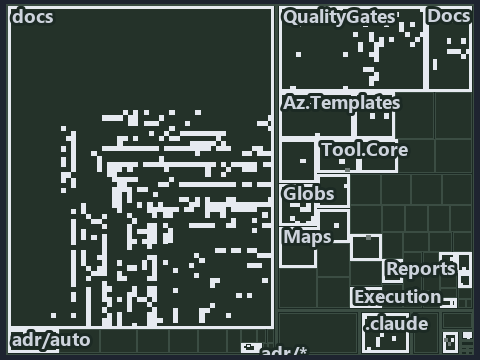

---
catzc:
  immutable:
    with_body_sha: cff531a8e717
    repo_status: locked
    path: docs/explanation/flow/.assets/drift-is-gated-generation-is-adr-only/tree.md
    source: docs/explanation/flow/.assets/drift-is-gated-generation-is-adr-only/diagram.drawio.png
    role: asset-description
    language: markdown
    filetype: md
    track: docs
    tracktype: documentation
---

# Three gates check the projection, while generation is held by the ADR alone: the tree minimap

```text
Which files cite ADR-AUTO-TEST and ADR-FLOW-CD-GLOBS: every file of the world map is a tile, grouped by top-level folder.
513 files lit in 25 groups.
```



This is the tree minimap in the sidebar of the governance diagram of [Three gates check the projection, while generation is held by the ADR
alone][514], which explains [ADR-AUTO-TEST][1] and [ADR-FLOW-CD-GLOBS][2]. It lights every file that cites those codes, grouped by folder,
so it shows which files carry the decision. Each lit group has its reason below, naming the code that selects it.

## What the minimap shows

The tree draws every file of the world map as a tile, grouped by top-level folder (under `pwsh/` by module, under `docs/adr/` by ADR
domain), and lights 513 files in 25 groups, filled in ink. A lit ADR file has a white rim; a file lit only by passing mentions is a lighter
ink. Every other tile is idle, a grey box: a file the slide's ADR codes do not select.

- docs (docs/ outside docs/adr/): 414 lit files
- QualityGates (pwsh/Catzc.Base.QualityGates): 37 lit files
- Docs (pwsh/Catzc.Base.Docs): 12 lit files
- Globs (pwsh/Catzc.Base.Globs): 11 lit files
- .claude: 8 lit files
- pipelines: 3 lit files
- Maps (pwsh/Catzc.Base.Maps): 3 lit files
- adr/* (the files directly in docs/adr/): 2 lit files
- adr/auto (docs/adr/automation): 2 lit files
- adr/flow (docs/adr/flow): 2 lit files
- Az.Templates (pwsh/Catzc.Azure.Templates): 2 lit files
- ModuleSystem (pwsh/Catzc.Base.ModuleSystem): 2 lit files
- Reports (pwsh/Catzc.Base.Reports): 2 lit files
- Tool.Core (pwsh/Catzc.Tooling.Core): 2 lit files
- Root files: 1 lit file
- .internal (pwsh/.internal): 1 lit file
- .scriptanalyzer (pwsh/.scriptanalyzer): 1 lit file
- Az.DevOps (pwsh/Catzc.Azure.DevOps): 1 lit file
- Contracts (pwsh/Catzc.Base.Contracts): 1 lit file
- Engines (pwsh/Catzc.Base.Engines): 1 lit file
- Environment (pwsh/Catzc.Base.Environment): 1 lit file
- Execution (pwsh/Catzc.Base.Execution): 1 lit file
- Modules (pwsh/Catzc.Base.Modules): 1 lit file
- RootConfig (pwsh/Catzc.Base.RootConfig): 1 lit file
- Tool.KeyHandler (pwsh/Catzc.Tooling.KeyHandler): 1 lit file

## Why each group is lit

### docs (docs/ outside docs/adr/, 414 lit files)

The group holds the files of docs/ outside docs/adr/; each sits in its world-map cell and is lit by:

- [docs/how-to/automation/apply-environment-approvals.md][3], in the cell docs × markdown: selected by [ADR-FLOW-CD-GLOBS][2]: the file
  cites it at line 4 (text).
- [docs/how-to/getting-started/pwsh/run-tests-and-checks.md][4], in the cell docs × markdown: selected by [ADR-AUTO-TEST][1]: the file cites
  it at line 31 (text).
- [docs/how-to/pwsh/manual-test-plan.md][5], in the cell docs × markdown: selected by [ADR-AUTO-TEST][1]: the file cites it at line 54
  (text) and line 61 (text).
- [docs/how-to/pwsh/manual-test-plan/azure.md][6], in the cell docs × markdown: selected by [ADR-AUTO-TEST][1]: the file cites it at line 15
  (text) and line 68 (text).
- [docs/how-to/pwsh/manual-test-plan/pipelines-and-globs.md][7], in the cell docs × markdown: selected by [ADR-FLOW-CD-GLOBS][2]: the file
  cites it at line 16 (text).
- [docs/how-to/pwsh/manual-test-plan/test-harness.md][8], in the cell docs × markdown: selected by [ADR-AUTO-TEST][1]: the file cites it at
  line 15 (text).
- [docs/references/pipelines/cd-apex.yaml.md][9], in the cell docs × markdown: selected by [ADR-FLOW-CD-GLOBS][2]: the file cites it at line
  31 (text).
- [docs/references/pipelines/cd-flux.yaml.md][10], in the cell docs × markdown: selected by [ADR-FLOW-CD-GLOBS][2]: the file cites it at
  line 30 (text).
- [docs/references/pipelines/cd-nova.yaml.md][11], in the cell docs × markdown: selected by [ADR-FLOW-CD-GLOBS][2]: the file cites it at
  line 30 (text).
- [docs/references/pipelines/cd-shared.yaml.md][12], in the cell docs × markdown: selected by [ADR-FLOW-CD-GLOBS][2]: the file cites it at
  line 22 (text).
- [docs/references/pipelines/ci-automation.yaml.md][13], in the cell docs × markdown: selected by [ADR-AUTO-TEST][1]: the file cites it at
  line 94 (text); selected by [ADR-FLOW-CD-GLOBS][2]: the file cites it at line 12 (text).
- [docs/references/pipelines/ci-infrastructure.yaml.md][14], in the cell docs × markdown: selected by [ADR-AUTO-TEST][1]: the file cites it
  at line 22 (text); selected by [ADR-FLOW-CD-GLOBS][2]: the file cites it at line 13 (text).
- [docs/references/pipelines/github-workflows/ci-automation.yml.md][15], in the cell docs × markdown: selected by [ADR-FLOW-CD-GLOBS][2]:
  the file cites it at line 12 (text).
- [docs/references/pwsh/.assets/invoke-executable-two-paths-one-bounded/diagram.drawio.md][16], in the cell docs × markdown: selected by
  [ADR-AUTO-TEST][1]: the file cites it at line 95 (text).
- [docs/references/pwsh/.assets/invoke-executable-two-paths-one-bounded/diagram.drawio.verify.md][17], in the cell docs × markdown: selected
  by [ADR-AUTO-TEST][1]: the file cites it at line 44 (text).
- [docs/references/pwsh/.assets/module-graph-declared-vs-observed/diagram.drawio.md][18], in the cell docs × markdown: selected by
  [ADR-AUTO-TEST][1]: the file cites it at line 39 (text), line 41 (text), line 104 (text) and line 104 (text).
- [docs/references/pwsh/.assets/module-graph-declared-vs-observed/diagram.drawio.verify.md][19], in the cell docs × markdown: selected by
  [ADR-AUTO-TEST][1]: the file cites it at line 53 (text) and line 53 (text).
- [docs/references/pwsh/.assets/protected-module-skip-by-hash/diagram.drawio.md][20], in the cell docs × markdown: selected by
  [ADR-FLOW-CD-GLOBS][2]: the file cites it at line 33 (text), line 108 (text) and line 108 (text).
- [docs/references/pwsh/.assets/protected-module-skip-by-hash/diagram.drawio.verify.md][21], in the cell docs × markdown: selected by
  [ADR-FLOW-CD-GLOBS][2]: the file cites it at line 55 (text) and line 55 (text).
- [docs/references/pwsh/.assets/test-automation-one-run-pipeline/diagram.drawio.md][22], in the cell docs × markdown: selected by
  [ADR-AUTO-TEST][1]: the file cites it at line 22 (text), line 25 (text), line 28 (text), line 96 (text), line 97 (text), line 97 (text)
  and line 102 (text).
- [docs/references/pwsh/.assets/test-automation-one-run-pipeline/diagram.drawio.verify.md][23], in the cell docs × markdown: selected by
  [ADR-AUTO-TEST][1]: the file cites it at line 17 (text), line 19 (text), line 48 (text), line 48 (text), line 48 (text) and line 61
  (text).
- [docs/references/pwsh/catzc-azure-devops-buildvalidation/Get-AdoBuildValidations.ps1.md][24], in the cell docs × markdown: selected by
  [ADR-FLOW-CD-GLOBS][2]: the file cites it at line 18 (text).
- [docs/references/pwsh/catzc-azure-devops-buildvalidation/Register-AdoBuildValidation.ps1.md][25], in the cell docs × markdown: selected by
  [ADR-FLOW-CD-GLOBS][2]: the file cites it at line 14 (text) and line 74 (text).
- [docs/references/pwsh/catzc-azure-devops-buildvalidation/Unregister-AdoBuildValidation.ps1.md][26], in the cell docs × markdown: selected
  by [ADR-FLOW-CD-GLOBS][2]: the file cites it at line 15 (text).
- [docs/references/pwsh/catzc-azure-devops-buildvalidation/configs/build-validation.yml.md][27], in the cell docs × markdown: selected by
  [ADR-FLOW-CD-GLOBS][2]: the file cites it at line 15 (text).
- [docs/references/pwsh/catzc-azure-devops-buildvalidation/private/Get-BuildValidationPathFilter.ps1.md][28], in the cell docs × markdown:
  selected by [ADR-FLOW-CD-GLOBS][2]: the file cites it at line 16 (text).
- [docs/references/pwsh/catzc-azure-devops-buildvalidation/tests/types/BuildValidationConfig.Tests.ps1.md][29], in the cell docs × markdown:
  selected by [ADR-AUTO-TEST][1]: the file cites it at line 24 (text).
- [docs/references/pwsh/catzc-azure-devops/Sync-AdoEnvironmentApprovals.ps1.md][30], in the cell docs × markdown: selected by
  [ADR-FLOW-CD-GLOBS][2]: the file cites it at line 15 (text).
- [docs/references/pwsh/catzc-azure-devops/Test-Pipelines.ps1.md][31], in the cell docs × markdown: selected by [ADR-AUTO-TEST][1]: the file
  cites it at line 16 (text).
- [docs/references/pwsh/catzc-azure-devops/configs/identity-tokens.yml.md][32], in the cell docs × markdown: selected by [ADR-AUTO-TEST][1]:
  the file cites it at line 12 (text).
- [docs/references/pwsh/catzc-azure-devops/tests/Get-AdoYamlFiles.Tests.ps1.md][33], in the cell docs × markdown: selected by
  [ADR-AUTO-TEST][1]: the file cites it at line 24 (text).
- [docs/references/pwsh/catzc-azure-templates/Get-BicepTemplatesOutputRoot.ps1.md][34], in the cell docs × markdown: selected by
  [ADR-AUTO-TEST][1]: the file cites it at line 18 (text).
- [docs/references/pwsh/catzc-azure-templates/tests/Assert-BicepTemplate.Tests.ps1.md][35], in the cell docs × markdown: selected by
  [ADR-AUTO-TEST][1]: the file cites it at line 26 (text).
- [docs/references/pwsh/catzc-azure-templates/tests/Build-Bicep.Integrity.Tests.ps1.md][36], in the cell docs × markdown: selected by
  [ADR-AUTO-TEST][1]: the file cites it at line 18 (text), line 20 (text) and line 23 (text).
- [docs/references/pwsh/catzc-azure-templates/tests/Build-Bicep.L2.Tests.ps1.md][37], in the cell docs × markdown: selected by
  [ADR-AUTO-TEST][1]: the file cites it at line 28 (text) and line 36 (text).
- [docs/references/pwsh/catzc-azure-templates/tests/Build-Bicep.SampleCustomer.Tests.ps1.md][38], in the cell docs × markdown: selected by
  [ADR-AUTO-TEST][1]: the file cites it at line 15 (text), line 15 (text), line 27 (text) and line 39 (text).
- [docs/references/pwsh/catzc-azure-templates/tests/Build-Bicep.SampleIndexed.Tests.ps1.md][39], in the cell docs × markdown: selected by
  [ADR-AUTO-TEST][1]: the file cites it at line 15 (text), line 15 (text) and line 35 (text).
- [docs/references/pwsh/catzc-azure-templates/tests/Build-Bicep.SampleSubscription.Tests.ps1.md][40], in the cell docs × markdown: selected
  by [ADR-AUTO-TEST][1]: the file cites it at line 13 (text), line 13 (text), line 25 (text) and line 37 (text).
- [docs/references/pwsh/catzc-azure-templates/tests/Build-Bicep.SampleWithModule.Tests.ps1.md][41], in the cell docs × markdown: selected by
  [ADR-AUTO-TEST][1]: the file cites it at line 15 (text), line 15 (text), line 27 (text) and line 39 (text).
- [docs/references/pwsh/catzc-azure-templates/tests/Build-Bicep.SampleWithPrepost.Tests.ps1.md][42], in the cell docs × markdown: selected
  by [ADR-AUTO-TEST][1]: the file cites it at line 21 (text) and line 30 (text).
- [docs/references/pwsh/catzc-azure-templates/tests/Build-Bicep.Tests.ps1.md][43], in the cell docs × markdown: selected by
  [ADR-AUTO-TEST][1]: the file cites it at line 15 (text), line 15 (text), line 25 (text) and line 35 (text).
- [docs/references/pwsh/catzc-azure-templates/tests/Deploy-Bicep.SampleSubscription.Tests.ps1.md][44], in the cell docs × markdown: selected
  by [ADR-AUTO-TEST][1]: the file cites it at line 22 (text), line 40 (text) and line 49 (text).
- [docs/references/pwsh/catzc-azure-templates/tests/Deploy-Bicep.Tests.ps1.md][45], in the cell docs × markdown: selected by
  [ADR-AUTO-TEST][1]: the file cites it at line 57 (text), line 57 (text) and line 67 (text).
- [docs/references/pwsh/catzc-azure-templates/tests/Get-BicepDeploymentContext.Tests.ps1.md][46], in the cell docs × markdown: selected by
  [ADR-AUTO-TEST][1]: the file cites it at line 15 (text), line 15 (text), line 26 (text) and line 56 (text).
- [docs/references/pwsh/catzc-azure-templates/tests/Get-BicepParameterModel.Shipped.Tests.ps1.md][47], in the cell docs × markdown: selected
  by [ADR-AUTO-TEST][1]: the file cites it at line 19 (text), line 22 (text), line 25 (text), line 30 (text) and line 39 (text).
- [docs/references/pwsh/catzc-azure-templates/tests/Get-BicepParameterModel.Tests.ps1.md][48], in the cell docs × markdown: selected by
  [ADR-AUTO-TEST][1]: the file cites it at line 13 (text).
- [docs/references/pwsh/catzc-azure-templates/tests/Get-BicepParameterViolations.Tests.ps1.md][49], in the cell docs × markdown: selected by
  [ADR-AUTO-TEST][1]: the file cites it at line 13 (text).
- [docs/references/pwsh/catzc-azure-templates/tests/Get-BicepResourceGroupName.Tests.ps1.md][50], in the cell docs × markdown: selected by
  [ADR-AUTO-TEST][1]: the file cites it at line 13 (text) and line 13 (text).
- [docs/references/pwsh/catzc-azure-templates/tests/Get-BicepResourceName.Tests.ps1.md][51], in the cell docs × markdown: selected by
  [ADR-AUTO-TEST][1]: the file cites it at line 17 (text) and line 17 (text).
- [docs/references/pwsh/catzc-azure-templates/tests/Get-BicepTemplate.Tests.ps1.md][52], in the cell docs × markdown: selected by
  [ADR-AUTO-TEST][1]: the file cites it at line 13 (text) and line 13 (text).
- [docs/references/pwsh/catzc-azure-templates/tests/Get-BicepTemplateConfiguration.Tests.ps1.md][53], in the cell docs × markdown: selected
  by [ADR-AUTO-TEST][1]: the file cites it at line 15 (text) and line 15 (text).
- [docs/references/pwsh/catzc-azure-templates/tests/Get-BicepTemplateCustomers.Tests.ps1.md][54], in the cell docs × markdown: selected by
  [ADR-AUTO-TEST][1]: the file cites it at line 13 (text), line 13 (text), line 23 (text) and line 23 (text).
- [docs/references/pwsh/catzc-azure-templates/tests/Get-BicepTemplateNames.Tests.ps1.md][55], in the cell docs × markdown: selected by
  [ADR-AUTO-TEST][1]: the file cites it at line 13 (text) and line 13 (text).
- [docs/references/pwsh/catzc-azure-templates/tests/Get-BicepTemplateSlots.Tests.ps1.md][56], in the cell docs × markdown: selected by
  [ADR-AUTO-TEST][1]: the file cites it at line 13 (text), line 13 (text), line 32 (text) and line 32 (text).
- [docs/references/pwsh/catzc-azure-templates/tests/Get-BicepTemplates.Tests.ps1.md][57], in the cell docs × markdown: selected by
  [ADR-AUTO-TEST][1]: the file cites it at line 17 (text) and line 17 (text).
- [docs/references/pwsh/catzc-azure-templates/tests/Get-BicepTrackTagNameSet.Tests.ps1.md][58], in the cell docs × markdown: selected by
  [ADR-AUTO-TEST][1]: the file cites it at line 13 (text) and line 13 (text).
- [docs/references/pwsh/catzc-azure-templates/tests/Resolve-BicepParameterAddresses.Tests.ps1.md][59], in the cell docs × markdown: selected
  by [ADR-AUTO-TEST][1]: the file cites it at line 12 (text).
- [docs/references/pwsh/catzc-azure-templates/tests/Set-BicepTemplateConfiguration.Tests.ps1.md][60], in the cell docs × markdown: selected
  by [ADR-AUTO-TEST][1]: the file cites it at line 57 (text).
- [docs/references/pwsh/catzc-azure-templates/tests/types/BicepShortName.Tests.ps1.md][61], in the cell docs × markdown: selected by
  [ADR-AUTO-TEST][1]: the file cites it at line 16 (text).
- [docs/references/pwsh/catzc-azure/Test-AzureNetworkPlan.ps1.md][62], in the cell docs × markdown: selected by [ADR-AUTO-TEST][1]: the file
  cites it at line 14 (text).
- [docs/references/pwsh/catzc-azure/configs/identity-tokens.yml.md][63], in the cell docs × markdown: selected by [ADR-AUTO-TEST][1]: the
  file cites it at line 13 (text).
- [docs/references/pwsh/catzc-azure/tests/Get-AzureBicepMinVersion.Tests.ps1.md][64], in the cell docs × markdown: selected by
  [ADR-AUTO-TEST][1]: the file cites it at line 13 (text) and line 13 (text).
- [docs/references/pwsh/catzc-azure/tests/Get-AzureCustomer.Tests.ps1.md][65], in the cell docs × markdown: selected by [ADR-AUTO-TEST][1]:
  the file cites it at line 13 (text).
- [docs/references/pwsh/catzc-azure/tests/Get-AzureCustomers.Tests.ps1.md][66], in the cell docs × markdown: selected by [ADR-AUTO-TEST][1]:
  the file cites it at line 13 (text) and line 13 (text).
- [docs/references/pwsh/catzc-azure/tests/Get-AzureEnvironment.Tests.ps1.md][67], in the cell docs × markdown: selected by
  [ADR-AUTO-TEST][1]: the file cites it at line 13 (text) and line 13 (text).
- [docs/references/pwsh/catzc-azure/tests/Get-AzureSubscription.Tests.ps1.md][68], in the cell docs × markdown: selected by
  [ADR-AUTO-TEST][1]: the file cites it at line 13 (text) and line 13 (text).
- [docs/references/pwsh/catzc-azure/tests/Get-AzureSubscriptionEnvironment.Tests.ps1.md][69], in the cell docs × markdown: selected by
  [ADR-AUTO-TEST][1]: the file cites it at line 13 (text) and line 13 (text).
- [docs/references/pwsh/catzc-azure/tests/Test-AzureNetworkPlan.Tests.ps1.md][70], in the cell docs × markdown: selected by
  [ADR-AUTO-TEST][1]: the file cites it at line 14 (text).
- [docs/references/pwsh/catzc-azure/tests/types/AzureConfig.Tests.ps1.md][71], in the cell docs × markdown: selected by [ADR-AUTO-TEST][1]:
  the file cites it at line 15 (text) and line 16 (text).
- [docs/references/pwsh/catzc-azure/tests/types/NetworkConfig.Tests.ps1.md][72], in the cell docs × markdown: selected by
  [ADR-AUTO-TEST][1]: the file cites it at line 14 (text) and line 15 (text).
- [docs/references/pwsh/catzc-base-config/tests/Config-Conventions.Tests.ps1.md][73], in the cell docs × markdown: selected by
  [ADR-AUTO-TEST][1]: the file cites it at line 22 (text).
- [docs/references/pwsh/catzc-base-config/tests/Get-Config.Tests.ps1.md][74], in the cell docs × markdown: selected by [ADR-AUTO-TEST][1]:
  the file cites it at line 12 (text), line 23 (text), line 26 (text) and line 44 (text).
- [docs/references/pwsh/catzc-base-config/tests/Get-ConfigValue.Tests.ps1.md][75], in the cell docs × markdown: selected by
  [ADR-AUTO-TEST][1]: the file cites it at line 22 (text).
- [docs/references/pwsh/catzc-base-configextensions/Test-ConfigValidators.ps1.md][76], in the cell docs × markdown: selected by
  [ADR-AUTO-TEST][1]: the file cites it at line 14 (text).
- [docs/references/pwsh/catzc-base-configextensions/tests/Invoke-ConfigValidator.Tests.ps1.md][77], in the cell docs × markdown: selected by
  [ADR-AUTO-TEST][1]: the file cites it at line 12 (text).
- [docs/references/pwsh/catzc-base-configextensions/tests/Test-ConfigValidators.Tests.ps1.md][78], in the cell docs × markdown: selected by
  [ADR-AUTO-TEST][1]: the file cites it at line 13 (text).
- [docs/references/pwsh/catzc-base-contracts/Test-Contracts.ps1.md][79], in the cell docs × markdown: selected by [ADR-AUTO-TEST][1]: the
  file cites it at line 17 (text).
- [docs/references/pwsh/catzc-base-contracts/tests/Build-ContractReference.Tests.ps1.md][80], in the cell docs × markdown: selected by
  [ADR-AUTO-TEST][1]: the file cites it at line 14 (text).
- [docs/references/pwsh/catzc-base-contracts/tests/ConvertTo-ContractNoteMarkdown.Tests.ps1.md][81], in the cell docs × markdown: selected
  by [ADR-AUTO-TEST][1]: the file cites it at line 15 (text).
- [docs/references/pwsh/catzc-base-contracts/tests/Get-ContractAssetNote.Tests.ps1.md][82], in the cell docs × markdown: selected by
  [ADR-AUTO-TEST][1]: the file cites it at line 14 (text).
- [docs/references/pwsh/catzc-base-contracts/tests/Get-ContractCheckResults.Assets.Tests.ps1.md][83], in the cell docs × markdown: selected
  by [ADR-AUTO-TEST][1]: the file cites it at line 27 (text).
- [docs/references/pwsh/catzc-base-contracts/tests/Get-ContractFreezeFindings.Tests.ps1.md][84], in the cell docs × markdown: selected by
  [ADR-AUTO-TEST][1]: the file cites it at line 13 (text).
- [docs/references/pwsh/catzc-base-contracts/tests/Publish-ContractRelease.Tests.ps1.md][85], in the cell docs × markdown: selected by
  [ADR-AUTO-TEST][1]: the file cites it at line 14 (text).
- [docs/references/pwsh/catzc-base-contracts/tests/Test-Contracts.Tests.ps1.md][86], in the cell docs × markdown: selected by
  [ADR-AUTO-TEST][1]: the file cites it at line 15 (text) and line 17 (text).
- [docs/references/pwsh/catzc-base-docs.md][87], in the cell docs × markdown: selected by [ADR-AUTO-TEST][1]: the file cites it at line 32
  (text).
- [docs/references/pwsh/catzc-base-docs/Test-AdrEngineNeutrality.ps1.md][88], in the cell docs × markdown: selected by [ADR-AUTO-TEST][1]:
  the file cites it at line 14 (text).
- [docs/references/pwsh/catzc-base-docs/Test-AdrRegistry.ps1.md][89], in the cell docs × markdown: selected by [ADR-AUTO-TEST][1]: the file
  cites it at line 14 (text).
- [docs/references/pwsh/catzc-base-docs/Test-AgentDefinitions.ps1.md][90], in the cell docs × markdown: selected by [ADR-AUTO-TEST][1]: the
  file cites it at line 14 (text).
- [docs/references/pwsh/catzc-base-docs/Test-GeneratedReadmes.ps1.md][91], in the cell docs × markdown: selected by [ADR-AUTO-TEST][1]: the
  file cites it at line 14 (text).
- [docs/references/pwsh/catzc-base-docs/Test-Glossary.ps1.md][92], in the cell docs × markdown: selected by [ADR-AUTO-TEST][1]: the file
  cites it at line 25 (text).
- [docs/references/pwsh/catzc-base-docs/configs/adr-checks.yml.md][93], in the cell docs × markdown: selected by [ADR-AUTO-TEST][1]: the
  file cites it at line 16 (text).
- [docs/references/pwsh/catzc-base-docs/private/Get-GlossaryRuleStatements.ps1.md][94], in the cell docs × markdown: selected by
  [ADR-AUTO-TEST][1]: the file cites it at line 31 (text).
- [docs/references/pwsh/catzc-base-docs/tests/Build-Glossary.Tests.ps1.md][95], in the cell docs × markdown: selected by [ADR-AUTO-TEST][1]:
  the file cites it at line 14 (text).
- [docs/references/pwsh/catzc-base-docs/tests/ConvertTo-AdrDomainDiagram.Tests.ps1.md][96], in the cell docs × markdown: selected by
  [ADR-AUTO-TEST][1]: the file cites it at line 12 (text).
- [docs/references/pwsh/catzc-base-docs/tests/Get-AdrCitationGraphViolations.Tests.ps1.md][97], in the cell docs × markdown: selected by
  [ADR-AUTO-TEST][1]: the file cites it at line 13 (text).
- [docs/references/pwsh/catzc-base-docs/tests/Get-AdrCitationMap.Tests.ps1.md][98], in the cell docs × markdown: selected by
  [ADR-AUTO-TEST][1]: the file cites it at line 14 (text).
- [docs/references/pwsh/catzc-base-docs/tests/Get-AdrDomainEdges.Tests.ps1.md][99], in the cell docs × markdown: selected by
  [ADR-AUTO-TEST][1]: the file cites it at line 13 (text).
- [docs/references/pwsh/catzc-base-docs/tests/Get-AdrDoraCoverageViolations.Tests.ps1.md][100], in the cell docs × markdown: selected by
  [ADR-AUTO-TEST][1]: the file cites it at line 13 (text).
- [docs/references/pwsh/catzc-base-docs/tests/Get-AdrFileIndex.Tests.ps1.md][101], in the cell docs × markdown: selected by
  [ADR-AUTO-TEST][1]: the file cites it at line 13 (text).
- [docs/references/pwsh/catzc-base-docs/tests/Get-AdrRuleSet.Tests.ps1.md][102], in the cell docs × markdown: selected by
  [ADR-AUTO-TEST][1]: the file cites it at line 13 (text) and line 22 (text).
- [docs/references/pwsh/catzc-base-docs/tests/Get-AdrRuleSummaryLines.Tests.ps1.md][103], in the cell docs × markdown: selected by
  [ADR-AUTO-TEST][1]: the file cites it at line 12 (text).
- [docs/references/pwsh/catzc-base-docs/tests/Get-AgentFrontMatter.Tests.ps1.md][104], in the cell docs × markdown: selected by
  [ADR-AUTO-TEST][1]: the file cites it at line 12 (text).
- [docs/references/pwsh/catzc-base-docs/tests/Get-CatsRuleEnforcers.Tests.ps1.md][105], in the cell docs × markdown: selected by
  [ADR-AUTO-TEST][1]: the file cites it at line 14 (text).
- [docs/references/pwsh/catzc-base-docs/tests/Get-ClaudeMdAgentNames.Tests.ps1.md][106], in the cell docs × markdown: selected by
  [ADR-AUTO-TEST][1]: the file cites it at line 12 (text).
- [docs/references/pwsh/catzc-base-docs/tests/Get-Glossary.Tests.ps1.md][107], in the cell docs × markdown: selected by [ADR-AUTO-TEST][1]:
  the file cites it at line 16 (text).
- [docs/references/pwsh/catzc-base-docs/tests/Get-GlossaryAnchorViolations.Tests.ps1.md][108], in the cell docs × markdown: selected by
  [ADR-AUTO-TEST][1]: the file cites it at line 16 (text).
- [docs/references/pwsh/catzc-base-docs/tests/Get-GlossaryDefinitionViolations.Tests.ps1.md][109], in the cell docs × markdown: selected by
  [ADR-AUTO-TEST][1]: the file cites it at line 15 (text).
- [docs/references/pwsh/catzc-base-docs/tests/Get-GlossaryEnforcementViolations.Tests.ps1.md][110], in the cell docs × markdown: selected by
  [ADR-AUTO-TEST][1]: the file cites it at line 16 (text).
- [docs/references/pwsh/catzc-base-docs/tests/Get-GlossaryFormViolations.Tests.ps1.md][111], in the cell docs × markdown: selected by
  [ADR-AUTO-TEST][1]: the file cites it at line 15 (text).
- [docs/references/pwsh/catzc-base-docs/tests/Get-GlossaryPhrasingViolations.Tests.ps1.md][112], in the cell docs × markdown: selected by
  [ADR-AUTO-TEST][1]: the file cites it at line 16 (text).
- [docs/references/pwsh/catzc-base-docs/tests/Get-GlossaryRuleStatements.Tests.ps1.md][113], in the cell docs × markdown: selected by
  [ADR-AUTO-TEST][1]: the file cites it at line 14 (text).
- [docs/references/pwsh/catzc-base-docs/tests/Get-GlossarySourceViolations.Tests.ps1.md][114], in the cell docs × markdown: selected by
  [ADR-AUTO-TEST][1]: the file cites it at line 15 (text).
- [docs/references/pwsh/catzc-base-docs/tests/Get-GlossarySources.Tests.ps1.md][115], in the cell docs × markdown: selected by
  [ADR-AUTO-TEST][1]: the file cites it at line 16 (text).
- [docs/references/pwsh/catzc-base-docs/tests/Resolve-AdrLinkTarget.Tests.ps1.md][116], in the cell docs × markdown: selected by
  [ADR-AUTO-TEST][1]: the file cites it at line 13 (text).
- [docs/references/pwsh/catzc-base-docs/tests/Test-AdrEngineNeutrality.Tests.ps1.md][117], in the cell docs × markdown: selected by
  [ADR-AUTO-TEST][1]: the file cites it at line 13 (text).
- [docs/references/pwsh/catzc-base-docs/tests/Test-AdrRegistry.Tests.ps1.md][118], in the cell docs × markdown: selected by
  [ADR-AUTO-TEST][1]: the file cites it at line 8 (text) and line 13 (text).
- [docs/references/pwsh/catzc-base-docs/tests/Test-AgentDefinitions.Tests.ps1.md][119], in the cell docs × markdown: selected by
  [ADR-AUTO-TEST][1]: the file cites it at line 13 (text).
- [docs/references/pwsh/catzc-base-docs/tests/Test-GeneratedReadmes.Tests.ps1.md][120], in the cell docs × markdown: selected by
  [ADR-AUTO-TEST][1]: the file cites it at line 13 (text).
- [docs/references/pwsh/catzc-base-docs/tests/Test-Glossary.Tests.ps1.md][121], in the cell docs × markdown: selected by [ADR-AUTO-TEST][1]:
  the file cites it at line 25 (text) and line 26 (text).
- [docs/references/pwsh/catzc-base-docs/tests/Update-AdrCitation.Tests.ps1.md][122], in the cell docs × markdown: selected by
  [ADR-AUTO-TEST][1]: the file cites it at line 13 (text).
- [docs/references/pwsh/catzc-base-docs/tests/types/AdrChecksConfig.Tests.ps1.md][123], in the cell docs × markdown: selected by
  [ADR-AUTO-TEST][1]: the file cites it at line 12 (text).
- [docs/references/pwsh/catzc-base-docs/tests/types/AdrDomainEdge.Tests.ps1.md][124], in the cell docs × markdown: selected by
  [ADR-AUTO-TEST][1]: the file cites it at line 12 (text).
- [docs/references/pwsh/catzc-base-docs/tests/types/AgentEntry.Tests.ps1.md][125], in the cell docs × markdown: selected by
  [ADR-AUTO-TEST][1]: the file cites it at line 13 (text).
- [docs/references/pwsh/catzc-base-docs/tests/types/AgentsConfig.Tests.ps1.md][126], in the cell docs × markdown: selected by
  [ADR-AUTO-TEST][1]: the file cites it at line 13 (text).
- [docs/references/pwsh/catzc-base-docs/tests/types/CheckModes.Tests.ps1.md][127], in the cell docs × markdown: selected by
  [ADR-AUTO-TEST][1]: the file cites it at line 13 (text).
- [docs/references/pwsh/catzc-base-docs/tests/types/GlossaryConfig.Tests.ps1.md][128], in the cell docs × markdown: selected by
  [ADR-AUTO-TEST][1]: the file cites it at line 15 (text).
- [docs/references/pwsh/catzc-base-docs/tests/types/GlossaryEntry.Tests.ps1.md][129], in the cell docs × markdown: selected by
  [ADR-AUTO-TEST][1]: the file cites it at line 13 (text).
- [docs/references/pwsh/catzc-base-docs/types/AdrChecksConfig.cs.md][130], in the cell docs × markdown: selected by [ADR-AUTO-TEST][1]: the
  file cites it at line 23 (text).
- [docs/references/pwsh/catzc-base-docs/types/AdrsConfig.cs.md][131], in the cell docs × markdown: selected by [ADR-FLOW-CD-GLOBS][2]: the
  file cites it at line 28 (text), line 29 (text), line 57 (text) and line 58 (text).
- [docs/references/pwsh/catzc-base-docs/types/CheckMode.cs.md][132], in the cell docs × markdown: selected by [ADR-AUTO-TEST][1]: the file
  cites it at line 15 (text).
- [docs/references/pwsh/catzc-base-docs/types/GlossaryConcept.cs.md][133], in the cell docs × markdown: selected by [ADR-AUTO-TEST][1]: the
  file cites it at line 33 (text).
- [docs/references/pwsh/catzc-base-execution/Invoke-Executable.ps1.md][134], in the cell docs × markdown: selected by [ADR-AUTO-TEST][1]:
  the file cites it at line 136 (text).
- [docs/references/pwsh/catzc-base-execution/tests/Find-Executable.Tests.ps1.md][135], in the cell docs × markdown: selected by
  [ADR-AUTO-TEST][1]: the file cites it at line 14 (text).
- [docs/references/pwsh/catzc-base-execution/tests/Get-ExecutableVersion.Tests.ps1.md][136], in the cell docs × markdown: selected by
  [ADR-AUTO-TEST][1]: the file cites it at line 13 (text).
- [docs/references/pwsh/catzc-base-execution/tests/Resolve-EngineExecutable.Tests.ps1.md][137], in the cell docs × markdown: selected by
  [ADR-AUTO-TEST][1]: the file cites it at line 13 (text).
- [docs/references/pwsh/catzc-base-execution/tests/Resolve-ToolExecutable.Tests.ps1.md][138], in the cell docs × markdown: selected by
  [ADR-AUTO-TEST][1]: the file cites it at line 14 (text).
- [docs/references/pwsh/catzc-base-execution/tests/types/CliRunner.Tests.ps1.md][139], in the cell docs × markdown: selected by
  [ADR-AUTO-TEST][1]: the file cites it at line 13 (text).
- [docs/references/pwsh/catzc-base-execution/tests/types/ExecutableProbe.Tests.ps1.md][140], in the cell docs × markdown: selected by
  [ADR-AUTO-TEST][1]: the file cites it at line 12 (text).
- [docs/references/pwsh/catzc-base-execution/tests/types/ToolConfig.Tests.ps1.md][141], in the cell docs × markdown: selected by
  [ADR-AUTO-TEST][1]: the file cites it at line 13 (text).
- [docs/references/pwsh/catzc-base-execution/tests/types/ToolsConfig.Tests.ps1.md][142], in the cell docs × markdown: selected by
  [ADR-AUTO-TEST][1]: the file cites it at line 12 (text), line 21 (text) and line 23 (text).
- [docs/references/pwsh/catzc-base-exporter/Get-CatzcContentHash.ps1.md][143], in the cell docs × markdown: selected by
  [ADR-FLOW-CD-GLOBS][2]: the file cites it at line 15 (text).
- [docs/references/pwsh/catzc-base-exporter/tests/Assert-CatzcBundle.Tests.ps1.md][144], in the cell docs × markdown: selected by
  [ADR-AUTO-TEST][1]: the file cites it at line 14 (text).
- [docs/references/pwsh/catzc-base-exporter/tests/Install-Catzc.Tests.ps1.md][145], in the cell docs × markdown: selected by
  [ADR-AUTO-TEST][1]: the file cites it at line 12 (text).
- [docs/references/pwsh/catzc-base-exporter/tests/New-CatzcNuGetPackage.Tests.ps1.md][146], in the cell docs × markdown: selected by
  [ADR-AUTO-TEST][1]: the file cites it at line 14 (text) and line 16 (text).
- [docs/references/pwsh/catzc-base-files/tests/Get-GitChangedPath.Tests.ps1.md][147], in the cell docs × markdown: selected by
  [ADR-AUTO-TEST][1]: the file cites it at line 12 (text).
- [docs/references/pwsh/catzc-base-globs.md][148], in the cell docs × markdown: selected by [ADR-AUTO-TEST][1]: the file cites it at line 42
  (text); selected by [ADR-FLOW-CD-GLOBS][2]: the file cites it at line 28 (text).
- [docs/references/pwsh/catzc-base-globs/Get-ChangedGlobSet.ps1.md][149], in the cell docs × markdown: selected by [ADR-FLOW-CD-GLOBS][2]:
  the file cites it at line 15 (text) and line 27 (text).
- [docs/references/pwsh/catzc-base-globs/Get-GlobSet.ps1.md][150], in the cell docs × markdown: selected by [ADR-FLOW-CD-GLOBS][2]: the file
  cites it at line 15 (text).
- [docs/references/pwsh/catzc-base-globs/Get-GlobSetChangeRange.ps1.md][151], in the cell docs × markdown: selected by
  [ADR-FLOW-CD-GLOBS][2]: the file cites it at line 26 (text).
- [docs/references/pwsh/catzc-base-globs/Get-GlobSetFile.ps1.md][152], in the cell docs × markdown: selected by [ADR-FLOW-CD-GLOBS][2]: the
  file cites it at line 15 (text) and line 17 (text).
- [docs/references/pwsh/catzc-base-globs/Get-GlobSetHash.ps1.md][153], in the cell docs × markdown: selected by [ADR-FLOW-CD-GLOBS][2]: the
  file cites it at line 20 (text).
- [docs/references/pwsh/catzc-base-globs/Get-GlobSetTrigger.ps1.md][154], in the cell docs × markdown: selected by [ADR-FLOW-CD-GLOBS][2]:
  the file cites it at line 15 (text), line 30 (text) and line 31 (text).
- [docs/references/pwsh/catzc-base-globs/Get-MarkerBlastRadius.ps1.md][155], in the cell docs × markdown: selected by
  [ADR-FLOW-CD-GLOBS][2]: the file cites it at line 15 (text).
- [docs/references/pwsh/catzc-base-globs/Get-ModuleGlobSet.ps1.md][156], in the cell docs × markdown: selected by [ADR-FLOW-CD-GLOBS][2]:
  the file cites it at line 58 (text), line 61 (text) and line 109 (text).
- [docs/references/pwsh/catzc-base-globs/Get-TrackedFile.ps1.md][157], in the cell docs × markdown: selected by [ADR-FLOW-CD-GLOBS][2]: the
  file cites it at line 15 (text).
- [docs/references/pwsh/catzc-base-globs/Test-AdoPipelineTriggerGlob.ps1.md][158], in the cell docs × markdown: selected by
  [ADR-AUTO-TEST][1]: the file cites it at line 21 (text); selected by [ADR-FLOW-CD-GLOBS][2]: the file cites it at line 24 (text) and line
  25 (text).
- [docs/references/pwsh/catzc-base-globs/Test-GitHubWorkflowTriggerGlob.ps1.md][159], in the cell docs × markdown: selected by
  [ADR-AUTO-TEST][1]: the file cites it at line 21 (text); selected by [ADR-FLOW-CD-GLOBS][2]: the file cites it at line 24 (text) and line
  25 (text).
- [docs/references/pwsh/catzc-base-globs/Test-GlobSetAffected.ps1.md][160], in the cell docs × markdown: selected by [ADR-FLOW-CD-GLOBS][2]:
  the file cites it at line 17 (text) and line 20 (text).
- [docs/references/pwsh/catzc-base-globs/Test-GlobSetIndependence.ps1.md][161], in the cell docs × markdown: selected by [ADR-AUTO-TEST][1]:
  the file cites it at line 23 (text); selected by [ADR-FLOW-CD-GLOBS][2]: the file cites it at line 18 (text), line 56 (text) and line 66
  (text).
- [docs/references/pwsh/catzc-base-globs/Test-GlobSetTriggerCoverage.ps1.md][162], in the cell docs × markdown: selected by
  [ADR-AUTO-TEST][1]: the file cites it at line 14 (text); selected by [ADR-FLOW-CD-GLOBS][2]: the file cites it at line 16 (text).
- [docs/references/pwsh/catzc-base-globs/configs/globs.yml.md][163], in the cell docs × markdown: selected by [ADR-FLOW-CD-GLOBS][2]: the
  file cites it at line 12 (text), line 17 (text), line 25 (text), line 27 (text), line 41 (text), line 71 (text) and line 85 (text).
- [docs/references/pwsh/catzc-base-globs/private/Get-ChangedFile.ps1.md][164], in the cell docs × markdown: selected by
  [ADR-FLOW-CD-GLOBS][2]: the file cites it at line 15 (text).
- [docs/references/pwsh/catzc-base-globs/private/Get-GlobSetMember.ps1.md][165], in the cell docs × markdown: selected by
  [ADR-FLOW-CD-GLOBS][2]: the file cites it at line 15 (text).
- [docs/references/pwsh/catzc-base-globs/private/Get-PipelineTrigger.ps1.md][166], in the cell docs × markdown: selected by
  [ADR-FLOW-CD-GLOBS][2]: the file cites it at line 16 (text).
- [docs/references/pwsh/catzc-base-globs/private/Test-GlobListEqual.ps1.md][167], in the cell docs × markdown: selected by
  [ADR-FLOW-CD-GLOBS][2]: the file cites it at line 18 (text).
- [docs/references/pwsh/catzc-base-globs/tests/Get-ChangedFile.Tests.ps1.md][168], in the cell docs × markdown: selected by
  [ADR-FLOW-CD-GLOBS][2]: the file cites it at line 13 (text).
- [docs/references/pwsh/catzc-base-globs/tests/Get-ChangedGlobSet.Tests.ps1.md][169], in the cell docs × markdown: selected by
  [ADR-AUTO-TEST][1]: the file cites it at line 22 (text); selected by [ADR-FLOW-CD-GLOBS][2]: the file cites it at line 12 (text).
- [docs/references/pwsh/catzc-base-globs/tests/Get-GlobSet.Tests.ps1.md][170], in the cell docs × markdown: selected by [ADR-AUTO-TEST][1]:
  the file cites it at line 13 (text).
- [docs/references/pwsh/catzc-base-globs/tests/Get-GlobSetFile.Tests.ps1.md][171], in the cell docs × markdown: selected by
  [ADR-FLOW-CD-GLOBS][2]: the file cites it at line 12 (text) and line 13 (text).
- [docs/references/pwsh/catzc-base-globs/tests/Get-GlobSetHash.Tests.ps1.md][172], in the cell docs × markdown: selected by
  [ADR-FLOW-CD-GLOBS][2]: the file cites it at line 13 (text).
- [docs/references/pwsh/catzc-base-globs/tests/Get-GlobSetMember.Tests.ps1.md][173], in the cell docs × markdown: selected by
  [ADR-FLOW-CD-GLOBS][2]: the file cites it at line 12 (text).
- [docs/references/pwsh/catzc-base-globs/tests/Get-GlobSetTrigger.Tests.ps1.md][174], in the cell docs × markdown: selected by
  [ADR-FLOW-CD-GLOBS][2]: the file cites it at line 12 (text).
- [docs/references/pwsh/catzc-base-globs/tests/Get-ModuleGlobSet.Tests.ps1.md][175], in the cell docs × markdown: selected by
  [ADR-AUTO-TEST][1]: the file cites it at line 23 (text).
- [docs/references/pwsh/catzc-base-globs/tests/Get-PipelineTrigger.Tests.ps1.md][176], in the cell docs × markdown: selected by
  [ADR-FLOW-CD-GLOBS][2]: the file cites it at line 12 (text).
- [docs/references/pwsh/catzc-base-globs/tests/Get-TrackedFile.Tests.ps1.md][177], in the cell docs × markdown: selected by
  [ADR-FLOW-CD-GLOBS][2]: the file cites it at line 11 (text).
- [docs/references/pwsh/catzc-base-globs/tests/GlobSet-Independence.Tests.ps1.md][178], in the cell docs × markdown: selected by
  [ADR-FLOW-CD-GLOBS][2]: the file cites it at line 12 (text).
- [docs/references/pwsh/catzc-base-globs/tests/GlobSetTrigger-Coverage.Tests.ps1.md][179], in the cell docs × markdown: selected by
  [ADR-AUTO-TEST][1]: the file cites it at line 13 (text); selected by [ADR-FLOW-CD-GLOBS][2]: the file cites it at line 12 (text).
- [docs/references/pwsh/catzc-base-globs/tests/PipelineTrigger-Integrity.Tests.ps1.md][180], in the cell docs × markdown: selected by
  [ADR-FLOW-CD-GLOBS][2]: the file cites it at line 13 (text).
- [docs/references/pwsh/catzc-base-globs/tests/Test-AdoPipelineTriggerGlob.Tests.ps1.md][181], in the cell docs × markdown: selected by
  [ADR-AUTO-TEST][1]: the file cites it at line 12 (text).
- [docs/references/pwsh/catzc-base-globs/tests/Test-GitHubWorkflowTriggerGlob.Tests.ps1.md][182], in the cell docs × markdown: selected by
  [ADR-AUTO-TEST][1]: the file cites it at line 12 (text) and line 14 (text).
- [docs/references/pwsh/catzc-base-globs/tests/Test-GlobSetAffected.Tests.ps1.md][183], in the cell docs × markdown: selected by
  [ADR-AUTO-TEST][1]: the file cites it at line 22 (text).
- [docs/references/pwsh/catzc-base-globs/tests/Test-GlobSetIndependence.Tests.ps1.md][184], in the cell docs × markdown: selected by
  [ADR-AUTO-TEST][1]: the file cites it at line 12 (text) and line 15 (text); selected by [ADR-FLOW-CD-GLOBS][2]: the file cites it at line
  13 (text).
- [docs/references/pwsh/catzc-base-globs/tests/Test-GlobSetTriggerCoverage.Tests.ps1.md][185], in the cell docs × markdown: selected by
  [ADR-AUTO-TEST][1]: the file cites it at line 12 (text).
- [docs/references/pwsh/catzc-base-globs/tests/types/GlobPattern.Tests.ps1.md][186], in the cell docs × markdown: selected by
  [ADR-FLOW-CD-GLOBS][2]: the file cites it at line 11 (text) and line 13 (text).
- [docs/references/pwsh/catzc-base-globs/tests/types/GlobSet.Tests.ps1.md][187], in the cell docs × markdown: selected by
  [ADR-FLOW-CD-GLOBS][2]: the file cites it at line 12 (text) and line 14 (text).
- [docs/references/pwsh/catzc-base-globs/tests/types/GlobsConfig.Tests.ps1.md][188], in the cell docs × markdown: selected by
  [ADR-AUTO-TEST][1]: the file cites it at line 35 (text); selected by [ADR-FLOW-CD-GLOBS][2]: the file cites it at line 14 (text), line 16
  (text) and line 25 (text).
- [docs/references/pwsh/catzc-base-globs/types/Aspect.cs.md][189], in the cell docs × markdown: selected by [ADR-FLOW-CD-GLOBS][2]: the file
  cites it at line 19 (text).
- [docs/references/pwsh/catzc-base-globs/types/DurableHash.cs.md][190], in the cell docs × markdown: selected by [ADR-FLOW-CD-GLOBS][2]: the
  file cites it at line 11 (text) and line 17 (text).
- [docs/references/pwsh/catzc-base-globs/types/GlobPattern.cs.md][191], in the cell docs × markdown: selected by [ADR-FLOW-CD-GLOBS][2]: the
  file cites it at line 17 (text), line 18 (text) and line 19 (text).
- [docs/references/pwsh/catzc-base-globs/types/GlobSet.cs.md][192], in the cell docs × markdown: selected by [ADR-FLOW-CD-GLOBS][2]: the
  file cites it at line 13 (text), line 15 (text), line 16 (text), line 22 (text), line 25 (text), line 27 (text), line 30 (text), line 38
  (text), line 47 (text), line 65 (text), line 82 (text), line 92 (text), line 116 (text) and line 124 (text).
- [docs/references/pwsh/catzc-base-globs/types/GlobsConfig.cs.md][193], in the cell docs × markdown: selected by [ADR-FLOW-CD-GLOBS][2]: the
  file cites it at line 13 (text), line 17 (text), line 20 (text) and line 39 (text).
- [docs/references/pwsh/catzc-base-languages.md][194], in the cell docs × markdown: selected by [ADR-AUTO-TEST][1]: the file cites it at
  line 37 (text).
- [docs/references/pwsh/catzc-base-languages/tests/ConvertFrom-BatsJunit.Tests.ps1.md][195], in the cell docs × markdown: selected by
  [ADR-AUTO-TEST][1]: the file cites it at line 13 (text).
- [docs/references/pwsh/catzc-base-languages/tests/ConvertFrom-PytestJunit.Tests.ps1.md][196], in the cell docs × markdown: selected by
  [ADR-AUTO-TEST][1]: the file cites it at line 12 (text).
- [docs/references/pwsh/catzc-base-languages/tests/Get-EngineContract.Tests.ps1.md][197], in the cell docs × markdown: selected by
  [ADR-AUTO-TEST][1]: the file cites it at line 13 (text).
- [docs/references/pwsh/catzc-base-languages/tests/Invoke-BashTest.Tests.ps1.md][198], in the cell docs × markdown: selected by
  [ADR-AUTO-TEST][1]: the file cites it at line 11 (text).
- [docs/references/pwsh/catzc-base-languages/tests/Invoke-GoTest.Tests.ps1.md][199], in the cell docs × markdown: selected by
  [ADR-AUTO-TEST][1]: the file cites it at line 11 (text).
- [docs/references/pwsh/catzc-base-languages/tests/Invoke-PythonTest.Tests.ps1.md][200], in the cell docs × markdown: selected by
  [ADR-AUTO-TEST][1]: the file cites it at line 11 (text).
- [docs/references/pwsh/catzc-base-languages/tests/New-GoWorkspace.Tests.ps1.md][201], in the cell docs × markdown: selected by
  [ADR-AUTO-TEST][1]: the file cites it at line 11 (text).
- [docs/references/pwsh/catzc-base-languages/tests/New-PythonProject.Tests.ps1.md][202], in the cell docs × markdown: selected by
  [ADR-AUTO-TEST][1]: the file cites it at line 13 (text).
- [docs/references/pwsh/catzc-base-languages/types/BashTestResult.cs.md][203], in the cell docs × markdown: selected by [ADR-AUTO-TEST][1]:
  the file cites it at line 18 (text).
- [docs/references/pwsh/catzc-base-languages/types/GoTestResult.cs.md][204], in the cell docs × markdown: selected by [ADR-AUTO-TEST][1]:
  the file cites it at line 18 (text).
- [docs/references/pwsh/catzc-base-languages/types/PythonTestResult.cs.md][205], in the cell docs × markdown: selected by
  [ADR-AUTO-TEST][1]: the file cites it at line 19 (text).
- [docs/references/pwsh/catzc-base-maps/Get-ValueChainHighlight.ps1.md][206], in the cell docs × markdown: selected by [ADR-AUTO-TEST][1]:
  the file cites it at line 43 (text); selected by [ADR-FLOW-CD-GLOBS][2]: the file cites it at line 37 (text).
- [docs/references/pwsh/catzc-base-maps/Get-WorldMapHighlight.ps1.md][207], in the cell docs × markdown: selected by [ADR-FLOW-CD-GLOBS][2]:
  the file cites it at line 54 (text).
- [docs/references/pwsh/catzc-base-maps/Test-ValueChainMap.ps1.md][208], in the cell docs × markdown: selected by [ADR-AUTO-TEST][1]: the
  file cites it at line 14 (text).
- [docs/references/pwsh/catzc-base-maps/Test-WorldMap.ps1.md][209], in the cell docs × markdown: selected by [ADR-AUTO-TEST][1]: the file
  cites it at line 14 (text).
- [docs/references/pwsh/catzc-base-maps/tests/Get-ValueChainHighlight.Tests.ps1.md][210], in the cell docs × markdown: selected by
  [ADR-AUTO-TEST][1]: the file cites it at line 14 (text).
- [docs/references/pwsh/catzc-base-maps/tests/Get-ValueChainMap.Tests.ps1.md][211], in the cell docs × markdown: selected by
  [ADR-AUTO-TEST][1]: the file cites it at line 13 (text).
- [docs/references/pwsh/catzc-base-maps/tests/Test-ValueChainMap.Tests.ps1.md][212], in the cell docs × markdown: selected by
  [ADR-AUTO-TEST][1]: the file cites it at line 15 (text) and line 17 (text).
- [docs/references/pwsh/catzc-base-maps/tests/Test-WorldMap.Tests.ps1.md][213], in the cell docs × markdown: selected by [ADR-AUTO-TEST][1]:
  the file cites it at line 15 (text) and line 17 (text).
- [docs/references/pwsh/catzc-base-maps/tests/types/ValueChainHighlight.Tests.ps1.md][214], in the cell docs × markdown: selected by
  [ADR-AUTO-TEST][1]: the file cites it at line 14 (text).
- [docs/references/pwsh/catzc-base-maps/tests/types/ValueChainMap.Tests.ps1.md][215], in the cell docs × markdown: selected by
  [ADR-AUTO-TEST][1]: the file cites it at line 13 (text).
- [docs/references/pwsh/catzc-base-modulesystem.md][216], in the cell docs × markdown: selected by [ADR-AUTO-TEST][1]: the file cites it at
  line 34 (text).
- [docs/references/pwsh/catzc-base-modulesystem/Get-FunctionDependency.ps1.md][217], in the cell docs × markdown: selected by
  [ADR-AUTO-TEST][1]: the file cites it at line 58 (text).
- [docs/references/pwsh/catzc-base-modulesystem/Test-CheckedInBinaries.ps1.md][218], in the cell docs × markdown: selected by
  [ADR-AUTO-TEST][1]: the file cites it at line 14 (text).
- [docs/references/pwsh/catzc-base-modulesystem/Test-FolderConventions.ps1.md][219], in the cell docs × markdown: selected by
  [ADR-AUTO-TEST][1]: the file cites it at line 14 (text).
- [docs/references/pwsh/catzc-base-modulesystem/Test-FunctionDependency.ps1.md][220], in the cell docs × markdown: selected by
  [ADR-AUTO-TEST][1]: the file cites it at line 21 (text).
- [docs/references/pwsh/catzc-base-modulesystem/Test-InternalAssetDependency.ps1.md][221], in the cell docs × markdown: selected by
  [ADR-AUTO-TEST][1]: the file cites it at line 14 (text).
- [docs/references/pwsh/catzc-base-modulesystem/Test-ModuleCycles.ps1.md][222], in the cell docs × markdown: selected by [ADR-AUTO-TEST][1]:
  the file cites it at line 14 (text).
- [docs/references/pwsh/catzc-base-modulesystem/Test-ModuleDependency.ps1.md][223], in the cell docs × markdown: selected by
  [ADR-AUTO-TEST][1]: the file cites it at line 16 (text).
- [docs/references/pwsh/catzc-base-modulesystem/configs/artifacts.yml.md][224], in the cell docs × markdown: selected by [ADR-AUTO-TEST][1]:
  the file cites it at line 14 (text).
- [docs/references/pwsh/catzc-base-modulesystem/private/Get-UncoveredInternalAssetDependency.ps1.md][225], in the cell docs × markdown:
  selected by [ADR-AUTO-TEST][1]: the file cites it at line 20 (text).
- [docs/references/pwsh/catzc-base-modulesystem/tests/Get-InternalAssetDependency.Integrity.Tests.ps1.md][226], in the cell docs × markdown:
  selected by [ADR-AUTO-TEST][1]: the file cites it at line 13 (text).
- [docs/references/pwsh/catzc-base-modulesystem/tests/Get-InternalAssetDependency.Tests.ps1.md][227], in the cell docs × markdown: selected
  by [ADR-AUTO-TEST][1]: the file cites it at line 15 (text).
- [docs/references/pwsh/catzc-base-modulesystem/tests/Get-UncoveredInternalAssetDependency.Tests.ps1.md][228], in the cell docs × markdown:
  selected by [ADR-AUTO-TEST][1]: the file cites it at line 17 (text).
- [docs/references/pwsh/catzc-base-modulesystem/tests/Test-CheckedInBinaries.Tests.ps1.md][229], in the cell docs × markdown: selected by
  [ADR-AUTO-TEST][1]: the file cites it at line 13 (text) and line 22 (text).
- [docs/references/pwsh/catzc-base-modulesystem/tests/Test-FolderConventions.Tests.ps1.md][230], in the cell docs × markdown: selected by
  [ADR-AUTO-TEST][1]: the file cites it at line 13 (text).
- [docs/references/pwsh/catzc-base-modulesystem/tests/Test-FunctionDependency.Tests.ps1.md][231], in the cell docs × markdown: selected by
  [ADR-AUTO-TEST][1]: the file cites it at line 13 (text).
- [docs/references/pwsh/catzc-base-modulesystem/tests/Test-InternalAssetDependency.Tests.ps1.md][232], in the cell docs × markdown: selected
  by [ADR-AUTO-TEST][1]: the file cites it at line 13 (text).
- [docs/references/pwsh/catzc-base-modulesystem/tests/Test-ModuleCycles.Tests.ps1.md][233], in the cell docs × markdown: selected by
  [ADR-AUTO-TEST][1]: the file cites it at line 12 (text).
- [docs/references/pwsh/catzc-base-modulesystem/tests/Test-ModuleDependency.Tests.ps1.md][234], in the cell docs × markdown: selected by
  [ADR-AUTO-TEST][1]: the file cites it at line 14 (text).
- [docs/references/pwsh/catzc-base-modulesystem/types/ArtifactsConfig.cs.md][235], in the cell docs × markdown: selected by
  [ADR-AUTO-TEST][1]: the file cites it at line 13 (text).
- [docs/references/pwsh/catzc-base-objects/tests/types/ConsoleText.Tests.ps1.md][236], in the cell docs × markdown: selected by
  [ADR-AUTO-TEST][1]: the file cites it at line 14 (text).
- [docs/references/pwsh/catzc-base-objects/tests/types/DictionaryRecord.Tests.ps1.md][237], in the cell docs × markdown: selected by
  [ADR-AUTO-TEST][1]: the file cites it at line 15 (text).
- [docs/references/pwsh/catzc-base-overlay/tests/Overlay.Fixture.ps1.md][238], in the cell docs × markdown: selected by [ADR-AUTO-TEST][1]:
  the file cites it at line 13 (text).
- [docs/references/pwsh/catzc-base-qualitygates/Get-TestTargetSkipReason.ps1.md][239], in the cell docs × markdown: selected by
  [ADR-AUTO-TEST][1]: the file cites it at line 15 (text) and line 18 (text).
- [docs/references/pwsh/catzc-base-qualitygates/Invoke-TestFile.ps1.md][240], in the cell docs × markdown: selected by [ADR-AUTO-TEST][1]:
  the file cites it at line 21 (text), line 30 (text), line 34 (text), line 39 (text) and line 41 (text).
- [docs/references/pwsh/catzc-base-qualitygates/Test-AnalyzerAdrMap.ps1.md][241], in the cell docs × markdown: selected by
  [ADR-AUTO-TEST][1]: the file cites it at line 14 (text).
- [docs/references/pwsh/catzc-base-qualitygates/Test-Automation.ps1.md][242], in the cell docs × markdown: selected by [ADR-AUTO-TEST][1]:
  the file cites it at line 20 (text), line 32 (text), line 34 (text), line 97 (text), line 111 (text), line 209 (text) and line 219 (text);
  selected by [ADR-FLOW-CD-GLOBS][2]: the file cites it at line 98 (text).
- [docs/references/pwsh/catzc-base-qualitygates/Test-BuildArtifact.ps1.md][243], in the cell docs × markdown: selected by
  [ADR-AUTO-TEST][1]: the file cites it at line 15 (text) and line 16 (text).
- [docs/references/pwsh/catzc-base-qualitygates/Test-CatzcBuild.ps1.md][244], in the cell docs × markdown: selected by [ADR-AUTO-TEST][1]:
  the file cites it at line 15 (text), line 24 (text) and line 50 (text).
- [docs/references/pwsh/catzc-base-qualitygates/Test-Change.ps1.md][245], in the cell docs × markdown: selected by [ADR-AUTO-TEST][1]: the
  file cites it at line 15 (text).
- [docs/references/pwsh/catzc-base-qualitygates/Test-Comments.ps1.md][246], in the cell docs × markdown: selected by [ADR-AUTO-TEST][1]: the
  file cites it at line 14 (text).
- [docs/references/pwsh/catzc-base-qualitygates/Test-ConfigIdentityHygiene.ps1.md][247], in the cell docs × markdown: selected by
  [ADR-AUTO-TEST][1]: the file cites it at line 26 (text).
- [docs/references/pwsh/catzc-base-qualitygates/Test-FileMeta.ps1.md][248], in the cell docs × markdown: selected by [ADR-AUTO-TEST][1]: the
  file cites it at line 16 (text).
- [docs/references/pwsh/catzc-base-qualitygates/Test-FileMetaProcessors.ps1.md][249], in the cell docs × markdown: selected by
  [ADR-AUTO-TEST][1]: the file cites it at line 17 (text).
- [docs/references/pwsh/catzc-base-qualitygates/Test-Formatting.ps1.md][250], in the cell docs × markdown: selected by [ADR-AUTO-TEST][1]:
  the file cites it at line 15 (text).
- [docs/references/pwsh/catzc-base-qualitygates/Test-GeneratedFiles.ps1.md][251], in the cell docs × markdown: selected by
  [ADR-AUTO-TEST][1]: the file cites it at line 15 (text).
- [docs/references/pwsh/catzc-base-qualitygates/Test-Links.ps1.md][252], in the cell docs × markdown: selected by [ADR-AUTO-TEST][1]: the
  file cites it at line 25 (text).
- [docs/references/pwsh/catzc-base-qualitygates/Test-LogicTestIdentity.ps1.md][253], in the cell docs × markdown: selected by
  [ADR-AUTO-TEST][1]: the file cites it at line 21 (text) and line 29 (text).
- [docs/references/pwsh/catzc-base-qualitygates/Test-ManagedGuids.ps1.md][254], in the cell docs × markdown: selected by [ADR-AUTO-TEST][1]:
  the file cites it at line 14 (text).
- [docs/references/pwsh/catzc-base-qualitygates/Test-ManualTestPlan.ps1.md][255], in the cell docs × markdown: selected by
  [ADR-AUTO-TEST][1]: the file cites it at line 14 (text) and line 19 (text).
- [docs/references/pwsh/catzc-base-qualitygates/Test-MarkdownTitle.ps1.md][256], in the cell docs × markdown: selected by
  [ADR-AUTO-TEST][1]: the file cites it at line 18 (text).
- [docs/references/pwsh/catzc-base-qualitygates/Test-Markdownlint.ps1.md][257], in the cell docs × markdown: selected by [ADR-AUTO-TEST][1]:
  the file cites it at line 20 (text).
- [docs/references/pwsh/catzc-base-qualitygates/Test-ParameterConsistency.ps1.md][258], in the cell docs × markdown: selected by
  [ADR-AUTO-TEST][1]: the file cites it at line 16 (text).
- [docs/references/pwsh/catzc-base-qualitygates/Test-Plans.ps1.md][259], in the cell docs × markdown: selected by [ADR-AUTO-TEST][1]: the
  file cites it at line 31 (text).
- [docs/references/pwsh/catzc-base-qualitygates/Test-ScriptAnalyzer.ps1.md][260], in the cell docs × markdown: selected by
  [ADR-AUTO-TEST][1]: the file cites it at line 23 (text).
- [docs/references/pwsh/catzc-base-qualitygates/Test-ShippedConfigs.ps1.md][261], in the cell docs × markdown: selected by
  [ADR-AUTO-TEST][1]: the file cites it at line 14 (text).
- [docs/references/pwsh/catzc-base-qualitygates/Test-SourceConventions.ps1.md][262], in the cell docs × markdown: selected by
  [ADR-AUTO-TEST][1]: the file cites it at line 14 (text) and line 41 (text).
- [docs/references/pwsh/catzc-base-qualitygates/Test-Spelling.ps1.md][263], in the cell docs × markdown: selected by [ADR-AUTO-TEST][1]: the
  file cites it at line 17 (text).
- [docs/references/pwsh/catzc-base-qualitygates/Test-Terminology.ps1.md][264], in the cell docs × markdown: selected by [ADR-AUTO-TEST][1]:
  the file cites it at line 27 (text).
- [docs/references/pwsh/catzc-base-qualitygates/Test-TestTitles.ps1.md][265], in the cell docs × markdown: selected by [ADR-AUTO-TEST][1]:
  the file cites it at line 14 (text) and line 18 (text).
- [docs/references/pwsh/catzc-base-qualitygates/configs/generated-files.yml.md][266], in the cell docs × markdown: selected by
  [ADR-AUTO-TEST][1]: the file cites it at line 11 (text).
- [docs/references/pwsh/catzc-base-qualitygates/configs/source-conventions.yml.md][267], in the cell docs × markdown: selected by
  [ADR-AUTO-TEST][1]: the file cites it at line 42 (text).
- [docs/references/pwsh/catzc-base-qualitygates/configs/terminology.yml.md][268], in the cell docs × markdown: selected by
  [ADR-AUTO-TEST][1]: the file cites it at line 42 (text).
- [docs/references/pwsh/catzc-base-qualitygates/configs/test-policy.yml.md][269], in the cell docs × markdown: selected by
  [ADR-AUTO-TEST][1]: the file cites it at line 11 (text).
- [docs/references/pwsh/catzc-base-qualitygates/private/Assert-TestTagGate.ps1.md][270], in the cell docs × markdown: selected by
  [ADR-AUTO-TEST][1]: the file cites it at line 15 (text).
- [docs/references/pwsh/catzc-base-qualitygates/private/Enter-SystemTestLock.ps1.md][271], in the cell docs × markdown: selected by
  [ADR-AUTO-TEST][1]: the file cites it at line 16 (text) and line 20 (text).
- [docs/references/pwsh/catzc-base-qualitygates/private/Enter-TestRunLocation.ps1.md][272], in the cell docs × markdown: selected by
  [ADR-AUTO-TEST][1]: the file cites it at line 15 (text).
- [docs/references/pwsh/catzc-base-qualitygates/private/Get-GeneratedFileGenerator.ps1.md][273], in the cell docs × markdown: selected by
  [ADR-AUTO-TEST][1]: the file cites it at line 15 (text).
- [docs/references/pwsh/catzc-base-qualitygates/private/Get-GuidScanFiles.ps1.md][274], in the cell docs × markdown: selected by
  [ADR-FLOW-CD-GLOBS][2]: the file cites it at line 17 (text).
- [docs/references/pwsh/catzc-base-qualitygates/private/Get-LanguageTestOutcomes.ps1.md][275], in the cell docs × markdown: selected by
  [ADR-AUTO-TEST][1]: the file cites it at line 20 (text).
- [docs/references/pwsh/catzc-base-qualitygates/private/Get-LiveIdentityTokens.ps1.md][276], in the cell docs × markdown: selected by
  [ADR-AUTO-TEST][1]: the file cites it at line 30 (text).
- [docs/references/pwsh/catzc-base-qualitygates/private/Get-LogicTestIdentityFinding.ps1.md][277], in the cell docs × markdown: selected by
  [ADR-AUTO-TEST][1]: the file cites it at line 19 (text).
- [docs/references/pwsh/catzc-base-qualitygates/private/Get-ModuleProtectionIdentity.ps1.md][278], in the cell docs × markdown: selected by
  [ADR-FLOW-CD-GLOBS][2]: the file cites it at line 80 (text).
- [docs/references/pwsh/catzc-base-qualitygates/private/Get-NeutralCodeFinding.ps1.md][279], in the cell docs × markdown: selected by
  [ADR-AUTO-TEST][1]: the file cites it at line 15 (text).
- [docs/references/pwsh/catzc-base-qualitygates/private/Get-TestOptOutExclusion.ps1.md][280], in the cell docs × markdown: selected by
  [ADR-AUTO-TEST][1]: the file cites it at line 15 (text).
- [docs/references/pwsh/catzc-base-qualitygates/private/Get-TestRunLocationEntry.ps1.md][281], in the cell docs × markdown: selected by
  [ADR-AUTO-TEST][1]: the file cites it at line 14 (text).
- [docs/references/pwsh/catzc-base-qualitygates/private/Invoke-BuildArtifactProbe.ps1.md][282], in the cell docs × markdown: selected by
  [ADR-AUTO-TEST][1]: the file cites it at line 15 (text).
- [docs/references/pwsh/catzc-base-qualitygates/private/Invoke-TestAutomationWorkers.ps1.md][283], in the cell docs × markdown: selected by
  [ADR-AUTO-TEST][1]: the file cites it at line 16 (text) and line 22 (text).
- [docs/references/pwsh/catzc-base-qualitygates/private/Invoke-TestRun.ps1.md][284], in the cell docs × markdown: selected by
  [ADR-AUTO-TEST][1]: the file cites it at line 15 (text), line 25 (text), line 219 (text) and line 299 (text).
- [docs/references/pwsh/catzc-base-qualitygates/private/New-PesterRunConfiguration.ps1.md][285], in the cell docs × markdown: selected by
  [ADR-AUTO-TEST][1]: the file cites it at line 18 (text).
- [docs/references/pwsh/catzc-base-qualitygates/private/New-TestAutomationShardScript.ps1.md][286], in the cell docs × markdown: selected by
  [ADR-AUTO-TEST][1]: the file cites it at line 18 (text), line 62 (text) and line 121 (text).
- [docs/references/pwsh/catzc-base-qualitygates/private/Resolve-TestRunMaxLevel.ps1.md][287], in the cell docs × markdown: selected by
  [ADR-AUTO-TEST][1]: the file cites it at line 15 (text) and line 26 (text).
- [docs/references/pwsh/catzc-base-qualitygates/private/Resolve-TestSuite.ps1.md][288], in the cell docs × markdown: selected by
  [ADR-AUTO-TEST][1]: the file cites it at line 15 (text); selected by [ADR-FLOW-CD-GLOBS][2]: the file cites it at line 17 (text).
- [docs/references/pwsh/catzc-base-qualitygates/private/Select-TestRunFiles.ps1.md][289], in the cell docs × markdown: selected by
  [ADR-AUTO-TEST][1]: the file cites it at line 24 (text).
- [docs/references/pwsh/catzc-base-qualitygates/private/Split-TestAutomationFiles.ps1.md][290], in the cell docs × markdown: selected by
  [ADR-AUTO-TEST][1]: the file cites it at line 27 (text) and line 31 (text).
- [docs/references/pwsh/catzc-base-qualitygates/private/Test-TestRunOverBudget.ps1.md][291], in the cell docs × markdown: selected by
  [ADR-AUTO-TEST][1]: the file cites it at line 15 (text).
- [docs/references/pwsh/catzc-base-qualitygates/private/Write-TestAutomationHeader.ps1.md][292], in the cell docs × markdown: selected by
  [ADR-AUTO-TEST][1]: the file cites it at line 37 (text).
- [docs/references/pwsh/catzc-base-qualitygates/private/Write-TestAutomationReport.ps1.md][293], in the cell docs × markdown: selected by
  [ADR-AUTO-TEST][1]: the file cites it at line 52 (text).
- [docs/references/pwsh/catzc-base-qualitygates/private/Write-TestOptOutExclusion.ps1.md][294], in the cell docs × markdown: selected by
  [ADR-AUTO-TEST][1]: the file cites it at line 18 (text).
- [docs/references/pwsh/catzc-base-qualitygates/tests/Build-EnglishDictionary.Tests.ps1.md][295], in the cell docs × markdown: selected by
  [ADR-AUTO-TEST][1]: the file cites it at line 12 (text).
- [docs/references/pwsh/catzc-base-qualitygates/tests/ConvertTo-PesterRunTarget.Tests.ps1.md][296], in the cell docs × markdown: selected by
  [ADR-AUTO-TEST][1]: the file cites it at line 13 (text).
- [docs/references/pwsh/catzc-base-qualitygates/tests/Format-Code.Tests.ps1.md][297], in the cell docs × markdown: selected by
  [ADR-AUTO-TEST][1]: the file cites it at line 11 (text), line 13 (text) and line 60 (text).
- [docs/references/pwsh/catzc-base-qualitygates/tests/Format-Links.Tests.ps1.md][298], in the cell docs × markdown: selected by
  [ADR-AUTO-TEST][1]: the file cites it at line 14 (text).
- [docs/references/pwsh/catzc-base-qualitygates/tests/Format-Types.Tests.ps1.md][299], in the cell docs × markdown: selected by
  [ADR-AUTO-TEST][1]: the file cites it at line 12 (text) and line 14 (text).
- [docs/references/pwsh/catzc-base-qualitygates/tests/Get-AnalyzerAdrCoverage.Tests.ps1.md][300], in the cell docs × markdown: selected by
  [ADR-AUTO-TEST][1]: the file cites it at line 13 (text).
- [docs/references/pwsh/catzc-base-qualitygates/tests/Get-BashTestCases.Tests.ps1.md][301], in the cell docs × markdown: selected by
  [ADR-AUTO-TEST][1]: the file cites it at line 13 (text).
- [docs/references/pwsh/catzc-base-qualitygates/tests/Get-ChangeCheckPlan.Tests.ps1.md][302], in the cell docs × markdown: selected by
  [ADR-AUTO-TEST][1]: the file cites it at line 12 (text).
- [docs/references/pwsh/catzc-base-qualitygates/tests/Get-ChangeTestFile.Tests.ps1.md][303], in the cell docs × markdown: selected by
  [ADR-AUTO-TEST][1]: the file cites it at line 12 (text).
- [docs/references/pwsh/catzc-base-qualitygates/tests/Get-EngineSetFinding.Tests.ps1.md][304], in the cell docs × markdown: selected by
  [ADR-AUTO-TEST][1]: the file cites it at line 12 (text).
- [docs/references/pwsh/catzc-base-qualitygates/tests/Get-FixtureIdentityTokens.Tests.ps1.md][305], in the cell docs × markdown: selected by
  [ADR-AUTO-TEST][1]: the file cites it at line 14 (text).
- [docs/references/pwsh/catzc-base-qualitygates/tests/Get-FormatEngineStamp.Tests.ps1.md][306], in the cell docs × markdown: selected by
  [ADR-AUTO-TEST][1]: the file cites it at line 12 (text).
- [docs/references/pwsh/catzc-base-qualitygates/tests/Get-FormatScope.Tests.ps1.md][307], in the cell docs × markdown: selected by
  [ADR-AUTO-TEST][1]: the file cites it at line 12 (text).
- [docs/references/pwsh/catzc-base-qualitygates/tests/Get-GoTestCases.Tests.ps1.md][308], in the cell docs × markdown: selected by
  [ADR-AUTO-TEST][1]: the file cites it at line 15 (text).
- [docs/references/pwsh/catzc-base-qualitygates/tests/Get-LanguageTestExecutable.Tests.ps1.md][309], in the cell docs × markdown: selected
  by [ADR-AUTO-TEST][1]: the file cites it at line 13 (text).
- [docs/references/pwsh/catzc-base-qualitygates/tests/Get-LanguageTestFolders.Tests.ps1.md][310], in the cell docs × markdown: selected by
  [ADR-AUTO-TEST][1]: the file cites it at line 14 (text).
- [docs/references/pwsh/catzc-base-qualitygates/tests/Get-LanguageTestOutcomes.Tests.ps1.md][311], in the cell docs × markdown: selected by
  [ADR-AUTO-TEST][1]: the file cites it at line 13 (text).
- [docs/references/pwsh/catzc-base-qualitygates/tests/Get-LiveIdentityTokens.Tests.ps1.md][312], in the cell docs × markdown: selected by
  [ADR-AUTO-TEST][1]: the file cites it at line 14 (text).
- [docs/references/pwsh/catzc-base-qualitygates/tests/Get-NeutralCodeFinding.Tests.ps1.md][313], in the cell docs × markdown: selected by
  [ADR-AUTO-TEST][1]: the file cites it at line 13 (text).
- [docs/references/pwsh/catzc-base-qualitygates/tests/Get-ParameterTypeConflict.Tests.ps1.md][314], in the cell docs × markdown: selected by
  [ADR-AUTO-TEST][1]: the file cites it at line 12 (text).
- [docs/references/pwsh/catzc-base-qualitygates/tests/Get-PythonCheckScope.Tests.ps1.md][315], in the cell docs × markdown: selected by
  [ADR-AUTO-TEST][1]: the file cites it at line 13 (text).
- [docs/references/pwsh/catzc-base-qualitygates/tests/Get-PythonTestCases.Tests.ps1.md][316], in the cell docs × markdown: selected by
  [ADR-AUTO-TEST][1]: the file cites it at line 13 (text).
- [docs/references/pwsh/catzc-base-qualitygates/tests/Get-RepositoryGuids.Tests.ps1.md][317], in the cell docs × markdown: selected by
  [ADR-AUTO-TEST][1]: the file cites it at line 21 (text).
- [docs/references/pwsh/catzc-base-qualitygates/tests/Get-TestAutomationTestPaths.Tests.ps1.md][318], in the cell docs × markdown: selected
  by [ADR-AUTO-TEST][1]: the file cites it at line 13 (text).
- [docs/references/pwsh/catzc-base-qualitygates/tests/Get-TestFileModule.Tests.ps1.md][319], in the cell docs × markdown: selected by
  [ADR-AUTO-TEST][1]: the file cites it at line 12 (text).
- [docs/references/pwsh/catzc-base-qualitygates/tests/Get-TestRunContext.Tests.ps1.md][320], in the cell docs × markdown: selected by
  [ADR-AUTO-TEST][1]: the file cites it at line 12 (text).
- [docs/references/pwsh/catzc-base-qualitygates/tests/Get-TestRunFile.Tests.ps1.md][321], in the cell docs × markdown: selected by
  [ADR-AUTO-TEST][1]: the file cites it at line 12 (text).
- [docs/references/pwsh/catzc-base-qualitygates/tests/Get-TestTagViolations.Tests.ps1.md][322], in the cell docs × markdown: selected by
  [ADR-AUTO-TEST][1]: the file cites it at line 13 (text).
- [docs/references/pwsh/catzc-base-qualitygates/tests/Invoke-BicepFormat.Tests.ps1.md][323], in the cell docs × markdown: selected by
  [ADR-AUTO-TEST][1]: the file cites it at line 11 (text) and line 13 (text).
- [docs/references/pwsh/catzc-base-qualitygates/tests/Invoke-DotnetFormat.Tests.ps1.md][324], in the cell docs × markdown: selected by
  [ADR-AUTO-TEST][1]: the file cites it at line 11 (text) and line 13 (text).
- [docs/references/pwsh/catzc-base-qualitygates/tests/Invoke-Gofmt.Tests.ps1.md][325], in the cell docs × markdown: selected by
  [ADR-AUTO-TEST][1]: the file cites it at line 11 (text) and line 13 (text).
- [docs/references/pwsh/catzc-base-qualitygates/tests/Invoke-ImprintStep.Tests.ps1.md][326], in the cell docs × markdown: selected by
  [ADR-AUTO-TEST][1]: the file cites it at line 12 (text).
- [docs/references/pwsh/catzc-base-qualitygates/tests/Invoke-Prettier.Tests.ps1.md][327], in the cell docs × markdown: selected by
  [ADR-AUTO-TEST][1]: the file cites it at line 11 (text) and line 13 (text).
- [docs/references/pwsh/catzc-base-qualitygates/tests/Invoke-PythonWorkspaceTool.Tests.ps1.md][328], in the cell docs × markdown: selected
  by [ADR-AUTO-TEST][1]: the file cites it at line 12 (text).
- [docs/references/pwsh/catzc-base-qualitygates/tests/Invoke-RuffFormat.Tests.ps1.md][329], in the cell docs × markdown: selected by
  [ADR-AUTO-TEST][1]: the file cites it at line 11 (text) and line 13 (text).
- [docs/references/pwsh/catzc-base-qualitygates/tests/Invoke-TestFile.Tests.ps1.md][330], in the cell docs × markdown: selected by
  [ADR-AUTO-TEST][1]: the file cites it at line 21 (text), line 27 (text), line 36 (text) and line 41 (text).
- [docs/references/pwsh/catzc-base-qualitygates/tests/Language.Bridge.ps1.md][331], in the cell docs × markdown: selected by
  [ADR-AUTO-TEST][1]: the file cites it at line 18 (text), line 23 (text) and line 25 (text).
- [docs/references/pwsh/catzc-base-qualitygates/tests/ManualTestPlan-Coverage.Tests.ps1.md][332], in the cell docs × markdown: selected by
  [ADR-AUTO-TEST][1]: the file cites it at line 12 (text) and line 14 (text).
- [docs/references/pwsh/catzc-base-qualitygates/tests/Measure-QualityGates.Tests.ps1.md][333], in the cell docs × markdown: selected by
  [ADR-AUTO-TEST][1]: the file cites it at line 13 (text).
- [docs/references/pwsh/catzc-base-qualitygates/tests/New-TestAutomationShardScript.Tests.ps1.md][334], in the cell docs × markdown:
  selected by [ADR-AUTO-TEST][1]: the file cites it at line 13 (text).
- [docs/references/pwsh/catzc-base-qualitygates/tests/New-TestRunFinalManifest.Tests.ps1.md][335], in the cell docs × markdown: selected by
  [ADR-AUTO-TEST][1]: the file cites it at line 21 (text).
- [docs/references/pwsh/catzc-base-qualitygates/tests/Save-TestDurationHistory.Tests.ps1.md][336], in the cell docs × markdown: selected by
  [ADR-AUTO-TEST][1]: the file cites it at line 12 (text).
- [docs/references/pwsh/catzc-base-qualitygates/tests/Select-TestShardAssignment.Tests.ps1.md][337], in the cell docs × markdown: selected
  by [ADR-AUTO-TEST][1]: the file cites it at line 12 (text).
- [docs/references/pwsh/catzc-base-qualitygates/tests/Split-CachedFile.Tests.ps1.md][338], in the cell docs × markdown: selected by
  [ADR-AUTO-TEST][1]: the file cites it at line 13 (text).
- [docs/references/pwsh/catzc-base-qualitygates/tests/Test-AnalyzerAdrMap.Tests.ps1.md][339], in the cell docs × markdown: selected by
  [ADR-AUTO-TEST][1]: the file cites it at line 12 (text).
- [docs/references/pwsh/catzc-base-qualitygates/tests/Test-Automation.Tests.ps1.md][340], in the cell docs × markdown: selected by
  [ADR-AUTO-TEST][1]: the file cites it at line 12 (text).
- [docs/references/pwsh/catzc-base-qualitygates/tests/Test-BuildArtifact.Tests.ps1.md][341], in the cell docs × markdown: selected by
  [ADR-AUTO-TEST][1]: the file cites it at line 12 (text).
- [docs/references/pwsh/catzc-base-qualitygates/tests/Test-Change.Tests.ps1.md][342], in the cell docs × markdown: selected by
  [ADR-AUTO-TEST][1]: the file cites it at line 14 (text).
- [docs/references/pwsh/catzc-base-qualitygates/tests/Test-ConfigIdentityHygiene.Tests.ps1.md][343], in the cell docs × markdown: selected
  by [ADR-AUTO-TEST][1]: the file cites it at line 13 (text) and line 14 (text).
- [docs/references/pwsh/catzc-base-qualitygates/tests/Test-FileMetaProcessors.Tests.ps1.md][344], in the cell docs × markdown: selected by
  [ADR-AUTO-TEST][1]: the file cites it at line 12 (text).
- [docs/references/pwsh/catzc-base-qualitygates/tests/Test-Formatting.Tests.ps1.md][345], in the cell docs × markdown: selected by
  [ADR-AUTO-TEST][1]: the file cites it at line 11 (text), line 13 (text) and line 24 (text).
- [docs/references/pwsh/catzc-base-qualitygates/tests/Test-GeneratedFiles.Tests.ps1.md][346], in the cell docs × markdown: selected by
  [ADR-AUTO-TEST][1]: the file cites it at line 12 (text).
- [docs/references/pwsh/catzc-base-qualitygates/tests/Test-Links.Tests.ps1.md][347], in the cell docs × markdown: selected by
  [ADR-AUTO-TEST][1]: the file cites it at line 13 (text) and line 15 (text).
- [docs/references/pwsh/catzc-base-qualitygates/tests/Test-Links.Untracked.Tests.ps1.md][348], in the cell docs × markdown: selected by
  [ADR-AUTO-TEST][1]: the file cites it at line 14 (text).
- [docs/references/pwsh/catzc-base-qualitygates/tests/Test-LogicTestIdentity.Tests.ps1.md][349], in the cell docs × markdown: selected by
  [ADR-AUTO-TEST][1]: the file cites it at line 13 (text), line 16 (text) and line 17 (text).
- [docs/references/pwsh/catzc-base-qualitygates/tests/Test-ManagedGuids.Tests.ps1.md][350], in the cell docs × markdown: selected by
  [ADR-AUTO-TEST][1]: the file cites it at line 12 (text).
- [docs/references/pwsh/catzc-base-qualitygates/tests/Test-ManualTestPlan.Tests.ps1.md][351], in the cell docs × markdown: selected by
  [ADR-AUTO-TEST][1]: the file cites it at line 13 (text).
- [docs/references/pwsh/catzc-base-qualitygates/tests/Test-Markdownlint.Tests.ps1.md][352], in the cell docs × markdown: selected by
  [ADR-AUTO-TEST][1]: the file cites it at line 13 (text) and line 15 (text).
- [docs/references/pwsh/catzc-base-qualitygates/tests/Test-ParameterConsistency.Tests.ps1.md][353], in the cell docs × markdown: selected by
  [ADR-AUTO-TEST][1]: the file cites it at line 11 (text) and line 14 (text).
- [docs/references/pwsh/catzc-base-qualitygates/tests/Test-PythonLint.Tests.ps1.md][354], in the cell docs × markdown: selected by
  [ADR-AUTO-TEST][1]: the file cites it at line 11 (text), line 13 (text) and line 23 (text).
- [docs/references/pwsh/catzc-base-qualitygates/tests/Test-ShellScripts.Tests.ps1.md][355], in the cell docs × markdown: selected by
  [ADR-AUTO-TEST][1]: the file cites it at line 11 (text), line 14 (text) and line 23 (text).
- [docs/references/pwsh/catzc-base-qualitygates/tests/Test-ShippedConfigs.Tests.ps1.md][356], in the cell docs × markdown: selected by
  [ADR-AUTO-TEST][1]: the file cites it at line 12 (text).
- [docs/references/pwsh/catzc-base-qualitygates/tests/Test-SourceConventions.Tests.ps1.md][357], in the cell docs × markdown: selected by
  [ADR-AUTO-TEST][1]: the file cites it at line 13 (text).
- [docs/references/pwsh/catzc-base-qualitygates/tests/Test-Spelling.Tests.ps1.md][358], in the cell docs × markdown: selected by
  [ADR-AUTO-TEST][1]: the file cites it at line 24 (text) and line 26 (text).
- [docs/references/pwsh/catzc-base-qualitygates/tests/Test-TestTitles.Tests.ps1.md][359], in the cell docs × markdown: selected by
  [ADR-AUTO-TEST][1]: the file cites it at line 13 (text).
- [docs/references/pwsh/catzc-base-qualitygates/tests/TestTitle-TemplateTokens.Tests.ps1.md][360], in the cell docs × markdown: selected by
  [ADR-AUTO-TEST][1]: the file cites it at line 12 (text) and line 16 (text).
- [docs/references/pwsh/catzc-base-qualitygates/tests/Write-TestRunFailures.Tests.ps1.md][361], in the cell docs × markdown: selected by
  [ADR-AUTO-TEST][1]: the file cites it at line 13 (text).
- [docs/references/pwsh/catzc-base-qualitygates/tests/types/EngineSetCheck.Tests.ps1.md][362], in the cell docs × markdown: selected by
  [ADR-AUTO-TEST][1]: the file cites it at line 13 (text).
- [docs/references/pwsh/catzc-base-qualitygates/tests/types/SpellingOracle.Tests.ps1.md][363], in the cell docs × markdown: selected by
  [ADR-AUTO-TEST][1]: the file cites it at line 21 (text).
- [docs/references/pwsh/catzc-base-qualitygates/types/IdentityTokenRule.cs.md][364], in the cell docs × markdown: selected by
  [ADR-AUTO-TEST][1]: the file cites it at line 13 (text).
- [docs/references/pwsh/catzc-base-qualitygates/types/SourceConventionsConfig.cs.md][365], in the cell docs × markdown: selected by
  [ADR-AUTO-TEST][1]: the file cites it at line 18 (text).
- [docs/references/pwsh/catzc-base-qualitygates/types/TestPolicyConfig.cs.md][366], in the cell docs × markdown: selected by
  [ADR-AUTO-TEST][1]: the file cites it at line 12 (text).
- [docs/references/pwsh/catzc-base-reports/Write-QualityGateReport.ps1.md][367], in the cell docs × markdown: selected by
  [ADR-AUTO-TEST][1]: the file cites it at line 15 (text).
- [docs/references/pwsh/catzc-base-reports/configs/reports.yml.md][368], in the cell docs × markdown: selected by [ADR-AUTO-TEST][1]: the
  file cites it at line 12 (text).
- [docs/references/pwsh/catzc-base-reports/tests/Write-QualityGateReport.Tests.ps1.md][369], in the cell docs × markdown: selected by
  [ADR-AUTO-TEST][1]: the file cites it at line 13 (text) and line 14 (text).
- [docs/references/pwsh/catzc-base-reports/types/ReportsConfig.cs.md][370], in the cell docs × markdown: selected by [ADR-AUTO-TEST][1]: the
  file cites it at line 14 (text).
- [docs/references/pwsh/catzc-base-repository/tests/Get-RepositoryFile.Tests.ps1.md][371], in the cell docs × markdown: selected by
  [ADR-AUTO-TEST][1]: the file cites it at line 12 (text).
- [docs/references/pwsh/catzc-base-repository/tests/Get-RepositoryFolder.Tests.ps1.md][372], in the cell docs × markdown: selected by
  [ADR-AUTO-TEST][1]: the file cites it at line 12 (text).
- [docs/references/pwsh/catzc-base-repository/tests/types/ParsedScripts.Tests.ps1.md][373], in the cell docs × markdown: selected by
  [ADR-AUTO-TEST][1]: the file cites it at line 12 (text).
- [docs/references/pwsh/catzc-base-repository/tests/types/SyntaxSearch.Tests.ps1.md][374], in the cell docs × markdown: selected by
  [ADR-AUTO-TEST][1]: the file cites it at line 12 (text).
- [docs/references/pwsh/catzc-base-rootconfig.md][375], in the cell docs × markdown: selected by [ADR-AUTO-TEST][1]: the file cites it at
  line 48 (text).
- [docs/references/pwsh/catzc-base-rootconfig/Test-RootAnalyzerSettings.ps1.md][376], in the cell docs × markdown: selected by
  [ADR-AUTO-TEST][1]: the file cites it at line 14 (text).
- [docs/references/pwsh/catzc-base-rootconfig/Test-RootConfigFiles.ps1.md][377], in the cell docs × markdown: selected by
  [ADR-AUTO-TEST][1]: the file cites it at line 14 (text).
- [docs/references/pwsh/catzc-base-rootconfig/tests/Build-RootConfig.Tests.ps1.md][378], in the cell docs × markdown: selected by
  [ADR-AUTO-TEST][1]: the file cites it at line 45 (text) and line 56 (text).
- [docs/references/pwsh/catzc-base-rootconfig/tests/Get-RootConfigRenderedFile.Tests.ps1.md][379], in the cell docs × markdown: selected by
  [ADR-AUTO-TEST][1]: the file cites it at line 13 (text).
- [docs/references/pwsh/catzc-base-rootconfig/tests/Test-RootAnalyzerSettings.Tests.ps1.md][380], in the cell docs × markdown: selected by
  [ADR-AUTO-TEST][1]: the file cites it at line 12 (text).
- [docs/references/pwsh/catzc-base-rootconfig/tests/Test-RootConfigFiles.Tests.ps1.md][381], in the cell docs × markdown: selected by
  [ADR-AUTO-TEST][1]: the file cites it at line 13 (text).
- [docs/references/pwsh/catzc-base-rootconfig/tests/Test-RootConfigIntegrity.Tests.ps1.md][382], in the cell docs × markdown: selected by
  [ADR-AUTO-TEST][1]: the file cites it at line 12 (text).
- [docs/references/pwsh/catzc-base-timeouts/types/TestTiers.cs.md][383], in the cell docs × markdown: selected by [ADR-AUTO-TEST][1]: the
  file cites it at line 12 (text) and line 13 (text).
- [docs/references/pwsh/catzc-base-typessystem/Test-ShippedTypes.ps1.md][384], in the cell docs × markdown: selected by [ADR-AUTO-TEST][1]:
  the file cites it at line 14 (text).
- [docs/references/pwsh/catzc-base-typessystem/tests/Assert-LoadedTypesCurrent.Tests.ps1.md][385], in the cell docs × markdown: selected by
  [ADR-AUTO-TEST][1]: the file cites it at line 12 (text) and line 13 (text).
- [docs/references/pwsh/catzc-base-typessystem/tests/Test-ConsoleReadyType.Tests.ps1.md][386], in the cell docs × markdown: selected by
  [ADR-AUTO-TEST][1]: the file cites it at line 13 (text).
- [docs/references/pwsh/catzc-base-typessystem/tests/Test-LoadedTypesCurrent.Tests.ps1.md][387], in the cell docs × markdown: selected by
  [ADR-AUTO-TEST][1]: the file cites it at line 12 (text) and line 14 (text).
- [docs/references/pwsh/catzc-base-typessystem/tests/Test-ShippedTypes.Tests.ps1.md][388], in the cell docs × markdown: selected by
  [ADR-AUTO-TEST][1]: the file cites it at line 13 (text).
- [docs/references/pwsh/catzc-tooling-core/Remove-SystemInstallation.ps1.md][389], in the cell docs × markdown: selected by
  [ADR-AUTO-TEST][1]: the file cites it at line 19 (text).
- [docs/references/pwsh/catzc-tooling-core/tests/Assert-Tool.Tests.ps1.md][390], in the cell docs × markdown: selected by
  [ADR-AUTO-TEST][1]: the file cites it at line 13 (text).
- [docs/references/pwsh/catzc-tooling-core/tests/Assert-ToolVersion.Tests.ps1.md][391], in the cell docs × markdown: selected by
  [ADR-AUTO-TEST][1]: the file cites it at line 15 (text).
- [docs/references/pwsh/catzc-tooling-core/tests/Get-ToolConfig.Tests.ps1.md][392], in the cell docs × markdown: selected by
  [ADR-AUTO-TEST][1]: the file cites it at line 21 (text).
- [docs/references/pwsh/catzc-tooling-core/tests/Get-ToolInstallOrder.Tests.ps1.md][393], in the cell docs × markdown: selected by
  [ADR-AUTO-TEST][1]: the file cites it at line 15 (text) and line 26 (text).
- [docs/references/pwsh/catzc-tooling-core/tests/Remove-LinuxToolInstall.Tests.ps1.md][394], in the cell docs × markdown: selected by
  [ADR-AUTO-TEST][1]: the file cites it at line 12 (text).
- [docs/references/pwsh/catzc-tooling-core/tests/Remove-MacToolInstall.Tests.ps1.md][395], in the cell docs × markdown: selected by
  [ADR-AUTO-TEST][1]: the file cites it at line 12 (text).
- [docs/references/pwsh/catzc-tooling-core/tests/Test-ExpectedPackageManager.Tests.ps1.md][396], in the cell docs × markdown: selected by
  [ADR-AUTO-TEST][1]: the file cites it at line 11 (text) and line 20 (text).
- [docs/references/pwsh/catzc-tooling-core/tests/Write-ToolProbeReport.Tests.ps1.md][397], in the cell docs × markdown: selected by
  [ADR-AUTO-TEST][1]: the file cites it at line 12 (text).
- [docs/references/pwsh/catzc-tooling-inspiration/tests/Get-Inspiration.Tests.ps1.md][398], in the cell docs × markdown: selected by
  [ADR-AUTO-TEST][1]: the file cites it at line 12 (text).
- [docs/references/pwsh/catzc-tooling-inspiration/tests/Resolve-InspirationRoot.Tests.ps1.md][399], in the cell docs × markdown: selected by
  [ADR-AUTO-TEST][1]: the file cites it at line 12 (text).
- [docs/references/pwsh/catzc-tooling-inspiration/tests/types/InspirationConfig.Tests.ps1.md][400], in the cell docs × markdown: selected by
  [ADR-AUTO-TEST][1]: the file cites it at line 12 (text).
- [docs/references/pwsh/catzc-tooling-inspiration/tests/types/InspirationRoot.Tests.ps1.md][401], in the cell docs × markdown: selected by
  [ADR-AUTO-TEST][1]: the file cites it at line 12 (text).
- [docs/references/pwsh/catzc-tooling-keyhandler/private/Select-SupportedKeyHandler.ps1.md][402], in the cell docs × markdown: selected by
  [ADR-AUTO-TEST][1]: the file cites it at line 15 (text).
- [docs/references/pwsh/catzc-tooling-keyhandler/tests/Import-PSReadLineKeyHandlerSet.Tests.ps1.md][403], in the cell docs × markdown:
  selected by [ADR-AUTO-TEST][1]: the file cites it at line 15 (text).
- [docs/references/pwsh/catzc-tooling-keyhandler/tests/Select-SupportedKeyHandler.Tests.ps1.md][404], in the cell docs × markdown: selected
  by [ADR-AUTO-TEST][1]: the file cites it at line 13 (text).
- [docs/references/pwsh/catzc-tooling-provisioning/Uninstall-Chocolatey.ps1.md][405], in the cell docs × markdown: selected by
  [ADR-AUTO-TEST][1]: the file cites it at line 38 (text).
- [docs/references/pwsh/catzc-tooling-provisioning/tests/Get-PackageTreePlan.Tests.ps1.md][406], in the cell docs × markdown: selected by
  [ADR-AUTO-TEST][1]: the file cites it at line 12 (text).
- [docs/references/pwsh/catzc-tooling-provisioning/tests/Get-ToolsStatus.Tests.ps1.md][407], in the cell docs × markdown: selected by
  [ADR-AUTO-TEST][1]: the file cites it at line 14 (text).
- [docs/references/pwsh/catzc-tooling-provisioning/tests/Get-ZshInstallLayout.Tests.ps1.md][408], in the cell docs × markdown: selected by
  [ADR-AUTO-TEST][1]: the file cites it at line 12 (text) and line 13 (text).
- [docs/references/pwsh/catzc-tooling-provisioning/tests/Install-Zsh.Tests.ps1.md][409], in the cell docs × markdown: selected by
  [ADR-AUTO-TEST][1]: the file cites it at line 13 (text) and line 14 (text).
- [docs/references/pwsh/catzc-tooling-provisioning/tests/Uninstall-Chocolatey.Tests.ps1.md][410], in the cell docs × markdown: selected by
  [ADR-AUTO-TEST][1]: the file cites it at line 14 (text).
- [docs/references/pwsh/catzc-tooling-provisioning/tests/Uninstall-Zsh.Tests.ps1.md][411], in the cell docs × markdown: selected by
  [ADR-AUTO-TEST][1]: the file cites it at line 12 (text) and line 13 (text).
- [docs/references/pwsh/catzc-tooling-python/tests/Install-PipTool.Tests.ps1.md][412], in the cell docs × markdown: selected by
  [ADR-AUTO-TEST][1]: the file cites it at line 11 (text).
- [docs/references/pwsh/catzc-tooling-toolchain/tests/Install-BicepStandalone.Tests.ps1.md][413], in the cell docs × markdown: selected by
  [ADR-AUTO-TEST][1]: the file cites it at line 12 (text).
- [docs/references/pwsh/catzc-tooling-toolchain/tests/Update-BatsVendor.Tests.ps1.md][414], in the cell docs × markdown: selected by
  [ADR-AUTO-TEST][1]: the file cites it at line 13 (text).
- [docs/references/pwsh/internal/tests/Import-AllModules.Tests.ps1.md][415], in the cell docs × markdown: selected by [ADR-AUTO-TEST][1]:
  the file cites it at line 82 (text).
- [docs/references/pwsh/internal/tests/Test-FolderConventions.Tests.ps1.md][416], in the cell docs × markdown: selected by
  [ADR-AUTO-TEST][1]: the file cites it at line 12 (text).

### QualityGates (pwsh/Catzc.Base.QualityGates, 37 lit files)

The group holds the files of pwsh/Catzc.Base.QualityGates; each sits in its world-map cell and is lit by:

- [pwsh/Catzc.Base.QualityGates/configs/analyzer-adr-map.yml][417], in the cell pwsh × yaml: selected by [ADR-AUTO-TEST][1]: the file cites
  it at line 21 (text).
- [pwsh/Catzc.Base.QualityGates/configs/glossary.yml][418], in the cell pwsh × yaml: selected by [ADR-AUTO-TEST][1]: the file cites it at
  line 5 (text), line 21 (text), line 30 (text), line 40 (text), line 67 (text), line 82 (text), line 105 (text), line 117 (text), line 128
  (text), line 138 (text), line 153 (text) and line 167 (text).
- [pwsh/Catzc.Base.QualityGates/configs/terminology.yml][419], in the cell pwsh × yaml: selected by [ADR-FLOW-CD-GLOBS][2]: the file cites
  it at line 1078 (text).
- [pwsh/Catzc.Base.QualityGates/private/Resolve-TestSuite.ps1][420], in the cell pwsh × powershell: selected by [ADR-AUTO-TEST][1]: the file
  cites it at line 11 (text).
- [pwsh/Catzc.Base.QualityGates/tests/Assert-TestTagGate.Tests.ps1][421], in the cell pwsh × powershell: selected by [ADR-AUTO-TEST][1]: the
  file cites it at line 1 (text).
- [pwsh/Catzc.Base.QualityGates/tests/Enter-SystemTestLock.Tests.ps1][422], in the cell pwsh × powershell: selected by [ADR-AUTO-TEST][1]:
  the file cites it at line 4 (text).
- [pwsh/Catzc.Base.QualityGates/tests/Format-FileMeta.Tests.ps1][423], in the cell pwsh × powershell: selected by [ADR-AUTO-TEST][1]: the
  file cites it at line 95 (text).
- [pwsh/Catzc.Base.QualityGates/tests/Format-MarkdownTitle.Tests.ps1][424], in the cell pwsh × powershell: selected by [ADR-AUTO-TEST][1]:
  the file cites it at line 51 (text).
- [pwsh/Catzc.Base.QualityGates/tests/Get-AnalyzerAdrCoverage.Tests.ps1][425], in the cell pwsh × powershell: selected by
  [ADR-AUTO-TEST][1]: the file cites it at line 1 (text).
- [pwsh/Catzc.Base.QualityGates/tests/Get-NeutralCodeFinding.Tests.ps1][426], in the cell pwsh × powershell: selected by [ADR-AUTO-TEST][1]:
  the file cites it at line 13 (text), line 25 (text), line 37 (text), line 49 (text), line 62 (text), line 72 (text) and line 85 (text).
- [pwsh/Catzc.Base.QualityGates/tests/Get-TestBlockTag.Tests.ps1][427], in the cell pwsh × powershell: selected by [ADR-AUTO-TEST][1]: the
  file cites it at line 21 (text).
- [pwsh/Catzc.Base.QualityGates/tests/Get-TestExcludeTag.Tests.ps1][428], in the cell pwsh × powershell: selected by [ADR-AUTO-TEST][1]: the
  file cites it at line 19 (text).
- [pwsh/Catzc.Base.QualityGates/tests/Get-TestOptOutExclusion.Tests.ps1][429], in the cell pwsh × powershell: selected by
  [ADR-AUTO-TEST][1]: the file cites it at line 1 (text).
- [pwsh/Catzc.Base.QualityGates/tests/Get-TestRuleTags.Tests.ps1][430], in the cell pwsh × powershell: selected by [ADR-AUTO-TEST][1]: the
  file cites it at line 1 (text).
- [pwsh/Catzc.Base.QualityGates/tests/Get-TestTagViolations.Tests.ps1][431], in the cell pwsh × powershell: selected by [ADR-AUTO-TEST][1]:
  the file cites it at line 2 (text), line 2 (text) and line 100 (text).
- [pwsh/Catzc.Base.QualityGates/tests/Get-TestTargetSkipReason.Tests.ps1][432], in the cell pwsh × powershell: selected by
  [ADR-AUTO-TEST][1]: the file cites it at line 1 (text).
- [pwsh/Catzc.Base.QualityGates/tests/Invoke-TestRun.Tests.ps1][433], in the cell pwsh × powershell: selected by [ADR-AUTO-TEST][1]: the
  file cites it at line 128 (text), line 153 (text), line 226 (text), line 241 (text), line 241 (text) and line 281 (text).
- [pwsh/Catzc.Base.QualityGates/tests/Resolve-TestSuite.Tests.ps1][434], in the cell pwsh × powershell: selected by [ADR-AUTO-TEST][1]: the
  file cites it at line 2 (text) and line 13 (text).
- [pwsh/Catzc.Base.QualityGates/tests/Select-RuleTaggedFiles.Tests.ps1][435], in the cell pwsh × powershell: selected by [ADR-AUTO-TEST][1]:
  the file cites it at line 1 (text).
- [pwsh/Catzc.Base.QualityGates/tests/Split-TestAutomationFiles.Tests.ps1][436], in the cell pwsh × powershell: selected by
  [ADR-AUTO-TEST][1]: the file cites it at line 16 (text).
- [pwsh/Catzc.Base.QualityGates/tests/Test-Automation.Tests.ps1][437], in the cell pwsh × powershell: selected by [ADR-AUTO-TEST][1]: the
  file cites it at line 13 (text).
- [pwsh/Catzc.Base.QualityGates/tests/Test-BuildArtifact.Tests.ps1][438], in the cell pwsh × powershell: selected by [ADR-AUTO-TEST][1]: the
  file cites it at line 52 (text), line 61 (text) and line 76 (text).
- [pwsh/Catzc.Base.QualityGates/tests/Test-CatzcBuild.Tests.ps1][439], in the cell pwsh × powershell: selected by [ADR-AUTO-TEST][1]: the
  file cites it at line 1 (text).
- [pwsh/Catzc.Base.QualityGates/tests/Test-ConfigIdentityHygiene.Tests.ps1][440], in the cell pwsh × powershell: selected by
  [ADR-AUTO-TEST][1]: the file cites it at line 48 (text), line 52 (text) and line 70 (text).
- [pwsh/Catzc.Base.QualityGates/tests/Test-Formatting.Tests.ps1][441], in the cell pwsh × powershell: selected by [ADR-AUTO-TEST][1]: the
  file cites it at line 25 (text) and line 32 (text).
- [pwsh/Catzc.Base.QualityGates/tests/Test-GeneratedFiles.Tests.ps1][442], in the cell pwsh × powershell: selected by [ADR-AUTO-TEST][1]:
  the file cites it at line 20 (text), line 26 (text), line 40 (text), line 64 (text) and line 77 (text).
- [pwsh/Catzc.Base.QualityGates/tests/Test-Links.Tests.ps1][443], in the cell pwsh × powershell: selected by [ADR-AUTO-TEST][1]: the file
  cites it at line 19 (text), line 24 (text) and line 37 (text).
- [pwsh/Catzc.Base.QualityGates/tests/Test-LogicTestIdentity.Tests.ps1][444], in the cell pwsh × powershell: selected by [ADR-AUTO-TEST][1]:
  the file cites it at line 36 (text), line 40 (text) and line 45 (text).
- [pwsh/Catzc.Base.QualityGates/tests/Test-Markdownlint.Tests.ps1][445], in the cell pwsh × powershell: selected by [ADR-AUTO-TEST][1]: the
  file cites it at line 19 (text), line 29 (text) and line 39 (text).
- [pwsh/Catzc.Base.QualityGates/tests/Test-Plans.Tests.ps1][446], in the cell pwsh × powershell: selected by [ADR-AUTO-TEST][1]: the file
  cites it at line 1 (text).
- [pwsh/Catzc.Base.QualityGates/tests/Test-PythonLint.Tests.ps1][447], in the cell pwsh × powershell: selected by [ADR-AUTO-TEST][1]: the
  file cites it at line 26 (text).
- [pwsh/Catzc.Base.QualityGates/tests/Test-PythonTypes.Tests.ps1][448], in the cell pwsh × powershell: selected by [ADR-AUTO-TEST][1]: the
  file cites it at line 24 (text).
- [pwsh/Catzc.Base.QualityGates/tests/Test-ScriptAnalyzer.Tests.ps1][449], in the cell pwsh × powershell: selected by [ADR-AUTO-TEST][1]:
  the file cites it at line 32 (text), line 41 (text) and line 53 (text).
- [pwsh/Catzc.Base.QualityGates/tests/Test-SourceConventions.Tests.ps1][450], in the cell pwsh × powershell: selected by [ADR-AUTO-TEST][1]:
  the file cites it at line 89 (text) and line 100 (text).
- [pwsh/Catzc.Base.QualityGates/tests/Test-Spelling.Tests.ps1][451], in the cell pwsh × powershell: selected by [ADR-AUTO-TEST][1]: the file
  cites it at line 20 (text), line 29 (text), line 43 (text) and line 53 (text).
- [pwsh/Catzc.Base.QualityGates/tests/Test-TestRunOverBudget.Tests.ps1][452], in the cell pwsh × powershell: selected by [ADR-AUTO-TEST][1]:
  the file cites it at line 1 (text).
- [pwsh/Catzc.Base.QualityGates/tests/Write-TestAutomationRuleCoverage.Tests.ps1][453], in the cell pwsh × powershell: selected by
  [ADR-AUTO-TEST][1]: the file cites it at line 1 (text).

### Docs (pwsh/Catzc.Base.Docs, 12 lit files)

The group holds the files of pwsh/Catzc.Base.Docs; each sits in its world-map cell and is lit by:

- [pwsh/Catzc.Base.Docs/configs/adrs.yml][454], in the cell pwsh × yaml: selected by [ADR-AUTO-TEST][1]: the file cites it at line 125
  (text); selected by [ADR-FLOW-CD-GLOBS][2]: the file cites it at line 97 (text) and line 101 (text).
- [pwsh/Catzc.Base.Docs/configs/agents.yml][455], in the cell pwsh × yaml: selected by [ADR-AUTO-TEST][1]: the file cites it at line 76
  (text), line 97 (text), line 97 (text) and line 97 (text).
- [pwsh/Catzc.Base.Docs/configs/capabilities.yml][456], in the cell pwsh × yaml: selected by [ADR-AUTO-TEST][1]: the file cites it at line 9
  (text), line 18 (text), line 26 (text), line 26 (text), line 26 (text) and line 31 (text).
- [pwsh/Catzc.Base.Docs/tests/Get-AdrCitationGraphViolations.Tests.ps1][457], in the cell pwsh × powershell: selected by [ADR-AUTO-TEST][1]:
  the file cites it at line 1 (text).
- [pwsh/Catzc.Base.Docs/tests/Get-AdrDoraCoverageViolations.Tests.ps1][458], in the cell pwsh × powershell: selected by [ADR-AUTO-TEST][1]:
  the file cites it at line 1 (text).
- [pwsh/Catzc.Base.Docs/tests/Test-AdrEngineNeutrality.Tests.ps1][459], in the cell pwsh × powershell: selected by [ADR-AUTO-TEST][1]: the
  file cites it at line 1 (text) and line 124 (text).
- [pwsh/Catzc.Base.Docs/tests/Test-AdrRegistry.Tests.ps1][460], in the cell pwsh × powershell: selected by [ADR-AUTO-TEST][1]: the file
  cites it at line 1 (text) and line 210 (text).
- [pwsh/Catzc.Base.Docs/tests/Test-AgentDefinitions.Tests.ps1][461], in the cell pwsh × powershell: selected by [ADR-AUTO-TEST][1]: the file
  cites it at line 53 (text), line 181 (text) and line 190 (text).
- [pwsh/Catzc.Base.Docs/tests/Test-Glossary.Tests.ps1][462], in the cell pwsh × powershell: selected by [ADR-AUTO-TEST][1]: the file cites
  it at line 43 (text) and line 85 (text).
- [pwsh/Catzc.Base.Docs/tests/assets/glossary/gadget/glossary.yml][463], in the cell pwsh × yaml: selected by [ADR-AUTO-TEST][1]: the file
  cites it at line 1 (header) and line 6 (text).
- [pwsh/Catzc.Base.Docs/tests/assets/glossary/widget/glossary.yml][464], in the cell pwsh × yaml: selected by [ADR-AUTO-TEST][1]: the file
  cites it at line 1 (header), line 8 (text) and line 16 (text).
- [pwsh/Catzc.Base.Docs/tests/types/CapabilitiesConfig.Tests.ps1][465], in the cell pwsh × powershell: selected by [ADR-AUTO-TEST][1]: the
  file cites it at line 1 (header).

### Globs (pwsh/Catzc.Base.Globs, 11 lit files)

The group holds the files of pwsh/Catzc.Base.Globs; each sits in its world-map cell and is lit by:

- [pwsh/Catzc.Base.Globs/Test-GlobSetIndependence.ps1][466], in the cell pwsh × powershell: selected by [ADR-FLOW-CD-GLOBS][2]: the file
  cites it at line 42 (text).
- [pwsh/Catzc.Base.Globs/tests/GlobSet-Independence.Tests.ps1][467], in the cell pwsh × powershell: selected by [ADR-FLOW-CD-GLOBS][2]: the
  file cites it at line 2 (text) and line 4 (text).
- [pwsh/Catzc.Base.Globs/tests/Test-AdoPipelineTriggerGlob.Tests.ps1][468], in the cell pwsh × powershell: selected by [ADR-AUTO-TEST][1]:
  the file cites it at line 15 (text), line 26 (text) and line 38 (text).
- [pwsh/Catzc.Base.Globs/tests/Test-GitHubWorkflowTriggerGlob.Tests.ps1][469], in the cell pwsh × powershell: selected by
  [ADR-AUTO-TEST][1]: the file cites it at line 14 (text), line 21 (text) and line 32 (text).
- [pwsh/Catzc.Base.Globs/tests/Test-GlobSetIndependence.Tests.ps1][470], in the cell pwsh × powershell: selected by [ADR-AUTO-TEST][1]: the
  file cites it at line 24 (text), line 32 (text) and line 45 (text).
- [pwsh/Catzc.Base.Globs/tests/types/GlobPattern.Tests.ps1][471], in the cell pwsh × powershell: selected by [ADR-FLOW-CD-GLOBS][2]: the
  file cites it at line 58 (text).
- [pwsh/Catzc.Base.Globs/tests/types/GlobSet.Tests.ps1][472], in the cell pwsh × powershell: selected by [ADR-FLOW-CD-GLOBS][2]: the file
  cites it at line 9 (text).
- [pwsh/Catzc.Base.Globs/tests/types/GlobsConfig.Tests.ps1][473], in the cell pwsh × powershell: selected by [ADR-AUTO-TEST][1]: the file
  cites it at line 41 (text); selected by [ADR-FLOW-CD-GLOBS][2]: the file cites it at line 53 (text), line 66 (text), line 77 (text) and
  line 89 (text).
- [pwsh/Catzc.Base.Globs/types/GlobPattern.cs][474], in the cell pwsh × csharp: selected by [ADR-FLOW-CD-GLOBS][2]: the file cites it at
  line 23 (text), line 27 (text), line 31 (text), line 43 (text), line 47 (text) and line 56 (text).
- [pwsh/Catzc.Base.Globs/types/GlobSet.cs][475], in the cell pwsh × csharp: selected by [ADR-FLOW-CD-GLOBS][2]: the file cites it at line 54
  (text).
- [pwsh/Catzc.Base.Globs/types/GlobsConfig.cs][476], in the cell pwsh × csharp: selected by [ADR-FLOW-CD-GLOBS][2]: the file cites it at
  line 73 (text), line 136 (text), line 140 (text) and line 154 (text).

### .claude (8 lit files)

The group holds the files of .claude; each sits in its world-map cell and is lit by:

- [.claude/CLAUDE.md][477], in the cell .claude × markdown: selected by [ADR-AUTO-TEST][1]: the file cites it at line 54 (text); selected by
  [ADR-FLOW-CD-GLOBS][2]: the file cites it at line 55 (text).
- [.claude/agents/test-optimization.md][478], in the cell .claude × markdown: selected by [ADR-AUTO-TEST][1]: the file cites it at line 5
  (text).
- [.claude/plans/plan-explanation-drift-gaps.md][479], in the cell .claude × markdown: selected by [ADR-FLOW-CD-GLOBS][2]: the file cites it
  at line 17 (text).
- [.claude/plans/plan-layers-vocabulary-rename-contracts.md][480], in the cell .claude × markdown: selected by [ADR-AUTO-TEST][1]: the file
  cites it at line 73 (text), line 73 (text), line 73 (text), line 73 (text) and line 74 (text).
- [.claude/plans/plan-promotion-ladder.md][481], in the cell .claude × markdown: selected by [ADR-FLOW-CD-GLOBS][2]: the file cites it at
  line 11 (text) and line 38 (text).
- [.claude/plans/value-of-plan.md][482], in the cell .claude × markdown: selected by [ADR-FLOW-CD-GLOBS][2]: the file cites it at line 32
  (text).
- [.claude/skills/catzc-module/SKILL.md][483], in the cell .claude × markdown: selected by [ADR-AUTO-TEST][1]: the file cites it at line 29
  (text) and line 43 (text).
- [.claude/skills/test-speed/SKILL.md][484], in the cell .claude × markdown: selected by [ADR-AUTO-TEST][1]: the file cites it at line 4
  (text), line 26 (text), line 27 (text), line 28 (text), line 29 (text), line 30 (text), line 31 (text), line 43 (text), line 44 (text),
  line 45 (text), line 47 (text), line 48 (text) and line 50 (text).

### pipelines (3 lit files)

The group holds the files of pipelines; each sits in its world-map cell and is lit by:

- [pipelines/cd-shared.yaml][485], in the cell pipelines × pipeline-yaml: selected by [ADR-FLOW-CD-GLOBS][2]: the file cites it at line 45
  (body comment) (a passing mention only).
- [pipelines/ci-automation.yaml][486], in the cell pipelines × pipeline-yaml: selected by [ADR-AUTO-TEST][1]: a pipeline that cites nothing
  itself carries its globset's citations, which cite it at `pwsh/.internal/tests/New-BuiltCatzcRoot.Tests.ps1` line 1 (text),
  `pwsh/.internal/tests/New-BuiltCatzcRoot.Tests.ps1` line 77 (text), `pwsh/.scriptanalyzer/tests/AnnounceStateChange.Tests.ps1` line 147
  (text), `pwsh/Catzc.Azure.DevOps/tests/Test-Pipelines.Tests.ps1` line 42 (text), `pwsh/Catzc.Azure.DevOps/tests/Test-Pipelines.Tests.ps1`
  line 51 (text), `pwsh/Catzc.Azure.Templates/tests/Get-BicepParameterModel.Shipped.Tests.ps1` line 5 (text),
  `pwsh/Catzc.Azure.Templates/tests/assets/Get-AzureResourceName.Content.yml` line 7 (header),
  `pwsh/Catzc.Base.Contracts/tests/Test-Contracts.Tests.ps1` line 26 (text), `pwsh/Catzc.Base.Contracts/tests/Test-Contracts.Tests.ps1` line
  46 (text), `pwsh/Catzc.Base.Contracts/tests/Test-Contracts.Tests.ps1` line 70 (text),
  `pwsh/Catzc.Base.Contracts/tests/Test-Contracts.Tests.ps1` line 197 (text), `pwsh/Catzc.Base.Docs/configs/adrs.yml` line 125 (text),
  `pwsh/Catzc.Base.Docs/configs/agents.yml` line 76 (text), `pwsh/Catzc.Base.Docs/configs/agents.yml` line 97 (text),
  `pwsh/Catzc.Base.Docs/configs/agents.yml` line 97 (text), `pwsh/Catzc.Base.Docs/configs/agents.yml` line 97 (text),
  `pwsh/Catzc.Base.Docs/configs/capabilities.yml` line 9 (text), `pwsh/Catzc.Base.Docs/configs/capabilities.yml` line 18 (text),
  `pwsh/Catzc.Base.Docs/configs/capabilities.yml` line 26 (text), `pwsh/Catzc.Base.Docs/configs/capabilities.yml` line 26 (text),
  `pwsh/Catzc.Base.Docs/configs/capabilities.yml` line 26 (text), `pwsh/Catzc.Base.Docs/configs/capabilities.yml` line 31 (text),
  `pwsh/Catzc.Base.Docs/tests/Get-AdrCitationGraphViolations.Tests.ps1` line 1 (text),
  `pwsh/Catzc.Base.Docs/tests/Get-AdrDoraCoverageViolations.Tests.ps1` line 1 (text),
  `pwsh/Catzc.Base.Docs/tests/Test-AdrEngineNeutrality.Tests.ps1` line 1 (text),
  `pwsh/Catzc.Base.Docs/tests/Test-AdrEngineNeutrality.Tests.ps1` line 124 (text), `pwsh/Catzc.Base.Docs/tests/Test-AdrRegistry.Tests.ps1`
  line 1 (text), `pwsh/Catzc.Base.Docs/tests/Test-AdrRegistry.Tests.ps1` line 210 (text),
  `pwsh/Catzc.Base.Docs/tests/Test-AgentDefinitions.Tests.ps1` line 53 (text), `pwsh/Catzc.Base.Docs/tests/Test-AgentDefinitions.Tests.ps1`
  line 181 (text), `pwsh/Catzc.Base.Docs/tests/Test-AgentDefinitions.Tests.ps1` line 190 (text),
  `pwsh/Catzc.Base.Docs/tests/Test-Glossary.Tests.ps1` line 43 (text), `pwsh/Catzc.Base.Docs/tests/Test-Glossary.Tests.ps1` line 85 (text),
  `pwsh/Catzc.Base.Docs/tests/assets/glossary/gadget/glossary.yml` line 1 (header),
  `pwsh/Catzc.Base.Docs/tests/assets/glossary/gadget/glossary.yml` line 6 (text),
  `pwsh/Catzc.Base.Docs/tests/assets/glossary/widget/glossary.yml` line 1 (header),
  `pwsh/Catzc.Base.Docs/tests/assets/glossary/widget/glossary.yml` line 8 (text),
  `pwsh/Catzc.Base.Docs/tests/assets/glossary/widget/glossary.yml` line 16 (text),
  `pwsh/Catzc.Base.Docs/tests/types/CapabilitiesConfig.Tests.ps1` line 1 (header),
  `pwsh/Catzc.Base.Engines/tests/assets/engine-cases/engine-start.yml` line 5 (header),
  `pwsh/Catzc.Base.Environment/tests/Set-PermanentEnvironmentVariable.Tests.ps1` line 1 (text),
  `pwsh/Catzc.Base.Execution/tests/Invoke-Executable.Tests.ps1` line 79 (text),
  `pwsh/Catzc.Base.Execution/tests/Invoke-Executable.Tests.ps1` line 79 (text),
  `pwsh/Catzc.Base.Globs/tests/Test-AdoPipelineTriggerGlob.Tests.ps1` line 15 (text),
  `pwsh/Catzc.Base.Globs/tests/Test-AdoPipelineTriggerGlob.Tests.ps1` line 26 (text),
  `pwsh/Catzc.Base.Globs/tests/Test-AdoPipelineTriggerGlob.Tests.ps1` line 38 (text),
  `pwsh/Catzc.Base.Globs/tests/Test-GitHubWorkflowTriggerGlob.Tests.ps1` line 14 (text),
  `pwsh/Catzc.Base.Globs/tests/Test-GitHubWorkflowTriggerGlob.Tests.ps1` line 21 (text),
  `pwsh/Catzc.Base.Globs/tests/Test-GitHubWorkflowTriggerGlob.Tests.ps1` line 32 (text),
  `pwsh/Catzc.Base.Globs/tests/Test-GlobSetIndependence.Tests.ps1` line 24 (text),
  `pwsh/Catzc.Base.Globs/tests/Test-GlobSetIndependence.Tests.ps1` line 32 (text),
  `pwsh/Catzc.Base.Globs/tests/Test-GlobSetIndependence.Tests.ps1` line 45 (text), `pwsh/Catzc.Base.Globs/tests/types/GlobsConfig.Tests.ps1`
  line 41 (text), `pwsh/Catzc.Base.Maps/tests/Test-ValueChainMap.Tests.ps1` line 37 (text),
  `pwsh/Catzc.Base.Maps/tests/Test-ValueChainMap.Tests.ps1` line 66 (text), `pwsh/Catzc.Base.Maps/tests/Test-ValueChainMap.Tests.ps1` line
  72 (text), `pwsh/Catzc.Base.Maps/tests/Test-ValueChainMap.Tests.ps1` line 80 (text), `pwsh/Catzc.Base.Maps/tests/Test-WorldMap.Tests.ps1`
  line 45 (text), `pwsh/Catzc.Base.Maps/tests/Test-WorldMap.Tests.ps1` line 96 (text), `pwsh/Catzc.Base.Maps/tests/Test-WorldMap.Tests.ps1`
  line 103 (text), `pwsh/Catzc.Base.Maps/tests/Test-WorldMap.Tests.ps1` line 111 (text),
  `pwsh/Catzc.Base.ModuleSystem/tests/Test-FunctionDependency.Tests.ps1` line 27 (text),
  `pwsh/Catzc.Base.ModuleSystem/tests/Test-FunctionDependency.Tests.ps1` line 33 (text),
  `pwsh/Catzc.Base.ModuleSystem/tests/Test-FunctionDependency.Tests.ps1` line 43 (text),
  `pwsh/Catzc.Base.ModuleSystem/tests/Test-ModuleDependency.Tests.ps1` line 16 (text),
  `pwsh/Catzc.Base.ModuleSystem/tests/Test-ModuleDependency.Tests.ps1` line 28 (text),
  `pwsh/Catzc.Base.Modules/tests/Get-CatzcModule.Tests.ps1` line 1 (header), `pwsh/Catzc.Base.QualityGates/configs/analyzer-adr-map.yml`
  line 21 (text), `pwsh/Catzc.Base.QualityGates/configs/glossary.yml` line 5 (text), `pwsh/Catzc.Base.QualityGates/configs/glossary.yml`
  line 21 (text), `pwsh/Catzc.Base.QualityGates/configs/glossary.yml` line 30 (text), `pwsh/Catzc.Base.QualityGates/configs/glossary.yml`
  line 40 (text), `pwsh/Catzc.Base.QualityGates/configs/glossary.yml` line 67 (text), `pwsh/Catzc.Base.QualityGates/configs/glossary.yml`
  line 82 (text), `pwsh/Catzc.Base.QualityGates/configs/glossary.yml` line 105 (text), `pwsh/Catzc.Base.QualityGates/configs/glossary.yml`
  line 117 (text), `pwsh/Catzc.Base.QualityGates/configs/glossary.yml` line 128 (text), `pwsh/Catzc.Base.QualityGates/configs/glossary.yml`
  line 138 (text), `pwsh/Catzc.Base.QualityGates/configs/glossary.yml` line 153 (text), `pwsh/Catzc.Base.QualityGates/configs/glossary.yml`
  line 167 (text), `pwsh/Catzc.Base.QualityGates/private/Resolve-TestSuite.ps1` line 11 (text),
  `pwsh/Catzc.Base.QualityGates/tests/Assert-TestTagGate.Tests.ps1` line 1 (text),
  `pwsh/Catzc.Base.QualityGates/tests/Enter-SystemTestLock.Tests.ps1` line 4 (text),
  `pwsh/Catzc.Base.QualityGates/tests/Format-FileMeta.Tests.ps1` line 95 (text),
  `pwsh/Catzc.Base.QualityGates/tests/Format-MarkdownTitle.Tests.ps1` line 51 (text),
  `pwsh/Catzc.Base.QualityGates/tests/Get-AnalyzerAdrCoverage.Tests.ps1` line 1 (text),
  `pwsh/Catzc.Base.QualityGates/tests/Get-NeutralCodeFinding.Tests.ps1` line 13 (text),
  `pwsh/Catzc.Base.QualityGates/tests/Get-NeutralCodeFinding.Tests.ps1` line 25 (text),
  `pwsh/Catzc.Base.QualityGates/tests/Get-NeutralCodeFinding.Tests.ps1` line 37 (text),
  `pwsh/Catzc.Base.QualityGates/tests/Get-NeutralCodeFinding.Tests.ps1` line 49 (text),
  `pwsh/Catzc.Base.QualityGates/tests/Get-NeutralCodeFinding.Tests.ps1` line 62 (text),
  `pwsh/Catzc.Base.QualityGates/tests/Get-NeutralCodeFinding.Tests.ps1` line 72 (text),
  `pwsh/Catzc.Base.QualityGates/tests/Get-NeutralCodeFinding.Tests.ps1` line 85 (text),
  `pwsh/Catzc.Base.QualityGates/tests/Get-TestBlockTag.Tests.ps1` line 21 (text),
  `pwsh/Catzc.Base.QualityGates/tests/Get-TestExcludeTag.Tests.ps1` line 19 (text),
  `pwsh/Catzc.Base.QualityGates/tests/Get-TestOptOutExclusion.Tests.ps1` line 1 (text),
  `pwsh/Catzc.Base.QualityGates/tests/Get-TestRuleTags.Tests.ps1` line 1 (text),
  `pwsh/Catzc.Base.QualityGates/tests/Get-TestTagViolations.Tests.ps1` line 2 (text),
  `pwsh/Catzc.Base.QualityGates/tests/Get-TestTagViolations.Tests.ps1` line 2 (text),
  `pwsh/Catzc.Base.QualityGates/tests/Get-TestTagViolations.Tests.ps1` line 100 (text),
  `pwsh/Catzc.Base.QualityGates/tests/Get-TestTargetSkipReason.Tests.ps1` line 1 (text),
  `pwsh/Catzc.Base.QualityGates/tests/Invoke-TestRun.Tests.ps1` line 128 (text),
  `pwsh/Catzc.Base.QualityGates/tests/Invoke-TestRun.Tests.ps1` line 153 (text),
  `pwsh/Catzc.Base.QualityGates/tests/Invoke-TestRun.Tests.ps1` line 226 (text),
  `pwsh/Catzc.Base.QualityGates/tests/Invoke-TestRun.Tests.ps1` line 241 (text),
  `pwsh/Catzc.Base.QualityGates/tests/Invoke-TestRun.Tests.ps1` line 241 (text),
  `pwsh/Catzc.Base.QualityGates/tests/Invoke-TestRun.Tests.ps1` line 281 (text),
  `pwsh/Catzc.Base.QualityGates/tests/Resolve-TestSuite.Tests.ps1` line 2 (text),
  `pwsh/Catzc.Base.QualityGates/tests/Resolve-TestSuite.Tests.ps1` line 13 (text),
  `pwsh/Catzc.Base.QualityGates/tests/Select-RuleTaggedFiles.Tests.ps1` line 1 (text),
  `pwsh/Catzc.Base.QualityGates/tests/Split-TestAutomationFiles.Tests.ps1` line 16 (text),
  `pwsh/Catzc.Base.QualityGates/tests/Test-Automation.Tests.ps1` line 13 (text),
  `pwsh/Catzc.Base.QualityGates/tests/Test-BuildArtifact.Tests.ps1` line 52 (text),
  `pwsh/Catzc.Base.QualityGates/tests/Test-BuildArtifact.Tests.ps1` line 61 (text),
  `pwsh/Catzc.Base.QualityGates/tests/Test-BuildArtifact.Tests.ps1` line 76 (text),
  `pwsh/Catzc.Base.QualityGates/tests/Test-CatzcBuild.Tests.ps1` line 1 (text),
  `pwsh/Catzc.Base.QualityGates/tests/Test-ConfigIdentityHygiene.Tests.ps1` line 48 (text),
  `pwsh/Catzc.Base.QualityGates/tests/Test-ConfigIdentityHygiene.Tests.ps1` line 52 (text),
  `pwsh/Catzc.Base.QualityGates/tests/Test-ConfigIdentityHygiene.Tests.ps1` line 70 (text),
  `pwsh/Catzc.Base.QualityGates/tests/Test-Formatting.Tests.ps1` line 25 (text),
  `pwsh/Catzc.Base.QualityGates/tests/Test-Formatting.Tests.ps1` line 32 (text),
  `pwsh/Catzc.Base.QualityGates/tests/Test-GeneratedFiles.Tests.ps1` line 20 (text),
  `pwsh/Catzc.Base.QualityGates/tests/Test-GeneratedFiles.Tests.ps1` line 26 (text),
  `pwsh/Catzc.Base.QualityGates/tests/Test-GeneratedFiles.Tests.ps1` line 40 (text),
  `pwsh/Catzc.Base.QualityGates/tests/Test-GeneratedFiles.Tests.ps1` line 64 (text),
  `pwsh/Catzc.Base.QualityGates/tests/Test-GeneratedFiles.Tests.ps1` line 77 (text),
  `pwsh/Catzc.Base.QualityGates/tests/Test-Links.Tests.ps1` line 19 (text), `pwsh/Catzc.Base.QualityGates/tests/Test-Links.Tests.ps1` line
  24 (text), `pwsh/Catzc.Base.QualityGates/tests/Test-Links.Tests.ps1` line 37 (text),
  `pwsh/Catzc.Base.QualityGates/tests/Test-LogicTestIdentity.Tests.ps1` line 36 (text),
  `pwsh/Catzc.Base.QualityGates/tests/Test-LogicTestIdentity.Tests.ps1` line 40 (text),
  `pwsh/Catzc.Base.QualityGates/tests/Test-LogicTestIdentity.Tests.ps1` line 45 (text),
  `pwsh/Catzc.Base.QualityGates/tests/Test-Markdownlint.Tests.ps1` line 19 (text),
  `pwsh/Catzc.Base.QualityGates/tests/Test-Markdownlint.Tests.ps1` line 29 (text),
  `pwsh/Catzc.Base.QualityGates/tests/Test-Markdownlint.Tests.ps1` line 39 (text), `pwsh/Catzc.Base.QualityGates/tests/Test-Plans.Tests.ps1`
  line 1 (text), `pwsh/Catzc.Base.QualityGates/tests/Test-PythonLint.Tests.ps1` line 26 (text),
  `pwsh/Catzc.Base.QualityGates/tests/Test-PythonTypes.Tests.ps1` line 24 (text),
  `pwsh/Catzc.Base.QualityGates/tests/Test-ScriptAnalyzer.Tests.ps1` line 32 (text),
  `pwsh/Catzc.Base.QualityGates/tests/Test-ScriptAnalyzer.Tests.ps1` line 41 (text),
  `pwsh/Catzc.Base.QualityGates/tests/Test-ScriptAnalyzer.Tests.ps1` line 53 (text),
  `pwsh/Catzc.Base.QualityGates/tests/Test-SourceConventions.Tests.ps1` line 89 (text),
  `pwsh/Catzc.Base.QualityGates/tests/Test-SourceConventions.Tests.ps1` line 100 (text),
  `pwsh/Catzc.Base.QualityGates/tests/Test-Spelling.Tests.ps1` line 20 (text), `pwsh/Catzc.Base.QualityGates/tests/Test-Spelling.Tests.ps1`
  line 29 (text), `pwsh/Catzc.Base.QualityGates/tests/Test-Spelling.Tests.ps1` line 43 (text),
  `pwsh/Catzc.Base.QualityGates/tests/Test-Spelling.Tests.ps1` line 53 (text),
  `pwsh/Catzc.Base.QualityGates/tests/Test-TestRunOverBudget.Tests.ps1` line 1 (text),
  `pwsh/Catzc.Base.QualityGates/tests/Write-TestAutomationRuleCoverage.Tests.ps1` line 1 (text),
  `pwsh/Catzc.Base.Reports/tests/Write-QualityGateReport.Tests.ps1` line 10 (text),
  `pwsh/Catzc.Base.Reports/tests/Write-QualityGateReport.Tests.ps1` line 20 (text),
  `pwsh/Catzc.Base.Reports/tests/Write-QualityGateReport.Tests.ps1` line 28 (text),
  `pwsh/Catzc.Base.Reports/tests/Write-QualityGateReport.Tests.ps1` line 39 (text),
  `pwsh/Catzc.Base.Reports/tests/Write-QualityGateReport.Tests.ps1` line 45 (text),
  `pwsh/Catzc.Base.Reports/tests/types/ReportsConfig.Tests.ps1` line 2 (text), `pwsh/Catzc.Base.Reports/tests/types/ReportsConfig.Tests.ps1`
  line 10 (text), `pwsh/Catzc.Base.Reports/tests/types/ReportsConfig.Tests.ps1` line 17 (text),
  `pwsh/Catzc.Base.RootConfig/assets/root/.markdownlint.yml` line 120 (body comment),
  `pwsh/Catzc.Tooling.Core/tests/Remove-SystemInstallation.Tests.ps1` line 1 (text),
  `pwsh/Catzc.Tooling.Core/tests/Test-ToolLocationManaged.Tests.ps1` line 74 (body comment) and
  `pwsh/Catzc.Tooling.KeyHandler/tests/Select-SupportedKeyHandler.Tests.ps1` line 1 (text); selected by [ADR-FLOW-CD-GLOBS][2]: a pipeline
  that cites nothing itself carries its globset's citations, which cite it at `pwsh/Catzc.Base.Docs/configs/adrs.yml` line 97 (text),
  `pwsh/Catzc.Base.Docs/configs/adrs.yml` line 101 (text), `pwsh/Catzc.Base.Globs/Test-GlobSetIndependence.ps1` line 42 (text),
  `pwsh/Catzc.Base.Globs/tests/GlobSet-Independence.Tests.ps1` line 2 (text), `pwsh/Catzc.Base.Globs/tests/GlobSet-Independence.Tests.ps1`
  line 4 (text), `pwsh/Catzc.Base.Globs/tests/types/GlobPattern.Tests.ps1` line 58 (text),
  `pwsh/Catzc.Base.Globs/tests/types/GlobSet.Tests.ps1` line 9 (text), `pwsh/Catzc.Base.Globs/tests/types/GlobsConfig.Tests.ps1` line 53
  (text), `pwsh/Catzc.Base.Globs/tests/types/GlobsConfig.Tests.ps1` line 66 (text),
  `pwsh/Catzc.Base.Globs/tests/types/GlobsConfig.Tests.ps1` line 77 (text), `pwsh/Catzc.Base.Globs/tests/types/GlobsConfig.Tests.ps1` line
  89 (text), `pwsh/Catzc.Base.Globs/types/GlobPattern.cs` line 23 (text), `pwsh/Catzc.Base.Globs/types/GlobPattern.cs` line 27 (text),
  `pwsh/Catzc.Base.Globs/types/GlobPattern.cs` line 31 (text), `pwsh/Catzc.Base.Globs/types/GlobPattern.cs` line 43 (text),
  `pwsh/Catzc.Base.Globs/types/GlobPattern.cs` line 47 (text), `pwsh/Catzc.Base.Globs/types/GlobPattern.cs` line 56 (text),
  `pwsh/Catzc.Base.Globs/types/GlobSet.cs` line 54 (text), `pwsh/Catzc.Base.Globs/types/GlobsConfig.cs` line 73 (text),
  `pwsh/Catzc.Base.Globs/types/GlobsConfig.cs` line 136 (text), `pwsh/Catzc.Base.Globs/types/GlobsConfig.cs` line 140 (text),
  `pwsh/Catzc.Base.Globs/types/GlobsConfig.cs` line 154 (text), `pwsh/Catzc.Base.Maps/tests/Get-WorldMapHighlight.Tests.ps1` line 70 (text),
  `pwsh/Catzc.Base.Maps/tests/Get-WorldMapHighlight.Tests.ps1` line 71 (text) and `pwsh/Catzc.Base.QualityGates/configs/terminology.yml`
  line 1078 (text).
- [pipelines/extends/cd-customer.yaml][487], in the cell pipelines × pipeline-yaml: selected by [ADR-FLOW-CD-GLOBS][2]: the file cites it at
  line 21 (body comment) (a passing mention only).

### Maps (pwsh/Catzc.Base.Maps, 3 lit files)

The group holds the files of pwsh/Catzc.Base.Maps; each sits in its world-map cell and is lit by:

- [pwsh/Catzc.Base.Maps/tests/Get-WorldMapHighlight.Tests.ps1][488], in the cell pwsh × powershell: selected by [ADR-FLOW-CD-GLOBS][2]: the
  file cites it at line 70 (text) and line 71 (text).
- [pwsh/Catzc.Base.Maps/tests/Test-ValueChainMap.Tests.ps1][489], in the cell pwsh × powershell: selected by [ADR-AUTO-TEST][1]: the file
  cites it at line 37 (text), line 66 (text), line 72 (text) and line 80 (text).
- [pwsh/Catzc.Base.Maps/tests/Test-WorldMap.Tests.ps1][490], in the cell pwsh × powershell: selected by [ADR-AUTO-TEST][1]: the file cites
  it at line 45 (text), line 96 (text), line 103 (text) and line 111 (text).

### adr/* (the files directly in docs/adr/, 2 lit files)

The group holds the files of the files directly in docs/adr/; each sits in its world-map cell and is lit by:

- [docs/adr/glossary.md][491], in the cell docs × markdown: selected by [ADR-AUTO-TEST][1]: the file cites it at line 544 (text), line 602
  (text), line 624 (text), line 759 (text), line 827 (text), line 845 (text), line 857 (text), line 871 (text), line 893 (text), line 907
  (text), line 918 (text) and line 938 (text).
- [docs/adr/index.md][492], in the cell docs × markdown: selected by [ADR-AUTO-TEST][1]: the file cites it at line 156 (text); selected by
  [ADR-FLOW-CD-GLOBS][2]: the file cites it at line 129 (text) and line 133 (text).

### adr/auto (docs/adr/automation, 2 lit files)

The group holds the files of docs/adr/automation; each sits in its world-map cell and is lit by:

- [docs/adr/automation/dora-explains.md][493], in the cell docs × markdown: selected by [ADR-AUTO-TEST][1]: the file cites it at line 140
  (text).
- [docs/adr/automation/test-automation.md][1], in the cell docs × markdown: selected by [ADR-AUTO-TEST][1]: the ADR's own file.

### adr/flow (docs/adr/flow, 2 lit files)

The group holds the files of docs/adr/flow; each sits in its world-map cell and is lit by:

- [docs/adr/flow/dora-explains.md][494], in the cell docs × markdown: selected by [ADR-FLOW-CD-GLOBS][2]: the file cites it at line 11
  (text) and line 92 (text).
- [docs/adr/flow/durable-sha-globs.md][2], in the cell docs × markdown: selected by [ADR-FLOW-CD-GLOBS][2]: the ADR's own file.

### Az.Templates (pwsh/Catzc.Azure.Templates, 2 lit files)

The group holds the files of pwsh/Catzc.Azure.Templates; each sits in its world-map cell and is lit by:

- [pwsh/Catzc.Azure.Templates/tests/Get-BicepParameterModel.Shipped.Tests.ps1][495], in the cell pwsh × powershell: selected by
  [ADR-AUTO-TEST][1]: the file cites it at line 5 (text).
- [pwsh/Catzc.Azure.Templates/tests/assets/Get-AzureResourceName.Content.yml][496], in the cell pwsh × yaml: selected by [ADR-AUTO-TEST][1]:
  the file cites it at line 7 (header).

### ModuleSystem (pwsh/Catzc.Base.ModuleSystem, 2 lit files)

The group holds the files of pwsh/Catzc.Base.ModuleSystem; each sits in its world-map cell and is lit by:

- [pwsh/Catzc.Base.ModuleSystem/tests/Test-FunctionDependency.Tests.ps1][497], in the cell pwsh × powershell: selected by
  [ADR-AUTO-TEST][1]: the file cites it at line 27 (text), line 33 (text) and line 43 (text).
- [pwsh/Catzc.Base.ModuleSystem/tests/Test-ModuleDependency.Tests.ps1][498], in the cell pwsh × powershell: selected by [ADR-AUTO-TEST][1]:
  the file cites it at line 16 (text) and line 28 (text).

### Reports (pwsh/Catzc.Base.Reports, 2 lit files)

The group holds the files of pwsh/Catzc.Base.Reports; each sits in its world-map cell and is lit by:

- [pwsh/Catzc.Base.Reports/tests/Write-QualityGateReport.Tests.ps1][499], in the cell pwsh × powershell: selected by [ADR-AUTO-TEST][1]: the
  file cites it at line 10 (text), line 20 (text), line 28 (text), line 39 (text) and line 45 (text).
- [pwsh/Catzc.Base.Reports/tests/types/ReportsConfig.Tests.ps1][500], in the cell pwsh × powershell: selected by [ADR-AUTO-TEST][1]: the
  file cites it at line 2 (text), line 10 (text) and line 17 (text).

### Tool.Core (pwsh/Catzc.Tooling.Core, 2 lit files)

The group holds the files of pwsh/Catzc.Tooling.Core; each sits in its world-map cell and is lit by:

- [pwsh/Catzc.Tooling.Core/tests/Remove-SystemInstallation.Tests.ps1][501], in the cell pwsh × powershell: selected by [ADR-AUTO-TEST][1]:
  the file cites it at line 1 (text).
- [pwsh/Catzc.Tooling.Core/tests/Test-ToolLocationManaged.Tests.ps1][502], in the cell pwsh × powershell: selected by [ADR-AUTO-TEST][1]:
  the file cites it at line 74 (body comment) (a passing mention only).

### Root files (1 lit file)

The group holds the files of Root files; each sits in its world-map cell and is lit by:

- [importer.ps1][503], in the cell Root files × powershell: selected by [ADR-AUTO-TEST][1]: a root file carries the citations of its owner
  module's files (files.yml), which cite it at `pwsh/.internal/tests/New-BuiltCatzcRoot.Tests.ps1` line 1 (text) and
  `pwsh/.internal/tests/New-BuiltCatzcRoot.Tests.ps1` line 77 (text).

### .internal (pwsh/.internal, 1 lit file)

The group holds the files of pwsh/.internal; each sits in its world-map cell and is lit by:

- [pwsh/.internal/tests/New-BuiltCatzcRoot.Tests.ps1][504], in the cell pwsh × powershell: selected by [ADR-AUTO-TEST][1]: the file cites it
  at line 1 (text) and line 77 (text).

### .scriptanalyzer (pwsh/.scriptanalyzer, 1 lit file)

The group holds the files of pwsh/.scriptanalyzer; each sits in its world-map cell and is lit by:

- [pwsh/.scriptanalyzer/tests/AnnounceStateChange.Tests.ps1][505], in the cell pwsh × powershell: selected by [ADR-AUTO-TEST][1]: the file
  cites it at line 147 (text).

### Az.DevOps (pwsh/Catzc.Azure.DevOps, 1 lit file)

The group holds the files of pwsh/Catzc.Azure.DevOps; each sits in its world-map cell and is lit by:

- [pwsh/Catzc.Azure.DevOps/tests/Test-Pipelines.Tests.ps1][506], in the cell pwsh × powershell: selected by [ADR-AUTO-TEST][1]: the file
  cites it at line 42 (text) and line 51 (text).

### Contracts (pwsh/Catzc.Base.Contracts, 1 lit file)

The group holds the files of pwsh/Catzc.Base.Contracts; each sits in its world-map cell and is lit by:

- [pwsh/Catzc.Base.Contracts/tests/Test-Contracts.Tests.ps1][507], in the cell pwsh × powershell: selected by [ADR-AUTO-TEST][1]: the file
  cites it at line 26 (text), line 46 (text), line 70 (text) and line 197 (text).

### Engines (pwsh/Catzc.Base.Engines, 1 lit file)

The group holds the files of pwsh/Catzc.Base.Engines; each sits in its world-map cell and is lit by:

- [pwsh/Catzc.Base.Engines/tests/assets/engine-cases/engine-start.yml][508], in the cell pwsh × yaml: selected by [ADR-AUTO-TEST][1]: the
  file cites it at line 5 (header).

### Environment (pwsh/Catzc.Base.Environment, 1 lit file)

The group holds the files of pwsh/Catzc.Base.Environment; each sits in its world-map cell and is lit by:

- [pwsh/Catzc.Base.Environment/tests/Set-PermanentEnvironmentVariable.Tests.ps1][509], in the cell pwsh × powershell: selected by
  [ADR-AUTO-TEST][1]: the file cites it at line 1 (text).

### Execution (pwsh/Catzc.Base.Execution, 1 lit file)

The group holds the files of pwsh/Catzc.Base.Execution; each sits in its world-map cell and is lit by:

- [pwsh/Catzc.Base.Execution/tests/Invoke-Executable.Tests.ps1][510], in the cell pwsh × powershell: selected by [ADR-AUTO-TEST][1]: the
  file cites it at line 79 (text) and line 79 (text).

### Modules (pwsh/Catzc.Base.Modules, 1 lit file)

The group holds the files of pwsh/Catzc.Base.Modules; each sits in its world-map cell and is lit by:

- [pwsh/Catzc.Base.Modules/tests/Get-CatzcModule.Tests.ps1][511], in the cell pwsh × powershell: selected by [ADR-AUTO-TEST][1]: the file
  cites it at line 1 (header).

### RootConfig (pwsh/Catzc.Base.RootConfig, 1 lit file)

The group holds the files of pwsh/Catzc.Base.RootConfig; each sits in its world-map cell and is lit by:

- [pwsh/Catzc.Base.RootConfig/assets/root/.markdownlint.yml][512], in the cell pwsh × yaml: selected by [ADR-AUTO-TEST][1]: the file cites
  it at line 120 (body comment) (a passing mention only).

### Tool.KeyHandler (pwsh/Catzc.Tooling.KeyHandler, 1 lit file)

The group holds the files of pwsh/Catzc.Tooling.KeyHandler; each sits in its world-map cell and is lit by:

- [pwsh/Catzc.Tooling.KeyHandler/tests/Select-SupportedKeyHandler.Tests.ps1][513], in the cell pwsh × powershell: selected by
  [ADR-AUTO-TEST][1]: the file cites it at line 1 (text).

## Keywords

- [world map][515]
- [track][516]
- [file language][517]
- [cell][518]
- [lit cell][519]
- [root file][520]
- [.claude][521]: a track
- [docs][521]: a track
- [pipelines][521]: a track
- [pwsh][521]: a track
- [csharp][522]: a file language
- [markdown][522]: a file language
- [pipeline-yaml][522]: a file language
- [powershell][522]: a file language
- [yaml][522]: a file language

[1]: ../../../../adr/automation/test-automation.md
[2]: ../../../../adr/flow/durable-sha-globs.md
[3]: ../../../../how-to/automation/apply-environment-approvals.md
[4]: ../../../../how-to/getting-started/pwsh/run-tests-and-checks.md
[5]: ../../../../how-to/pwsh/manual-test-plan.md
[6]: ../../../../how-to/pwsh/manual-test-plan/azure.md
[7]: ../../../../how-to/pwsh/manual-test-plan/pipelines-and-globs.md
[8]: ../../../../how-to/pwsh/manual-test-plan/test-harness.md
[9]: ../../../../references/pipelines/cd-apex.yaml.md
[10]: ../../../../references/pipelines/cd-flux.yaml.md
[11]: ../../../../references/pipelines/cd-nova.yaml.md
[12]: ../../../../references/pipelines/cd-shared.yaml.md
[13]: ../../../../references/pipelines/ci-automation.yaml.md
[14]: ../../../../references/pipelines/ci-infrastructure.yaml.md
[15]: ../../../../references/pipelines/github-workflows/ci-automation.yml.md
[16]: ../../../../references/pwsh/.assets/invoke-executable-two-paths-one-bounded/diagram.drawio.md
[17]: ../../../../references/pwsh/.assets/invoke-executable-two-paths-one-bounded/diagram.drawio.verify.md
[18]: ../../../../references/pwsh/.assets/module-graph-declared-vs-observed/diagram.drawio.md
[19]: ../../../../references/pwsh/.assets/module-graph-declared-vs-observed/diagram.drawio.verify.md
[20]: ../../../../references/pwsh/.assets/protected-module-skip-by-hash/diagram.drawio.md
[21]: ../../../../references/pwsh/.assets/protected-module-skip-by-hash/diagram.drawio.verify.md
[22]: ../../../../references/pwsh/.assets/test-automation-one-run-pipeline/diagram.drawio.md
[23]: ../../../../references/pwsh/.assets/test-automation-one-run-pipeline/diagram.drawio.verify.md
[24]: ../../../../references/pwsh/catzc-azure-devops-buildvalidation/Get-AdoBuildValidations.ps1.md
[25]: ../../../../references/pwsh/catzc-azure-devops-buildvalidation/Register-AdoBuildValidation.ps1.md
[26]: ../../../../references/pwsh/catzc-azure-devops-buildvalidation/Unregister-AdoBuildValidation.ps1.md
[27]: ../../../../references/pwsh/catzc-azure-devops-buildvalidation/configs/build-validation.yml.md
[28]: ../../../../references/pwsh/catzc-azure-devops-buildvalidation/private/Get-BuildValidationPathFilter.ps1.md
[29]: ../../../../references/pwsh/catzc-azure-devops-buildvalidation/tests/types/BuildValidationConfig.Tests.ps1.md
[30]: ../../../../references/pwsh/catzc-azure-devops/Sync-AdoEnvironmentApprovals.ps1.md
[31]: ../../../../references/pwsh/catzc-azure-devops/Test-Pipelines.ps1.md
[32]: ../../../../references/pwsh/catzc-azure-devops/configs/identity-tokens.yml.md
[33]: ../../../../references/pwsh/catzc-azure-devops/tests/Get-AdoYamlFiles.Tests.ps1.md
[34]: ../../../../references/pwsh/catzc-azure-templates/Get-BicepTemplatesOutputRoot.ps1.md
[35]: ../../../../references/pwsh/catzc-azure-templates/tests/Assert-BicepTemplate.Tests.ps1.md
[36]: ../../../../references/pwsh/catzc-azure-templates/tests/Build-Bicep.Integrity.Tests.ps1.md
[37]: ../../../../references/pwsh/catzc-azure-templates/tests/Build-Bicep.L2.Tests.ps1.md
[38]: ../../../../references/pwsh/catzc-azure-templates/tests/Build-Bicep.SampleCustomer.Tests.ps1.md
[39]: ../../../../references/pwsh/catzc-azure-templates/tests/Build-Bicep.SampleIndexed.Tests.ps1.md
[40]: ../../../../references/pwsh/catzc-azure-templates/tests/Build-Bicep.SampleSubscription.Tests.ps1.md
[41]: ../../../../references/pwsh/catzc-azure-templates/tests/Build-Bicep.SampleWithModule.Tests.ps1.md
[42]: ../../../../references/pwsh/catzc-azure-templates/tests/Build-Bicep.SampleWithPrepost.Tests.ps1.md
[43]: ../../../../references/pwsh/catzc-azure-templates/tests/Build-Bicep.Tests.ps1.md
[44]: ../../../../references/pwsh/catzc-azure-templates/tests/Deploy-Bicep.SampleSubscription.Tests.ps1.md
[45]: ../../../../references/pwsh/catzc-azure-templates/tests/Deploy-Bicep.Tests.ps1.md
[46]: ../../../../references/pwsh/catzc-azure-templates/tests/Get-BicepDeploymentContext.Tests.ps1.md
[47]: ../../../../references/pwsh/catzc-azure-templates/tests/Get-BicepParameterModel.Shipped.Tests.ps1.md
[48]: ../../../../references/pwsh/catzc-azure-templates/tests/Get-BicepParameterModel.Tests.ps1.md
[49]: ../../../../references/pwsh/catzc-azure-templates/tests/Get-BicepParameterViolations.Tests.ps1.md
[50]: ../../../../references/pwsh/catzc-azure-templates/tests/Get-BicepResourceGroupName.Tests.ps1.md
[51]: ../../../../references/pwsh/catzc-azure-templates/tests/Get-BicepResourceName.Tests.ps1.md
[52]: ../../../../references/pwsh/catzc-azure-templates/tests/Get-BicepTemplate.Tests.ps1.md
[53]: ../../../../references/pwsh/catzc-azure-templates/tests/Get-BicepTemplateConfiguration.Tests.ps1.md
[54]: ../../../../references/pwsh/catzc-azure-templates/tests/Get-BicepTemplateCustomers.Tests.ps1.md
[55]: ../../../../references/pwsh/catzc-azure-templates/tests/Get-BicepTemplateNames.Tests.ps1.md
[56]: ../../../../references/pwsh/catzc-azure-templates/tests/Get-BicepTemplateSlots.Tests.ps1.md
[57]: ../../../../references/pwsh/catzc-azure-templates/tests/Get-BicepTemplates.Tests.ps1.md
[58]: ../../../../references/pwsh/catzc-azure-templates/tests/Get-BicepTrackTagNameSet.Tests.ps1.md
[59]: ../../../../references/pwsh/catzc-azure-templates/tests/Resolve-BicepParameterAddresses.Tests.ps1.md
[60]: ../../../../references/pwsh/catzc-azure-templates/tests/Set-BicepTemplateConfiguration.Tests.ps1.md
[61]: ../../../../references/pwsh/catzc-azure-templates/tests/types/BicepShortName.Tests.ps1.md
[62]: ../../../../references/pwsh/catzc-azure/Test-AzureNetworkPlan.ps1.md
[63]: ../../../../references/pwsh/catzc-azure/configs/identity-tokens.yml.md
[64]: ../../../../references/pwsh/catzc-azure/tests/Get-AzureBicepMinVersion.Tests.ps1.md
[65]: ../../../../references/pwsh/catzc-azure/tests/Get-AzureCustomer.Tests.ps1.md
[66]: ../../../../references/pwsh/catzc-azure/tests/Get-AzureCustomers.Tests.ps1.md
[67]: ../../../../references/pwsh/catzc-azure/tests/Get-AzureEnvironment.Tests.ps1.md
[68]: ../../../../references/pwsh/catzc-azure/tests/Get-AzureSubscription.Tests.ps1.md
[69]: ../../../../references/pwsh/catzc-azure/tests/Get-AzureSubscriptionEnvironment.Tests.ps1.md
[70]: ../../../../references/pwsh/catzc-azure/tests/Test-AzureNetworkPlan.Tests.ps1.md
[71]: ../../../../references/pwsh/catzc-azure/tests/types/AzureConfig.Tests.ps1.md
[72]: ../../../../references/pwsh/catzc-azure/tests/types/NetworkConfig.Tests.ps1.md
[73]: ../../../../references/pwsh/catzc-base-config/tests/Config-Conventions.Tests.ps1.md
[74]: ../../../../references/pwsh/catzc-base-config/tests/Get-Config.Tests.ps1.md
[75]: ../../../../references/pwsh/catzc-base-config/tests/Get-ConfigValue.Tests.ps1.md
[76]: ../../../../references/pwsh/catzc-base-configextensions/Test-ConfigValidators.ps1.md
[77]: ../../../../references/pwsh/catzc-base-configextensions/tests/Invoke-ConfigValidator.Tests.ps1.md
[78]: ../../../../references/pwsh/catzc-base-configextensions/tests/Test-ConfigValidators.Tests.ps1.md
[79]: ../../../../references/pwsh/catzc-base-contracts/Test-Contracts.ps1.md
[80]: ../../../../references/pwsh/catzc-base-contracts/tests/Build-ContractReference.Tests.ps1.md
[81]: ../../../../references/pwsh/catzc-base-contracts/tests/ConvertTo-ContractNoteMarkdown.Tests.ps1.md
[82]: ../../../../references/pwsh/catzc-base-contracts/tests/Get-ContractAssetNote.Tests.ps1.md
[83]: ../../../../references/pwsh/catzc-base-contracts/tests/Get-ContractCheckResults.Assets.Tests.ps1.md
[84]: ../../../../references/pwsh/catzc-base-contracts/tests/Get-ContractFreezeFindings.Tests.ps1.md
[85]: ../../../../references/pwsh/catzc-base-contracts/tests/Publish-ContractRelease.Tests.ps1.md
[86]: ../../../../references/pwsh/catzc-base-contracts/tests/Test-Contracts.Tests.ps1.md
[87]: ../../../../references/pwsh/catzc-base-docs.md
[88]: ../../../../references/pwsh/catzc-base-docs/Test-AdrEngineNeutrality.ps1.md
[89]: ../../../../references/pwsh/catzc-base-docs/Test-AdrRegistry.ps1.md
[90]: ../../../../references/pwsh/catzc-base-docs/Test-AgentDefinitions.ps1.md
[91]: ../../../../references/pwsh/catzc-base-docs/Test-GeneratedReadmes.ps1.md
[92]: ../../../../references/pwsh/catzc-base-docs/Test-Glossary.ps1.md
[93]: ../../../../references/pwsh/catzc-base-docs/configs/adr-checks.yml.md
[94]: ../../../../references/pwsh/catzc-base-docs/private/Get-GlossaryRuleStatements.ps1.md
[95]: ../../../../references/pwsh/catzc-base-docs/tests/Build-Glossary.Tests.ps1.md
[96]: ../../../../references/pwsh/catzc-base-docs/tests/ConvertTo-AdrDomainDiagram.Tests.ps1.md
[97]: ../../../../references/pwsh/catzc-base-docs/tests/Get-AdrCitationGraphViolations.Tests.ps1.md
[98]: ../../../../references/pwsh/catzc-base-docs/tests/Get-AdrCitationMap.Tests.ps1.md
[99]: ../../../../references/pwsh/catzc-base-docs/tests/Get-AdrDomainEdges.Tests.ps1.md
[100]: ../../../../references/pwsh/catzc-base-docs/tests/Get-AdrDoraCoverageViolations.Tests.ps1.md
[101]: ../../../../references/pwsh/catzc-base-docs/tests/Get-AdrFileIndex.Tests.ps1.md
[102]: ../../../../references/pwsh/catzc-base-docs/tests/Get-AdrRuleSet.Tests.ps1.md
[103]: ../../../../references/pwsh/catzc-base-docs/tests/Get-AdrRuleSummaryLines.Tests.ps1.md
[104]: ../../../../references/pwsh/catzc-base-docs/tests/Get-AgentFrontMatter.Tests.ps1.md
[105]: ../../../../references/pwsh/catzc-base-docs/tests/Get-CatsRuleEnforcers.Tests.ps1.md
[106]: ../../../../references/pwsh/catzc-base-docs/tests/Get-ClaudeMdAgentNames.Tests.ps1.md
[107]: ../../../../references/pwsh/catzc-base-docs/tests/Get-Glossary.Tests.ps1.md
[108]: ../../../../references/pwsh/catzc-base-docs/tests/Get-GlossaryAnchorViolations.Tests.ps1.md
[109]: ../../../../references/pwsh/catzc-base-docs/tests/Get-GlossaryDefinitionViolations.Tests.ps1.md
[110]: ../../../../references/pwsh/catzc-base-docs/tests/Get-GlossaryEnforcementViolations.Tests.ps1.md
[111]: ../../../../references/pwsh/catzc-base-docs/tests/Get-GlossaryFormViolations.Tests.ps1.md
[112]: ../../../../references/pwsh/catzc-base-docs/tests/Get-GlossaryPhrasingViolations.Tests.ps1.md
[113]: ../../../../references/pwsh/catzc-base-docs/tests/Get-GlossaryRuleStatements.Tests.ps1.md
[114]: ../../../../references/pwsh/catzc-base-docs/tests/Get-GlossarySourceViolations.Tests.ps1.md
[115]: ../../../../references/pwsh/catzc-base-docs/tests/Get-GlossarySources.Tests.ps1.md
[116]: ../../../../references/pwsh/catzc-base-docs/tests/Resolve-AdrLinkTarget.Tests.ps1.md
[117]: ../../../../references/pwsh/catzc-base-docs/tests/Test-AdrEngineNeutrality.Tests.ps1.md
[118]: ../../../../references/pwsh/catzc-base-docs/tests/Test-AdrRegistry.Tests.ps1.md
[119]: ../../../../references/pwsh/catzc-base-docs/tests/Test-AgentDefinitions.Tests.ps1.md
[120]: ../../../../references/pwsh/catzc-base-docs/tests/Test-GeneratedReadmes.Tests.ps1.md
[121]: ../../../../references/pwsh/catzc-base-docs/tests/Test-Glossary.Tests.ps1.md
[122]: ../../../../references/pwsh/catzc-base-docs/tests/Update-AdrCitation.Tests.ps1.md
[123]: ../../../../references/pwsh/catzc-base-docs/tests/types/AdrChecksConfig.Tests.ps1.md
[124]: ../../../../references/pwsh/catzc-base-docs/tests/types/AdrDomainEdge.Tests.ps1.md
[125]: ../../../../references/pwsh/catzc-base-docs/tests/types/AgentEntry.Tests.ps1.md
[126]: ../../../../references/pwsh/catzc-base-docs/tests/types/AgentsConfig.Tests.ps1.md
[127]: ../../../../references/pwsh/catzc-base-docs/tests/types/CheckModes.Tests.ps1.md
[128]: ../../../../references/pwsh/catzc-base-docs/tests/types/GlossaryConfig.Tests.ps1.md
[129]: ../../../../references/pwsh/catzc-base-docs/tests/types/GlossaryEntry.Tests.ps1.md
[130]: ../../../../references/pwsh/catzc-base-docs/types/AdrChecksConfig.cs.md
[131]: ../../../../references/pwsh/catzc-base-docs/types/AdrsConfig.cs.md
[132]: ../../../../references/pwsh/catzc-base-docs/types/CheckMode.cs.md
[133]: ../../../../references/pwsh/catzc-base-docs/types/GlossaryConcept.cs.md
[134]: ../../../../references/pwsh/catzc-base-execution/Invoke-Executable.ps1.md
[135]: ../../../../references/pwsh/catzc-base-execution/tests/Find-Executable.Tests.ps1.md
[136]: ../../../../references/pwsh/catzc-base-execution/tests/Get-ExecutableVersion.Tests.ps1.md
[137]: ../../../../references/pwsh/catzc-base-execution/tests/Resolve-EngineExecutable.Tests.ps1.md
[138]: ../../../../references/pwsh/catzc-base-execution/tests/Resolve-ToolExecutable.Tests.ps1.md
[139]: ../../../../references/pwsh/catzc-base-execution/tests/types/CliRunner.Tests.ps1.md
[140]: ../../../../references/pwsh/catzc-base-execution/tests/types/ExecutableProbe.Tests.ps1.md
[141]: ../../../../references/pwsh/catzc-base-execution/tests/types/ToolConfig.Tests.ps1.md
[142]: ../../../../references/pwsh/catzc-base-execution/tests/types/ToolsConfig.Tests.ps1.md
[143]: ../../../../references/pwsh/catzc-base-exporter/Get-CatzcContentHash.ps1.md
[144]: ../../../../references/pwsh/catzc-base-exporter/tests/Assert-CatzcBundle.Tests.ps1.md
[145]: ../../../../references/pwsh/catzc-base-exporter/tests/Install-Catzc.Tests.ps1.md
[146]: ../../../../references/pwsh/catzc-base-exporter/tests/New-CatzcNuGetPackage.Tests.ps1.md
[147]: ../../../../references/pwsh/catzc-base-files/tests/Get-GitChangedPath.Tests.ps1.md
[148]: ../../../../references/pwsh/catzc-base-globs.md
[149]: ../../../../references/pwsh/catzc-base-globs/Get-ChangedGlobSet.ps1.md
[150]: ../../../../references/pwsh/catzc-base-globs/Get-GlobSet.ps1.md
[151]: ../../../../references/pwsh/catzc-base-globs/Get-GlobSetChangeRange.ps1.md
[152]: ../../../../references/pwsh/catzc-base-globs/Get-GlobSetFile.ps1.md
[153]: ../../../../references/pwsh/catzc-base-globs/Get-GlobSetHash.ps1.md
[154]: ../../../../references/pwsh/catzc-base-globs/Get-GlobSetTrigger.ps1.md
[155]: ../../../../references/pwsh/catzc-base-globs/Get-MarkerBlastRadius.ps1.md
[156]: ../../../../references/pwsh/catzc-base-globs/Get-ModuleGlobSet.ps1.md
[157]: ../../../../references/pwsh/catzc-base-globs/Get-TrackedFile.ps1.md
[158]: ../../../../references/pwsh/catzc-base-globs/Test-AdoPipelineTriggerGlob.ps1.md
[159]: ../../../../references/pwsh/catzc-base-globs/Test-GitHubWorkflowTriggerGlob.ps1.md
[160]: ../../../../references/pwsh/catzc-base-globs/Test-GlobSetAffected.ps1.md
[161]: ../../../../references/pwsh/catzc-base-globs/Test-GlobSetIndependence.ps1.md
[162]: ../../../../references/pwsh/catzc-base-globs/Test-GlobSetTriggerCoverage.ps1.md
[163]: ../../../../references/pwsh/catzc-base-globs/configs/globs.yml.md
[164]: ../../../../references/pwsh/catzc-base-globs/private/Get-ChangedFile.ps1.md
[165]: ../../../../references/pwsh/catzc-base-globs/private/Get-GlobSetMember.ps1.md
[166]: ../../../../references/pwsh/catzc-base-globs/private/Get-PipelineTrigger.ps1.md
[167]: ../../../../references/pwsh/catzc-base-globs/private/Test-GlobListEqual.ps1.md
[168]: ../../../../references/pwsh/catzc-base-globs/tests/Get-ChangedFile.Tests.ps1.md
[169]: ../../../../references/pwsh/catzc-base-globs/tests/Get-ChangedGlobSet.Tests.ps1.md
[170]: ../../../../references/pwsh/catzc-base-globs/tests/Get-GlobSet.Tests.ps1.md
[171]: ../../../../references/pwsh/catzc-base-globs/tests/Get-GlobSetFile.Tests.ps1.md
[172]: ../../../../references/pwsh/catzc-base-globs/tests/Get-GlobSetHash.Tests.ps1.md
[173]: ../../../../references/pwsh/catzc-base-globs/tests/Get-GlobSetMember.Tests.ps1.md
[174]: ../../../../references/pwsh/catzc-base-globs/tests/Get-GlobSetTrigger.Tests.ps1.md
[175]: ../../../../references/pwsh/catzc-base-globs/tests/Get-ModuleGlobSet.Tests.ps1.md
[176]: ../../../../references/pwsh/catzc-base-globs/tests/Get-PipelineTrigger.Tests.ps1.md
[177]: ../../../../references/pwsh/catzc-base-globs/tests/Get-TrackedFile.Tests.ps1.md
[178]: ../../../../references/pwsh/catzc-base-globs/tests/GlobSet-Independence.Tests.ps1.md
[179]: ../../../../references/pwsh/catzc-base-globs/tests/GlobSetTrigger-Coverage.Tests.ps1.md
[180]: ../../../../references/pwsh/catzc-base-globs/tests/PipelineTrigger-Integrity.Tests.ps1.md
[181]: ../../../../references/pwsh/catzc-base-globs/tests/Test-AdoPipelineTriggerGlob.Tests.ps1.md
[182]: ../../../../references/pwsh/catzc-base-globs/tests/Test-GitHubWorkflowTriggerGlob.Tests.ps1.md
[183]: ../../../../references/pwsh/catzc-base-globs/tests/Test-GlobSetAffected.Tests.ps1.md
[184]: ../../../../references/pwsh/catzc-base-globs/tests/Test-GlobSetIndependence.Tests.ps1.md
[185]: ../../../../references/pwsh/catzc-base-globs/tests/Test-GlobSetTriggerCoverage.Tests.ps1.md
[186]: ../../../../references/pwsh/catzc-base-globs/tests/types/GlobPattern.Tests.ps1.md
[187]: ../../../../references/pwsh/catzc-base-globs/tests/types/GlobSet.Tests.ps1.md
[188]: ../../../../references/pwsh/catzc-base-globs/tests/types/GlobsConfig.Tests.ps1.md
[189]: ../../../../references/pwsh/catzc-base-globs/types/Aspect.cs.md
[190]: ../../../../references/pwsh/catzc-base-globs/types/DurableHash.cs.md
[191]: ../../../../references/pwsh/catzc-base-globs/types/GlobPattern.cs.md
[192]: ../../../../references/pwsh/catzc-base-globs/types/GlobSet.cs.md
[193]: ../../../../references/pwsh/catzc-base-globs/types/GlobsConfig.cs.md
[194]: ../../../../references/pwsh/catzc-base-languages.md
[195]: ../../../../references/pwsh/catzc-base-languages/tests/ConvertFrom-BatsJunit.Tests.ps1.md
[196]: ../../../../references/pwsh/catzc-base-languages/tests/ConvertFrom-PytestJunit.Tests.ps1.md
[197]: ../../../../references/pwsh/catzc-base-languages/tests/Get-EngineContract.Tests.ps1.md
[198]: ../../../../references/pwsh/catzc-base-languages/tests/Invoke-BashTest.Tests.ps1.md
[199]: ../../../../references/pwsh/catzc-base-languages/tests/Invoke-GoTest.Tests.ps1.md
[200]: ../../../../references/pwsh/catzc-base-languages/tests/Invoke-PythonTest.Tests.ps1.md
[201]: ../../../../references/pwsh/catzc-base-languages/tests/New-GoWorkspace.Tests.ps1.md
[202]: ../../../../references/pwsh/catzc-base-languages/tests/New-PythonProject.Tests.ps1.md
[203]: ../../../../references/pwsh/catzc-base-languages/types/BashTestResult.cs.md
[204]: ../../../../references/pwsh/catzc-base-languages/types/GoTestResult.cs.md
[205]: ../../../../references/pwsh/catzc-base-languages/types/PythonTestResult.cs.md
[206]: ../../../../references/pwsh/catzc-base-maps/Get-ValueChainHighlight.ps1.md
[207]: ../../../../references/pwsh/catzc-base-maps/Get-WorldMapHighlight.ps1.md
[208]: ../../../../references/pwsh/catzc-base-maps/Test-ValueChainMap.ps1.md
[209]: ../../../../references/pwsh/catzc-base-maps/Test-WorldMap.ps1.md
[210]: ../../../../references/pwsh/catzc-base-maps/tests/Get-ValueChainHighlight.Tests.ps1.md
[211]: ../../../../references/pwsh/catzc-base-maps/tests/Get-ValueChainMap.Tests.ps1.md
[212]: ../../../../references/pwsh/catzc-base-maps/tests/Test-ValueChainMap.Tests.ps1.md
[213]: ../../../../references/pwsh/catzc-base-maps/tests/Test-WorldMap.Tests.ps1.md
[214]: ../../../../references/pwsh/catzc-base-maps/tests/types/ValueChainHighlight.Tests.ps1.md
[215]: ../../../../references/pwsh/catzc-base-maps/tests/types/ValueChainMap.Tests.ps1.md
[216]: ../../../../references/pwsh/catzc-base-modulesystem.md
[217]: ../../../../references/pwsh/catzc-base-modulesystem/Get-FunctionDependency.ps1.md
[218]: ../../../../references/pwsh/catzc-base-modulesystem/Test-CheckedInBinaries.ps1.md
[219]: ../../../../references/pwsh/catzc-base-modulesystem/Test-FolderConventions.ps1.md
[220]: ../../../../references/pwsh/catzc-base-modulesystem/Test-FunctionDependency.ps1.md
[221]: ../../../../references/pwsh/catzc-base-modulesystem/Test-InternalAssetDependency.ps1.md
[222]: ../../../../references/pwsh/catzc-base-modulesystem/Test-ModuleCycles.ps1.md
[223]: ../../../../references/pwsh/catzc-base-modulesystem/Test-ModuleDependency.ps1.md
[224]: ../../../../references/pwsh/catzc-base-modulesystem/configs/artifacts.yml.md
[225]: ../../../../references/pwsh/catzc-base-modulesystem/private/Get-UncoveredInternalAssetDependency.ps1.md
[226]: ../../../../references/pwsh/catzc-base-modulesystem/tests/Get-InternalAssetDependency.Integrity.Tests.ps1.md
[227]: ../../../../references/pwsh/catzc-base-modulesystem/tests/Get-InternalAssetDependency.Tests.ps1.md
[228]: ../../../../references/pwsh/catzc-base-modulesystem/tests/Get-UncoveredInternalAssetDependency.Tests.ps1.md
[229]: ../../../../references/pwsh/catzc-base-modulesystem/tests/Test-CheckedInBinaries.Tests.ps1.md
[230]: ../../../../references/pwsh/catzc-base-modulesystem/tests/Test-FolderConventions.Tests.ps1.md
[231]: ../../../../references/pwsh/catzc-base-modulesystem/tests/Test-FunctionDependency.Tests.ps1.md
[232]: ../../../../references/pwsh/catzc-base-modulesystem/tests/Test-InternalAssetDependency.Tests.ps1.md
[233]: ../../../../references/pwsh/catzc-base-modulesystem/tests/Test-ModuleCycles.Tests.ps1.md
[234]: ../../../../references/pwsh/catzc-base-modulesystem/tests/Test-ModuleDependency.Tests.ps1.md
[235]: ../../../../references/pwsh/catzc-base-modulesystem/types/ArtifactsConfig.cs.md
[236]: ../../../../references/pwsh/catzc-base-objects/tests/types/ConsoleText.Tests.ps1.md
[237]: ../../../../references/pwsh/catzc-base-objects/tests/types/DictionaryRecord.Tests.ps1.md
[238]: ../../../../references/pwsh/catzc-base-overlay/tests/Overlay.Fixture.ps1.md
[239]: ../../../../references/pwsh/catzc-base-qualitygates/Get-TestTargetSkipReason.ps1.md
[240]: ../../../../references/pwsh/catzc-base-qualitygates/Invoke-TestFile.ps1.md
[241]: ../../../../references/pwsh/catzc-base-qualitygates/Test-AnalyzerAdrMap.ps1.md
[242]: ../../../../references/pwsh/catzc-base-qualitygates/Test-Automation.ps1.md
[243]: ../../../../references/pwsh/catzc-base-qualitygates/Test-BuildArtifact.ps1.md
[244]: ../../../../references/pwsh/catzc-base-qualitygates/Test-CatzcBuild.ps1.md
[245]: ../../../../references/pwsh/catzc-base-qualitygates/Test-Change.ps1.md
[246]: ../../../../references/pwsh/catzc-base-qualitygates/Test-Comments.ps1.md
[247]: ../../../../references/pwsh/catzc-base-qualitygates/Test-ConfigIdentityHygiene.ps1.md
[248]: ../../../../references/pwsh/catzc-base-qualitygates/Test-FileMeta.ps1.md
[249]: ../../../../references/pwsh/catzc-base-qualitygates/Test-FileMetaProcessors.ps1.md
[250]: ../../../../references/pwsh/catzc-base-qualitygates/Test-Formatting.ps1.md
[251]: ../../../../references/pwsh/catzc-base-qualitygates/Test-GeneratedFiles.ps1.md
[252]: ../../../../references/pwsh/catzc-base-qualitygates/Test-Links.ps1.md
[253]: ../../../../references/pwsh/catzc-base-qualitygates/Test-LogicTestIdentity.ps1.md
[254]: ../../../../references/pwsh/catzc-base-qualitygates/Test-ManagedGuids.ps1.md
[255]: ../../../../references/pwsh/catzc-base-qualitygates/Test-ManualTestPlan.ps1.md
[256]: ../../../../references/pwsh/catzc-base-qualitygates/Test-MarkdownTitle.ps1.md
[257]: ../../../../references/pwsh/catzc-base-qualitygates/Test-Markdownlint.ps1.md
[258]: ../../../../references/pwsh/catzc-base-qualitygates/Test-ParameterConsistency.ps1.md
[259]: ../../../../references/pwsh/catzc-base-qualitygates/Test-Plans.ps1.md
[260]: ../../../../references/pwsh/catzc-base-qualitygates/Test-ScriptAnalyzer.ps1.md
[261]: ../../../../references/pwsh/catzc-base-qualitygates/Test-ShippedConfigs.ps1.md
[262]: ../../../../references/pwsh/catzc-base-qualitygates/Test-SourceConventions.ps1.md
[263]: ../../../../references/pwsh/catzc-base-qualitygates/Test-Spelling.ps1.md
[264]: ../../../../references/pwsh/catzc-base-qualitygates/Test-Terminology.ps1.md
[265]: ../../../../references/pwsh/catzc-base-qualitygates/Test-TestTitles.ps1.md
[266]: ../../../../references/pwsh/catzc-base-qualitygates/configs/generated-files.yml.md
[267]: ../../../../references/pwsh/catzc-base-qualitygates/configs/source-conventions.yml.md
[268]: ../../../../references/pwsh/catzc-base-qualitygates/configs/terminology.yml.md
[269]: ../../../../references/pwsh/catzc-base-qualitygates/configs/test-policy.yml.md
[270]: ../../../../references/pwsh/catzc-base-qualitygates/private/Assert-TestTagGate.ps1.md
[271]: ../../../../references/pwsh/catzc-base-qualitygates/private/Enter-SystemTestLock.ps1.md
[272]: ../../../../references/pwsh/catzc-base-qualitygates/private/Enter-TestRunLocation.ps1.md
[273]: ../../../../references/pwsh/catzc-base-qualitygates/private/Get-GeneratedFileGenerator.ps1.md
[274]: ../../../../references/pwsh/catzc-base-qualitygates/private/Get-GuidScanFiles.ps1.md
[275]: ../../../../references/pwsh/catzc-base-qualitygates/private/Get-LanguageTestOutcomes.ps1.md
[276]: ../../../../references/pwsh/catzc-base-qualitygates/private/Get-LiveIdentityTokens.ps1.md
[277]: ../../../../references/pwsh/catzc-base-qualitygates/private/Get-LogicTestIdentityFinding.ps1.md
[278]: ../../../../references/pwsh/catzc-base-qualitygates/private/Get-ModuleProtectionIdentity.ps1.md
[279]: ../../../../references/pwsh/catzc-base-qualitygates/private/Get-NeutralCodeFinding.ps1.md
[280]: ../../../../references/pwsh/catzc-base-qualitygates/private/Get-TestOptOutExclusion.ps1.md
[281]: ../../../../references/pwsh/catzc-base-qualitygates/private/Get-TestRunLocationEntry.ps1.md
[282]: ../../../../references/pwsh/catzc-base-qualitygates/private/Invoke-BuildArtifactProbe.ps1.md
[283]: ../../../../references/pwsh/catzc-base-qualitygates/private/Invoke-TestAutomationWorkers.ps1.md
[284]: ../../../../references/pwsh/catzc-base-qualitygates/private/Invoke-TestRun.ps1.md
[285]: ../../../../references/pwsh/catzc-base-qualitygates/private/New-PesterRunConfiguration.ps1.md
[286]: ../../../../references/pwsh/catzc-base-qualitygates/private/New-TestAutomationShardScript.ps1.md
[287]: ../../../../references/pwsh/catzc-base-qualitygates/private/Resolve-TestRunMaxLevel.ps1.md
[288]: ../../../../references/pwsh/catzc-base-qualitygates/private/Resolve-TestSuite.ps1.md
[289]: ../../../../references/pwsh/catzc-base-qualitygates/private/Select-TestRunFiles.ps1.md
[290]: ../../../../references/pwsh/catzc-base-qualitygates/private/Split-TestAutomationFiles.ps1.md
[291]: ../../../../references/pwsh/catzc-base-qualitygates/private/Test-TestRunOverBudget.ps1.md
[292]: ../../../../references/pwsh/catzc-base-qualitygates/private/Write-TestAutomationHeader.ps1.md
[293]: ../../../../references/pwsh/catzc-base-qualitygates/private/Write-TestAutomationReport.ps1.md
[294]: ../../../../references/pwsh/catzc-base-qualitygates/private/Write-TestOptOutExclusion.ps1.md
[295]: ../../../../references/pwsh/catzc-base-qualitygates/tests/Build-EnglishDictionary.Tests.ps1.md
[296]: ../../../../references/pwsh/catzc-base-qualitygates/tests/ConvertTo-PesterRunTarget.Tests.ps1.md
[297]: ../../../../references/pwsh/catzc-base-qualitygates/tests/Format-Code.Tests.ps1.md
[298]: ../../../../references/pwsh/catzc-base-qualitygates/tests/Format-Links.Tests.ps1.md
[299]: ../../../../references/pwsh/catzc-base-qualitygates/tests/Format-Types.Tests.ps1.md
[300]: ../../../../references/pwsh/catzc-base-qualitygates/tests/Get-AnalyzerAdrCoverage.Tests.ps1.md
[301]: ../../../../references/pwsh/catzc-base-qualitygates/tests/Get-BashTestCases.Tests.ps1.md
[302]: ../../../../references/pwsh/catzc-base-qualitygates/tests/Get-ChangeCheckPlan.Tests.ps1.md
[303]: ../../../../references/pwsh/catzc-base-qualitygates/tests/Get-ChangeTestFile.Tests.ps1.md
[304]: ../../../../references/pwsh/catzc-base-qualitygates/tests/Get-EngineSetFinding.Tests.ps1.md
[305]: ../../../../references/pwsh/catzc-base-qualitygates/tests/Get-FixtureIdentityTokens.Tests.ps1.md
[306]: ../../../../references/pwsh/catzc-base-qualitygates/tests/Get-FormatEngineStamp.Tests.ps1.md
[307]: ../../../../references/pwsh/catzc-base-qualitygates/tests/Get-FormatScope.Tests.ps1.md
[308]: ../../../../references/pwsh/catzc-base-qualitygates/tests/Get-GoTestCases.Tests.ps1.md
[309]: ../../../../references/pwsh/catzc-base-qualitygates/tests/Get-LanguageTestExecutable.Tests.ps1.md
[310]: ../../../../references/pwsh/catzc-base-qualitygates/tests/Get-LanguageTestFolders.Tests.ps1.md
[311]: ../../../../references/pwsh/catzc-base-qualitygates/tests/Get-LanguageTestOutcomes.Tests.ps1.md
[312]: ../../../../references/pwsh/catzc-base-qualitygates/tests/Get-LiveIdentityTokens.Tests.ps1.md
[313]: ../../../../references/pwsh/catzc-base-qualitygates/tests/Get-NeutralCodeFinding.Tests.ps1.md
[314]: ../../../../references/pwsh/catzc-base-qualitygates/tests/Get-ParameterTypeConflict.Tests.ps1.md
[315]: ../../../../references/pwsh/catzc-base-qualitygates/tests/Get-PythonCheckScope.Tests.ps1.md
[316]: ../../../../references/pwsh/catzc-base-qualitygates/tests/Get-PythonTestCases.Tests.ps1.md
[317]: ../../../../references/pwsh/catzc-base-qualitygates/tests/Get-RepositoryGuids.Tests.ps1.md
[318]: ../../../../references/pwsh/catzc-base-qualitygates/tests/Get-TestAutomationTestPaths.Tests.ps1.md
[319]: ../../../../references/pwsh/catzc-base-qualitygates/tests/Get-TestFileModule.Tests.ps1.md
[320]: ../../../../references/pwsh/catzc-base-qualitygates/tests/Get-TestRunContext.Tests.ps1.md
[321]: ../../../../references/pwsh/catzc-base-qualitygates/tests/Get-TestRunFile.Tests.ps1.md
[322]: ../../../../references/pwsh/catzc-base-qualitygates/tests/Get-TestTagViolations.Tests.ps1.md
[323]: ../../../../references/pwsh/catzc-base-qualitygates/tests/Invoke-BicepFormat.Tests.ps1.md
[324]: ../../../../references/pwsh/catzc-base-qualitygates/tests/Invoke-DotnetFormat.Tests.ps1.md
[325]: ../../../../references/pwsh/catzc-base-qualitygates/tests/Invoke-Gofmt.Tests.ps1.md
[326]: ../../../../references/pwsh/catzc-base-qualitygates/tests/Invoke-ImprintStep.Tests.ps1.md
[327]: ../../../../references/pwsh/catzc-base-qualitygates/tests/Invoke-Prettier.Tests.ps1.md
[328]: ../../../../references/pwsh/catzc-base-qualitygates/tests/Invoke-PythonWorkspaceTool.Tests.ps1.md
[329]: ../../../../references/pwsh/catzc-base-qualitygates/tests/Invoke-RuffFormat.Tests.ps1.md
[330]: ../../../../references/pwsh/catzc-base-qualitygates/tests/Invoke-TestFile.Tests.ps1.md
[331]: ../../../../references/pwsh/catzc-base-qualitygates/tests/Language.Bridge.ps1.md
[332]: ../../../../references/pwsh/catzc-base-qualitygates/tests/ManualTestPlan-Coverage.Tests.ps1.md
[333]: ../../../../references/pwsh/catzc-base-qualitygates/tests/Measure-QualityGates.Tests.ps1.md
[334]: ../../../../references/pwsh/catzc-base-qualitygates/tests/New-TestAutomationShardScript.Tests.ps1.md
[335]: ../../../../references/pwsh/catzc-base-qualitygates/tests/New-TestRunFinalManifest.Tests.ps1.md
[336]: ../../../../references/pwsh/catzc-base-qualitygates/tests/Save-TestDurationHistory.Tests.ps1.md
[337]: ../../../../references/pwsh/catzc-base-qualitygates/tests/Select-TestShardAssignment.Tests.ps1.md
[338]: ../../../../references/pwsh/catzc-base-qualitygates/tests/Split-CachedFile.Tests.ps1.md
[339]: ../../../../references/pwsh/catzc-base-qualitygates/tests/Test-AnalyzerAdrMap.Tests.ps1.md
[340]: ../../../../references/pwsh/catzc-base-qualitygates/tests/Test-Automation.Tests.ps1.md
[341]: ../../../../references/pwsh/catzc-base-qualitygates/tests/Test-BuildArtifact.Tests.ps1.md
[342]: ../../../../references/pwsh/catzc-base-qualitygates/tests/Test-Change.Tests.ps1.md
[343]: ../../../../references/pwsh/catzc-base-qualitygates/tests/Test-ConfigIdentityHygiene.Tests.ps1.md
[344]: ../../../../references/pwsh/catzc-base-qualitygates/tests/Test-FileMetaProcessors.Tests.ps1.md
[345]: ../../../../references/pwsh/catzc-base-qualitygates/tests/Test-Formatting.Tests.ps1.md
[346]: ../../../../references/pwsh/catzc-base-qualitygates/tests/Test-GeneratedFiles.Tests.ps1.md
[347]: ../../../../references/pwsh/catzc-base-qualitygates/tests/Test-Links.Tests.ps1.md
[348]: ../../../../references/pwsh/catzc-base-qualitygates/tests/Test-Links.Untracked.Tests.ps1.md
[349]: ../../../../references/pwsh/catzc-base-qualitygates/tests/Test-LogicTestIdentity.Tests.ps1.md
[350]: ../../../../references/pwsh/catzc-base-qualitygates/tests/Test-ManagedGuids.Tests.ps1.md
[351]: ../../../../references/pwsh/catzc-base-qualitygates/tests/Test-ManualTestPlan.Tests.ps1.md
[352]: ../../../../references/pwsh/catzc-base-qualitygates/tests/Test-Markdownlint.Tests.ps1.md
[353]: ../../../../references/pwsh/catzc-base-qualitygates/tests/Test-ParameterConsistency.Tests.ps1.md
[354]: ../../../../references/pwsh/catzc-base-qualitygates/tests/Test-PythonLint.Tests.ps1.md
[355]: ../../../../references/pwsh/catzc-base-qualitygates/tests/Test-ShellScripts.Tests.ps1.md
[356]: ../../../../references/pwsh/catzc-base-qualitygates/tests/Test-ShippedConfigs.Tests.ps1.md
[357]: ../../../../references/pwsh/catzc-base-qualitygates/tests/Test-SourceConventions.Tests.ps1.md
[358]: ../../../../references/pwsh/catzc-base-qualitygates/tests/Test-Spelling.Tests.ps1.md
[359]: ../../../../references/pwsh/catzc-base-qualitygates/tests/Test-TestTitles.Tests.ps1.md
[360]: ../../../../references/pwsh/catzc-base-qualitygates/tests/TestTitle-TemplateTokens.Tests.ps1.md
[361]: ../../../../references/pwsh/catzc-base-qualitygates/tests/Write-TestRunFailures.Tests.ps1.md
[362]: ../../../../references/pwsh/catzc-base-qualitygates/tests/types/EngineSetCheck.Tests.ps1.md
[363]: ../../../../references/pwsh/catzc-base-qualitygates/tests/types/SpellingOracle.Tests.ps1.md
[364]: ../../../../references/pwsh/catzc-base-qualitygates/types/IdentityTokenRule.cs.md
[365]: ../../../../references/pwsh/catzc-base-qualitygates/types/SourceConventionsConfig.cs.md
[366]: ../../../../references/pwsh/catzc-base-qualitygates/types/TestPolicyConfig.cs.md
[367]: ../../../../references/pwsh/catzc-base-reports/Write-QualityGateReport.ps1.md
[368]: ../../../../references/pwsh/catzc-base-reports/configs/reports.yml.md
[369]: ../../../../references/pwsh/catzc-base-reports/tests/Write-QualityGateReport.Tests.ps1.md
[370]: ../../../../references/pwsh/catzc-base-reports/types/ReportsConfig.cs.md
[371]: ../../../../references/pwsh/catzc-base-repository/tests/Get-RepositoryFile.Tests.ps1.md
[372]: ../../../../references/pwsh/catzc-base-repository/tests/Get-RepositoryFolder.Tests.ps1.md
[373]: ../../../../references/pwsh/catzc-base-repository/tests/types/ParsedScripts.Tests.ps1.md
[374]: ../../../../references/pwsh/catzc-base-repository/tests/types/SyntaxSearch.Tests.ps1.md
[375]: ../../../../references/pwsh/catzc-base-rootconfig.md
[376]: ../../../../references/pwsh/catzc-base-rootconfig/Test-RootAnalyzerSettings.ps1.md
[377]: ../../../../references/pwsh/catzc-base-rootconfig/Test-RootConfigFiles.ps1.md
[378]: ../../../../references/pwsh/catzc-base-rootconfig/tests/Build-RootConfig.Tests.ps1.md
[379]: ../../../../references/pwsh/catzc-base-rootconfig/tests/Get-RootConfigRenderedFile.Tests.ps1.md
[380]: ../../../../references/pwsh/catzc-base-rootconfig/tests/Test-RootAnalyzerSettings.Tests.ps1.md
[381]: ../../../../references/pwsh/catzc-base-rootconfig/tests/Test-RootConfigFiles.Tests.ps1.md
[382]: ../../../../references/pwsh/catzc-base-rootconfig/tests/Test-RootConfigIntegrity.Tests.ps1.md
[383]: ../../../../references/pwsh/catzc-base-timeouts/types/TestTiers.cs.md
[384]: ../../../../references/pwsh/catzc-base-typessystem/Test-ShippedTypes.ps1.md
[385]: ../../../../references/pwsh/catzc-base-typessystem/tests/Assert-LoadedTypesCurrent.Tests.ps1.md
[386]: ../../../../references/pwsh/catzc-base-typessystem/tests/Test-ConsoleReadyType.Tests.ps1.md
[387]: ../../../../references/pwsh/catzc-base-typessystem/tests/Test-LoadedTypesCurrent.Tests.ps1.md
[388]: ../../../../references/pwsh/catzc-base-typessystem/tests/Test-ShippedTypes.Tests.ps1.md
[389]: ../../../../references/pwsh/catzc-tooling-core/Remove-SystemInstallation.ps1.md
[390]: ../../../../references/pwsh/catzc-tooling-core/tests/Assert-Tool.Tests.ps1.md
[391]: ../../../../references/pwsh/catzc-tooling-core/tests/Assert-ToolVersion.Tests.ps1.md
[392]: ../../../../references/pwsh/catzc-tooling-core/tests/Get-ToolConfig.Tests.ps1.md
[393]: ../../../../references/pwsh/catzc-tooling-core/tests/Get-ToolInstallOrder.Tests.ps1.md
[394]: ../../../../references/pwsh/catzc-tooling-core/tests/Remove-LinuxToolInstall.Tests.ps1.md
[395]: ../../../../references/pwsh/catzc-tooling-core/tests/Remove-MacToolInstall.Tests.ps1.md
[396]: ../../../../references/pwsh/catzc-tooling-core/tests/Test-ExpectedPackageManager.Tests.ps1.md
[397]: ../../../../references/pwsh/catzc-tooling-core/tests/Write-ToolProbeReport.Tests.ps1.md
[398]: ../../../../references/pwsh/catzc-tooling-inspiration/tests/Get-Inspiration.Tests.ps1.md
[399]: ../../../../references/pwsh/catzc-tooling-inspiration/tests/Resolve-InspirationRoot.Tests.ps1.md
[400]: ../../../../references/pwsh/catzc-tooling-inspiration/tests/types/InspirationConfig.Tests.ps1.md
[401]: ../../../../references/pwsh/catzc-tooling-inspiration/tests/types/InspirationRoot.Tests.ps1.md
[402]: ../../../../references/pwsh/catzc-tooling-keyhandler/private/Select-SupportedKeyHandler.ps1.md
[403]: ../../../../references/pwsh/catzc-tooling-keyhandler/tests/Import-PSReadLineKeyHandlerSet.Tests.ps1.md
[404]: ../../../../references/pwsh/catzc-tooling-keyhandler/tests/Select-SupportedKeyHandler.Tests.ps1.md
[405]: ../../../../references/pwsh/catzc-tooling-provisioning/Uninstall-Chocolatey.ps1.md
[406]: ../../../../references/pwsh/catzc-tooling-provisioning/tests/Get-PackageTreePlan.Tests.ps1.md
[407]: ../../../../references/pwsh/catzc-tooling-provisioning/tests/Get-ToolsStatus.Tests.ps1.md
[408]: ../../../../references/pwsh/catzc-tooling-provisioning/tests/Get-ZshInstallLayout.Tests.ps1.md
[409]: ../../../../references/pwsh/catzc-tooling-provisioning/tests/Install-Zsh.Tests.ps1.md
[410]: ../../../../references/pwsh/catzc-tooling-provisioning/tests/Uninstall-Chocolatey.Tests.ps1.md
[411]: ../../../../references/pwsh/catzc-tooling-provisioning/tests/Uninstall-Zsh.Tests.ps1.md
[412]: ../../../../references/pwsh/catzc-tooling-python/tests/Install-PipTool.Tests.ps1.md
[413]: ../../../../references/pwsh/catzc-tooling-toolchain/tests/Install-BicepStandalone.Tests.ps1.md
[414]: ../../../../references/pwsh/catzc-tooling-toolchain/tests/Update-BatsVendor.Tests.ps1.md
[415]: ../../../../references/pwsh/internal/tests/Import-AllModules.Tests.ps1.md
[416]: ../../../../references/pwsh/internal/tests/Test-FolderConventions.Tests.ps1.md
[417]: ../../../../../pwsh/Catzc.Base.QualityGates/configs/analyzer-adr-map.yml
[418]: ../../../../../pwsh/Catzc.Base.QualityGates/configs/glossary.yml
[419]: ../../../../../pwsh/Catzc.Base.QualityGates/configs/terminology.yml
[420]: ../../../../../pwsh/Catzc.Base.QualityGates/private/Resolve-TestSuite.ps1
[421]: ../../../../../pwsh/Catzc.Base.QualityGates/tests/Assert-TestTagGate.Tests.ps1
[422]: ../../../../../pwsh/Catzc.Base.QualityGates/tests/Enter-SystemTestLock.Tests.ps1
[423]: ../../../../../pwsh/Catzc.Base.QualityGates/tests/Format-FileMeta.Tests.ps1
[424]: ../../../../../pwsh/Catzc.Base.QualityGates/tests/Format-MarkdownTitle.Tests.ps1
[425]: ../../../../../pwsh/Catzc.Base.QualityGates/tests/Get-AnalyzerAdrCoverage.Tests.ps1
[426]: ../../../../../pwsh/Catzc.Base.QualityGates/tests/Get-NeutralCodeFinding.Tests.ps1
[427]: ../../../../../pwsh/Catzc.Base.QualityGates/tests/Get-TestBlockTag.Tests.ps1
[428]: ../../../../../pwsh/Catzc.Base.QualityGates/tests/Get-TestExcludeTag.Tests.ps1
[429]: ../../../../../pwsh/Catzc.Base.QualityGates/tests/Get-TestOptOutExclusion.Tests.ps1
[430]: ../../../../../pwsh/Catzc.Base.QualityGates/tests/Get-TestRuleTags.Tests.ps1
[431]: ../../../../../pwsh/Catzc.Base.QualityGates/tests/Get-TestTagViolations.Tests.ps1
[432]: ../../../../../pwsh/Catzc.Base.QualityGates/tests/Get-TestTargetSkipReason.Tests.ps1
[433]: ../../../../../pwsh/Catzc.Base.QualityGates/tests/Invoke-TestRun.Tests.ps1
[434]: ../../../../../pwsh/Catzc.Base.QualityGates/tests/Resolve-TestSuite.Tests.ps1
[435]: ../../../../../pwsh/Catzc.Base.QualityGates/tests/Select-RuleTaggedFiles.Tests.ps1
[436]: ../../../../../pwsh/Catzc.Base.QualityGates/tests/Split-TestAutomationFiles.Tests.ps1
[437]: ../../../../../pwsh/Catzc.Base.QualityGates/tests/Test-Automation.Tests.ps1
[438]: ../../../../../pwsh/Catzc.Base.QualityGates/tests/Test-BuildArtifact.Tests.ps1
[439]: ../../../../../pwsh/Catzc.Base.QualityGates/tests/Test-CatzcBuild.Tests.ps1
[440]: ../../../../../pwsh/Catzc.Base.QualityGates/tests/Test-ConfigIdentityHygiene.Tests.ps1
[441]: ../../../../../pwsh/Catzc.Base.QualityGates/tests/Test-Formatting.Tests.ps1
[442]: ../../../../../pwsh/Catzc.Base.QualityGates/tests/Test-GeneratedFiles.Tests.ps1
[443]: ../../../../../pwsh/Catzc.Base.QualityGates/tests/Test-Links.Tests.ps1
[444]: ../../../../../pwsh/Catzc.Base.QualityGates/tests/Test-LogicTestIdentity.Tests.ps1
[445]: ../../../../../pwsh/Catzc.Base.QualityGates/tests/Test-Markdownlint.Tests.ps1
[446]: ../../../../../pwsh/Catzc.Base.QualityGates/tests/Test-Plans.Tests.ps1
[447]: ../../../../../pwsh/Catzc.Base.QualityGates/tests/Test-PythonLint.Tests.ps1
[448]: ../../../../../pwsh/Catzc.Base.QualityGates/tests/Test-PythonTypes.Tests.ps1
[449]: ../../../../../pwsh/Catzc.Base.QualityGates/tests/Test-ScriptAnalyzer.Tests.ps1
[450]: ../../../../../pwsh/Catzc.Base.QualityGates/tests/Test-SourceConventions.Tests.ps1
[451]: ../../../../../pwsh/Catzc.Base.QualityGates/tests/Test-Spelling.Tests.ps1
[452]: ../../../../../pwsh/Catzc.Base.QualityGates/tests/Test-TestRunOverBudget.Tests.ps1
[453]: ../../../../../pwsh/Catzc.Base.QualityGates/tests/Write-TestAutomationRuleCoverage.Tests.ps1
[454]: ../../../../../pwsh/Catzc.Base.Docs/configs/adrs.yml
[455]: ../../../../../pwsh/Catzc.Base.Docs/configs/agents.yml
[456]: ../../../../../pwsh/Catzc.Base.Docs/configs/capabilities.yml
[457]: ../../../../../pwsh/Catzc.Base.Docs/tests/Get-AdrCitationGraphViolations.Tests.ps1
[458]: ../../../../../pwsh/Catzc.Base.Docs/tests/Get-AdrDoraCoverageViolations.Tests.ps1
[459]: ../../../../../pwsh/Catzc.Base.Docs/tests/Test-AdrEngineNeutrality.Tests.ps1
[460]: ../../../../../pwsh/Catzc.Base.Docs/tests/Test-AdrRegistry.Tests.ps1
[461]: ../../../../../pwsh/Catzc.Base.Docs/tests/Test-AgentDefinitions.Tests.ps1
[462]: ../../../../../pwsh/Catzc.Base.Docs/tests/Test-Glossary.Tests.ps1
[463]: ../../../../../pwsh/Catzc.Base.Docs/tests/assets/glossary/gadget/glossary.yml
[464]: ../../../../../pwsh/Catzc.Base.Docs/tests/assets/glossary/widget/glossary.yml
[465]: ../../../../../pwsh/Catzc.Base.Docs/tests/types/CapabilitiesConfig.Tests.ps1
[466]: ../../../../../pwsh/Catzc.Base.Globs/Test-GlobSetIndependence.ps1
[467]: ../../../../../pwsh/Catzc.Base.Globs/tests/GlobSet-Independence.Tests.ps1
[468]: ../../../../../pwsh/Catzc.Base.Globs/tests/Test-AdoPipelineTriggerGlob.Tests.ps1
[469]: ../../../../../pwsh/Catzc.Base.Globs/tests/Test-GitHubWorkflowTriggerGlob.Tests.ps1
[470]: ../../../../../pwsh/Catzc.Base.Globs/tests/Test-GlobSetIndependence.Tests.ps1
[471]: ../../../../../pwsh/Catzc.Base.Globs/tests/types/GlobPattern.Tests.ps1
[472]: ../../../../../pwsh/Catzc.Base.Globs/tests/types/GlobSet.Tests.ps1
[473]: ../../../../../pwsh/Catzc.Base.Globs/tests/types/GlobsConfig.Tests.ps1
[474]: ../../../../../pwsh/Catzc.Base.Globs/types/GlobPattern.cs
[475]: ../../../../../pwsh/Catzc.Base.Globs/types/GlobSet.cs
[476]: ../../../../../pwsh/Catzc.Base.Globs/types/GlobsConfig.cs
[477]: ../../../../../.claude/CLAUDE.md
[478]: ../../../../../.claude/agents/test-optimization.md
[479]: ../../../../../.claude/plans/plan-explanation-drift-gaps.md
[480]: ../../../../../.claude/plans/plan-layers-vocabulary-rename-contracts.md
[481]: ../../../../../.claude/plans/plan-promotion-ladder.md
[482]: ../../../../../.claude/plans/value-of-plan.md
[483]: ../../../../../.claude/skills/catzc-module/SKILL.md
[484]: ../../../../../.claude/skills/test-speed/SKILL.md
[485]: ../../../../../pipelines/cd-shared.yaml
[486]: ../../../../../pipelines/ci-automation.yaml
[487]: ../../../../../pipelines/extends/cd-customer.yaml
[488]: ../../../../../pwsh/Catzc.Base.Maps/tests/Get-WorldMapHighlight.Tests.ps1
[489]: ../../../../../pwsh/Catzc.Base.Maps/tests/Test-ValueChainMap.Tests.ps1
[490]: ../../../../../pwsh/Catzc.Base.Maps/tests/Test-WorldMap.Tests.ps1
[491]: ../../../../adr/glossary.md
[492]: ../../../../adr/index.md
[493]: ../../../../adr/automation/dora-explains.md
[494]: ../../../../adr/flow/dora-explains.md
[495]: ../../../../../pwsh/Catzc.Azure.Templates/tests/Get-BicepParameterModel.Shipped.Tests.ps1
[496]: ../../../../../pwsh/Catzc.Azure.Templates/tests/assets/Get-AzureResourceName.Content.yml
[497]: ../../../../../pwsh/Catzc.Base.ModuleSystem/tests/Test-FunctionDependency.Tests.ps1
[498]: ../../../../../pwsh/Catzc.Base.ModuleSystem/tests/Test-ModuleDependency.Tests.ps1
[499]: ../../../../../pwsh/Catzc.Base.Reports/tests/Write-QualityGateReport.Tests.ps1
[500]: ../../../../../pwsh/Catzc.Base.Reports/tests/types/ReportsConfig.Tests.ps1
[501]: ../../../../../pwsh/Catzc.Tooling.Core/tests/Remove-SystemInstallation.Tests.ps1
[502]: ../../../../../pwsh/Catzc.Tooling.Core/tests/Test-ToolLocationManaged.Tests.ps1
[503]: ../../../../../importer.ps1
[504]: ../../../../../pwsh/.internal/tests/New-BuiltCatzcRoot.Tests.ps1
[505]: ../../../../../pwsh/.scriptanalyzer/tests/AnnounceStateChange.Tests.ps1
[506]: ../../../../../pwsh/Catzc.Azure.DevOps/tests/Test-Pipelines.Tests.ps1
[507]: ../../../../../pwsh/Catzc.Base.Contracts/tests/Test-Contracts.Tests.ps1
[508]: ../../../../../pwsh/Catzc.Base.Engines/tests/assets/engine-cases/engine-start.yml
[509]: ../../../../../pwsh/Catzc.Base.Environment/tests/Set-PermanentEnvironmentVariable.Tests.ps1
[510]: ../../../../../pwsh/Catzc.Base.Execution/tests/Invoke-Executable.Tests.ps1
[511]: ../../../../../pwsh/Catzc.Base.Modules/tests/Get-CatzcModule.Tests.ps1
[512]: ../../../../../pwsh/Catzc.Base.RootConfig/assets/root/.markdownlint.yml
[513]: ../../../../../pwsh/Catzc.Tooling.KeyHandler/tests/Select-SupportedKeyHandler.Tests.ps1
[514]: ../../drift-is-gated-generation-is-adr-only.md
[515]: ../../../../adr/glossary.md#world-map
[516]: ../../../../adr/glossary.md#track
[517]: ../../../../adr/glossary.md#file-language
[518]: ../../../../adr/glossary.md#cell
[519]: ../../../../adr/glossary.md#lit-cell
[520]: ../../../../adr/glossary.md#root-file
[521]: ../../../../../pwsh/Catzc.Base.Variants/configs/variants.yml
[522]: ../../../../../pwsh/Catzc.Base.Languages/configs/languages.yml
