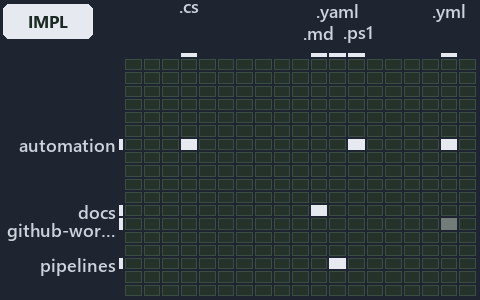

---
catzc:
  immutable:
    with_body_sha: e26956b8653b
    repo_status: locked
    path: docs/explanation/flow/.assets/independence-check-groups-by-layer/grid.md
    source: docs/explanation/flow/.assets/independence-check-groups-by-layer/diagram.drawio.png
    role: asset-description
    language: markdown
    filetype: md
    track: docs
    tracktype: documentation
---

# Test-GlobSetIndependence groups every set by layer and tests each same-layer pair: the world-map minimap

```text
Where the files that cite ADR-FLOW-CD-GLOBS sit in the repository: tracks down, file languages across.
6 of 342 cells lit, holding 86 files.
```



This is the world-map minimap in the sidebar of the implementation diagram of [Test-GlobSetIndependence groups every set by layer and tests
each same-layer pair][88], which explains [ADR-FLOW-CD-GLOBS][1]. It lights every cell of the world map that holds a file citing those
codes, so it shows where the decision lives in the repository. Each lit cell has its reason below, naming the code that selects it.

## What the minimap shows

The grid crosses the 18 tracks (rows) with the 19 file languages (columns) of the world map and lights 6 cells, filled in ink. A cell lit
only by passing mentions (citations in body comments, not in a file's header or text) is touched: a lighter ink. Every other cell is idle, a
grey box: it holds files the slide's ADR codes do not select, or no file at all (288 of the 342 cells hold none). The minimap shows where
the slide sits, not how many files a cell holds; the world-map PDFs show the counts.

- .claude × markdown: 4 lit of 64 files
- docs × markdown: 68 lit of 2781 files
- pipelines × pipeline-yaml: 3 lit of 14 files
- pwsh × csharp: 3 lit of 295 files
- pwsh × powershell: 6 lit of 1653 files
- pwsh × yaml: 2 lit of 115 files

## Key

A lit row prints its track's name; a lit column prints a short code, the first extension of its file language:

- `.cs`: csharp
- `.md`: markdown
- `.yaml`: pipeline-yaml
- `.ps1`: powershell
- `.yml`: yaml

## Why each cell is lit

### .claude × markdown (4 lit files)

Placed: the root folder `.claude/` names the track .claude ([ADR-DSGN-TRACK-TRACKISPLACEDCLUSTER][2]); the extension `.md` names the file
language markdown ([ADR-DSGN-TRACK-FILELANGUAGE][2]). Lit ([ADR-DSGN-TRACK-LITCELL][2]) by:

- [.claude/CLAUDE.md][3]: selected by [ADR-FLOW-CD-GLOBS][1]: the file cites it at line 55 (text).
- [.claude/plans/plan-explanation-drift-gaps.md][4]: selected by [ADR-FLOW-CD-GLOBS][1]: the file cites it at line 18 (text).
- [.claude/plans/plan-promotion-ladder.md][5]: selected by [ADR-FLOW-CD-GLOBS][1]: the file cites it at line 11 (text) and line 38 (text).
- [.claude/plans/value-of-plan.md][6]: selected by [ADR-FLOW-CD-GLOBS][1]: the file cites it at line 33 (text).

### docs × markdown (68 lit files)

Placed: the root folder `docs/` names the track docs ([ADR-DSGN-TRACK-TRACKISPLACEDCLUSTER][2]); the extension `.md` names the file language
markdown ([ADR-DSGN-TRACK-FILELANGUAGE][2]). Lit ([ADR-DSGN-TRACK-LITCELL][2]) by:

- [docs/adr/flow/dora-explains.md][7]: selected by [ADR-FLOW-CD-GLOBS][1]: the file cites it at line 11 (text) and line 92 (text).
- [docs/adr/flow/durable-sha-globs.md][1]: selected by [ADR-FLOW-CD-GLOBS][1]: the ADR's own file.
- [docs/adr/index.md][8]: selected by [ADR-FLOW-CD-GLOBS][1]: the file cites it at line 129 (text) and line 133 (text).
- [docs/how-to/automation/apply-environment-approvals.md][9]: selected by [ADR-FLOW-CD-GLOBS][1]: the file cites it at line 4 (text).
- [docs/how-to/pwsh/manual-test-plan/pipelines-and-globs.md][10]: selected by [ADR-FLOW-CD-GLOBS][1]: the file cites it at line 16 (text).
- [docs/references/pipelines/cd-apex.yaml.md][11]: selected by [ADR-FLOW-CD-GLOBS][1]: the file cites it at line 31 (text).
- [docs/references/pipelines/cd-flux.yaml.md][12]: selected by [ADR-FLOW-CD-GLOBS][1]: the file cites it at line 30 (text).
- [docs/references/pipelines/cd-nova.yaml.md][13]: selected by [ADR-FLOW-CD-GLOBS][1]: the file cites it at line 30 (text).
- [docs/references/pipelines/cd-shared.yaml.md][14]: selected by [ADR-FLOW-CD-GLOBS][1]: the file cites it at line 22 (text).
- [docs/references/pipelines/ci-automation.yaml.md][15]: selected by [ADR-FLOW-CD-GLOBS][1]: the file cites it at line 12 (text).
- [docs/references/pipelines/ci-infrastructure.yaml.md][16]: selected by [ADR-FLOW-CD-GLOBS][1]: the file cites it at line 13 (text).
- [docs/references/pipelines/github-workflows/ci-automation.yml.md][17]: selected by [ADR-FLOW-CD-GLOBS][1]: the file cites it at line 12
  (text).
- [docs/references/pwsh/.assets/protected-module-skip-by-hash/diagram.drawio.md][18]: selected by [ADR-FLOW-CD-GLOBS][1]: the file cites it
  at line 33 (text), line 108 (text) and line 108 (text).
- [docs/references/pwsh/.assets/protected-module-skip-by-hash/diagram.drawio.verify.md][19]: selected by [ADR-FLOW-CD-GLOBS][1]: the file
  cites it at line 55 (text) and line 55 (text).
- [docs/references/pwsh/catzc-azure-devops-buildvalidation/Get-AdoBuildValidations.ps1.md][20]: selected by [ADR-FLOW-CD-GLOBS][1]: the file
  cites it at line 18 (text).
- [docs/references/pwsh/catzc-azure-devops-buildvalidation/Register-AdoBuildValidation.ps1.md][21]: selected by [ADR-FLOW-CD-GLOBS][1]: the
  file cites it at line 14 (text) and line 74 (text).
- [docs/references/pwsh/catzc-azure-devops-buildvalidation/Unregister-AdoBuildValidation.ps1.md][22]: selected by [ADR-FLOW-CD-GLOBS][1]:
  the file cites it at line 15 (text).
- [docs/references/pwsh/catzc-azure-devops-buildvalidation/configs/build-validation.yml.md][23]: selected by [ADR-FLOW-CD-GLOBS][1]: the
  file cites it at line 15 (text).
- [docs/references/pwsh/catzc-azure-devops-buildvalidation/private/Get-BuildValidationPathFilter.ps1.md][24]: selected by
  [ADR-FLOW-CD-GLOBS][1]: the file cites it at line 16 (text).
- [docs/references/pwsh/catzc-azure-devops/Sync-AdoEnvironmentApprovals.ps1.md][25]: selected by [ADR-FLOW-CD-GLOBS][1]: the file cites it
  at line 15 (text).
- [docs/references/pwsh/catzc-base-docs/types/AdrsConfig.cs.md][26]: selected by [ADR-FLOW-CD-GLOBS][1]: the file cites it at line 28
  (text), line 29 (text), line 57 (text) and line 58 (text).
- [docs/references/pwsh/catzc-base-exporter/Get-CatzcContentHash.ps1.md][27]: selected by [ADR-FLOW-CD-GLOBS][1]: the file cites it at line
  15 (text).
- [docs/references/pwsh/catzc-base-globs.md][28]: selected by [ADR-FLOW-CD-GLOBS][1]: the file cites it at line 28 (text).
- [docs/references/pwsh/catzc-base-globs/Get-ChangedGlobSet.ps1.md][29]: selected by [ADR-FLOW-CD-GLOBS][1]: the file cites it at line 15
  (text) and line 27 (text).
- [docs/references/pwsh/catzc-base-globs/Get-GlobSet.ps1.md][30]: selected by [ADR-FLOW-CD-GLOBS][1]: the file cites it at line 15 (text).
- [docs/references/pwsh/catzc-base-globs/Get-GlobSetChangeRange.ps1.md][31]: selected by [ADR-FLOW-CD-GLOBS][1]: the file cites it at line
  26 (text).
- [docs/references/pwsh/catzc-base-globs/Get-GlobSetFile.ps1.md][32]: selected by [ADR-FLOW-CD-GLOBS][1]: the file cites it at line 15
  (text) and line 17 (text).
- [docs/references/pwsh/catzc-base-globs/Get-GlobSetHash.ps1.md][33]: selected by [ADR-FLOW-CD-GLOBS][1]: the file cites it at line 20
  (text).
- [docs/references/pwsh/catzc-base-globs/Get-GlobSetTrigger.ps1.md][34]: selected by [ADR-FLOW-CD-GLOBS][1]: the file cites it at line 15
  (text), line 30 (text) and line 31 (text).
- [docs/references/pwsh/catzc-base-globs/Get-MarkerBlastRadius.ps1.md][35]: selected by [ADR-FLOW-CD-GLOBS][1]: the file cites it at line 15
  (text).
- [docs/references/pwsh/catzc-base-globs/Get-ModuleGlobSet.ps1.md][36]: selected by [ADR-FLOW-CD-GLOBS][1]: the file cites it at line 58
  (text), line 61 (text) and line 109 (text).
- [docs/references/pwsh/catzc-base-globs/Get-TrackedFile.ps1.md][37]: selected by [ADR-FLOW-CD-GLOBS][1]: the file cites it at line 15
  (text).
- [docs/references/pwsh/catzc-base-globs/Test-AdoPipelineTriggerGlob.ps1.md][38]: selected by [ADR-FLOW-CD-GLOBS][1]: the file cites it at
  line 24 (text) and line 25 (text).
- [docs/references/pwsh/catzc-base-globs/Test-GitHubWorkflowTriggerGlob.ps1.md][39]: selected by [ADR-FLOW-CD-GLOBS][1]: the file cites it
  at line 24 (text) and line 25 (text).
- [docs/references/pwsh/catzc-base-globs/Test-GlobSetAffected.ps1.md][40]: selected by [ADR-FLOW-CD-GLOBS][1]: the file cites it at line 17
  (text) and line 20 (text).
- [docs/references/pwsh/catzc-base-globs/Test-GlobSetIndependence.ps1.md][41]: selected by [ADR-FLOW-CD-GLOBS][1]: the file cites it at line
  18 (text), line 56 (text) and line 66 (text).
- [docs/references/pwsh/catzc-base-globs/Test-GlobSetTriggerCoverage.ps1.md][42]: selected by [ADR-FLOW-CD-GLOBS][1]: the file cites it at
  line 16 (text).
- [docs/references/pwsh/catzc-base-globs/configs/globs.yml.md][43]: selected by [ADR-FLOW-CD-GLOBS][1]: the file cites it at line 12 (text),
  line 17 (text), line 25 (text), line 27 (text), line 41 (text), line 71 (text) and line 85 (text).
- [docs/references/pwsh/catzc-base-globs/private/Get-ChangedFile.ps1.md][44]: selected by [ADR-FLOW-CD-GLOBS][1]: the file cites it at line
  15 (text).
- [docs/references/pwsh/catzc-base-globs/private/Get-GlobSetMember.ps1.md][45]: selected by [ADR-FLOW-CD-GLOBS][1]: the file cites it at
  line 15 (text).
- [docs/references/pwsh/catzc-base-globs/private/Get-PipelineTrigger.ps1.md][46]: selected by [ADR-FLOW-CD-GLOBS][1]: the file cites it at
  line 16 (text).
- [docs/references/pwsh/catzc-base-globs/private/Test-GlobListEqual.ps1.md][47]: selected by [ADR-FLOW-CD-GLOBS][1]: the file cites it at
  line 18 (text).
- [docs/references/pwsh/catzc-base-globs/tests/Get-ChangedFile.Tests.ps1.md][48]: selected by [ADR-FLOW-CD-GLOBS][1]: the file cites it at
  line 13 (text).
- [docs/references/pwsh/catzc-base-globs/tests/Get-ChangedGlobSet.Tests.ps1.md][49]: selected by [ADR-FLOW-CD-GLOBS][1]: the file cites it
  at line 12 (text).
- [docs/references/pwsh/catzc-base-globs/tests/Get-GlobSetFile.Tests.ps1.md][50]: selected by [ADR-FLOW-CD-GLOBS][1]: the file cites it at
  line 12 (text) and line 13 (text).
- [docs/references/pwsh/catzc-base-globs/tests/Get-GlobSetHash.Tests.ps1.md][51]: selected by [ADR-FLOW-CD-GLOBS][1]: the file cites it at
  line 13 (text).
- [docs/references/pwsh/catzc-base-globs/tests/Get-GlobSetMember.Tests.ps1.md][52]: selected by [ADR-FLOW-CD-GLOBS][1]: the file cites it at
  line 12 (text).
- [docs/references/pwsh/catzc-base-globs/tests/Get-GlobSetTrigger.Tests.ps1.md][53]: selected by [ADR-FLOW-CD-GLOBS][1]: the file cites it
  at line 12 (text).
- [docs/references/pwsh/catzc-base-globs/tests/Get-PipelineTrigger.Tests.ps1.md][54]: selected by [ADR-FLOW-CD-GLOBS][1]: the file cites it
  at line 12 (text).
- [docs/references/pwsh/catzc-base-globs/tests/Get-TrackedFile.Tests.ps1.md][55]: selected by [ADR-FLOW-CD-GLOBS][1]: the file cites it at
  line 11 (text).
- [docs/references/pwsh/catzc-base-globs/tests/GlobSet-Independence.Tests.ps1.md][56]: selected by [ADR-FLOW-CD-GLOBS][1]: the file cites it
  at line 12 (text).
- [docs/references/pwsh/catzc-base-globs/tests/GlobSetTrigger-Coverage.Tests.ps1.md][57]: selected by [ADR-FLOW-CD-GLOBS][1]: the file cites
  it at line 12 (text).
- [docs/references/pwsh/catzc-base-globs/tests/PipelineTrigger-Integrity.Tests.ps1.md][58]: selected by [ADR-FLOW-CD-GLOBS][1]: the file
  cites it at line 13 (text).
- [docs/references/pwsh/catzc-base-globs/tests/Test-GlobSetIndependence.Tests.ps1.md][59]: selected by [ADR-FLOW-CD-GLOBS][1]: the file
  cites it at line 13 (text).
- [docs/references/pwsh/catzc-base-globs/tests/types/GlobPattern.Tests.ps1.md][60]: selected by [ADR-FLOW-CD-GLOBS][1]: the file cites it at
  line 11 (text) and line 13 (text).
- [docs/references/pwsh/catzc-base-globs/tests/types/GlobSet.Tests.ps1.md][61]: selected by [ADR-FLOW-CD-GLOBS][1]: the file cites it at
  line 12 (text) and line 14 (text).
- [docs/references/pwsh/catzc-base-globs/tests/types/GlobsConfig.Tests.ps1.md][62]: selected by [ADR-FLOW-CD-GLOBS][1]: the file cites it at
  line 14 (text), line 16 (text) and line 25 (text).
- [docs/references/pwsh/catzc-base-globs/types/Aspect.cs.md][63]: selected by [ADR-FLOW-CD-GLOBS][1]: the file cites it at line 19 (text).
- [docs/references/pwsh/catzc-base-globs/types/DurableHash.cs.md][64]: selected by [ADR-FLOW-CD-GLOBS][1]: the file cites it at line 11
  (text) and line 17 (text).
- [docs/references/pwsh/catzc-base-globs/types/GlobPattern.cs.md][65]: selected by [ADR-FLOW-CD-GLOBS][1]: the file cites it at line 17
  (text), line 18 (text) and line 19 (text).
- [docs/references/pwsh/catzc-base-globs/types/GlobSet.cs.md][66]: selected by [ADR-FLOW-CD-GLOBS][1]: the file cites it at line 13 (text),
  line 15 (text), line 16 (text), line 22 (text), line 25 (text), line 27 (text), line 30 (text), line 38 (text), line 47 (text), line 65
  (text), line 82 (text), line 92 (text), line 116 (text) and line 124 (text).
- [docs/references/pwsh/catzc-base-globs/types/GlobsConfig.cs.md][67]: selected by [ADR-FLOW-CD-GLOBS][1]: the file cites it at line 13
  (text), line 17 (text), line 20 (text) and line 39 (text).
- [docs/references/pwsh/catzc-base-maps/Get-ValueChainHighlight.ps1.md][68]: selected by [ADR-FLOW-CD-GLOBS][1]: the file cites it at line
  37 (text).
- [docs/references/pwsh/catzc-base-maps/Get-WorldMapHighlight.ps1.md][69]: selected by [ADR-FLOW-CD-GLOBS][1]: the file cites it at line 54
  (text).
- [docs/references/pwsh/catzc-base-qualitygates/Test-Automation.ps1.md][70]: selected by [ADR-FLOW-CD-GLOBS][1]: the file cites it at line
  98 (text).
- [docs/references/pwsh/catzc-base-qualitygates/private/Get-GuidScanFiles.ps1.md][71]: selected by [ADR-FLOW-CD-GLOBS][1]: the file cites it
  at line 17 (text).
- [docs/references/pwsh/catzc-base-qualitygates/private/Get-ModuleProtectionIdentity.ps1.md][72]: selected by [ADR-FLOW-CD-GLOBS][1]: the
  file cites it at line 80 (text).
- [docs/references/pwsh/catzc-base-qualitygates/private/Resolve-TestSuite.ps1.md][73]: selected by [ADR-FLOW-CD-GLOBS][1]: the file cites it
  at line 17 (text).

### pipelines × pipeline-yaml (3 lit files)

Placed: the root folder `pipelines/` names the track pipelines ([ADR-DSGN-TRACK-TRACKISPLACEDCLUSTER][2]); the extension `.yaml` names the
file language pipeline-yaml ([ADR-DSGN-TRACK-FILELANGUAGE][2]). Lit ([ADR-DSGN-TRACK-LITCELL][2]) by:

- [pipelines/cd-shared.yaml][74]: selected by [ADR-FLOW-CD-GLOBS][1]: the file cites it at line 45 (body comment) (a passing mention only).
- [pipelines/ci-automation.yaml][75]: selected by [ADR-FLOW-CD-GLOBS][1]: a pipeline that cites nothing itself carries its globset's
  citations, which cite it at `pwsh/Catzc.Base.Docs/configs/adrs.yml` line 97 (text), `pwsh/Catzc.Base.Docs/configs/adrs.yml` line 101
  (text), `pwsh/Catzc.Base.Globs/Test-GlobSetIndependence.ps1` line 42 (text), `pwsh/Catzc.Base.Globs/tests/GlobSet-Independence.Tests.ps1`
  line 2 (text), `pwsh/Catzc.Base.Globs/tests/GlobSet-Independence.Tests.ps1` line 4 (text),
  `pwsh/Catzc.Base.Globs/tests/types/GlobPattern.Tests.ps1` line 58 (text), `pwsh/Catzc.Base.Globs/tests/types/GlobSet.Tests.ps1` line 9
  (text), `pwsh/Catzc.Base.Globs/tests/types/GlobsConfig.Tests.ps1` line 53 (text),
  `pwsh/Catzc.Base.Globs/tests/types/GlobsConfig.Tests.ps1` line 66 (text), `pwsh/Catzc.Base.Globs/tests/types/GlobsConfig.Tests.ps1` line
  77 (text), `pwsh/Catzc.Base.Globs/tests/types/GlobsConfig.Tests.ps1` line 89 (text), `pwsh/Catzc.Base.Globs/types/GlobPattern.cs` line 23
  (text), `pwsh/Catzc.Base.Globs/types/GlobPattern.cs` line 27 (text), `pwsh/Catzc.Base.Globs/types/GlobPattern.cs` line 31 (text),
  `pwsh/Catzc.Base.Globs/types/GlobPattern.cs` line 43 (text), `pwsh/Catzc.Base.Globs/types/GlobPattern.cs` line 47 (text),
  `pwsh/Catzc.Base.Globs/types/GlobPattern.cs` line 56 (text), `pwsh/Catzc.Base.Globs/types/GlobSet.cs` line 54 (text),
  `pwsh/Catzc.Base.Globs/types/GlobsConfig.cs` line 73 (text), `pwsh/Catzc.Base.Globs/types/GlobsConfig.cs` line 136 (text),
  `pwsh/Catzc.Base.Globs/types/GlobsConfig.cs` line 140 (text), `pwsh/Catzc.Base.Globs/types/GlobsConfig.cs` line 154 (text),
  `pwsh/Catzc.Base.Maps/tests/Get-WorldMapHighlight.Tests.ps1` line 70 (text), `pwsh/Catzc.Base.Maps/tests/Get-WorldMapHighlight.Tests.ps1`
  line 71 (text) and `pwsh/Catzc.Base.QualityGates/configs/terminology.yml` line 1078 (text).
- [pipelines/extends/cd-customer.yaml][76]: selected by [ADR-FLOW-CD-GLOBS][1]: the file cites it at line 21 (body comment) (a passing
  mention only).

### pwsh × csharp (3 lit files)

Placed: the root folder `pwsh/` names the track pwsh ([ADR-DSGN-TRACK-TRACKISPLACEDCLUSTER][2]); the extension `.cs` names the file language
csharp ([ADR-DSGN-TRACK-FILELANGUAGE][2]). Lit ([ADR-DSGN-TRACK-LITCELL][2]) by:

- [pwsh/Catzc.Base.Globs/types/GlobPattern.cs][77]: selected by [ADR-FLOW-CD-GLOBS][1]: the file cites it at line 23 (text), line 27 (text),
  line 31 (text), line 43 (text), line 47 (text) and line 56 (text).
- [pwsh/Catzc.Base.Globs/types/GlobSet.cs][78]: selected by [ADR-FLOW-CD-GLOBS][1]: the file cites it at line 54 (text).
- [pwsh/Catzc.Base.Globs/types/GlobsConfig.cs][79]: selected by [ADR-FLOW-CD-GLOBS][1]: the file cites it at line 73 (text), line 136
  (text), line 140 (text) and line 154 (text).

### pwsh × powershell (6 lit files)

Placed: the root folder `pwsh/` names the track pwsh ([ADR-DSGN-TRACK-TRACKISPLACEDCLUSTER][2]); the extension `.ps1` names the file
language powershell ([ADR-DSGN-TRACK-FILELANGUAGE][2]). Lit ([ADR-DSGN-TRACK-LITCELL][2]) by:

- [pwsh/Catzc.Base.Globs/Test-GlobSetIndependence.ps1][80]: selected by [ADR-FLOW-CD-GLOBS][1]: the file cites it at line 42 (text).
- [pwsh/Catzc.Base.Globs/tests/GlobSet-Independence.Tests.ps1][81]: selected by [ADR-FLOW-CD-GLOBS][1]: the file cites it at line 2 (text)
  and line 4 (text).
- [pwsh/Catzc.Base.Globs/tests/types/GlobPattern.Tests.ps1][82]: selected by [ADR-FLOW-CD-GLOBS][1]: the file cites it at line 58 (text).
- [pwsh/Catzc.Base.Globs/tests/types/GlobSet.Tests.ps1][83]: selected by [ADR-FLOW-CD-GLOBS][1]: the file cites it at line 9 (text).
- [pwsh/Catzc.Base.Globs/tests/types/GlobsConfig.Tests.ps1][84]: selected by [ADR-FLOW-CD-GLOBS][1]: the file cites it at line 53 (text),
  line 66 (text), line 77 (text) and line 89 (text).
- [pwsh/Catzc.Base.Maps/tests/Get-WorldMapHighlight.Tests.ps1][85]: selected by [ADR-FLOW-CD-GLOBS][1]: the file cites it at line 70 (text)
  and line 71 (text).

### pwsh × yaml (2 lit files)

Placed: the root folder `pwsh/` names the track pwsh ([ADR-DSGN-TRACK-TRACKISPLACEDCLUSTER][2]); the extension `.yml` names the file
language yaml ([ADR-DSGN-TRACK-FILELANGUAGE][2]). Lit ([ADR-DSGN-TRACK-LITCELL][2]) by:

- [pwsh/Catzc.Base.Docs/configs/adrs.yml][86]: selected by [ADR-FLOW-CD-GLOBS][1]: the file cites it at line 97 (text) and line 101 (text).
- [pwsh/Catzc.Base.QualityGates/configs/terminology.yml][87]: selected by [ADR-FLOW-CD-GLOBS][1]: the file cites it at line 1078 (text).

## Keywords

- [world map][89]
- [track][90]
- [file language][91]
- [cell][92]
- [lit cell][93]
- [.claude][94]: a track
- [docs][94]: a track
- [pipelines][94]: a track
- [pwsh][94]: a track
- [csharp][95]: a file language
- [markdown][95]: a file language
- [pipeline-yaml][95]: a file language
- [powershell][95]: a file language
- [yaml][95]: a file language

[1]: ../../../../adr/flow/durable-sha-globs.md
[2]: ../../../../adr/design/tracks.md
[3]: ../../../../../.claude/CLAUDE.md
[4]: ../../../../../.claude/plans/plan-explanation-drift-gaps.md
[5]: ../../../../../.claude/plans/plan-promotion-ladder.md
[6]: ../../../../../.claude/plans/value-of-plan.md
[7]: ../../../../adr/flow/dora-explains.md
[8]: ../../../../adr/index.md
[9]: ../../../../how-to/automation/apply-environment-approvals.md
[10]: ../../../../how-to/pwsh/manual-test-plan/pipelines-and-globs.md
[11]: ../../../../references/pipelines/cd-apex.yaml.md
[12]: ../../../../references/pipelines/cd-flux.yaml.md
[13]: ../../../../references/pipelines/cd-nova.yaml.md
[14]: ../../../../references/pipelines/cd-shared.yaml.md
[15]: ../../../../references/pipelines/ci-automation.yaml.md
[16]: ../../../../references/pipelines/ci-infrastructure.yaml.md
[17]: ../../../../references/pipelines/github-workflows/ci-automation.yml.md
[18]: ../../../../references/pwsh/.assets/protected-module-skip-by-hash/diagram.drawio.md
[19]: ../../../../references/pwsh/.assets/protected-module-skip-by-hash/diagram.drawio.verify.md
[20]: ../../../../references/pwsh/catzc-azure-devops-buildvalidation/Get-AdoBuildValidations.ps1.md
[21]: ../../../../references/pwsh/catzc-azure-devops-buildvalidation/Register-AdoBuildValidation.ps1.md
[22]: ../../../../references/pwsh/catzc-azure-devops-buildvalidation/Unregister-AdoBuildValidation.ps1.md
[23]: ../../../../references/pwsh/catzc-azure-devops-buildvalidation/configs/build-validation.yml.md
[24]: ../../../../references/pwsh/catzc-azure-devops-buildvalidation/private/Get-BuildValidationPathFilter.ps1.md
[25]: ../../../../references/pwsh/catzc-azure-devops/Sync-AdoEnvironmentApprovals.ps1.md
[26]: ../../../../references/pwsh/catzc-base-docs/types/AdrsConfig.cs.md
[27]: ../../../../references/pwsh/catzc-base-exporter/Get-CatzcContentHash.ps1.md
[28]: ../../../../references/pwsh/catzc-base-globs.md
[29]: ../../../../references/pwsh/catzc-base-globs/Get-ChangedGlobSet.ps1.md
[30]: ../../../../references/pwsh/catzc-base-globs/Get-GlobSet.ps1.md
[31]: ../../../../references/pwsh/catzc-base-globs/Get-GlobSetChangeRange.ps1.md
[32]: ../../../../references/pwsh/catzc-base-globs/Get-GlobSetFile.ps1.md
[33]: ../../../../references/pwsh/catzc-base-globs/Get-GlobSetHash.ps1.md
[34]: ../../../../references/pwsh/catzc-base-globs/Get-GlobSetTrigger.ps1.md
[35]: ../../../../references/pwsh/catzc-base-globs/Get-MarkerBlastRadius.ps1.md
[36]: ../../../../references/pwsh/catzc-base-globs/Get-ModuleGlobSet.ps1.md
[37]: ../../../../references/pwsh/catzc-base-globs/Get-TrackedFile.ps1.md
[38]: ../../../../references/pwsh/catzc-base-globs/Test-AdoPipelineTriggerGlob.ps1.md
[39]: ../../../../references/pwsh/catzc-base-globs/Test-GitHubWorkflowTriggerGlob.ps1.md
[40]: ../../../../references/pwsh/catzc-base-globs/Test-GlobSetAffected.ps1.md
[41]: ../../../../references/pwsh/catzc-base-globs/Test-GlobSetIndependence.ps1.md
[42]: ../../../../references/pwsh/catzc-base-globs/Test-GlobSetTriggerCoverage.ps1.md
[43]: ../../../../references/pwsh/catzc-base-globs/configs/globs.yml.md
[44]: ../../../../references/pwsh/catzc-base-globs/private/Get-ChangedFile.ps1.md
[45]: ../../../../references/pwsh/catzc-base-globs/private/Get-GlobSetMember.ps1.md
[46]: ../../../../references/pwsh/catzc-base-globs/private/Get-PipelineTrigger.ps1.md
[47]: ../../../../references/pwsh/catzc-base-globs/private/Test-GlobListEqual.ps1.md
[48]: ../../../../references/pwsh/catzc-base-globs/tests/Get-ChangedFile.Tests.ps1.md
[49]: ../../../../references/pwsh/catzc-base-globs/tests/Get-ChangedGlobSet.Tests.ps1.md
[50]: ../../../../references/pwsh/catzc-base-globs/tests/Get-GlobSetFile.Tests.ps1.md
[51]: ../../../../references/pwsh/catzc-base-globs/tests/Get-GlobSetHash.Tests.ps1.md
[52]: ../../../../references/pwsh/catzc-base-globs/tests/Get-GlobSetMember.Tests.ps1.md
[53]: ../../../../references/pwsh/catzc-base-globs/tests/Get-GlobSetTrigger.Tests.ps1.md
[54]: ../../../../references/pwsh/catzc-base-globs/tests/Get-PipelineTrigger.Tests.ps1.md
[55]: ../../../../references/pwsh/catzc-base-globs/tests/Get-TrackedFile.Tests.ps1.md
[56]: ../../../../references/pwsh/catzc-base-globs/tests/GlobSet-Independence.Tests.ps1.md
[57]: ../../../../references/pwsh/catzc-base-globs/tests/GlobSetTrigger-Coverage.Tests.ps1.md
[58]: ../../../../references/pwsh/catzc-base-globs/tests/PipelineTrigger-Integrity.Tests.ps1.md
[59]: ../../../../references/pwsh/catzc-base-globs/tests/Test-GlobSetIndependence.Tests.ps1.md
[60]: ../../../../references/pwsh/catzc-base-globs/tests/types/GlobPattern.Tests.ps1.md
[61]: ../../../../references/pwsh/catzc-base-globs/tests/types/GlobSet.Tests.ps1.md
[62]: ../../../../references/pwsh/catzc-base-globs/tests/types/GlobsConfig.Tests.ps1.md
[63]: ../../../../references/pwsh/catzc-base-globs/types/Aspect.cs.md
[64]: ../../../../references/pwsh/catzc-base-globs/types/DurableHash.cs.md
[65]: ../../../../references/pwsh/catzc-base-globs/types/GlobPattern.cs.md
[66]: ../../../../references/pwsh/catzc-base-globs/types/GlobSet.cs.md
[67]: ../../../../references/pwsh/catzc-base-globs/types/GlobsConfig.cs.md
[68]: ../../../../references/pwsh/catzc-base-maps/Get-ValueChainHighlight.ps1.md
[69]: ../../../../references/pwsh/catzc-base-maps/Get-WorldMapHighlight.ps1.md
[70]: ../../../../references/pwsh/catzc-base-qualitygates/Test-Automation.ps1.md
[71]: ../../../../references/pwsh/catzc-base-qualitygates/private/Get-GuidScanFiles.ps1.md
[72]: ../../../../references/pwsh/catzc-base-qualitygates/private/Get-ModuleProtectionIdentity.ps1.md
[73]: ../../../../references/pwsh/catzc-base-qualitygates/private/Resolve-TestSuite.ps1.md
[74]: ../../../../../pipelines/cd-shared.yaml
[75]: ../../../../../pipelines/ci-automation.yaml
[76]: ../../../../../pipelines/extends/cd-customer.yaml
[77]: ../../../../../pwsh/Catzc.Base.Globs/types/GlobPattern.cs
[78]: ../../../../../pwsh/Catzc.Base.Globs/types/GlobSet.cs
[79]: ../../../../../pwsh/Catzc.Base.Globs/types/GlobsConfig.cs
[80]: ../../../../../pwsh/Catzc.Base.Globs/Test-GlobSetIndependence.ps1
[81]: ../../../../../pwsh/Catzc.Base.Globs/tests/GlobSet-Independence.Tests.ps1
[82]: ../../../../../pwsh/Catzc.Base.Globs/tests/types/GlobPattern.Tests.ps1
[83]: ../../../../../pwsh/Catzc.Base.Globs/tests/types/GlobSet.Tests.ps1
[84]: ../../../../../pwsh/Catzc.Base.Globs/tests/types/GlobsConfig.Tests.ps1
[85]: ../../../../../pwsh/Catzc.Base.Maps/tests/Get-WorldMapHighlight.Tests.ps1
[86]: ../../../../../pwsh/Catzc.Base.Docs/configs/adrs.yml
[87]: ../../../../../pwsh/Catzc.Base.QualityGates/configs/terminology.yml
[88]: ../../independence-check-groups-by-layer.md
[89]: ../../../../adr/glossary.md#world-map
[90]: ../../../../adr/glossary.md#track
[91]: ../../../../adr/glossary.md#file-language
[92]: ../../../../adr/glossary.md#cell
[93]: ../../../../adr/glossary.md#lit-cell
[94]: ../../../../../pwsh/Catzc.Base.Variants/configs/variants.yml
[95]: ../../../../../pwsh/Catzc.Base.Languages/configs/languages.yml
