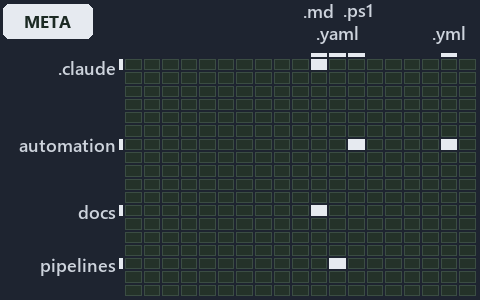

---
catzc:
  immutable:
    with_body_sha: "579503c2ec92"
    repo_status: locked
    path: docs/explanation/.assets/grid/adr-flow-cd--one-artifact-climbs-unchanged--meta.grid.md
    source: docs/explanation/.assets/adr-flow-cd--one-artifact-climbs-unchanged--meta.drawio.png
    role: asset-description
    language: markdown
    filetype: md
    track: docs
    tracktype: documentation
---

# One artifact is built once and climbs to production unchanged: the world-map minimap

```text
Where the files that cite ADR-FLOW-CD sit in the repository: tracks down, file languages across.
5 of 342 cells lit, holding 15 files.
```



This is the world-map minimap in the sidebar of the meta diagram of [One artifact is built once and climbs to production unchanged][19],
which explains [ADR-FLOW-CD][1]. It lights every cell of the world map that holds a file citing those codes, so it shows where the decision
lives in the repository. Each lit cell has its reason below, naming the code that selects it.

## What the minimap shows

The grid crosses the 18 tracks (rows) with the 19 file languages (columns) of the world map and lights 5 cells, filled in ink. A cell lit
only by passing mentions (citations in body comments, not in a file's header or text) is touched: a lighter ink. Every other cell is idle, a
grey box: it holds files the slide's ADR codes do not select, or no file at all (288 of the 342 cells hold none). The minimap shows where
the slide sits, not how many files a cell holds; the world-map PDFs show the counts.

- .claude × markdown: 1 lit of 90 files
- automation × powershell: 1 lit of 1629 files
- automation × yaml: 3 lit of 112 files
- docs × markdown: 9 lit of 2742 files
- pipelines × pipeline-yaml: 1 lit of 9 files

## Key

A lit row prints its track's name; a lit column prints a short code, the first extension of its file language:

- `.md`: markdown
- `.yaml`: pipeline-yaml
- `.ps1`: powershell
- `.yml`: yaml

## Why each cell is lit

### .claude × markdown (1 lit file)

Placed: the root folder `.claude/` names the track .claude ([ADR-DSGN-TRACK#1][2]); the extension `.md` names the file language markdown
([ADR-DSGN-TRACK#6][3]). Lit ([ADR-DSGN-TRACK#12][4]) by:

- [.claude/CLAUDE.md][5]: selected by [ADR-FLOW-CD][1]: the file cites it at line 55 (text).

### automation × powershell (1 lit file)

Placed: the root folder `automation/` names the track automation ([ADR-DSGN-TRACK#1][2]); the extension `.ps1` names the file language
powershell ([ADR-DSGN-TRACK#6][3]). Lit ([ADR-DSGN-TRACK#12][4]) by:

- [pwsh/Catzc.Base.Maps/tests/Get-WorldMapHighlight.Tests.ps1][6]: selected by [ADR-FLOW-CD][1]: the file cites it at line 70 (text) and
  line 71 (text).

### automation × yaml (3 lit files)

Placed: the root folder `automation/` names the track automation ([ADR-DSGN-TRACK#1][2]); the extension `.yml` names the file language yaml
([ADR-DSGN-TRACK#6][3]). Lit ([ADR-DSGN-TRACK#12][4]) by:

- [pwsh/Catzc.Base.Docs/configs/adrs.yml][7]: selected by [ADR-FLOW-CD][1]: the file cites it at line 97 (text).
- [pwsh/Catzc.Base.ModuleSystem/configs/glossary.yml][8]: selected by [ADR-FLOW-CD][1]: the file cites it at line 18 (text).
- [pwsh/Catzc.Base.QualityGates/configs/glossary.yml][9]: selected by [ADR-FLOW-CD][1]: the file cites it at line 58 (text).

### docs × markdown (9 lit files)

Placed: the root folder `docs/` names the track docs ([ADR-DSGN-TRACK#1][2]); the extension `.md` names the file language markdown
([ADR-DSGN-TRACK#6][3]). Lit ([ADR-DSGN-TRACK#12][4]) by:

- [docs/adr/flow/cd-discipline-and-promotion-flow.md][1]: selected by [ADR-FLOW-CD][1]: the ADR's own file.
- [docs/adr/flow/dora-explains.md][10]: selected by [ADR-FLOW-CD][1]: the file cites it at line 11 (text).
- [docs/adr/glossary.md][11]: selected by [ADR-FLOW-CD][1]: the file cites it at line 497 (text) and line 510 (text).
- [docs/adr/index.md][12]: selected by [ADR-FLOW-CD][1]: the file cites it at line 129 (text).
- [docs/references/pwsh/catzc-base-docs/configs/adrs.yml.md][13]: selected by [ADR-FLOW-CD][1]: the file cites it at line 40 (text).
- [docs/references/pwsh/catzc-base-docs/types/AdrsConfig.cs.md][14]: selected by [ADR-FLOW-CD][1]: the file cites it at line 28 (text), line
  29 (text), line 57 (text) and line 58 (text).
- [docs/references/pwsh/catzc-base-docs/types/GlossaryConcept.cs.md][15]: selected by [ADR-FLOW-CD][1]: the file cites it at line 34 (text).
- [docs/references/pwsh/catzc-base-maps/Get-ValueChainHighlight.ps1.md][16]: selected by [ADR-FLOW-CD][1]: the file cites it at line 37
  (text).
- [docs/references/pwsh/catzc-base-maps/Get-WorldMapHighlight.ps1.md][17]: selected by [ADR-FLOW-CD][1]: the file cites it at line 54
  (text).

### pipelines × pipeline-yaml (1 lit file)

Placed: the root folder `pipelines/` names the track pipelines ([ADR-DSGN-TRACK#1][2]); the extension `.yaml` names the file language
pipeline-yaml ([ADR-DSGN-TRACK#6][3]). Lit ([ADR-DSGN-TRACK#12][4]) by:

- [pipelines/ci-automation.yaml][18]: selected by [ADR-FLOW-CD][1]: a pipeline that cites nothing itself carries its globset's citations,
  which cite it at `pwsh/Catzc.Base.Docs/configs/adrs.yml` line 97 (text), `pwsh/Catzc.Base.Maps/tests/Get-WorldMapHighlight.Tests.ps1` line
  70 (text), `pwsh/Catzc.Base.Maps/tests/Get-WorldMapHighlight.Tests.ps1` line 71 (text),
  `pwsh/Catzc.Base.ModuleSystem/configs/glossary.yml` line 18 (text) and `pwsh/Catzc.Base.QualityGates/configs/glossary.yml` line 58 (text).

## Keywords

- [world map][20]
- [track][21]
- [file language][22]
- [cell][23]
- [lit cell][24]
- [.claude][25]: a track
- [automation][25]: a track
- [docs][25]: a track
- [pipelines][25]: a track
- [markdown][26]: a file language
- [pipeline-yaml][26]: a file language
- [powershell][26]: a file language
- [yaml][26]: a file language

Terms the cited ADRs define:

- [gate][27], defined by [ADR-FLOW-CD#13][28]
- [release candidate][29], defined by [ADR-FLOW-CD#14][30]

[1]: ../../../../adr/flow/cd-discipline-and-promotion-flow.md
[2]: ../../../../adr/design/tracks.md#rule-adr-dsgn-track1
[3]: ../../../../adr/design/tracks.md#rule-adr-dsgn-track6
[4]: ../../../../adr/design/tracks.md#rule-adr-dsgn-track12
[5]: ../../../../../.claude/CLAUDE.md
[6]: ../../../../../pwsh/Catzc.Base.Maps/tests/Get-WorldMapHighlight.Tests.ps1
[7]: ../../../../../pwsh/Catzc.Base.Docs/configs/adrs.yml
[8]: ../../../../../pwsh/Catzc.Base.ModuleSystem/configs/glossary.yml
[9]: ../../../../../pwsh/Catzc.Base.QualityGates/configs/glossary.yml
[10]: ../../../../adr/flow/dora-explains.md
[11]: ../../../../adr/glossary.md
[12]: ../../../../adr/index.md
[13]: ../../../../references/pwsh/catzc-base-docs/configs/adrs.yml.md
[14]: ../../../../references/pwsh/catzc-base-docs/types/AdrsConfig.cs.md
[15]: ../../../../references/pwsh/catzc-base-docs/types/GlossaryConcept.cs.md
[16]: ../../../../references/pwsh/catzc-base-maps/Get-ValueChainHighlight.ps1.md
[17]: ../../../../references/pwsh/catzc-base-maps/Get-WorldMapHighlight.ps1.md
[18]: ../../../../../pipelines/ci-automation.yaml
[19]: ../../one-artifact-climbs-unchanged.md
[20]: ../../../../adr/glossary.md#world-map
[21]: ../../../../adr/glossary.md#track
[22]: ../../../../adr/glossary.md#file-language
[23]: ../../../../adr/glossary.md#cell
[24]: ../../../../adr/glossary.md#lit-cell
[25]: ../../../../../pwsh/Catzc.Base.Variants/configs/variants.yml
[26]: ../../../../../pwsh/Catzc.Base.Languages/configs/languages.yml
[27]: ../../../../adr/glossary.md#gate
[28]: ../../../../adr/flow/cd-discipline-and-promotion-flow.md#rule-adr-flow-cd13
[29]: ../../../../adr/glossary.md#release-candidate
[30]: ../../../../adr/flow/cd-discipline-and-promotion-flow.md#rule-adr-flow-cd14
