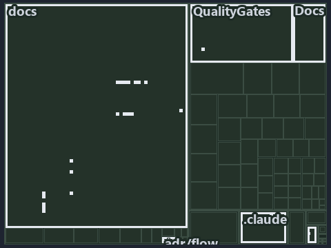

---
catzc:
  immutable:
    with_body_sha: fdfda4a4113b
    repo_status: locked
    path: docs/explanation/flow/.assets/range-per-context-then-diff-and-match/tree.md
    source: docs/explanation/flow/.assets/range-per-context-then-diff-and-match/diagram.drawio.png
    role: asset-description
    language: markdown
    filetype: md
    track: docs
    tracktype: documentation
---

# Check the name, pick the range per context, then diff git and match the paths: the tree minimap

```text
Which files cite ADR-FLOW-CD-DETECT and ADR-FLOW-CD-GLOBS: every file of the world map is a tile, grouped by top-level folder.
28 files lit in 7 groups.
```



This is the tree minimap in the sidebar of the implementation diagram of [Check the name, pick the range per context, then diff git and
match the paths][29], which explains [ADR-FLOW-CD-DETECT][1] and [ADR-FLOW-CD-GLOBS][2]. It lights every file that cites those codes,
grouped by folder, so it shows which files carry the decision. Each lit group has its reason below, naming the code that selects it.

## What the minimap shows

The tree draws every file of the world map as a tile, grouped by top-level folder (under `pwsh/` by module, under `docs/adr/` by ADR
domain), and lights 28 files in 7 groups, filled in ink. A lit ADR file has a white rim; a file lit only by passing mentions is a lighter
ink. Every other tile is idle, a grey box: a file the slide's ADR codes do not select.

- docs (docs/ outside docs/adr/): 20 lit files
- adr/flow (docs/adr/flow): 3 lit files
- .claude: 1 lit file
- adr/* (the files directly in docs/adr/): 1 lit file
- pipelines: 1 lit file
- Docs (pwsh/Catzc.Base.Docs): 1 lit file
- QualityGates (pwsh/Catzc.Base.QualityGates): 1 lit file

## Why each group is lit

### docs (docs/ outside docs/adr/, 20 lit files)

The group holds the files of docs/ outside docs/adr/; each sits in its world-map cell and is lit by:

- [docs/references/pipelines/cd-apex.yaml.md][3], in the cell docs × markdown: selected by [ADR-FLOW-CD-GLOBS][2]: the file cites it at line
  31 (text).
- [docs/references/pipelines/cd-flux.yaml.md][4], in the cell docs × markdown: selected by [ADR-FLOW-CD-GLOBS][2]: the file cites it at line
  30 (text).
- [docs/references/pipelines/cd-nova.yaml.md][5], in the cell docs × markdown: selected by [ADR-FLOW-CD-GLOBS][2]: the file cites it at line
  30 (text).
- [docs/references/pipelines/cd-shared.yaml.md][6], in the cell docs × markdown: selected by [ADR-FLOW-CD-GLOBS][2]: the file cites it at
  line 22 (text).
- [docs/references/pipelines/ci-automation.yaml.md][7], in the cell docs × markdown: selected by [ADR-FLOW-CD-GLOBS][2]: the file cites it
  at line 12 (text).
- [docs/references/pipelines/ci-infrastructure.yaml.md][8], in the cell docs × markdown: selected by [ADR-FLOW-CD-GLOBS][2]: the file cites
  it at line 13 (text).
- [docs/references/pipelines/github-workflows/ci-automation.yml.md][9], in the cell docs × markdown: selected by [ADR-FLOW-CD-GLOBS][2]: the
  file cites it at line 12 (text).
- [docs/references/pwsh/catzc-azure-devops-buildvalidation/Get-AdoBuildValidations.ps1.md][10], in the cell docs × markdown: selected by
  [ADR-FLOW-CD-GLOBS][2]: the file cites it at line 17 (text).
- [docs/references/pwsh/catzc-azure-devops-buildvalidation/Register-AdoBuildValidation.ps1.md][11], in the cell docs × markdown: selected by
  [ADR-FLOW-CD-GLOBS][2]: the file cites it at line 14 (text) and line 74 (text).
- [docs/references/pwsh/catzc-azure-devops-buildvalidation/Unregister-AdoBuildValidation.ps1.md][12], in the cell docs × markdown: selected
  by [ADR-FLOW-CD-GLOBS][2]: the file cites it at line 15 (text).
- [docs/references/pwsh/catzc-azure-devops-buildvalidation/configs/build-validation.yml.md][13], in the cell docs × markdown: selected by
  [ADR-FLOW-CD-GLOBS][2]: the file cites it at line 15 (text).
- [docs/references/pwsh/catzc-azure-devops-buildvalidation/private/Get-BuildValidationPathFilter.ps1.md][14], in the cell docs × markdown:
  selected by [ADR-FLOW-CD-GLOBS][2]: the file cites it at line 16 (text).
- [docs/references/pwsh/catzc-base-globs/Get-GlobSetChangeRange.ps1.md][15], in the cell docs × markdown: selected by
  [ADR-FLOW-CD-DETECT][1]: the file cites it at line 15 (text).
- [docs/references/pwsh/catzc-base-globs/configs/globs.yml.md][16], in the cell docs × markdown: selected by [ADR-FLOW-CD-GLOBS][2]: the
  file cites it at line 12 (text).
- [docs/references/pwsh/catzc-base-globs/private/Get-PipelineTrigger.ps1.md][17], in the cell docs × markdown: selected by
  [ADR-FLOW-CD-GLOBS][2]: the file cites it at line 16 (text).
- [docs/references/pwsh/catzc-base-globs/tests/Get-GlobSetChangeRange.Tests.ps1.md][18], in the cell docs × markdown: selected by
  [ADR-FLOW-CD-DETECT][1]: the file cites it at line 11 (text).
- [docs/references/pwsh/catzc-base-globs/types/DurableHash.cs.md][19], in the cell docs × markdown: selected by [ADR-FLOW-CD-GLOBS][2]: the
  file cites it at line 17 (text).
- [docs/references/pwsh/catzc-base-globs/types/GlobPattern.cs.md][20], in the cell docs × markdown: selected by [ADR-FLOW-CD-GLOBS][2]: the
  file cites it at line 17 (text).
- [docs/references/pwsh/catzc-base-globs/types/GlobSet.cs.md][21], in the cell docs × markdown: selected by [ADR-FLOW-CD-GLOBS][2]: the file
  cites it at line 30 (text).
- [docs/references/pwsh/catzc-base-globs/types/GlobsConfig.cs.md][22], in the cell docs × markdown: selected by [ADR-FLOW-CD-GLOBS][2]: the
  file cites it at line 20 (text).

### adr/flow (docs/adr/flow, 3 lit files)

The group holds the files of docs/adr/flow; each sits in its world-map cell and is lit by:

- [docs/adr/flow/dora-explains.md][23], in the cell docs × markdown: selected by [ADR-FLOW-CD-DETECT][1]: the file cites it at line 49
  (text); selected by [ADR-FLOW-CD-GLOBS][2]: the file cites it at line 92 (text).
- [docs/adr/flow/durable-sha-globs.md][2], in the cell docs × markdown: selected by [ADR-FLOW-CD-GLOBS][2]: the ADR's own file.
- [docs/adr/flow/pipeline-detection.md][1], in the cell docs × markdown: selected by [ADR-FLOW-CD-DETECT][1]: the ADR's own file.

### .claude (1 lit file)

The group holds the files of .claude; each sits in its world-map cell and is lit by:

- [.claude/plans/plan-explanation-drift-gaps.md][24], in the cell .claude × markdown: selected by [ADR-FLOW-CD-GLOBS][2]: the file cites it
  at line 109 (text).

### adr/* (the files directly in docs/adr/, 1 lit file)

The group holds the files of the files directly in docs/adr/; each sits in its world-map cell and is lit by:

- [docs/adr/index.md][25], in the cell docs × markdown: selected by [ADR-FLOW-CD-DETECT][1]: the file cites it at line 133 (text); selected
  by [ADR-FLOW-CD-GLOBS][2]: the file cites it at line 135 (text).

### pipelines (1 lit file)

The group holds the files of pipelines; each sits in its world-map cell and is lit by:

- [pipelines/ci-automation.yaml][26], in the cell pipelines × pipeline-yaml: selected by [ADR-FLOW-CD-DETECT][1]: a pipeline that cites
  nothing itself carries its globset's citations, which cite it at `pwsh/Catzc.Base.Docs/configs/adrs.yml` line 99 (text); selected by
  [ADR-FLOW-CD-GLOBS][2]: a pipeline that cites nothing itself carries its globset's citations, which cite it at
  `pwsh/Catzc.Base.Docs/configs/adrs.yml` line 101 (text) and `pwsh/Catzc.Base.QualityGates/configs/terminology.yml` line 1076 (text).

### Docs (pwsh/Catzc.Base.Docs, 1 lit file)

The group holds the files of pwsh/Catzc.Base.Docs; each sits in its world-map cell and is lit by:

- [pwsh/Catzc.Base.Docs/configs/adrs.yml][27], in the cell pwsh × yaml: selected by [ADR-FLOW-CD-DETECT][1]: the file cites it at line 99
  (text); selected by [ADR-FLOW-CD-GLOBS][2]: the file cites it at line 101 (text).

### QualityGates (pwsh/Catzc.Base.QualityGates, 1 lit file)

The group holds the files of pwsh/Catzc.Base.QualityGates; each sits in its world-map cell and is lit by:

- [pwsh/Catzc.Base.QualityGates/configs/terminology.yml][28], in the cell pwsh × yaml: selected by [ADR-FLOW-CD-GLOBS][2]: the file cites it
  at line 1076 (text).

## Keywords

- [world map][30]
- [track][31]
- [file language][32]
- [cell][33]
- [lit cell][34]
- [.claude][35]: a track
- [docs][35]: a track
- [pipelines][35]: a track
- [pwsh][35]: a track
- [markdown][36]: a file language
- [pipeline-yaml][36]: a file language
- [yaml][36]: a file language

[1]: ../../../../adr/flow/pipeline-detection.md
[2]: ../../../../adr/flow/durable-sha-globs.md
[3]: ../../../../references/pipelines/cd-apex.yaml.md
[4]: ../../../../references/pipelines/cd-flux.yaml.md
[5]: ../../../../references/pipelines/cd-nova.yaml.md
[6]: ../../../../references/pipelines/cd-shared.yaml.md
[7]: ../../../../references/pipelines/ci-automation.yaml.md
[8]: ../../../../references/pipelines/ci-infrastructure.yaml.md
[9]: ../../../../references/pipelines/github-workflows/ci-automation.yml.md
[10]: ../../../../references/pwsh/catzc-azure-devops-buildvalidation/Get-AdoBuildValidations.ps1.md
[11]: ../../../../references/pwsh/catzc-azure-devops-buildvalidation/Register-AdoBuildValidation.ps1.md
[12]: ../../../../references/pwsh/catzc-azure-devops-buildvalidation/Unregister-AdoBuildValidation.ps1.md
[13]: ../../../../references/pwsh/catzc-azure-devops-buildvalidation/configs/build-validation.yml.md
[14]: ../../../../references/pwsh/catzc-azure-devops-buildvalidation/private/Get-BuildValidationPathFilter.ps1.md
[15]: ../../../../references/pwsh/catzc-base-globs/Get-GlobSetChangeRange.ps1.md
[16]: ../../../../references/pwsh/catzc-base-globs/configs/globs.yml.md
[17]: ../../../../references/pwsh/catzc-base-globs/private/Get-PipelineTrigger.ps1.md
[18]: ../../../../references/pwsh/catzc-base-globs/tests/Get-GlobSetChangeRange.Tests.ps1.md
[19]: ../../../../references/pwsh/catzc-base-globs/types/DurableHash.cs.md
[20]: ../../../../references/pwsh/catzc-base-globs/types/GlobPattern.cs.md
[21]: ../../../../references/pwsh/catzc-base-globs/types/GlobSet.cs.md
[22]: ../../../../references/pwsh/catzc-base-globs/types/GlobsConfig.cs.md
[23]: ../../../../adr/flow/dora-explains.md
[24]: ../../../../../.claude/plans/plan-explanation-drift-gaps.md
[25]: ../../../../adr/index.md
[26]: ../../../../../pipelines/ci-automation.yaml
[27]: ../../../../../pwsh/Catzc.Base.Docs/configs/adrs.yml
[28]: ../../../../../pwsh/Catzc.Base.QualityGates/configs/terminology.yml
[29]: ../../range-per-context-then-diff-and-match.md
[30]: ../../../../adr/glossary.md#world-map
[31]: ../../../../adr/glossary.md#track
[32]: ../../../../adr/glossary.md#file-language
[33]: ../../../../adr/glossary.md#cell
[34]: ../../../../adr/glossary.md#lit-cell
[35]: ../../../../../pwsh/Catzc.Base.Variants/configs/variants.yml
[36]: ../../../../../pwsh/Catzc.Base.Languages/configs/languages.yml
