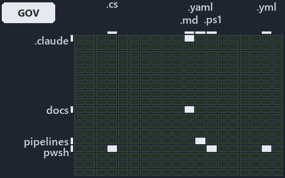

---
catzc:
  immutable:
    with_body_sha: "68221c6edc1d"
    repo_status: locked
    path: docs/explanation/flow/.assets/tests-pin-the-throw-and-fail-open-no-caller/grid.md
    source: docs/explanation/flow/.assets/tests-pin-the-throw-and-fail-open-no-caller/diagram.drawio.png
    role: asset-description
    language: markdown
    filetype: md
    track: docs
    tracktype: documentation
---

# Tests pin the throw and the fail-open, a rule pins detection, and no pipeline calls it: the world-map minimap

```text
Where the files that cite ADR-AUTO-FAILFAST, ADR-FLOW-CD-DETECT and ADR-FLOW-CD-GLOBS sit in the repository: tracks down, file languages across.
6 of 342 cells lit, holding 116 files.
```



This is the world-map minimap in the sidebar of the governance diagram of [Tests pin the throw and the fail-open, a rule pins detection, and
no pipeline calls it][120], which explains [ADR-AUTO-FAILFAST][1], [ADR-FLOW-CD-DETECT][2] and [ADR-FLOW-CD-GLOBS][3]. It lights every cell
of the world map that holds a file citing those codes, so it shows where the decision lives in the repository. Each lit cell has its reason
below, naming the code that selects it.

## What the minimap shows

The grid crosses the 18 tracks (rows) with the 19 file languages (columns) of the world map and lights 6 cells, filled in ink. A cell lit
only by passing mentions (citations in body comments, not in a file's header or text) is touched: a lighter ink. Every other cell is idle, a
grey box: it holds files the slide's ADR codes do not select, or no file at all (288 of the 342 cells hold none). The minimap shows where
the slide sits, not how many files a cell holds; the world-map PDFs show the counts.

- .claude × markdown: 9 lit of 89 files
- docs × markdown: 87 lit of 2761 files
- pipelines × pipeline-yaml: 3 lit of 13 files
- pwsh × csharp: 3 lit of 293 files
- pwsh × powershell: 9 lit of 1649 files
- pwsh × yaml: 5 lit of 115 files

## Key

A lit row prints its track's name; a lit column prints a short code, the first extension of its file language:

- `.cs`: csharp
- `.md`: markdown
- `.yaml`: pipeline-yaml
- `.ps1`: powershell
- `.yml`: yaml

## Why each cell is lit

### .claude × markdown (9 lit files)

Placed: the root folder `.claude/` names the track .claude ([ADR-DSGN-TRACK#1][4]); the extension `.md` names the file language markdown
([ADR-DSGN-TRACK#6][5]). Lit ([ADR-DSGN-TRACK#12][6]) by:

- [.claude/CLAUDE.md][7]: selected by [ADR-AUTO-FAILFAST][1]: the file cites it at line 121 (text).
- [.claude/plans/decisions-2026-10-16.md][8]: selected by [ADR-AUTO-FAILFAST][1]: the file cites it at line 39 (text), line 39 (text), line
  161 (text) and line 168 (text).
- [.claude/plans/plan-adr-code-language.md][9]: selected by [ADR-AUTO-FAILFAST][1]: the file cites it at line 31 (text), line 37 (text),
  line 39 (text), line 89 (text), line 89 (text), line 90 (text), line 92 (text), line 93 (text), line 105 (text) and line 108 (text).
- [.claude/plans/plan-assert-wait.md][10]: selected by [ADR-AUTO-FAILFAST][1]: the file cites it at line 19 (text), line 33 (text), line 41
  (text), line 86 (text), line 88 (text), line 89 (text), line 129 (text) and line 137 (text).
- [.claude/plans/plan-explanation-drift-gaps.md][11]: selected by [ADR-AUTO-FAILFAST][1]: the file cites it at line 51 (text), line 65
  (text) and line 106 (text); selected by [ADR-FLOW-CD-GLOBS][3]: the file cites it at line 60 (text), line 97 (text) and line 109 (text).
- [.claude/plans/prompt-assert-wait-1-watch-blocking.md][12]: selected by [ADR-AUTO-FAILFAST][1]: the file cites it at line 18 (text).
- [.claude/plans/prompt-bounded-folder-enumeration-continue.md][13]: selected by [ADR-AUTO-FAILFAST][1]: the file cites it at line 17
  (text).
- [.claude/plans/questionnaire-2026-10-16.md][14]: selected by [ADR-AUTO-FAILFAST][1]: the file cites it at line 121 (text).
- [.claude/plans/task-assert-wait.md][15]: selected by [ADR-AUTO-FAILFAST][1]: the file cites it at line 54 (text).

### docs × markdown (87 lit files)

Placed: the root folder `docs/` names the track docs ([ADR-DSGN-TRACK#1][4]); the extension `.md` names the file language markdown
([ADR-DSGN-TRACK#6][5]). Lit ([ADR-DSGN-TRACK#12][6]) by:

- [docs/adr/automation/dora-explains.md][16]: selected by [ADR-AUTO-FAILFAST][1]: the file cites it at line 260 (text).
- [docs/adr/automation/fail-fast-with-asserts.md][1]: selected by [ADR-AUTO-FAILFAST][1]: the ADR's own file.
- [docs/adr/flow/dora-explains.md][17]: selected by [ADR-FLOW-CD-DETECT][2]: the file cites it at line 49 (text); selected by
  [ADR-FLOW-CD-GLOBS][3]: the file cites it at line 92 (text).
- [docs/adr/flow/durable-sha-globs.md][3]: selected by [ADR-FLOW-CD-GLOBS][3]: the ADR's own file.
- [docs/adr/flow/pipeline-detection.md][2]: selected by [ADR-FLOW-CD-DETECT][2]: the ADR's own file.
- [docs/adr/index.md][18]: selected by [ADR-AUTO-FAILFAST][1]: the file cites it at line 163 (text); selected by [ADR-FLOW-CD-DETECT][2]:
  the file cites it at line 131 (text); selected by [ADR-FLOW-CD-GLOBS][3]: the file cites it at line 133 (text).
- [docs/how-to/pwsh/manual-test-plan/pipelines-and-globs.md][19]: selected by [ADR-FLOW-CD-GLOBS][3]: the file cites it at line 16 (text).
- [docs/references/.assets/automation/catzc-azure-cli/az-cli-test-assert-share-one-state.drawio.verify.md][20]: selected by
  [ADR-AUTO-FAILFAST][1]: the file cites it at line 63 (text).
- [docs/references/.assets/automation/catzc-base-execution/invoke-executable-two-paths-one-bounded.drawio.verify.md][21]: selected by
  [ADR-AUTO-FAILFAST][1]: the file cites it at line 45 (text), line 58 (text), line 61 (text), line 62 (text) and line 62 (text).
- [docs/references/.assets/automation/catzc-base-globs/protected-module-skip-by-hash.drawio.verify.md][22]: selected by
  [ADR-FLOW-CD-DETECT][2]: the file cites it at line 55 (text); selected by [ADR-FLOW-CD-GLOBS][3]: the file cites it at line 55 (text).
- [docs/references/pipelines/cd-apex.yaml.md][23]: selected by [ADR-FLOW-CD-GLOBS][3]: the file cites it at line 31 (text).
- [docs/references/pipelines/cd-flux.yaml.md][24]: selected by [ADR-FLOW-CD-GLOBS][3]: the file cites it at line 30 (text).
- [docs/references/pipelines/cd-nova.yaml.md][25]: selected by [ADR-FLOW-CD-GLOBS][3]: the file cites it at line 30 (text).
- [docs/references/pipelines/cd-shared.yaml.md][26]: selected by [ADR-FLOW-CD-GLOBS][3]: the file cites it at line 22 (text).
- [docs/references/pipelines/ci-automation.yaml.md][27]: selected by [ADR-FLOW-CD-GLOBS][3]: the file cites it at line 12 (text).
- [docs/references/pipelines/ci-infrastructure.yaml.md][28]: selected by [ADR-FLOW-CD-GLOBS][3]: the file cites it at line 13 (text).
- [docs/references/pipelines/github-workflows/ci-automation.yml.md][29]: selected by [ADR-FLOW-CD-GLOBS][3]: the file cites it at line 12
  (text).
- [docs/references/pwsh/catzc-azure-cli/Assert-AzCliSubscriptionAccessible.ps1.md][30]: selected by [ADR-AUTO-FAILFAST][1]: the file cites
  it at line 22 (text).
- [docs/references/pwsh/catzc-azure-cli/az-cli-test-assert-share-one-state.drawio.md][31]: selected by [ADR-AUTO-FAILFAST][1]: the file
  cites it at line 102 (text).
- [docs/references/pwsh/catzc-azure-devops-buildvalidation/Get-AdoBuildValidations.ps1.md][32]: selected by [ADR-FLOW-CD-GLOBS][3]: the file
  cites it at line 17 (text).
- [docs/references/pwsh/catzc-azure-devops-buildvalidation/Register-AdoBuildValidation.ps1.md][33]: selected by [ADR-FLOW-CD-GLOBS][3]: the
  file cites it at line 14 (text) and line 74 (text).
- [docs/references/pwsh/catzc-azure-devops-buildvalidation/Unregister-AdoBuildValidation.ps1.md][34]: selected by [ADR-FLOW-CD-GLOBS][3]:
  the file cites it at line 15 (text).
- [docs/references/pwsh/catzc-azure-devops-buildvalidation/configs/build-validation.yml.md][35]: selected by [ADR-FLOW-CD-GLOBS][3]: the
  file cites it at line 15 (text).
- [docs/references/pwsh/catzc-azure-devops-buildvalidation/private/Get-BuildValidationPathFilter.ps1.md][36]: selected by
  [ADR-FLOW-CD-GLOBS][3]: the file cites it at line 16 (text).
- [docs/references/pwsh/catzc-azure-templates/Get-BicepDeploymentName.ps1.md][37]: selected by [ADR-FLOW-CD-DETECT][2]: the file cites it at
  line 58 (text).
- [docs/references/pwsh/catzc-base-docs/Test-Glossary.ps1.md][38]: selected by [ADR-AUTO-FAILFAST][1]: the file cites it at line 27 (text).
- [docs/references/pwsh/catzc-base-docs/private/Import-AdrCitationMapFile.ps1.md][39]: selected by [ADR-AUTO-FAILFAST][1]: the file cites it
  at line 15 (text).
- [docs/references/pwsh/catzc-base-docs/tests/Test-Glossary.Tests.ps1.md][40]: selected by [ADR-AUTO-FAILFAST][1]: the file cites it at line
  13 (text).
- [docs/references/pwsh/catzc-base-engines/types/ExecutionEngine.cs.md][41]: selected by [ADR-AUTO-FAILFAST][1]: the file cites it at line
  37 (text).
- [docs/references/pwsh/catzc-base-execution/invoke-executable-two-paths-one-bounded.drawio.md][42]: selected by [ADR-AUTO-FAILFAST][1]: the
  file cites it at line 32 (text) and line 100 (text).
- [docs/references/pwsh/catzc-base-exporter/Get-CatzcContentHash.ps1.md][43]: selected by [ADR-FLOW-CD-GLOBS][3]: the file cites it at line
  14 (text).
- [docs/references/pwsh/catzc-base-git/Import-RepositoryWithHistory.ps1.md][44]: selected by [ADR-AUTO-FAILFAST][1]: the file cites it at
  line 22 (text).
- [docs/references/pwsh/catzc-base-globs.md][45]: selected by [ADR-FLOW-CD-GLOBS][3]: the file cites it at line 27 (text).
- [docs/references/pwsh/catzc-base-globs/Get-ChangedGlobSet.ps1.md][46]: selected by [ADR-FLOW-CD-GLOBS][3]: the file cites it at line 15
  (text) and line 27 (text).
- [docs/references/pwsh/catzc-base-globs/Get-GlobSet.ps1.md][47]: selected by [ADR-FLOW-CD-GLOBS][3]: the file cites it at line 14 (text).
- [docs/references/pwsh/catzc-base-globs/Get-GlobSetChangeRange.ps1.md][48]: selected by [ADR-FLOW-CD-DETECT][2]: the file cites it at line
  15 (text); selected by [ADR-FLOW-CD-GLOBS][3]: the file cites it at line 26 (text).
- [docs/references/pwsh/catzc-base-globs/Get-GlobSetFile.ps1.md][49]: selected by [ADR-FLOW-CD-GLOBS][3]: the file cites it at line 14
  (text) and line 16 (text).
- [docs/references/pwsh/catzc-base-globs/Get-GlobSetHash.ps1.md][50]: selected by [ADR-FLOW-CD-GLOBS][3]: the file cites it at line 20
  (text).
- [docs/references/pwsh/catzc-base-globs/Get-GlobSetTrigger.ps1.md][51]: selected by [ADR-FLOW-CD-GLOBS][3]: the file cites it at line 15
  (text), line 29 (text) and line 30 (text).
- [docs/references/pwsh/catzc-base-globs/Get-MarkerBlastRadius.ps1.md][52]: selected by [ADR-FLOW-CD-GLOBS][3]: the file cites it at line 14
  (text).
- [docs/references/pwsh/catzc-base-globs/Get-ModuleGlobSet.ps1.md][53]: selected by [ADR-FLOW-CD-GLOBS][3]: the file cites it at line 58
  (text), line 61 (text) and line 109 (text).
- [docs/references/pwsh/catzc-base-globs/Get-TrackedFile.ps1.md][54]: selected by [ADR-FLOW-CD-GLOBS][3]: the file cites it at line 15
  (text).
- [docs/references/pwsh/catzc-base-globs/Test-AdoPipelineTriggerGlob.ps1.md][55]: selected by [ADR-FLOW-CD-GLOBS][3]: the file cites it at
  line 24 (text) and line 25 (text).
- [docs/references/pwsh/catzc-base-globs/Test-GitHubWorkflowTriggerGlob.ps1.md][56]: selected by [ADR-FLOW-CD-GLOBS][3]: the file cites it
  at line 24 (text) and line 25 (text).
- [docs/references/pwsh/catzc-base-globs/Test-GlobSetAffected.ps1.md][57]: selected by [ADR-AUTO-FAILFAST][1]: the file cites it at line 25
  (text); selected by [ADR-FLOW-CD-GLOBS][3]: the file cites it at line 17 (text) and line 20 (text).
- [docs/references/pwsh/catzc-base-globs/Test-GlobSetIndependence.ps1.md][58]: selected by [ADR-FLOW-CD-GLOBS][3]: the file cites it at line
  18 (text), line 56 (text) and line 66 (text).
- [docs/references/pwsh/catzc-base-globs/Test-GlobSetTriggerCoverage.ps1.md][59]: selected by [ADR-FLOW-CD-GLOBS][3]: the file cites it at
  line 15 (text).
- [docs/references/pwsh/catzc-base-globs/configs/globs.yml.md][60]: selected by [ADR-FLOW-CD-GLOBS][3]: the file cites it at line 12 (text),
  line 17 (text), line 25 (text), line 27 (text), line 41 (text), line 71 (text) and line 85 (text).
- [docs/references/pwsh/catzc-base-globs/private/Get-ChangedFile.ps1.md][61]: selected by [ADR-FLOW-CD-GLOBS][3]: the file cites it at line
  14 (text).
- [docs/references/pwsh/catzc-base-globs/private/Get-GlobSetMember.ps1.md][62]: selected by [ADR-FLOW-CD-GLOBS][3]: the file cites it at
  line 14 (text).
- [docs/references/pwsh/catzc-base-globs/private/Get-PipelineTrigger.ps1.md][63]: selected by [ADR-FLOW-CD-GLOBS][3]: the file cites it at
  line 16 (text).
- [docs/references/pwsh/catzc-base-globs/private/Test-GlobListEqual.ps1.md][64]: selected by [ADR-FLOW-CD-GLOBS][3]: the file cites it at
  line 18 (text).
- [docs/references/pwsh/catzc-base-globs/protected-module-skip-by-hash.drawio.md][65]: selected by [ADR-FLOW-CD-DETECT][2]: the file cites
  it at line 26 (text) and line 109 (text); selected by [ADR-FLOW-CD-GLOBS][3]: the file cites it at line 33 (text) and line 108 (text).
- [docs/references/pwsh/catzc-base-globs/tests/Get-ChangedFile.Tests.ps1.md][66]: selected by [ADR-FLOW-CD-GLOBS][3]: the file cites it at
  line 13 (text).
- [docs/references/pwsh/catzc-base-globs/tests/Get-ChangedGlobSet.Tests.ps1.md][67]: selected by [ADR-FLOW-CD-GLOBS][3]: the file cites it
  at line 12 (text).
- [docs/references/pwsh/catzc-base-globs/tests/Get-GlobSetChangeRange.Tests.ps1.md][68]: selected by [ADR-FLOW-CD-DETECT][2]: the file cites
  it at line 11 (text).
- [docs/references/pwsh/catzc-base-globs/tests/Get-GlobSetFile.Tests.ps1.md][69]: selected by [ADR-FLOW-CD-GLOBS][3]: the file cites it at
  line 12 (text) and line 13 (text).
- [docs/references/pwsh/catzc-base-globs/tests/Get-GlobSetHash.Tests.ps1.md][70]: selected by [ADR-FLOW-CD-GLOBS][3]: the file cites it at
  line 13 (text).
- [docs/references/pwsh/catzc-base-globs/tests/Get-GlobSetMember.Tests.ps1.md][71]: selected by [ADR-FLOW-CD-GLOBS][3]: the file cites it at
  line 12 (text).
- [docs/references/pwsh/catzc-base-globs/tests/Get-GlobSetTrigger.Tests.ps1.md][72]: selected by [ADR-FLOW-CD-GLOBS][3]: the file cites it
  at line 12 (text).
- [docs/references/pwsh/catzc-base-globs/tests/Get-PipelineTrigger.Tests.ps1.md][73]: selected by [ADR-FLOW-CD-GLOBS][3]: the file cites it
  at line 12 (text).
- [docs/references/pwsh/catzc-base-globs/tests/Get-TrackedFile.Tests.ps1.md][74]: selected by [ADR-FLOW-CD-GLOBS][3]: the file cites it at
  line 11 (text).
- [docs/references/pwsh/catzc-base-globs/tests/GlobSet-Independence.Tests.ps1.md][75]: selected by [ADR-FLOW-CD-GLOBS][3]: the file cites it
  at line 12 (text).
- [docs/references/pwsh/catzc-base-globs/tests/GlobSetTrigger-Coverage.Tests.ps1.md][76]: selected by [ADR-FLOW-CD-GLOBS][3]: the file cites
  it at line 12 (text).
- [docs/references/pwsh/catzc-base-globs/tests/PipelineTrigger-Integrity.Tests.ps1.md][77]: selected by [ADR-FLOW-CD-GLOBS][3]: the file
  cites it at line 13 (text).
- [docs/references/pwsh/catzc-base-globs/tests/Test-GlobSetIndependence.Tests.ps1.md][78]: selected by [ADR-FLOW-CD-GLOBS][3]: the file
  cites it at line 13 (text).
- [docs/references/pwsh/catzc-base-globs/tests/types/GlobPattern.Tests.ps1.md][79]: selected by [ADR-FLOW-CD-GLOBS][3]: the file cites it at
  line 11 (text) and line 13 (text).
- [docs/references/pwsh/catzc-base-globs/tests/types/GlobSet.Tests.ps1.md][80]: selected by [ADR-FLOW-CD-GLOBS][3]: the file cites it at
  line 12 (text) and line 14 (text).
- [docs/references/pwsh/catzc-base-globs/tests/types/GlobsConfig.Tests.ps1.md][81]: selected by [ADR-FLOW-CD-GLOBS][3]: the file cites it at
  line 14 (text), line 16 (text) and line 25 (text).
- [docs/references/pwsh/catzc-base-globs/types/Aspect.cs.md][82]: selected by [ADR-FLOW-CD-GLOBS][3]: the file cites it at line 19 (text).
- [docs/references/pwsh/catzc-base-globs/types/DurableHash.cs.md][83]: selected by [ADR-FLOW-CD-GLOBS][3]: the file cites it at line 11
  (text) and line 17 (text).
- [docs/references/pwsh/catzc-base-globs/types/GlobPattern.cs.md][84]: selected by [ADR-FLOW-CD-GLOBS][3]: the file cites it at line 17
  (text), line 18 (text) and line 19 (text).
- [docs/references/pwsh/catzc-base-globs/types/GlobSet.cs.md][85]: selected by [ADR-FLOW-CD-GLOBS][3]: the file cites it at line 13 (text),
  line 15 (text), line 16 (text), line 22 (text), line 25 (text), line 27 (text), line 30 (text), line 38 (text), line 47 (text), line 65
  (text), line 82 (text), line 92 (text), line 116 (text) and line 124 (text).
- [docs/references/pwsh/catzc-base-globs/types/GlobsConfig.cs.md][86]: selected by [ADR-FLOW-CD-GLOBS][3]: the file cites it at line 13
  (text), line 17 (text), line 20 (text) and line 39 (text).
- [docs/references/pwsh/catzc-base-qualitygates/Test-Automation.ps1.md][87]: selected by [ADR-FLOW-CD-GLOBS][3]: the file cites it at line
  97 (text).
- [docs/references/pwsh/catzc-base-qualitygates/private/Get-GuidScanFiles.ps1.md][88]: selected by [ADR-FLOW-CD-GLOBS][3]: the file cites it
  at line 15 (text).
- [docs/references/pwsh/catzc-base-qualitygates/private/Get-ModuleProtectionIdentity.ps1.md][89]: selected by [ADR-FLOW-CD-GLOBS][3]: the
  file cites it at line 80 (text).
- [docs/references/pwsh/catzc-base-qualitygates/private/Resolve-TestSuite.ps1.md][90]: selected by [ADR-FLOW-CD-GLOBS][3]: the file cites it
  at line 17 (text).
- [docs/references/pwsh/catzc-base-qualitygates/private/Test-TestRunOverBudget.ps1.md][91]: selected by [ADR-AUTO-FAILFAST][1]: the file
  cites it at line 16 (text).
- [docs/references/pwsh/catzc-base-qualitygates/private/Write-TestAutomationVerdict.ps1.md][92]: selected by [ADR-AUTO-FAILFAST][1]: the
  file cites it at line 25 (text).
- [docs/references/pwsh/catzc-base-timeouts/Assert-Wait.ps1.md][93]: selected by [ADR-AUTO-FAILFAST][1]: the file cites it at line 23 (text)
  and line 24 (text).
- [docs/references/pwsh/catzc-base-timeouts/Get-TestTimeLimits.ps1.md][94]: selected by [ADR-AUTO-FAILFAST][1]: the file cites it at line 16
  (text).
- [docs/references/pwsh/catzc-base-timeouts/types/BashSafeguard.cs.md][95]: selected by [ADR-AUTO-FAILFAST][1]: the file cites it at line 12
  (text).
- [docs/references/pwsh/catzc-base-typessystem.md][96]: selected by [ADR-AUTO-FAILFAST][1]: the file cites it at line 64 (text).
- [docs/references/pwsh/catzc-base-typessystem/Assert-LoadedTypesCurrent.ps1.md][97]: selected by [ADR-AUTO-FAILFAST][1]: the file cites it
  at line 15 (text).
- [docs/references/pwsh/catzc-base-typessystem/Build-BashTimeoutHook.ps1.md][98]: selected by [ADR-AUTO-FAILFAST][1]: the file cites it at
  line 15 (text).
- [docs/references/pwsh/claude-hooks/Assert-BashTimeout/Program.cs.md][99]: selected by [ADR-AUTO-FAILFAST][1]: the file cites it at line 12
  (text) and line 39 (text).

### pipelines × pipeline-yaml (3 lit files)

Placed: the root folder `pipelines/` names the track pipelines ([ADR-DSGN-TRACK#1][4]); the extension `.yaml` names the file language
pipeline-yaml ([ADR-DSGN-TRACK#6][5]). Lit ([ADR-DSGN-TRACK#12][6]) by:

- [pipelines/cd-shared.yaml][100]: selected by [ADR-FLOW-CD-GLOBS][3]: the file cites it at line 45 (body comment) (a passing mention only).
- [pipelines/ci-automation.yaml][101]: selected by [ADR-AUTO-FAILFAST][1]: a pipeline that cites nothing itself carries its globset's
  citations, which cite it at `pwsh/Catzc.Base.Docs/configs/adrs.yml` line 132 (text), `pwsh/Catzc.Base.Docs/configs/agents.yml` line 55
  (body comment), `pwsh/Catzc.Base.Docs/configs/agents.yml` line 76 (text), `pwsh/Catzc.Base.Docs/configs/capabilities.yml` line 4 (text),
  `pwsh/Catzc.Base.Folders/tests/Get-ChildPath.Tests.ps1` line 47 (text), `pwsh/Catzc.Base.Folders/tests/types/FolderWalker.Tests.ps1` line
  64 (text), `pwsh/Catzc.Base.QualityGates/configs/terminology.yml` line 585 (text),
  `pwsh/Catzc.Base.Slides/tests/Build-SlideDeck.Tests.ps1` line 145 (text), `pwsh/Catzc.Base.Slides/tests/Build-SlideDeck.Tests.ps1` line
  153 (text) and `pwsh/Catzc.Base.Slides/tests/Test-Slides.Tests.ps1` line 44 (text); selected by [ADR-FLOW-CD-DETECT][2]: a pipeline that
  cites nothing itself carries its globset's citations, which cite it at `pwsh/Catzc.Base.Docs/configs/adrs.yml` line 99 (text) and
  `pwsh/Catzc.Base.QualityGates/configs/analyzer-adr-map.yml` line 11 (text); selected by [ADR-FLOW-CD-GLOBS][3]: a pipeline that cites
  nothing itself carries its globset's citations, which cite it at `pwsh/Catzc.Base.Docs/configs/adrs.yml` line 101 (text),
  `pwsh/Catzc.Base.Globs/Test-GlobSetIndependence.ps1` line 42 (text), `pwsh/Catzc.Base.Globs/tests/GlobSet-Independence.Tests.ps1` line 2
  (text), `pwsh/Catzc.Base.Globs/tests/GlobSet-Independence.Tests.ps1` line 4 (text),
  `pwsh/Catzc.Base.Globs/tests/types/GlobPattern.Tests.ps1` line 58 (text), `pwsh/Catzc.Base.Globs/tests/types/GlobSet.Tests.ps1` line 9
  (text), `pwsh/Catzc.Base.Globs/tests/types/GlobsConfig.Tests.ps1` line 53 (text),
  `pwsh/Catzc.Base.Globs/tests/types/GlobsConfig.Tests.ps1` line 66 (text), `pwsh/Catzc.Base.Globs/tests/types/GlobsConfig.Tests.ps1` line
  77 (text), `pwsh/Catzc.Base.Globs/tests/types/GlobsConfig.Tests.ps1` line 89 (text), `pwsh/Catzc.Base.Globs/types/GlobPattern.cs` line 23
  (text), `pwsh/Catzc.Base.Globs/types/GlobPattern.cs` line 27 (text), `pwsh/Catzc.Base.Globs/types/GlobPattern.cs` line 31 (text),
  `pwsh/Catzc.Base.Globs/types/GlobPattern.cs` line 43 (text), `pwsh/Catzc.Base.Globs/types/GlobPattern.cs` line 47 (text),
  `pwsh/Catzc.Base.Globs/types/GlobPattern.cs` line 56 (text), `pwsh/Catzc.Base.Globs/types/GlobSet.cs` line 54 (text),
  `pwsh/Catzc.Base.Globs/types/GlobsConfig.cs` line 73 (text), `pwsh/Catzc.Base.Globs/types/GlobsConfig.cs` line 136 (text),
  `pwsh/Catzc.Base.Globs/types/GlobsConfig.cs` line 140 (text), `pwsh/Catzc.Base.Globs/types/GlobsConfig.cs` line 154 (text) and
  `pwsh/Catzc.Base.QualityGates/configs/terminology.yml` line 1226 (text).
- [pipelines/extends/cd-customer.yaml][102]: selected by [ADR-FLOW-CD-GLOBS][3]: the file cites it at line 21 (body comment) (a passing
  mention only).

### pwsh × csharp (3 lit files)

Placed: the root folder `pwsh/` names the track pwsh ([ADR-DSGN-TRACK#1][4]); the extension `.cs` names the file language csharp
([ADR-DSGN-TRACK#6][5]). Lit ([ADR-DSGN-TRACK#12][6]) by:

- [pwsh/Catzc.Base.Globs/types/GlobPattern.cs][103]: selected by [ADR-FLOW-CD-GLOBS][3]: the file cites it at line 23 (text), line 27
  (text), line 31 (text), line 43 (text), line 47 (text) and line 56 (text).
- [pwsh/Catzc.Base.Globs/types/GlobSet.cs][104]: selected by [ADR-FLOW-CD-GLOBS][3]: the file cites it at line 54 (text).
- [pwsh/Catzc.Base.Globs/types/GlobsConfig.cs][105]: selected by [ADR-FLOW-CD-GLOBS][3]: the file cites it at line 73 (text), line 136
  (text), line 140 (text) and line 154 (text).

### pwsh × powershell (9 lit files)

Placed: the root folder `pwsh/` names the track pwsh ([ADR-DSGN-TRACK#1][4]); the extension `.ps1` names the file language powershell
([ADR-DSGN-TRACK#6][5]). Lit ([ADR-DSGN-TRACK#12][6]) by:

- [pwsh/Catzc.Base.Folders/tests/Get-ChildPath.Tests.ps1][106]: selected by [ADR-AUTO-FAILFAST][1]: the file cites it at line 47 (text).
- [pwsh/Catzc.Base.Folders/tests/types/FolderWalker.Tests.ps1][107]: selected by [ADR-AUTO-FAILFAST][1]: the file cites it at line 64
  (text).
- [pwsh/Catzc.Base.Globs/Test-GlobSetIndependence.ps1][108]: selected by [ADR-FLOW-CD-GLOBS][3]: the file cites it at line 42 (text).
- [pwsh/Catzc.Base.Globs/tests/GlobSet-Independence.Tests.ps1][109]: selected by [ADR-FLOW-CD-GLOBS][3]: the file cites it at line 2 (text)
  and line 4 (text).
- [pwsh/Catzc.Base.Globs/tests/types/GlobPattern.Tests.ps1][110]: selected by [ADR-FLOW-CD-GLOBS][3]: the file cites it at line 58 (text).
- [pwsh/Catzc.Base.Globs/tests/types/GlobSet.Tests.ps1][111]: selected by [ADR-FLOW-CD-GLOBS][3]: the file cites it at line 9 (text).
- [pwsh/Catzc.Base.Globs/tests/types/GlobsConfig.Tests.ps1][112]: selected by [ADR-FLOW-CD-GLOBS][3]: the file cites it at line 53 (text),
  line 66 (text), line 77 (text) and line 89 (text).
- [pwsh/Catzc.Base.Slides/tests/Build-SlideDeck.Tests.ps1][113]: selected by [ADR-AUTO-FAILFAST][1]: the file cites it at line 145 (text)
  and line 153 (text).
- [pwsh/Catzc.Base.Slides/tests/Test-Slides.Tests.ps1][114]: selected by [ADR-AUTO-FAILFAST][1]: the file cites it at line 44 (text).

### pwsh × yaml (5 lit files)

Placed: the root folder `pwsh/` names the track pwsh ([ADR-DSGN-TRACK#1][4]); the extension `.yml` names the file language yaml
([ADR-DSGN-TRACK#6][5]). Lit ([ADR-DSGN-TRACK#12][6]) by:

- [pwsh/Catzc.Base.Docs/configs/adrs.yml][115]: selected by [ADR-AUTO-FAILFAST][1]: the file cites it at line 132 (text); selected by
  [ADR-FLOW-CD-DETECT][2]: the file cites it at line 99 (text); selected by [ADR-FLOW-CD-GLOBS][3]: the file cites it at line 101 (text).
- [pwsh/Catzc.Base.Docs/configs/agents.yml][116]: selected by [ADR-AUTO-FAILFAST][1]: the file cites it at line 55 (body comment) and line
  76 (text).
- [pwsh/Catzc.Base.Docs/configs/capabilities.yml][117]: selected by [ADR-AUTO-FAILFAST][1]: the file cites it at line 4 (text).
- [pwsh/Catzc.Base.QualityGates/configs/analyzer-adr-map.yml][118]: selected by [ADR-FLOW-CD-DETECT][2]: the file cites it at line 11
  (text).
- [pwsh/Catzc.Base.QualityGates/configs/terminology.yml][119]: selected by [ADR-AUTO-FAILFAST][1]: the file cites it at line 585 (text);
  selected by [ADR-FLOW-CD-GLOBS][3]: the file cites it at line 1226 (text).

## Keywords

- [world map][121]
- [track][122]
- [file language][123]
- [cell][124]
- [lit cell][125]
- [.claude][126]: a track
- [docs][126]: a track
- [pipelines][126]: a track
- [pwsh][126]: a track
- [csharp][127]: a file language
- [markdown][127]: a file language
- [pipeline-yaml][127]: a file language
- [powershell][127]: a file language
- [yaml][127]: a file language

[1]: ../../../../adr/automation/fail-fast-with-asserts.md
[2]: ../../../../adr/flow/pipeline-detection.md
[3]: ../../../../adr/flow/durable-sha-globs.md
[4]: ../../../../adr/design/tracks.md#rule-adr-dsgn-track1
[5]: ../../../../adr/design/tracks.md#rule-adr-dsgn-track6
[6]: ../../../../adr/design/tracks.md#rule-adr-dsgn-track12
[7]: ../../../../../.claude/CLAUDE.md
[8]: ../../../../../.claude/plans/decisions-2026-10-16.md
[9]: ../../../../../.claude/plans/plan-adr-code-language.md
[10]: ../../../../../.claude/plans/plan-assert-wait.md
[11]: ../../../../../.claude/plans/plan-explanation-drift-gaps.md
[12]: ../../../../../.claude/plans/prompt-assert-wait-1-watch-blocking.md
[13]: ../../../../../.claude/plans/prompt-bounded-folder-enumeration-continue.md
[14]: ../../../../../.claude/plans/questionnaire-2026-10-16.md
[15]: ../../../../../.claude/plans/task-assert-wait.md
[16]: ../../../../adr/automation/dora-explains.md
[17]: ../../../../adr/flow/dora-explains.md
[18]: ../../../../adr/index.md
[19]: ../../../../how-to/pwsh/manual-test-plan/pipelines-and-globs.md
[20]: ../../../../references/.assets/automation/catzc-azure-cli/az-cli-test-assert-share-one-state.drawio.verify.md
[21]: ../../../../references/.assets/automation/catzc-base-execution/invoke-executable-two-paths-one-bounded.drawio.verify.md
[22]: ../../../../references/.assets/automation/catzc-base-globs/protected-module-skip-by-hash.drawio.verify.md
[23]: ../../../../references/pipelines/cd-apex.yaml.md
[24]: ../../../../references/pipelines/cd-flux.yaml.md
[25]: ../../../../references/pipelines/cd-nova.yaml.md
[26]: ../../../../references/pipelines/cd-shared.yaml.md
[27]: ../../../../references/pipelines/ci-automation.yaml.md
[28]: ../../../../references/pipelines/ci-infrastructure.yaml.md
[29]: ../../../../references/pipelines/github-workflows/ci-automation.yml.md
[30]: ../../../../references/pwsh/catzc-azure-cli/Assert-AzCliSubscriptionAccessible.ps1.md
[31]: ../../../../references/pwsh/catzc-azure-cli/az-cli-test-assert-share-one-state.drawio.md
[32]: ../../../../references/pwsh/catzc-azure-devops-buildvalidation/Get-AdoBuildValidations.ps1.md
[33]: ../../../../references/pwsh/catzc-azure-devops-buildvalidation/Register-AdoBuildValidation.ps1.md
[34]: ../../../../references/pwsh/catzc-azure-devops-buildvalidation/Unregister-AdoBuildValidation.ps1.md
[35]: ../../../../references/pwsh/catzc-azure-devops-buildvalidation/configs/build-validation.yml.md
[36]: ../../../../references/pwsh/catzc-azure-devops-buildvalidation/private/Get-BuildValidationPathFilter.ps1.md
[37]: ../../../../references/pwsh/catzc-azure-templates/Get-BicepDeploymentName.ps1.md
[38]: ../../../../references/pwsh/catzc-base-docs/Test-Glossary.ps1.md
[39]: ../../../../references/pwsh/catzc-base-docs/private/Import-AdrCitationMapFile.ps1.md
[40]: ../../../../references/pwsh/catzc-base-docs/tests/Test-Glossary.Tests.ps1.md
[41]: ../../../../references/pwsh/catzc-base-engines/types/ExecutionEngine.cs.md
[42]: ../../../../references/pwsh/catzc-base-execution/invoke-executable-two-paths-one-bounded.drawio.md
[43]: ../../../../references/pwsh/catzc-base-exporter/Get-CatzcContentHash.ps1.md
[44]: ../../../../references/pwsh/catzc-base-git/Import-RepositoryWithHistory.ps1.md
[45]: ../../../../references/pwsh/catzc-base-globs.md
[46]: ../../../../references/pwsh/catzc-base-globs/Get-ChangedGlobSet.ps1.md
[47]: ../../../../references/pwsh/catzc-base-globs/Get-GlobSet.ps1.md
[48]: ../../../../references/pwsh/catzc-base-globs/Get-GlobSetChangeRange.ps1.md
[49]: ../../../../references/pwsh/catzc-base-globs/Get-GlobSetFile.ps1.md
[50]: ../../../../references/pwsh/catzc-base-globs/Get-GlobSetHash.ps1.md
[51]: ../../../../references/pwsh/catzc-base-globs/Get-GlobSetTrigger.ps1.md
[52]: ../../../../references/pwsh/catzc-base-globs/Get-MarkerBlastRadius.ps1.md
[53]: ../../../../references/pwsh/catzc-base-globs/Get-ModuleGlobSet.ps1.md
[54]: ../../../../references/pwsh/catzc-base-globs/Get-TrackedFile.ps1.md
[55]: ../../../../references/pwsh/catzc-base-globs/Test-AdoPipelineTriggerGlob.ps1.md
[56]: ../../../../references/pwsh/catzc-base-globs/Test-GitHubWorkflowTriggerGlob.ps1.md
[57]: ../../../../references/pwsh/catzc-base-globs/Test-GlobSetAffected.ps1.md
[58]: ../../../../references/pwsh/catzc-base-globs/Test-GlobSetIndependence.ps1.md
[59]: ../../../../references/pwsh/catzc-base-globs/Test-GlobSetTriggerCoverage.ps1.md
[60]: ../../../../references/pwsh/catzc-base-globs/configs/globs.yml.md
[61]: ../../../../references/pwsh/catzc-base-globs/private/Get-ChangedFile.ps1.md
[62]: ../../../../references/pwsh/catzc-base-globs/private/Get-GlobSetMember.ps1.md
[63]: ../../../../references/pwsh/catzc-base-globs/private/Get-PipelineTrigger.ps1.md
[64]: ../../../../references/pwsh/catzc-base-globs/private/Test-GlobListEqual.ps1.md
[65]: ../../../../references/pwsh/catzc-base-globs/protected-module-skip-by-hash.drawio.md
[66]: ../../../../references/pwsh/catzc-base-globs/tests/Get-ChangedFile.Tests.ps1.md
[67]: ../../../../references/pwsh/catzc-base-globs/tests/Get-ChangedGlobSet.Tests.ps1.md
[68]: ../../../../references/pwsh/catzc-base-globs/tests/Get-GlobSetChangeRange.Tests.ps1.md
[69]: ../../../../references/pwsh/catzc-base-globs/tests/Get-GlobSetFile.Tests.ps1.md
[70]: ../../../../references/pwsh/catzc-base-globs/tests/Get-GlobSetHash.Tests.ps1.md
[71]: ../../../../references/pwsh/catzc-base-globs/tests/Get-GlobSetMember.Tests.ps1.md
[72]: ../../../../references/pwsh/catzc-base-globs/tests/Get-GlobSetTrigger.Tests.ps1.md
[73]: ../../../../references/pwsh/catzc-base-globs/tests/Get-PipelineTrigger.Tests.ps1.md
[74]: ../../../../references/pwsh/catzc-base-globs/tests/Get-TrackedFile.Tests.ps1.md
[75]: ../../../../references/pwsh/catzc-base-globs/tests/GlobSet-Independence.Tests.ps1.md
[76]: ../../../../references/pwsh/catzc-base-globs/tests/GlobSetTrigger-Coverage.Tests.ps1.md
[77]: ../../../../references/pwsh/catzc-base-globs/tests/PipelineTrigger-Integrity.Tests.ps1.md
[78]: ../../../../references/pwsh/catzc-base-globs/tests/Test-GlobSetIndependence.Tests.ps1.md
[79]: ../../../../references/pwsh/catzc-base-globs/tests/types/GlobPattern.Tests.ps1.md
[80]: ../../../../references/pwsh/catzc-base-globs/tests/types/GlobSet.Tests.ps1.md
[81]: ../../../../references/pwsh/catzc-base-globs/tests/types/GlobsConfig.Tests.ps1.md
[82]: ../../../../references/pwsh/catzc-base-globs/types/Aspect.cs.md
[83]: ../../../../references/pwsh/catzc-base-globs/types/DurableHash.cs.md
[84]: ../../../../references/pwsh/catzc-base-globs/types/GlobPattern.cs.md
[85]: ../../../../references/pwsh/catzc-base-globs/types/GlobSet.cs.md
[86]: ../../../../references/pwsh/catzc-base-globs/types/GlobsConfig.cs.md
[87]: ../../../../references/pwsh/catzc-base-qualitygates/Test-Automation.ps1.md
[88]: ../../../../references/pwsh/catzc-base-qualitygates/private/Get-GuidScanFiles.ps1.md
[89]: ../../../../references/pwsh/catzc-base-qualitygates/private/Get-ModuleProtectionIdentity.ps1.md
[90]: ../../../../references/pwsh/catzc-base-qualitygates/private/Resolve-TestSuite.ps1.md
[91]: ../../../../references/pwsh/catzc-base-qualitygates/private/Test-TestRunOverBudget.ps1.md
[92]: ../../../../references/pwsh/catzc-base-qualitygates/private/Write-TestAutomationVerdict.ps1.md
[93]: ../../../../references/pwsh/catzc-base-timeouts/Assert-Wait.ps1.md
[94]: ../../../../references/pwsh/catzc-base-timeouts/Get-TestTimeLimits.ps1.md
[95]: ../../../../references/pwsh/catzc-base-timeouts/types/BashSafeguard.cs.md
[96]: ../../../../references/pwsh/catzc-base-typessystem.md
[97]: ../../../../references/pwsh/catzc-base-typessystem/Assert-LoadedTypesCurrent.ps1.md
[98]: ../../../../references/pwsh/catzc-base-typessystem/Build-BashTimeoutHook.ps1.md
[99]: ../../../../references/pwsh/claude-hooks/Assert-BashTimeout/Program.cs.md
[100]: ../../../../../pipelines/cd-shared.yaml
[101]: ../../../../../pipelines/ci-automation.yaml
[102]: ../../../../../pipelines/extends/cd-customer.yaml
[103]: ../../../../../pwsh/Catzc.Base.Globs/types/GlobPattern.cs
[104]: ../../../../../pwsh/Catzc.Base.Globs/types/GlobSet.cs
[105]: ../../../../../pwsh/Catzc.Base.Globs/types/GlobsConfig.cs
[106]: ../../../../../pwsh/Catzc.Base.Folders/tests/Get-ChildPath.Tests.ps1
[107]: ../../../../../pwsh/Catzc.Base.Folders/tests/types/FolderWalker.Tests.ps1
[108]: ../../../../../pwsh/Catzc.Base.Globs/Test-GlobSetIndependence.ps1
[109]: ../../../../../pwsh/Catzc.Base.Globs/tests/GlobSet-Independence.Tests.ps1
[110]: ../../../../../pwsh/Catzc.Base.Globs/tests/types/GlobPattern.Tests.ps1
[111]: ../../../../../pwsh/Catzc.Base.Globs/tests/types/GlobSet.Tests.ps1
[112]: ../../../../../pwsh/Catzc.Base.Globs/tests/types/GlobsConfig.Tests.ps1
[113]: ../../../../../pwsh/Catzc.Base.Slides/tests/Build-SlideDeck.Tests.ps1
[114]: ../../../../../pwsh/Catzc.Base.Slides/tests/Test-Slides.Tests.ps1
[115]: ../../../../../pwsh/Catzc.Base.Docs/configs/adrs.yml
[116]: ../../../../../pwsh/Catzc.Base.Docs/configs/agents.yml
[117]: ../../../../../pwsh/Catzc.Base.Docs/configs/capabilities.yml
[118]: ../../../../../pwsh/Catzc.Base.QualityGates/configs/analyzer-adr-map.yml
[119]: ../../../../../pwsh/Catzc.Base.QualityGates/configs/terminology.yml
[120]: ../../tests-pin-the-throw-and-fail-open-no-caller.md
[121]: ../../../../adr/glossary.md#world-map
[122]: ../../../../adr/glossary.md#track
[123]: ../../../../adr/glossary.md#file-language
[124]: ../../../../adr/glossary.md#cell
[125]: ../../../../adr/glossary.md#lit-cell
[126]: ../../../../../pwsh/Catzc.Base.Variants/configs/variants.yml
[127]: ../../../../../pwsh/Catzc.Base.Languages/configs/languages.yml
