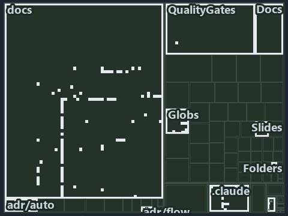

---
catzc:
  immutable:
    with_body_sha: cdaada97fc5e
    repo_status: locked
    path: docs/explanation/flow/.assets/tests-pin-the-throw-and-fail-open-no-caller/tree.md
    source: docs/explanation/flow/.assets/tests-pin-the-throw-and-fail-open-no-caller/diagram.drawio.png
    role: asset-description
    language: markdown
    filetype: md
    track: docs
    tracktype: documentation
---

# Tests pin the throw and the fail-open, a rule pins detection, and the CD stages call it ungated: the tree minimap

```text
Which files cite ADR-AUTO-FAILFAST, ADR-FLOW-CD-DETECT and ADR-FLOW-CD-GLOBS: every file of the world map is a tile, grouped by top-level folder.
116 files lit in 11 groups.
```



This is the tree minimap in the sidebar of the governance diagram of [Tests pin the throw and the fail-open, a rule pins detection, and the
CD stages call it ungated][117], which explains [ADR-AUTO-FAILFAST][1], [ADR-FLOW-CD-DETECT][2] and [ADR-FLOW-CD-GLOBS][3]. It lights every
file that cites those codes, grouped by folder, so it shows which files carry the decision. Each lit group has its reason below, naming the
code that selects it.

## What the minimap shows

The tree draws every file of the world map as a tile, grouped by top-level folder (under `pwsh/` by module, under `docs/adr/` by ADR
domain), and lights 116 files in 11 groups, filled in ink. A lit ADR file has a white rim; a file lit only by passing mentions is a lighter
ink. Every other tile is idle, a grey box: a file the slide's ADR codes do not select.

- docs (docs/ outside docs/adr/): 81 lit files
- .claude: 9 lit files
- Globs (pwsh/Catzc.Base.Globs): 8 lit files
- adr/flow (docs/adr/flow): 3 lit files
- pipelines: 3 lit files
- Docs (pwsh/Catzc.Base.Docs): 3 lit files
- adr/auto (docs/adr/automation): 2 lit files
- Folders (pwsh/Catzc.Base.Folders): 2 lit files
- QualityGates (pwsh/Catzc.Base.QualityGates): 2 lit files
- Slides (pwsh/Catzc.Base.Slides): 2 lit files
- adr/* (the files directly in docs/adr/): 1 lit file

## Why each group is lit

### docs (docs/ outside docs/adr/, 81 lit files)

The group holds the files of docs/ outside docs/adr/; each sits in its world-map cell and is lit by:

- [docs/how-to/pwsh/manual-test-plan/pipelines-and-globs.md][4], in the cell docs × markdown: selected by [ADR-FLOW-CD-GLOBS][3]: the file
  cites it at line 16 (text).
- [docs/references/.assets/automation/catzc-azure-cli/az-cli-test-assert-share-one-state.drawio.verify.md][5], in the cell docs × markdown:
  selected by [ADR-AUTO-FAILFAST][1]: the file cites it at line 63 (text).
- [docs/references/.assets/automation/catzc-base-execution/invoke-executable-two-paths-one-bounded.drawio.verify.md][6], in the cell docs ×
  markdown: selected by [ADR-AUTO-FAILFAST][1]: the file cites it at line 45 (text), line 58 (text), line 61 (text), line 62 (text) and line
  62 (text).
- [docs/references/.assets/automation/catzc-base-globs/protected-module-skip-by-hash.drawio.verify.md][7], in the cell docs × markdown:
  selected by [ADR-FLOW-CD-DETECT][2]: the file cites it at line 55 (text); selected by [ADR-FLOW-CD-GLOBS][3]: the file cites it at line 55
  (text).
- [docs/references/pipelines/cd-apex.yaml.md][8], in the cell docs × markdown: selected by [ADR-FLOW-CD-GLOBS][3]: the file cites it at line
  31 (text).
- [docs/references/pipelines/cd-flux.yaml.md][9], in the cell docs × markdown: selected by [ADR-FLOW-CD-GLOBS][3]: the file cites it at line
  30 (text).
- [docs/references/pipelines/cd-nova.yaml.md][10], in the cell docs × markdown: selected by [ADR-FLOW-CD-GLOBS][3]: the file cites it at
  line 30 (text).
- [docs/references/pipelines/cd-shared.yaml.md][11], in the cell docs × markdown: selected by [ADR-FLOW-CD-GLOBS][3]: the file cites it at
  line 22 (text).
- [docs/references/pipelines/ci-automation.yaml.md][12], in the cell docs × markdown: selected by [ADR-FLOW-CD-GLOBS][3]: the file cites it
  at line 12 (text).
- [docs/references/pipelines/ci-infrastructure.yaml.md][13], in the cell docs × markdown: selected by [ADR-FLOW-CD-GLOBS][3]: the file cites
  it at line 13 (text).
- [docs/references/pipelines/github-workflows/ci-automation.yml.md][14], in the cell docs × markdown: selected by [ADR-FLOW-CD-GLOBS][3]:
  the file cites it at line 12 (text).
- [docs/references/pwsh/catzc-azure-cli/Assert-AzCliSubscriptionAccessible.ps1.md][15], in the cell docs × markdown: selected by
  [ADR-AUTO-FAILFAST][1]: the file cites it at line 22 (text).
- [docs/references/pwsh/catzc-azure-cli/az-cli-test-assert-share-one-state.drawio.md][16], in the cell docs × markdown: selected by
  [ADR-AUTO-FAILFAST][1]: the file cites it at line 102 (text).
- [docs/references/pwsh/catzc-azure-devops-buildvalidation/Get-AdoBuildValidations.ps1.md][17], in the cell docs × markdown: selected by
  [ADR-FLOW-CD-GLOBS][3]: the file cites it at line 17 (text).
- [docs/references/pwsh/catzc-azure-devops-buildvalidation/Register-AdoBuildValidation.ps1.md][18], in the cell docs × markdown: selected by
  [ADR-FLOW-CD-GLOBS][3]: the file cites it at line 14 (text) and line 74 (text).
- [docs/references/pwsh/catzc-azure-devops-buildvalidation/Unregister-AdoBuildValidation.ps1.md][19], in the cell docs × markdown: selected
  by [ADR-FLOW-CD-GLOBS][3]: the file cites it at line 15 (text).
- [docs/references/pwsh/catzc-azure-devops-buildvalidation/configs/build-validation.yml.md][20], in the cell docs × markdown: selected by
  [ADR-FLOW-CD-GLOBS][3]: the file cites it at line 15 (text).
- [docs/references/pwsh/catzc-azure-devops-buildvalidation/private/Get-BuildValidationPathFilter.ps1.md][21], in the cell docs × markdown:
  selected by [ADR-FLOW-CD-GLOBS][3]: the file cites it at line 16 (text).
- [docs/references/pwsh/catzc-azure-templates/Get-BicepDeploymentName.ps1.md][22], in the cell docs × markdown: selected by
  [ADR-FLOW-CD-DETECT][2]: the file cites it at line 58 (text).
- [docs/references/pwsh/catzc-base-docs/Test-Glossary.ps1.md][23], in the cell docs × markdown: selected by [ADR-AUTO-FAILFAST][1]: the file
  cites it at line 27 (text).
- [docs/references/pwsh/catzc-base-docs/private/Import-AdrCitationMapFile.ps1.md][24], in the cell docs × markdown: selected by
  [ADR-AUTO-FAILFAST][1]: the file cites it at line 15 (text).
- [docs/references/pwsh/catzc-base-docs/tests/Test-Glossary.Tests.ps1.md][25], in the cell docs × markdown: selected by
  [ADR-AUTO-FAILFAST][1]: the file cites it at line 13 (text).
- [docs/references/pwsh/catzc-base-engines/types/ExecutionEngine.cs.md][26], in the cell docs × markdown: selected by
  [ADR-AUTO-FAILFAST][1]: the file cites it at line 37 (text).
- [docs/references/pwsh/catzc-base-execution/invoke-executable-two-paths-one-bounded.drawio.md][27], in the cell docs × markdown: selected
  by [ADR-AUTO-FAILFAST][1]: the file cites it at line 32 (text) and line 100 (text).
- [docs/references/pwsh/catzc-base-exporter/Get-CatzcContentHash.ps1.md][28], in the cell docs × markdown: selected by
  [ADR-FLOW-CD-GLOBS][3]: the file cites it at line 14 (text).
- [docs/references/pwsh/catzc-base-git/Import-RepositoryWithHistory.ps1.md][29], in the cell docs × markdown: selected by
  [ADR-AUTO-FAILFAST][1]: the file cites it at line 22 (text).
- [docs/references/pwsh/catzc-base-globs.md][30], in the cell docs × markdown: selected by [ADR-FLOW-CD-GLOBS][3]: the file cites it at line
  27 (text).
- [docs/references/pwsh/catzc-base-globs/Get-ChangedGlobSet.ps1.md][31], in the cell docs × markdown: selected by [ADR-FLOW-CD-GLOBS][3]:
  the file cites it at line 15 (text) and line 27 (text).
- [docs/references/pwsh/catzc-base-globs/Get-GlobSet.ps1.md][32], in the cell docs × markdown: selected by [ADR-FLOW-CD-GLOBS][3]: the file
  cites it at line 14 (text).
- [docs/references/pwsh/catzc-base-globs/Get-GlobSetChangeRange.ps1.md][33], in the cell docs × markdown: selected by
  [ADR-FLOW-CD-DETECT][2]: the file cites it at line 15 (text); selected by [ADR-FLOW-CD-GLOBS][3]: the file cites it at line 26 (text).
- [docs/references/pwsh/catzc-base-globs/Get-GlobSetFile.ps1.md][34], in the cell docs × markdown: selected by [ADR-FLOW-CD-GLOBS][3]: the
  file cites it at line 14 (text) and line 16 (text).
- [docs/references/pwsh/catzc-base-globs/Get-GlobSetHash.ps1.md][35], in the cell docs × markdown: selected by [ADR-FLOW-CD-GLOBS][3]: the
  file cites it at line 20 (text).
- [docs/references/pwsh/catzc-base-globs/Get-GlobSetTrigger.ps1.md][36], in the cell docs × markdown: selected by [ADR-FLOW-CD-GLOBS][3]:
  the file cites it at line 15 (text), line 29 (text) and line 30 (text).
- [docs/references/pwsh/catzc-base-globs/Get-MarkerBlastRadius.ps1.md][37], in the cell docs × markdown: selected by [ADR-FLOW-CD-GLOBS][3]:
  the file cites it at line 14 (text).
- [docs/references/pwsh/catzc-base-globs/Get-ModuleGlobSet.ps1.md][38], in the cell docs × markdown: selected by [ADR-FLOW-CD-GLOBS][3]: the
  file cites it at line 58 (text), line 61 (text) and line 109 (text).
- [docs/references/pwsh/catzc-base-globs/Get-TrackedFile.ps1.md][39], in the cell docs × markdown: selected by [ADR-FLOW-CD-GLOBS][3]: the
  file cites it at line 15 (text).
- [docs/references/pwsh/catzc-base-globs/Test-AdoPipelineTriggerGlob.ps1.md][40], in the cell docs × markdown: selected by
  [ADR-FLOW-CD-GLOBS][3]: the file cites it at line 24 (text) and line 25 (text).
- [docs/references/pwsh/catzc-base-globs/Test-GitHubWorkflowTriggerGlob.ps1.md][41], in the cell docs × markdown: selected by
  [ADR-FLOW-CD-GLOBS][3]: the file cites it at line 24 (text) and line 25 (text).
- [docs/references/pwsh/catzc-base-globs/Test-GlobSetAffected.ps1.md][42], in the cell docs × markdown: selected by [ADR-AUTO-FAILFAST][1]:
  the file cites it at line 25 (text); selected by [ADR-FLOW-CD-GLOBS][3]: the file cites it at line 17 (text) and line 20 (text).
- [docs/references/pwsh/catzc-base-globs/Test-GlobSetIndependence.ps1.md][43], in the cell docs × markdown: selected by
  [ADR-FLOW-CD-GLOBS][3]: the file cites it at line 18 (text), line 56 (text) and line 66 (text).
- [docs/references/pwsh/catzc-base-globs/Test-GlobSetTriggerCoverage.ps1.md][44], in the cell docs × markdown: selected by
  [ADR-FLOW-CD-GLOBS][3]: the file cites it at line 15 (text).
- [docs/references/pwsh/catzc-base-globs/configs/globs.yml.md][45], in the cell docs × markdown: selected by [ADR-FLOW-CD-GLOBS][3]: the
  file cites it at line 12 (text), line 17 (text), line 25 (text), line 27 (text), line 41 (text), line 71 (text) and line 85 (text).
- [docs/references/pwsh/catzc-base-globs/private/Get-ChangedFile.ps1.md][46], in the cell docs × markdown: selected by
  [ADR-FLOW-CD-GLOBS][3]: the file cites it at line 14 (text).
- [docs/references/pwsh/catzc-base-globs/private/Get-GlobSetMember.ps1.md][47], in the cell docs × markdown: selected by
  [ADR-FLOW-CD-GLOBS][3]: the file cites it at line 14 (text).
- [docs/references/pwsh/catzc-base-globs/private/Get-PipelineTrigger.ps1.md][48], in the cell docs × markdown: selected by
  [ADR-FLOW-CD-GLOBS][3]: the file cites it at line 16 (text).
- [docs/references/pwsh/catzc-base-globs/private/Test-GlobListEqual.ps1.md][49], in the cell docs × markdown: selected by
  [ADR-FLOW-CD-GLOBS][3]: the file cites it at line 18 (text).
- [docs/references/pwsh/catzc-base-globs/protected-module-skip-by-hash.drawio.md][50], in the cell docs × markdown: selected by
  [ADR-FLOW-CD-DETECT][2]: the file cites it at line 26 (text) and line 109 (text); selected by [ADR-FLOW-CD-GLOBS][3]: the file cites it at
  line 33 (text) and line 108 (text).
- [docs/references/pwsh/catzc-base-globs/tests/Get-ChangedFile.Tests.ps1.md][51], in the cell docs × markdown: selected by
  [ADR-FLOW-CD-GLOBS][3]: the file cites it at line 13 (text).
- [docs/references/pwsh/catzc-base-globs/tests/Get-ChangedGlobSet.Tests.ps1.md][52], in the cell docs × markdown: selected by
  [ADR-FLOW-CD-GLOBS][3]: the file cites it at line 12 (text).
- [docs/references/pwsh/catzc-base-globs/tests/Get-GlobSetChangeRange.Tests.ps1.md][53], in the cell docs × markdown: selected by
  [ADR-FLOW-CD-DETECT][2]: the file cites it at line 11 (text).
- [docs/references/pwsh/catzc-base-globs/tests/Get-GlobSetFile.Tests.ps1.md][54], in the cell docs × markdown: selected by
  [ADR-FLOW-CD-GLOBS][3]: the file cites it at line 12 (text) and line 13 (text).
- [docs/references/pwsh/catzc-base-globs/tests/Get-GlobSetHash.Tests.ps1.md][55], in the cell docs × markdown: selected by
  [ADR-FLOW-CD-GLOBS][3]: the file cites it at line 13 (text).
- [docs/references/pwsh/catzc-base-globs/tests/Get-GlobSetMember.Tests.ps1.md][56], in the cell docs × markdown: selected by
  [ADR-FLOW-CD-GLOBS][3]: the file cites it at line 12 (text).
- [docs/references/pwsh/catzc-base-globs/tests/Get-GlobSetTrigger.Tests.ps1.md][57], in the cell docs × markdown: selected by
  [ADR-FLOW-CD-GLOBS][3]: the file cites it at line 12 (text).
- [docs/references/pwsh/catzc-base-globs/tests/Get-PipelineTrigger.Tests.ps1.md][58], in the cell docs × markdown: selected by
  [ADR-FLOW-CD-GLOBS][3]: the file cites it at line 12 (text).
- [docs/references/pwsh/catzc-base-globs/tests/Get-TrackedFile.Tests.ps1.md][59], in the cell docs × markdown: selected by
  [ADR-FLOW-CD-GLOBS][3]: the file cites it at line 11 (text).
- [docs/references/pwsh/catzc-base-globs/tests/GlobSet-Independence.Tests.ps1.md][60], in the cell docs × markdown: selected by
  [ADR-FLOW-CD-GLOBS][3]: the file cites it at line 12 (text).
- [docs/references/pwsh/catzc-base-globs/tests/GlobSetTrigger-Coverage.Tests.ps1.md][61], in the cell docs × markdown: selected by
  [ADR-FLOW-CD-GLOBS][3]: the file cites it at line 12 (text).
- [docs/references/pwsh/catzc-base-globs/tests/PipelineTrigger-Integrity.Tests.ps1.md][62], in the cell docs × markdown: selected by
  [ADR-FLOW-CD-GLOBS][3]: the file cites it at line 13 (text).
- [docs/references/pwsh/catzc-base-globs/tests/Test-GlobSetIndependence.Tests.ps1.md][63], in the cell docs × markdown: selected by
  [ADR-FLOW-CD-GLOBS][3]: the file cites it at line 13 (text).
- [docs/references/pwsh/catzc-base-globs/tests/types/GlobPattern.Tests.ps1.md][64], in the cell docs × markdown: selected by
  [ADR-FLOW-CD-GLOBS][3]: the file cites it at line 11 (text) and line 13 (text).
- [docs/references/pwsh/catzc-base-globs/tests/types/GlobSet.Tests.ps1.md][65], in the cell docs × markdown: selected by
  [ADR-FLOW-CD-GLOBS][3]: the file cites it at line 12 (text) and line 14 (text).
- [docs/references/pwsh/catzc-base-globs/tests/types/GlobsConfig.Tests.ps1.md][66], in the cell docs × markdown: selected by
  [ADR-FLOW-CD-GLOBS][3]: the file cites it at line 14 (text), line 16 (text) and line 25 (text).
- [docs/references/pwsh/catzc-base-globs/types/Aspect.cs.md][67], in the cell docs × markdown: selected by [ADR-FLOW-CD-GLOBS][3]: the file
  cites it at line 19 (text).
- [docs/references/pwsh/catzc-base-globs/types/DurableHash.cs.md][68], in the cell docs × markdown: selected by [ADR-FLOW-CD-GLOBS][3]: the
  file cites it at line 11 (text) and line 17 (text).
- [docs/references/pwsh/catzc-base-globs/types/GlobPattern.cs.md][69], in the cell docs × markdown: selected by [ADR-FLOW-CD-GLOBS][3]: the
  file cites it at line 17 (text), line 18 (text) and line 19 (text).
- [docs/references/pwsh/catzc-base-globs/types/GlobSet.cs.md][70], in the cell docs × markdown: selected by [ADR-FLOW-CD-GLOBS][3]: the file
  cites it at line 13 (text), line 15 (text), line 16 (text), line 22 (text), line 25 (text), line 27 (text), line 30 (text), line 38
  (text), line 47 (text), line 65 (text), line 82 (text), line 92 (text), line 116 (text) and line 124 (text).
- [docs/references/pwsh/catzc-base-globs/types/GlobsConfig.cs.md][71], in the cell docs × markdown: selected by [ADR-FLOW-CD-GLOBS][3]: the
  file cites it at line 13 (text), line 17 (text), line 20 (text) and line 39 (text).
- [docs/references/pwsh/catzc-base-qualitygates/Test-Automation.ps1.md][72], in the cell docs × markdown: selected by
  [ADR-FLOW-CD-GLOBS][3]: the file cites it at line 97 (text).
- [docs/references/pwsh/catzc-base-qualitygates/private/Get-GuidScanFiles.ps1.md][73], in the cell docs × markdown: selected by
  [ADR-FLOW-CD-GLOBS][3]: the file cites it at line 15 (text).
- [docs/references/pwsh/catzc-base-qualitygates/private/Get-ModuleProtectionIdentity.ps1.md][74], in the cell docs × markdown: selected by
  [ADR-FLOW-CD-GLOBS][3]: the file cites it at line 80 (text).
- [docs/references/pwsh/catzc-base-qualitygates/private/Resolve-TestSuite.ps1.md][75], in the cell docs × markdown: selected by
  [ADR-FLOW-CD-GLOBS][3]: the file cites it at line 17 (text).
- [docs/references/pwsh/catzc-base-qualitygates/private/Test-TestRunOverBudget.ps1.md][76], in the cell docs × markdown: selected by
  [ADR-AUTO-FAILFAST][1]: the file cites it at line 16 (text).
- [docs/references/pwsh/catzc-base-qualitygates/private/Write-TestAutomationVerdict.ps1.md][77], in the cell docs × markdown: selected by
  [ADR-AUTO-FAILFAST][1]: the file cites it at line 25 (text).
- [docs/references/pwsh/catzc-base-timeouts/Assert-Wait.ps1.md][78], in the cell docs × markdown: selected by [ADR-AUTO-FAILFAST][1]: the
  file cites it at line 23 (text) and line 24 (text).
- [docs/references/pwsh/catzc-base-timeouts/Get-TestTimeLimits.ps1.md][79], in the cell docs × markdown: selected by [ADR-AUTO-FAILFAST][1]:
  the file cites it at line 16 (text).
- [docs/references/pwsh/catzc-base-timeouts/types/BashSafeguard.cs.md][80], in the cell docs × markdown: selected by [ADR-AUTO-FAILFAST][1]:
  the file cites it at line 12 (text).
- [docs/references/pwsh/catzc-base-typessystem.md][81], in the cell docs × markdown: selected by [ADR-AUTO-FAILFAST][1]: the file cites it
  at line 64 (text).
- [docs/references/pwsh/catzc-base-typessystem/Assert-LoadedTypesCurrent.ps1.md][82], in the cell docs × markdown: selected by
  [ADR-AUTO-FAILFAST][1]: the file cites it at line 15 (text).
- [docs/references/pwsh/catzc-base-typessystem/Build-BashTimeoutHook.ps1.md][83], in the cell docs × markdown: selected by
  [ADR-AUTO-FAILFAST][1]: the file cites it at line 15 (text).
- [docs/references/pwsh/claude-hooks/Assert-BashTimeout/Program.cs.md][84], in the cell docs × markdown: selected by [ADR-AUTO-FAILFAST][1]:
  the file cites it at line 12 (text) and line 39 (text).

### .claude (9 lit files)

The group holds the files of .claude; each sits in its world-map cell and is lit by:

- [.claude/CLAUDE.md][85], in the cell .claude × markdown: selected by [ADR-AUTO-FAILFAST][1]: the file cites it at line 121 (text).
- [.claude/plans/decisions-2026-10-16.md][86], in the cell .claude × markdown: selected by [ADR-AUTO-FAILFAST][1]: the file cites it at line
  39 (text), line 39 (text), line 161 (text) and line 168 (text).
- [.claude/plans/plan-adr-code-language.md][87], in the cell .claude × markdown: selected by [ADR-AUTO-FAILFAST][1]: the file cites it at
  line 31 (text), line 37 (text), line 39 (text), line 89 (text), line 89 (text), line 90 (text), line 92 (text), line 93 (text), line 105
  (text) and line 108 (text).
- [.claude/plans/plan-assert-wait.md][88], in the cell .claude × markdown: selected by [ADR-AUTO-FAILFAST][1]: the file cites it at line 19
  (text), line 33 (text), line 41 (text), line 86 (text), line 88 (text), line 89 (text), line 129 (text) and line 137 (text).
- [.claude/plans/plan-explanation-drift-gaps.md][89], in the cell .claude × markdown: selected by [ADR-AUTO-FAILFAST][1]: the file cites it
  at line 51 (text), line 65 (text) and line 106 (text); selected by [ADR-FLOW-CD-GLOBS][3]: the file cites it at line 60 (text), line 97
  (text) and line 109 (text).
- [.claude/plans/prompt-assert-wait-1-watch-blocking.md][90], in the cell .claude × markdown: selected by [ADR-AUTO-FAILFAST][1]: the file
  cites it at line 18 (text).
- [.claude/plans/prompt-bounded-folder-enumeration-continue.md][91], in the cell .claude × markdown: selected by [ADR-AUTO-FAILFAST][1]: the
  file cites it at line 17 (text).
- [.claude/plans/questionnaire-2026-10-16.md][92], in the cell .claude × markdown: selected by [ADR-AUTO-FAILFAST][1]: the file cites it at
  line 121 (text).
- [.claude/plans/task-assert-wait.md][93], in the cell .claude × markdown: selected by [ADR-AUTO-FAILFAST][1]: the file cites it at line 54
  (text).

### Globs (pwsh/Catzc.Base.Globs, 8 lit files)

The group holds the files of pwsh/Catzc.Base.Globs; each sits in its world-map cell and is lit by:

- [pwsh/Catzc.Base.Globs/Test-GlobSetIndependence.ps1][94], in the cell pwsh × powershell: selected by [ADR-FLOW-CD-GLOBS][3]: the file
  cites it at line 42 (text).
- [pwsh/Catzc.Base.Globs/tests/GlobSet-Independence.Tests.ps1][95], in the cell pwsh × powershell: selected by [ADR-FLOW-CD-GLOBS][3]: the
  file cites it at line 2 (text) and line 4 (text).
- [pwsh/Catzc.Base.Globs/tests/types/GlobPattern.Tests.ps1][96], in the cell pwsh × powershell: selected by [ADR-FLOW-CD-GLOBS][3]: the file
  cites it at line 58 (text).
- [pwsh/Catzc.Base.Globs/tests/types/GlobSet.Tests.ps1][97], in the cell pwsh × powershell: selected by [ADR-FLOW-CD-GLOBS][3]: the file
  cites it at line 9 (text).
- [pwsh/Catzc.Base.Globs/tests/types/GlobsConfig.Tests.ps1][98], in the cell pwsh × powershell: selected by [ADR-FLOW-CD-GLOBS][3]: the file
  cites it at line 53 (text), line 66 (text), line 77 (text) and line 89 (text).
- [pwsh/Catzc.Base.Globs/types/GlobPattern.cs][99], in the cell pwsh × csharp: selected by [ADR-FLOW-CD-GLOBS][3]: the file cites it at line
  23 (text), line 27 (text), line 31 (text), line 43 (text), line 47 (text) and line 56 (text).
- [pwsh/Catzc.Base.Globs/types/GlobSet.cs][100], in the cell pwsh × csharp: selected by [ADR-FLOW-CD-GLOBS][3]: the file cites it at line 54
  (text).
- [pwsh/Catzc.Base.Globs/types/GlobsConfig.cs][101], in the cell pwsh × csharp: selected by [ADR-FLOW-CD-GLOBS][3]: the file cites it at
  line 73 (text), line 136 (text), line 140 (text) and line 154 (text).

### adr/flow (docs/adr/flow, 3 lit files)

The group holds the files of docs/adr/flow; each sits in its world-map cell and is lit by:

- [docs/adr/flow/dora-explains.md][102], in the cell docs × markdown: selected by [ADR-FLOW-CD-DETECT][2]: the file cites it at line 49
  (text); selected by [ADR-FLOW-CD-GLOBS][3]: the file cites it at line 92 (text).
- [docs/adr/flow/durable-sha-globs.md][3], in the cell docs × markdown: selected by [ADR-FLOW-CD-GLOBS][3]: the ADR's own file.
- [docs/adr/flow/pipeline-detection.md][2], in the cell docs × markdown: selected by [ADR-FLOW-CD-DETECT][2]: the ADR's own file.

### pipelines (3 lit files)

The group holds the files of pipelines; each sits in its world-map cell and is lit by:

- [pipelines/cd-shared.yaml][103], in the cell pipelines × pipeline-yaml: selected by [ADR-FLOW-CD-GLOBS][3]: the file cites it at line 45
  (body comment) (a passing mention only).
- [pipelines/ci-automation.yaml][104], in the cell pipelines × pipeline-yaml: selected by [ADR-AUTO-FAILFAST][1]: a pipeline that cites
  nothing itself carries its globset's citations, which cite it at `pwsh/Catzc.Base.Docs/configs/adrs.yml` line 132 (text),
  `pwsh/Catzc.Base.Docs/configs/agents.yml` line 55 (body comment), `pwsh/Catzc.Base.Docs/configs/agents.yml` line 76 (text),
  `pwsh/Catzc.Base.Docs/configs/capabilities.yml` line 4 (text), `pwsh/Catzc.Base.Folders/tests/Get-ChildPath.Tests.ps1` line 47 (text),
  `pwsh/Catzc.Base.Folders/tests/types/FolderWalker.Tests.ps1` line 64 (text), `pwsh/Catzc.Base.Slides/tests/Build-SlideDeck.Tests.ps1` line
  145 (text), `pwsh/Catzc.Base.Slides/tests/Build-SlideDeck.Tests.ps1` line 153 (text) and
  `pwsh/Catzc.Base.Slides/tests/Test-Slides.Tests.ps1` line 44 (text); selected by [ADR-FLOW-CD-DETECT][2]: a pipeline that cites nothing
  itself carries its globset's citations, which cite it at `pwsh/Catzc.Base.Docs/configs/adrs.yml` line 99 (text) and
  `pwsh/Catzc.Base.QualityGates/configs/analyzer-adr-map.yml` line 11 (text); selected by [ADR-FLOW-CD-GLOBS][3]: a pipeline that cites
  nothing itself carries its globset's citations, which cite it at `pwsh/Catzc.Base.Docs/configs/adrs.yml` line 101 (text),
  `pwsh/Catzc.Base.Globs/Test-GlobSetIndependence.ps1` line 42 (text), `pwsh/Catzc.Base.Globs/tests/GlobSet-Independence.Tests.ps1` line 2
  (text), `pwsh/Catzc.Base.Globs/tests/GlobSet-Independence.Tests.ps1` line 4 (text),
  `pwsh/Catzc.Base.Globs/tests/types/GlobPattern.Tests.ps1` line 58 (text), `pwsh/Catzc.Base.Globs/tests/types/GlobSet.Tests.ps1` line 9
  (text), `pwsh/Catzc.Base.Globs/tests/types/GlobsConfig.Tests.ps1` line 53 (text),
  `pwsh/Catzc.Base.Globs/tests/types/GlobsConfig.Tests.ps1` line 66 (text), `pwsh/Catzc.Base.Globs/tests/types/GlobsConfig.Tests.ps1` line
  77 (text), `pwsh/Catzc.Base.Globs/tests/types/GlobsConfig.Tests.ps1` line 89 (text), `pwsh/Catzc.Base.Globs/types/GlobPattern.cs` line 23
  (text), `pwsh/Catzc.Base.Globs/types/GlobPattern.cs` line 27 (text), `pwsh/Catzc.Base.Globs/types/GlobPattern.cs` line 31 (text),
  `pwsh/Catzc.Base.Globs/types/GlobPattern.cs` line 43 (text), `pwsh/Catzc.Base.Globs/types/GlobPattern.cs` line 47 (text),
  `pwsh/Catzc.Base.Globs/types/GlobPattern.cs` line 56 (text), `pwsh/Catzc.Base.Globs/types/GlobSet.cs` line 54 (text),
  `pwsh/Catzc.Base.Globs/types/GlobsConfig.cs` line 73 (text), `pwsh/Catzc.Base.Globs/types/GlobsConfig.cs` line 136 (text),
  `pwsh/Catzc.Base.Globs/types/GlobsConfig.cs` line 140 (text), `pwsh/Catzc.Base.Globs/types/GlobsConfig.cs` line 154 (text) and
  `pwsh/Catzc.Base.QualityGates/configs/terminology.yml` line 1076 (text).
- [pipelines/extends/cd-customer.yaml][105], in the cell pipelines × pipeline-yaml: selected by [ADR-FLOW-CD-GLOBS][3]: the file cites it at
  line 21 (body comment) (a passing mention only).

### Docs (pwsh/Catzc.Base.Docs, 3 lit files)

The group holds the files of pwsh/Catzc.Base.Docs; each sits in its world-map cell and is lit by:

- [pwsh/Catzc.Base.Docs/configs/adrs.yml][106], in the cell pwsh × yaml: selected by [ADR-AUTO-FAILFAST][1]: the file cites it at line 132
  (text); selected by [ADR-FLOW-CD-DETECT][2]: the file cites it at line 99 (text); selected by [ADR-FLOW-CD-GLOBS][3]: the file cites it at
  line 101 (text).
- [pwsh/Catzc.Base.Docs/configs/agents.yml][107], in the cell pwsh × yaml: selected by [ADR-AUTO-FAILFAST][1]: the file cites it at line 55
  (body comment) and line 76 (text).
- [pwsh/Catzc.Base.Docs/configs/capabilities.yml][108], in the cell pwsh × yaml: selected by [ADR-AUTO-FAILFAST][1]: the file cites it at
  line 4 (text).

### adr/auto (docs/adr/automation, 2 lit files)

The group holds the files of docs/adr/automation; each sits in its world-map cell and is lit by:

- [docs/adr/automation/dora-explains.md][109], in the cell docs × markdown: selected by [ADR-AUTO-FAILFAST][1]: the file cites it at line
  260 (text).
- [docs/adr/automation/fail-fast-with-asserts.md][1], in the cell docs × markdown: selected by [ADR-AUTO-FAILFAST][1]: the ADR's own file.

### Folders (pwsh/Catzc.Base.Folders, 2 lit files)

The group holds the files of pwsh/Catzc.Base.Folders; each sits in its world-map cell and is lit by:

- [pwsh/Catzc.Base.Folders/tests/Get-ChildPath.Tests.ps1][110], in the cell pwsh × powershell: selected by [ADR-AUTO-FAILFAST][1]: the file
  cites it at line 47 (text).
- [pwsh/Catzc.Base.Folders/tests/types/FolderWalker.Tests.ps1][111], in the cell pwsh × powershell: selected by [ADR-AUTO-FAILFAST][1]: the
  file cites it at line 64 (text).

### QualityGates (pwsh/Catzc.Base.QualityGates, 2 lit files)

The group holds the files of pwsh/Catzc.Base.QualityGates; each sits in its world-map cell and is lit by:

- [pwsh/Catzc.Base.QualityGates/configs/analyzer-adr-map.yml][112], in the cell pwsh × yaml: selected by [ADR-FLOW-CD-DETECT][2]: the file
  cites it at line 11 (text).
- [pwsh/Catzc.Base.QualityGates/configs/terminology.yml][113], in the cell pwsh × yaml: selected by [ADR-FLOW-CD-GLOBS][3]: the file cites
  it at line 1076 (text).

### Slides (pwsh/Catzc.Base.Slides, 2 lit files)

The group holds the files of pwsh/Catzc.Base.Slides; each sits in its world-map cell and is lit by:

- [pwsh/Catzc.Base.Slides/tests/Build-SlideDeck.Tests.ps1][114], in the cell pwsh × powershell: selected by [ADR-AUTO-FAILFAST][1]: the file
  cites it at line 145 (text) and line 153 (text).
- [pwsh/Catzc.Base.Slides/tests/Test-Slides.Tests.ps1][115], in the cell pwsh × powershell: selected by [ADR-AUTO-FAILFAST][1]: the file
  cites it at line 44 (text).

### adr/* (the files directly in docs/adr/, 1 lit file)

The group holds the files of the files directly in docs/adr/; each sits in its world-map cell and is lit by:

- [docs/adr/index.md][116], in the cell docs × markdown: selected by [ADR-AUTO-FAILFAST][1]: the file cites it at line 163 (text); selected
  by [ADR-FLOW-CD-DETECT][2]: the file cites it at line 131 (text); selected by [ADR-FLOW-CD-GLOBS][3]: the file cites it at line 133
  (text).

## Keywords

- [world map][118]
- [track][119]
- [file language][120]
- [cell][121]
- [lit cell][122]
- [.claude][123]: a track
- [docs][123]: a track
- [pipelines][123]: a track
- [pwsh][123]: a track
- [csharp][124]: a file language
- [markdown][124]: a file language
- [pipeline-yaml][124]: a file language
- [powershell][124]: a file language
- [yaml][124]: a file language

[1]: ../../../../adr/automation/fail-fast-with-asserts.md
[2]: ../../../../adr/flow/pipeline-detection.md
[3]: ../../../../adr/flow/durable-sha-globs.md
[4]: ../../../../how-to/pwsh/manual-test-plan/pipelines-and-globs.md
[5]: ../../../../references/.assets/automation/catzc-azure-cli/az-cli-test-assert-share-one-state.drawio.verify.md
[6]: ../../../../references/.assets/automation/catzc-base-execution/invoke-executable-two-paths-one-bounded.drawio.verify.md
[7]: ../../../../references/.assets/automation/catzc-base-globs/protected-module-skip-by-hash.drawio.verify.md
[8]: ../../../../references/pipelines/cd-apex.yaml.md
[9]: ../../../../references/pipelines/cd-flux.yaml.md
[10]: ../../../../references/pipelines/cd-nova.yaml.md
[11]: ../../../../references/pipelines/cd-shared.yaml.md
[12]: ../../../../references/pipelines/ci-automation.yaml.md
[13]: ../../../../references/pipelines/ci-infrastructure.yaml.md
[14]: ../../../../references/pipelines/github-workflows/ci-automation.yml.md
[15]: ../../../../references/pwsh/catzc-azure-cli/Assert-AzCliSubscriptionAccessible.ps1.md
[16]: ../../../../references/pwsh/catzc-azure-cli/az-cli-test-assert-share-one-state.drawio.md
[17]: ../../../../references/pwsh/catzc-azure-devops-buildvalidation/Get-AdoBuildValidations.ps1.md
[18]: ../../../../references/pwsh/catzc-azure-devops-buildvalidation/Register-AdoBuildValidation.ps1.md
[19]: ../../../../references/pwsh/catzc-azure-devops-buildvalidation/Unregister-AdoBuildValidation.ps1.md
[20]: ../../../../references/pwsh/catzc-azure-devops-buildvalidation/configs/build-validation.yml.md
[21]: ../../../../references/pwsh/catzc-azure-devops-buildvalidation/private/Get-BuildValidationPathFilter.ps1.md
[22]: ../../../../references/pwsh/catzc-azure-templates/Get-BicepDeploymentName.ps1.md
[23]: ../../../../references/pwsh/catzc-base-docs/Test-Glossary.ps1.md
[24]: ../../../../references/pwsh/catzc-base-docs/private/Import-AdrCitationMapFile.ps1.md
[25]: ../../../../references/pwsh/catzc-base-docs/tests/Test-Glossary.Tests.ps1.md
[26]: ../../../../references/pwsh/catzc-base-engines/types/ExecutionEngine.cs.md
[27]: ../../../../references/pwsh/catzc-base-execution/invoke-executable-two-paths-one-bounded.drawio.md
[28]: ../../../../references/pwsh/catzc-base-exporter/Get-CatzcContentHash.ps1.md
[29]: ../../../../references/pwsh/catzc-base-git/Import-RepositoryWithHistory.ps1.md
[30]: ../../../../references/pwsh/catzc-base-globs.md
[31]: ../../../../references/pwsh/catzc-base-globs/Get-ChangedGlobSet.ps1.md
[32]: ../../../../references/pwsh/catzc-base-globs/Get-GlobSet.ps1.md
[33]: ../../../../references/pwsh/catzc-base-globs/Get-GlobSetChangeRange.ps1.md
[34]: ../../../../references/pwsh/catzc-base-globs/Get-GlobSetFile.ps1.md
[35]: ../../../../references/pwsh/catzc-base-globs/Get-GlobSetHash.ps1.md
[36]: ../../../../references/pwsh/catzc-base-globs/Get-GlobSetTrigger.ps1.md
[37]: ../../../../references/pwsh/catzc-base-globs/Get-MarkerBlastRadius.ps1.md
[38]: ../../../../references/pwsh/catzc-base-globs/Get-ModuleGlobSet.ps1.md
[39]: ../../../../references/pwsh/catzc-base-globs/Get-TrackedFile.ps1.md
[40]: ../../../../references/pwsh/catzc-base-globs/Test-AdoPipelineTriggerGlob.ps1.md
[41]: ../../../../references/pwsh/catzc-base-globs/Test-GitHubWorkflowTriggerGlob.ps1.md
[42]: ../../../../references/pwsh/catzc-base-globs/Test-GlobSetAffected.ps1.md
[43]: ../../../../references/pwsh/catzc-base-globs/Test-GlobSetIndependence.ps1.md
[44]: ../../../../references/pwsh/catzc-base-globs/Test-GlobSetTriggerCoverage.ps1.md
[45]: ../../../../references/pwsh/catzc-base-globs/configs/globs.yml.md
[46]: ../../../../references/pwsh/catzc-base-globs/private/Get-ChangedFile.ps1.md
[47]: ../../../../references/pwsh/catzc-base-globs/private/Get-GlobSetMember.ps1.md
[48]: ../../../../references/pwsh/catzc-base-globs/private/Get-PipelineTrigger.ps1.md
[49]: ../../../../references/pwsh/catzc-base-globs/private/Test-GlobListEqual.ps1.md
[50]: ../../../../references/pwsh/catzc-base-globs/protected-module-skip-by-hash.drawio.md
[51]: ../../../../references/pwsh/catzc-base-globs/tests/Get-ChangedFile.Tests.ps1.md
[52]: ../../../../references/pwsh/catzc-base-globs/tests/Get-ChangedGlobSet.Tests.ps1.md
[53]: ../../../../references/pwsh/catzc-base-globs/tests/Get-GlobSetChangeRange.Tests.ps1.md
[54]: ../../../../references/pwsh/catzc-base-globs/tests/Get-GlobSetFile.Tests.ps1.md
[55]: ../../../../references/pwsh/catzc-base-globs/tests/Get-GlobSetHash.Tests.ps1.md
[56]: ../../../../references/pwsh/catzc-base-globs/tests/Get-GlobSetMember.Tests.ps1.md
[57]: ../../../../references/pwsh/catzc-base-globs/tests/Get-GlobSetTrigger.Tests.ps1.md
[58]: ../../../../references/pwsh/catzc-base-globs/tests/Get-PipelineTrigger.Tests.ps1.md
[59]: ../../../../references/pwsh/catzc-base-globs/tests/Get-TrackedFile.Tests.ps1.md
[60]: ../../../../references/pwsh/catzc-base-globs/tests/GlobSet-Independence.Tests.ps1.md
[61]: ../../../../references/pwsh/catzc-base-globs/tests/GlobSetTrigger-Coverage.Tests.ps1.md
[62]: ../../../../references/pwsh/catzc-base-globs/tests/PipelineTrigger-Integrity.Tests.ps1.md
[63]: ../../../../references/pwsh/catzc-base-globs/tests/Test-GlobSetIndependence.Tests.ps1.md
[64]: ../../../../references/pwsh/catzc-base-globs/tests/types/GlobPattern.Tests.ps1.md
[65]: ../../../../references/pwsh/catzc-base-globs/tests/types/GlobSet.Tests.ps1.md
[66]: ../../../../references/pwsh/catzc-base-globs/tests/types/GlobsConfig.Tests.ps1.md
[67]: ../../../../references/pwsh/catzc-base-globs/types/Aspect.cs.md
[68]: ../../../../references/pwsh/catzc-base-globs/types/DurableHash.cs.md
[69]: ../../../../references/pwsh/catzc-base-globs/types/GlobPattern.cs.md
[70]: ../../../../references/pwsh/catzc-base-globs/types/GlobSet.cs.md
[71]: ../../../../references/pwsh/catzc-base-globs/types/GlobsConfig.cs.md
[72]: ../../../../references/pwsh/catzc-base-qualitygates/Test-Automation.ps1.md
[73]: ../../../../references/pwsh/catzc-base-qualitygates/private/Get-GuidScanFiles.ps1.md
[74]: ../../../../references/pwsh/catzc-base-qualitygates/private/Get-ModuleProtectionIdentity.ps1.md
[75]: ../../../../references/pwsh/catzc-base-qualitygates/private/Resolve-TestSuite.ps1.md
[76]: ../../../../references/pwsh/catzc-base-qualitygates/private/Test-TestRunOverBudget.ps1.md
[77]: ../../../../references/pwsh/catzc-base-qualitygates/private/Write-TestAutomationVerdict.ps1.md
[78]: ../../../../references/pwsh/catzc-base-timeouts/Assert-Wait.ps1.md
[79]: ../../../../references/pwsh/catzc-base-timeouts/Get-TestTimeLimits.ps1.md
[80]: ../../../../references/pwsh/catzc-base-timeouts/types/BashSafeguard.cs.md
[81]: ../../../../references/pwsh/catzc-base-typessystem.md
[82]: ../../../../references/pwsh/catzc-base-typessystem/Assert-LoadedTypesCurrent.ps1.md
[83]: ../../../../references/pwsh/catzc-base-typessystem/Build-BashTimeoutHook.ps1.md
[84]: ../../../../references/pwsh/claude-hooks/Assert-BashTimeout/Program.cs.md
[85]: ../../../../../.claude/CLAUDE.md
[86]: ../../../../../.claude/plans/decisions-2026-10-16.md
[87]: ../../../../../.claude/plans/plan-adr-code-language.md
[88]: ../../../../../.claude/plans/plan-assert-wait.md
[89]: ../../../../../.claude/plans/plan-explanation-drift-gaps.md
[90]: ../../../../../.claude/plans/prompt-assert-wait-1-watch-blocking.md
[91]: ../../../../../.claude/plans/prompt-bounded-folder-enumeration-continue.md
[92]: ../../../../../.claude/plans/questionnaire-2026-10-16.md
[93]: ../../../../../.claude/plans/task-assert-wait.md
[94]: ../../../../../pwsh/Catzc.Base.Globs/Test-GlobSetIndependence.ps1
[95]: ../../../../../pwsh/Catzc.Base.Globs/tests/GlobSet-Independence.Tests.ps1
[96]: ../../../../../pwsh/Catzc.Base.Globs/tests/types/GlobPattern.Tests.ps1
[97]: ../../../../../pwsh/Catzc.Base.Globs/tests/types/GlobSet.Tests.ps1
[98]: ../../../../../pwsh/Catzc.Base.Globs/tests/types/GlobsConfig.Tests.ps1
[99]: ../../../../../pwsh/Catzc.Base.Globs/types/GlobPattern.cs
[100]: ../../../../../pwsh/Catzc.Base.Globs/types/GlobSet.cs
[101]: ../../../../../pwsh/Catzc.Base.Globs/types/GlobsConfig.cs
[102]: ../../../../adr/flow/dora-explains.md
[103]: ../../../../../pipelines/cd-shared.yaml
[104]: ../../../../../pipelines/ci-automation.yaml
[105]: ../../../../../pipelines/extends/cd-customer.yaml
[106]: ../../../../../pwsh/Catzc.Base.Docs/configs/adrs.yml
[107]: ../../../../../pwsh/Catzc.Base.Docs/configs/agents.yml
[108]: ../../../../../pwsh/Catzc.Base.Docs/configs/capabilities.yml
[109]: ../../../../adr/automation/dora-explains.md
[110]: ../../../../../pwsh/Catzc.Base.Folders/tests/Get-ChildPath.Tests.ps1
[111]: ../../../../../pwsh/Catzc.Base.Folders/tests/types/FolderWalker.Tests.ps1
[112]: ../../../../../pwsh/Catzc.Base.QualityGates/configs/analyzer-adr-map.yml
[113]: ../../../../../pwsh/Catzc.Base.QualityGates/configs/terminology.yml
[114]: ../../../../../pwsh/Catzc.Base.Slides/tests/Build-SlideDeck.Tests.ps1
[115]: ../../../../../pwsh/Catzc.Base.Slides/tests/Test-Slides.Tests.ps1
[116]: ../../../../adr/index.md
[117]: ../../tests-pin-the-throw-and-fail-open-no-caller.md
[118]: ../../../../adr/glossary.md#world-map
[119]: ../../../../adr/glossary.md#track
[120]: ../../../../adr/glossary.md#file-language
[121]: ../../../../adr/glossary.md#cell
[122]: ../../../../adr/glossary.md#lit-cell
[123]: ../../../../../pwsh/Catzc.Base.Variants/configs/variants.yml
[124]: ../../../../../pwsh/Catzc.Base.Languages/configs/languages.yml
