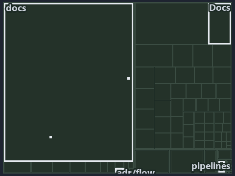

---
catzc:
  immutable:
    with_body_sha: "2dc5e57d022f"
    repo_status: locked
    path: docs/explanation/flow/.assets/the-analyzer-names-the-raw-read/tree.md
    source: docs/explanation/flow/.assets/the-analyzer-names-the-raw-read/diagram.drawio.png
    role: asset-description
    language: markdown
    filetype: md
    track: docs
    tracktype: documentation
---

# A raw read fails Test-ScriptAnalyzer with one Error line, and CI step 2e asserts the seam: the tree minimap

```text
Which files cite ADR-FLOW-CD-DETECT: every file of the world map is a tile, grouped by top-level folder.
24 files lit in 8 groups.
```



This is the tree minimap in the sidebar of the operations diagram of [A raw read fails Test-ScriptAnalyzer with one Error line, and CI step
2e asserts the seam][25], which explains [ADR-FLOW-CD-DETECT][1]. It lights every file that cites those codes, grouped by folder, so it
shows which files carry the decision. Each lit group has its reason below, naming the code that selects it.

## What the minimap shows

The tree draws every file of the world map as a tile, grouped by top-level folder (under `pwsh/` by module, under `docs/adr/` by ADR
domain), and lights 24 files in 8 groups, filled in ink. A lit ADR file has a white rim; a file lit only by passing mentions is a lighter
ink. Every other tile is idle, a grey box: a file the slide's ADR codes do not select.

- docs (docs/ outside docs/adr/): 10 lit files
- .claude: 7 lit files
- adr/flow (docs/adr/flow): 2 lit files
- adr/* (the files directly in docs/adr/): 1 lit file
- pipelines: 1 lit file
- Docs (pwsh/Catzc.Base.Docs): 1 lit file
- Maps (pwsh/Catzc.Base.Maps): 1 lit file
- QualityGates (pwsh/Catzc.Base.QualityGates): 1 lit file

## Why each group is lit

### docs (docs/ outside docs/adr/, 10 lit files)

The group holds the files of docs/ outside docs/adr/; each sits in its world-map cell and is lit by:

- [docs/how-to/automation/apply-environment-approvals.md][2], in the cell docs × markdown: selected by [ADR-FLOW-CD-DETECT][1]: the file
  cites it at line 4 (text).
- [docs/references/.assets/automation/catzc-base-globs/protected-module-skip-by-hash.drawio.verify.md][3], in the cell docs × markdown:
  selected by [ADR-FLOW-CD-DETECT][1]: the file cites it at line 55 (text).
- [docs/references/pwsh/catzc-azure-devops/Sync-AdoEnvironmentApprovals.ps1.md][4], in the cell docs × markdown: selected by
  [ADR-FLOW-CD-DETECT][1]: the file cites it at line 15 (text).
- [docs/references/pwsh/catzc-azure-templates/Get-BicepDeploymentName.ps1.md][5], in the cell docs × markdown: selected by
  [ADR-FLOW-CD-DETECT][1]: the file cites it at line 58 (text).
- [docs/references/pwsh/catzc-base-docs/types/AdrsConfig.cs.md][6], in the cell docs × markdown: selected by [ADR-FLOW-CD-DETECT][1]: the
  file cites it at line 28 (text), line 29 (text), line 57 (text) and line 58 (text).
- [docs/references/pwsh/catzc-base-globs/Get-GlobSetChangeRange.ps1.md][7], in the cell docs × markdown: selected by
  [ADR-FLOW-CD-DETECT][1]: the file cites it at line 15 (text).
- [docs/references/pwsh/catzc-base-globs/protected-module-skip-by-hash.drawio.md][8], in the cell docs × markdown: selected by
  [ADR-FLOW-CD-DETECT][1]: the file cites it at line 26 (text) and line 109 (text).
- [docs/references/pwsh/catzc-base-globs/tests/Get-GlobSetChangeRange.Tests.ps1.md][9], in the cell docs × markdown: selected by
  [ADR-FLOW-CD-DETECT][1]: the file cites it at line 11 (text).
- [docs/references/pwsh/catzc-base-maps/Get-ValueChainHighlight.ps1.md][10], in the cell docs × markdown: selected by
  [ADR-FLOW-CD-DETECT][1]: the file cites it at line 37 (text).
- [docs/references/pwsh/catzc-base-maps/Get-WorldMapHighlight.ps1.md][11], in the cell docs × markdown: selected by [ADR-FLOW-CD-DETECT][1]:
  the file cites it at line 54 (text).

### .claude (7 lit files)

The group holds the files of .claude; each sits in its world-map cell and is lit by:

- [.claude/CLAUDE.md][12], in the cell .claude × markdown: selected by [ADR-FLOW-CD-DETECT][1]: the file cites it at line 55 (text).
- [.claude/plans/plan-adr-code-language.md][13], in the cell .claude × markdown: selected by [ADR-FLOW-CD-DETECT][1]: the file cites it at
  line 126 (text), line 127 (text), line 128 (text), line 181 (text) and line 184 (text).
- [.claude/plans/plan-explanation-drift-gaps.md][14], in the cell .claude × markdown: selected by [ADR-FLOW-CD-DETECT][1]: the file cites it
  at line 36 (text).
- [.claude/plans/plan-promotion-ladder.md][15], in the cell .claude × markdown: selected by [ADR-FLOW-CD-DETECT][1]: the file cites it at
  line 12 (text), line 35 (text) and line 87 (text).
- [.claude/plans/prompt-promotion-ladder-1-build.md][16], in the cell .claude × markdown: selected by [ADR-FLOW-CD-DETECT][1]: the file
  cites it at line 21 (text).
- [.claude/plans/task-loose-ends.md][17], in the cell .claude × markdown: selected by [ADR-FLOW-CD-DETECT][1]: the file cites it at line 59
  (text).
- [.claude/plans/value-of-plan.md][18], in the cell .claude × markdown: selected by [ADR-FLOW-CD-DETECT][1]: the file cites it at line 34
  (text).

### adr/flow (docs/adr/flow, 2 lit files)

The group holds the files of docs/adr/flow; each sits in its world-map cell and is lit by:

- [docs/adr/flow/dora-explains.md][19], in the cell docs × markdown: selected by [ADR-FLOW-CD-DETECT][1]: the file cites it at line 11
  (text) and line 49 (text).
- [docs/adr/flow/pipeline-detection.md][1], in the cell docs × markdown: selected by [ADR-FLOW-CD-DETECT][1]: the ADR's own file.

### adr/* (the files directly in docs/adr/, 1 lit file)

The group holds the files of the files directly in docs/adr/; each sits in its world-map cell and is lit by:

- [docs/adr/index.md][20], in the cell docs × markdown: selected by [ADR-FLOW-CD-DETECT][1]: the file cites it at line 129 (text) and line
  131 (text).

### pipelines (1 lit file)

The group holds the files of pipelines; each sits in its world-map cell and is lit by:

- [pipelines/ci-automation.yaml][21], in the cell pipelines × pipeline-yaml: selected by [ADR-FLOW-CD-DETECT][1]: a pipeline that cites
  nothing itself carries its globset's citations, which cite it at `pwsh/Catzc.Base.Docs/configs/adrs.yml` line 97 (text),
  `pwsh/Catzc.Base.Docs/configs/adrs.yml` line 99 (text), `pwsh/Catzc.Base.Maps/tests/Get-WorldMapHighlight.Tests.ps1` line 70 (text),
  `pwsh/Catzc.Base.Maps/tests/Get-WorldMapHighlight.Tests.ps1` line 71 (text) and
  `pwsh/Catzc.Base.QualityGates/configs/analyzer-adr-map.yml` line 11 (text).

### Docs (pwsh/Catzc.Base.Docs, 1 lit file)

The group holds the files of pwsh/Catzc.Base.Docs; each sits in its world-map cell and is lit by:

- [pwsh/Catzc.Base.Docs/configs/adrs.yml][22], in the cell pwsh × yaml: selected by [ADR-FLOW-CD-DETECT][1]: the file cites it at line 97
  (text) and line 99 (text).

### Maps (pwsh/Catzc.Base.Maps, 1 lit file)

The group holds the files of pwsh/Catzc.Base.Maps; each sits in its world-map cell and is lit by:

- [pwsh/Catzc.Base.Maps/tests/Get-WorldMapHighlight.Tests.ps1][23], in the cell pwsh × powershell: selected by [ADR-FLOW-CD-DETECT][1]: the
  file cites it at line 70 (text) and line 71 (text).

### QualityGates (pwsh/Catzc.Base.QualityGates, 1 lit file)

The group holds the files of pwsh/Catzc.Base.QualityGates; each sits in its world-map cell and is lit by:

- [pwsh/Catzc.Base.QualityGates/configs/analyzer-adr-map.yml][24], in the cell pwsh × yaml: selected by [ADR-FLOW-CD-DETECT][1]: the file
  cites it at line 11 (text).

## Keywords

- [world map][26]
- [track][27]
- [file language][28]
- [cell][29]
- [lit cell][30]
- [.claude][31]: a track
- [docs][31]: a track
- [pipelines][31]: a track
- [pwsh][31]: a track
- [markdown][32]: a file language
- [pipeline-yaml][32]: a file language
- [powershell][32]: a file language
- [yaml][32]: a file language

[1]: ../../../../adr/flow/pipeline-detection.md
[2]: ../../../../how-to/automation/apply-environment-approvals.md
[3]: ../../../../references/.assets/automation/catzc-base-globs/protected-module-skip-by-hash.drawio.verify.md
[4]: ../../../../references/pwsh/catzc-azure-devops/Sync-AdoEnvironmentApprovals.ps1.md
[5]: ../../../../references/pwsh/catzc-azure-templates/Get-BicepDeploymentName.ps1.md
[6]: ../../../../references/pwsh/catzc-base-docs/types/AdrsConfig.cs.md
[7]: ../../../../references/pwsh/catzc-base-globs/Get-GlobSetChangeRange.ps1.md
[8]: ../../../../references/pwsh/.assets/protected-module-skip-by-hash/diagram.drawio.md
[9]: ../../../../references/pwsh/catzc-base-globs/tests/Get-GlobSetChangeRange.Tests.ps1.md
[10]: ../../../../references/pwsh/catzc-base-maps/Get-ValueChainHighlight.ps1.md
[11]: ../../../../references/pwsh/catzc-base-maps/Get-WorldMapHighlight.ps1.md
[12]: ../../../../../.claude/CLAUDE.md
[13]: ../../../../../.claude/plans/plan-adr-code-language.md
[14]: ../../../../../.claude/plans/plan-explanation-drift-gaps.md
[15]: ../../../../../.claude/plans/plan-promotion-ladder.md
[16]: ../../../../../.claude/plans/prompt-promotion-ladder-1-build.md
[17]: ../../../../../.claude/plans/task-loose-ends.md
[18]: ../../../../../.claude/plans/value-of-plan.md
[19]: ../../../../adr/flow/dora-explains.md
[20]: ../../../../adr/index.md
[21]: ../../../../../pipelines/ci-automation.yaml
[22]: ../../../../../pwsh/Catzc.Base.Docs/configs/adrs.yml
[23]: ../../../../../pwsh/Catzc.Base.Maps/tests/Get-WorldMapHighlight.Tests.ps1
[24]: ../../../../../pwsh/Catzc.Base.QualityGates/configs/analyzer-adr-map.yml
[25]: ../../the-analyzer-names-the-raw-read.md
[26]: ../../../../adr/glossary.md#world-map
[27]: ../../../../adr/glossary.md#track
[28]: ../../../../adr/glossary.md#file-language
[29]: ../../../../adr/glossary.md#cell
[30]: ../../../../adr/glossary.md#lit-cell
[31]: ../../../../../pwsh/Catzc.Base.Variants/configs/variants.yml
[32]: ../../../../../pwsh/Catzc.Base.Languages/configs/languages.yml
