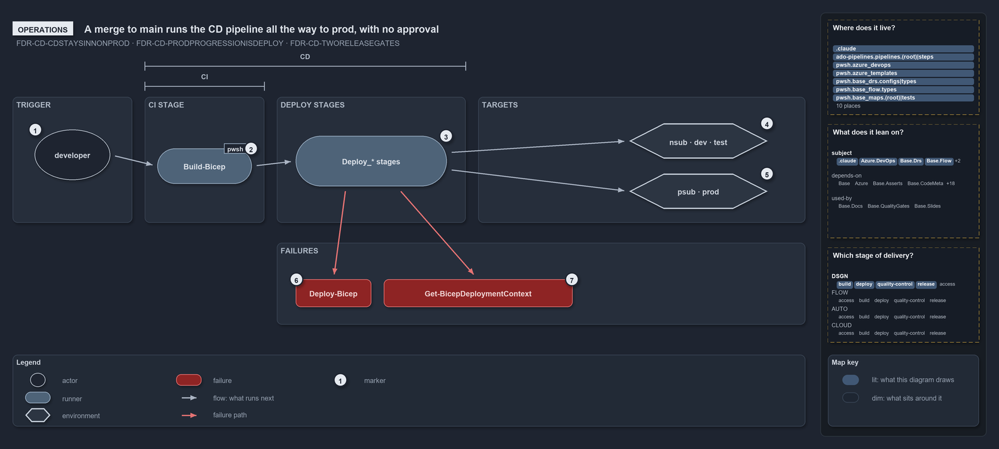

---
catzc:
  warning: "Header is generated by Format-FileMeta via Format-Code; do not change it"
  edges:
    cites:
      - FDR-CD-CDSTAYSINNONPROD
      - FDR-CD-PRODPROGRESSIONISDEPLOY
      - FDR-CD-TWORELEASEGATES
    drs_total: 3
---

# A merge to main runs the CD pipeline all the way to prod, with no approval

```text
A merge to main runs the CD pipeline all the way to prod, with no approval.

1  developer                   a pull request or a merge to main starts the run
2  Build-Bicep                 the CI stage builds and publishes three artifacts
3  PR run ends here            deploy stages run only on main
4  nsub, dev, test             non-prod targets, one Azure DevOps environment each
5  psub, prod                  the prod tier, same run, no approval in the YAML
6  Deploy-Bicep                throws when the subscription assert is missing
7  Get-BicepDeploymentContext  throws when the session targets the wrong subscription

Supports FDR-CD-CDSTAYSINNONPROD, FDR-CD-PRODPROGRESSIONISDEPLOY and FDR-CD-TWORELEASEGATES (operations lens).
```

To an operator in Azure DevOps, a customer CD pipeline is one run. A pull request or a merge to main triggers it, the CI stage builds, and a
merge goes on to deploy every target the pipeline lists, the prod tier included, with no approval step in the YAML. The run has a trigger, a
CI stage, the deploy stages and the environments they reach, and two failures an operator can meet on the way.

```yml drawio
description:
  "A pull request or a merge to main starts the CD pipeline: the CI stage builds, the deploy stages run on main only and reach every target
  the pipeline lists, prod tier included, with no approval step in the YAML; two deploy functions throw on a missing or wrong subscription."
about:
  adrs: [FDR-CD-CDSTAYSINNONPROD, FDR-CD-PRODPROGRESSIONISDEPLOY, FDR-CD-TWORELEASEGATES]
  lens: operations
content:
  title: A merge to main runs the CD pipeline all the way to prod, with no approval
  kind: explanation
  flow: left-to-right
  relation: what runs next
  theme: dark
  bands:
    - { id: band-trigger, label: TRIGGER }
    - { id: band-ci, label: CI STAGE }
    - { id: band-deploy, label: DEPLOY STAGES }
    - { id: band-targets, label: TARGETS }
    - { id: band-failures, label: FAILURES }
  spans:
    - id: span-ci
      label: CI
      over: [band-ci]
    - id: span-cd
      label: CD
      over: [band-ci, band-deploy]
  glyphs:
    - { id: g-developer, kind: actor, label: developer, in: band-trigger }
    - { id: g-build-bicep, kind: runner, label: Build-Bicep, in: band-ci }
    - { id: g-deploy-stages, kind: runner, label: Deploy_* stages, in: band-deploy }
    - { id: e-non-prod, kind: env, label: nsub · dev · test, in: band-targets }
    - { id: e-prod-tier, kind: env, label: psub · prod, in: band-targets }
    - { id: f-deploy-bicep, kind: failure, label: Deploy-Bicep, in: band-failures }
    - { id: f-deployment-context, kind: failure, label: Get-BicepDeploymentContext, in: band-failures }
  edges:
    - { from: g-developer, to: g-build-bicep, kind: flow, label: "" }
    - { from: g-build-bicep, to: g-deploy-stages, kind: flow, label: "" }
    - { from: g-deploy-stages, to: e-non-prod, kind: flow, label: "" }
    - { from: g-deploy-stages, to: e-prod-tier, kind: flow, label: "" }
    - { from: g-deploy-stages, to: f-deploy-bicep, kind: fail, label: "" }
    - { from: g-deploy-stages, to: f-deployment-context, kind: fail, label: "" }
  markers:
    - { at: g-developer, number: 1 }
    - { at: g-build-bicep, number: 2 }
    - { at: g-deploy-stages, number: 3 }
    - { at: e-non-prod, number: 4 }
    - { at: e-prod-tier, number: 5 }
    - { at: f-deploy-bicep, number: 6 }
    - { at: f-deployment-context, number: 7 }
  legend: auto
  minimaps: [code-locations, module-neighbourhood, axis]
layout:
  band-trigger: { x: 20, y: 108, w: 190, h: 200 }
  band-ci: { x: 230, y: 108, w: 190, h: 200 }
  band-deploy: { x: 440, y: 108, w: 300, h: 200 }
  band-targets: { x: 760, y: 108, w: 520, h: 200 }
  band-failures: { x: 440, y: 340, w: 840, h: 130 }
  g-developer: { x: 55, y: 160, w: 120, h: 80 }
  g-build-bicep: { x: 250, y: 190, w: 150, h: 56 }
  g-deploy-stages: { x: 470, y: 170, w: 240, h: 80 }
  e-non-prod: { x: 1000, y: 150, w: 220, h: 56 }
  e-prod-tier: { x: 1000, y: 230, w: 220, h: 56 }
  f-deploy-bicep: { x: 470, y: 398, w: 120, h: 44 }
  f-deployment-context: { x: 610, y: 398, w: 300, h: 44 }
```



## Walkthrough

1. **Developer.** A pull request into main or a merge to main starts the run. The path filter is the customer's globset, projected into
   Azure DevOps `trigger:` and `pr:` paths by `Get-GlobSetTrigger`.
2. **Build-Bicep.** The CI stage runs `Build-Bicep` once per template and publishes three artifacts: `foundation`, `discovery` and
   `expedition`.
3. **A pull-request run ends here.** Every deploy stage's condition requires `refs/heads/main`, so only a merge goes on to deploy.
4. **Non-prod targets.** Foundation and discovery deploy per subscription, to `nsub`; the expedition template deploys to `dev` and, in
   `cd-apex`, to its slot `dev-blu`. Each target shows as an Azure DevOps environment named `<customer>-<env>`, or `<customer>-<env>-<slot>`
   for an expedition entry with a slot, with one deployment job each.
5. **Prod-tier targets.** `psub` and `prod` deploy in the same run and the same stages as non-prod, with no approval step in the YAML:
   `psub` for foundation and discovery in `cd-apex` and `cd-shared`, and `prod` for the expedition in `cd-apex`. Environment checks set in
   the Azure DevOps UI live outside the repository.
6. **Deploy-Bicep.** It throws when a pipeline omits the assert: "Deploy-Bicep requires -SubscriptionIdAssertIs in a pipeline — the pipeline
   must pin the subscription GUID its service connection is expected to target, …".
7. **Get-BicepDeploymentContext.** It throws on a subscription mismatch instead of retargeting: "-SubscriptionIdAssertIs failed: the az
   session targets subscription '…', not … — in a pipeline this means the service connection is wired to the wrong subscription."

## Why it holds

- CD takes the artifact through non-prod only (FDR-CD-CDSTAYSINNONPROD).
- Progression toward prod leaves the automated flow and enters DEPLOY, behind a manual gate (FDR-CD-PRODPROGRESSIONISDEPLOY).
- RC and RBC are the manual gates that decide whether the artifact may proceed (FDR-CD-TWORELEASEGATES).

## Where the code and the decision record differ

- The FDR keeps CD in non-prod and puts a manual gate and DEPLOY before prod, but `cd-apex.yaml` and `cd-shared.yaml` deploy `psub`, and
  `cd-apex.yaml` also deploys the expedition to `prod`, from the CD run.
- An operator has no entry point in the repository for certifying RC or RBC or for running DEPLOY.

## See also

- [The CI discipline and the promotion flow](../../drs/flow/cd-discipline-and-promotion-flow.md) — the decision this article explains.
- The other lenses on the same flow: [meta](one-artifact-climbs-unchanged.md), [architecture](pipeline-kinds-keyed-by-one-artifact.md),
  [implementation](cd-builds-once-then-deploys-prod-itself.md) and [governance](ci-budget-is-the-only-quality-gate.md).
- [The flow explanations](index.md) · [How to read the diagrams](../index.md#how-to-read-the-diagrams)
