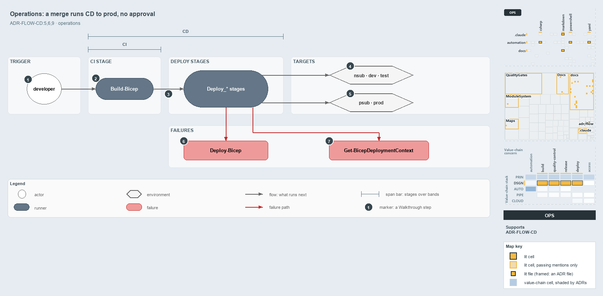

---
catzc:
  derived:
    path: docs/explanation/flow/a-merge-runs-cd-to-prod.md
    kind: explanation
    language: markdown
    filetype: md
    track: docs
    body_sha: "1c55ad0ec400"
    adrs:
      - ADR-FLOW-CD#{5,6,9}
    links:
      - docs/.assets/explanation/adr-flow-cd--a-merge-runs-cd-to-prod--operations.drawio.md
      - docs/.assets/explanation/adr-flow-cd--a-merge-runs-cd-to-prod--operations.drawio.png
      - docs/adr/flow/cd-discipline-and-promotion-flow.md
      - docs/explanation/flow/cd-builds-once-then-deploys-prod-itself.md
      - docs/explanation/flow/ci-budget-is-the-only-quality-gate.md
      - docs/explanation/flow/index.md
      - docs/explanation/flow/one-artifact-climbs-unchanged.md
      - docs/explanation/flow/pipeline-kinds-keyed-by-one-artifact.md
      - docs/explanation/index.md#how-to-read-the-diagrams
---

# A merge to main runs the CD pipeline all the way to prod, with no approval

```text
A merge to main runs the CD pipeline all the way to prod, with no approval.

1  developer                   a pull request or a merge to main starts the run
2  Build-Bicep                 the CI stage builds and publishes three artifacts
3  PR run ends here            deploy stages run only on main
4  nsub, dev, test             non-prod targets, one Azure DevOps environment each
5  psub, prod                  the prod tier, same run, no approval in the YAML
6  Deploy-Bicep                throws when the subscription assert is missing
7  Get-BicepDeploymentContext  throws when the session targets the wrong subscription

Supports ADR-FLOW-CD#5, #6 and #9 (operations lens).
```

To an operator in Azure DevOps, a customer CD pipeline is one run. A pull request or a merge to main triggers it, the CI stage builds, and a
merge goes on to deploy every target the pipeline lists, the prod tier included, with no approval step in the YAML. The run has a trigger, a
CI stage, the deploy stages and the environments they reach, and two failures an operator can meet on the way.



The diagram is described element by element in
[its asset description](../../.assets/explanation/adr-flow-cd--a-merge-runs-cd-to-prod--operations.drawio.md).

## Walkthrough

1. **Developer.** A pull request into main or a merge to main starts the run. The path filter is the customer's globset, projected into
   Azure DevOps `trigger:` and `pr:` paths by `Get-GlobSetTrigger`.
2. **Build-Bicep.** The CI stage runs `Build-Bicep` once per template and publishes three artifacts: `foundation`, `discovery` and
   `expedition`.
3. **A pull-request run ends here.** Every deploy stage's condition requires `refs/heads/main`, so only a merge goes on to deploy.
4. **Non-prod targets.** Foundation and discovery deploy per subscription, to `nsub`; the expedition template deploys to `dev` and, in
   `cd-apex`, to its slot `dev-blu`. Each target shows as an Azure DevOps environment named `<customer>-<env>`, or `<customer>-<env>-<slot>`
   for an expedition entry with a slot, with one deployment job each.
5. **Prod-tier targets.** `psub` and `prod` deploy in the same run and the same stages as non-prod, with no approval step in the YAML:
   `psub` for foundation and discovery in `cd-apex` and `cd-shared`, and `prod` for the expedition in `cd-apex`. Environment checks set in
   the Azure DevOps UI live outside the repository.
6. **Deploy-Bicep.** It throws when a pipeline omits the assert: "Deploy-Bicep requires -SubscriptionIdAssertIs in a pipeline — the pipeline
   must pin the subscription GUID its service connection is expected to target, …".
7. **Get-BicepDeploymentContext.** It throws on a subscription mismatch instead of retargeting: "-SubscriptionIdAssertIs failed: the az
   session targets subscription '…', not … — in a pipeline this means the service connection is wired to the wrong subscription."

## Why it holds

- CD takes the artifact through non-prod only (ADR-FLOW-CD#5).
- Progression toward prod leaves the automated flow and enters DEPLOY, behind a manual gate (ADR-FLOW-CD#6).
- RC and RBC are the manual gates that decide whether the artifact may proceed (ADR-FLOW-CD#9).

## Where the code and the ADR differ

- The ADR keeps CD in non-prod and puts a manual gate and DEPLOY before prod, but `cd-apex.yaml` and `cd-shared.yaml` deploy `psub`, and
  `cd-apex.yaml` also deploys the expedition to `prod`, from the CD run.
- An operator has no entry point in the repository for certifying RC or RBC or for running DEPLOY.

## See also

- [The CI discipline and the promotion flow](../../adr/flow/cd-discipline-and-promotion-flow.md) — the decision this article explains.
- The other lenses on the same flow: [meta](one-artifact-climbs-unchanged.md), [architecture](pipeline-kinds-keyed-by-one-artifact.md),
  [implementation](cd-builds-once-then-deploys-prod-itself.md) and [governance](ci-budget-is-the-only-quality-gate.md).
- [The flow explanations](index.md) · [How to read the diagrams](../index.md#how-to-read-the-diagrams)
