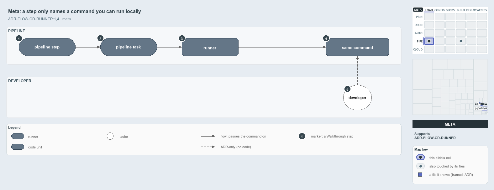

---
catzc:
  derived:
    path: docs/explanation/flow/a-step-only-names-a-command.md
    kind: explanation
    language: markdown
    track: docs
    body_sha: "01018e7b150d"
    adrs:
      - ADR-FLOW-CD-RUNNER#{1,4}
    links:
      - docs/.assets/explanation/adr-flow-cd-runner--a-step-only-names-a-command--meta.drawio.md
      - docs/.assets/explanation/adr-flow-cd-runner--a-step-only-names-a-command--meta.drawio.png
      - docs/adr/flow/pipeline-runner-pattern.md
      - docs/explanation/flow/index.md
      - docs/explanation/flow/no-gate-checks-rules-one-and-four.md
      - docs/explanation/flow/the-runner-is-the-only-seam.md
      - docs/explanation/flow/the-step-is-named-after-its-command.md
      - docs/explanation/flow/three-tasks-one-guard-one-runner.md
      - docs/explanation/index.md#how-to-read-the-diagrams
---

# A pipeline step only names a command that a developer can run locally

```text
A pipeline step only names a command, and a developer can run that same command locally.

1  pipeline step  names a command and holds no PowerShell
2  pipeline task  the pipeline host: adds authentication, token and label
3  runner         the one bootstrap: loads the modules once, hands the command over
4  same command   runs with the same modules, in the scope of the load
5  developer      loads the modules and types the same command; no gate checks it

Supports ADR-FLOW-CD-RUNNER#1 and #4 (meta lens).
```

A pipeline step in cats does not hold PowerShell. It names a command, and one runner turns that name into the same command a developer runs
in a terminal. YAML declares, PowerShell executes, and the string in the step is exactly what a developer types after loading the modules.
That one invariant is what makes every pipeline step reproducible by hand.



The diagram is described element by element in
[its asset description](../../.assets/explanation/adr-flow-cd-runner--a-step-only-names-a-command--meta.drawio.md).

## Walkthrough

1. **Pipeline step.** The step names a command and nothing else. The YAML never holds PowerShell logic.
2. **Pipeline task.** The task is the pipeline host. It adds the authentication, the access token and the step's label around the command,
   and passes the command on.
3. **Runner.** The runner is the one bootstrap: it loads the modules once and hands the command over.
4. **Same command.** The command runs with the same modules, in the same scope as the load.
5. **Developer.** A developer loads the modules and types the same command, with no pipeline, no task and no runner in between. No gate
   checks that the two runs match, so this path holds by the ADR alone.

The expected-failures guardrail pipeline is the one sanctioned exception: it calls the runner directly, without a step template, to prove
the runner's own failure modes.

## Why it holds

- YAML steps never contain inline PowerShell; all PowerShell runs through the runner (ADR-FLOW-CD-RUNNER#1).
- Whatever string a step names can be pasted into a local terminal after the importer (ADR-FLOW-CD-RUNNER#4).

## Where the code and the ADR differ

No gate checks that a step's command runs the same way in a terminal: nothing replays a command outside the runner.

## See also

- [Pipeline runner pattern](../../adr/flow/pipeline-runner-pattern.md) — the decision this article explains.
- The other lenses on the same runner: [architecture](the-runner-is-the-only-seam.md),
  [implementation](three-tasks-one-guard-one-runner.md), [operations](the-step-is-named-after-its-command.md) and
  [governance](no-gate-checks-rules-one-and-four.md).
- [The flow explanations](index.md) · [How to read the diagrams](../index.md#how-to-read-the-diagrams)
