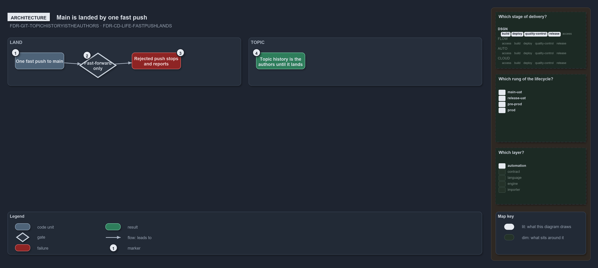

---
catzc:
  warning: "Experimental: this article merges two rules into one and holds nothing beyond what they say"
  edges:
    cites:
      - FDR-GIT-TOPICHISTORYISTHEAUTHORS
      - FDR-CD-LIFE-FASTPUSHLANDS
---

# A topics history is its authors and main is landed by one fast push

This article is one rule: [FDR-GIT-TOPICHISTORYISTHEAUTHORS](../../drs/flow/git-topic-flow.md#rule-fdr-git-topichistoryistheauthors) and
[FDR-CD-LIFE-FASTPUSHLANDS](../../drs/flow/commit-lifecycle.md#rule-fdr-cd-life-fastpushlands) merged into one. It holds nothing beyond what
those two rules say.

A topic's history is its author's to rewrite until it lands, and the server's main is never rewritten. In `main-direct` the client lands a
commit by one fast push to main, and a push is never a history change: it fast-forwards the server's main, and a rejected push stops and
reports.

