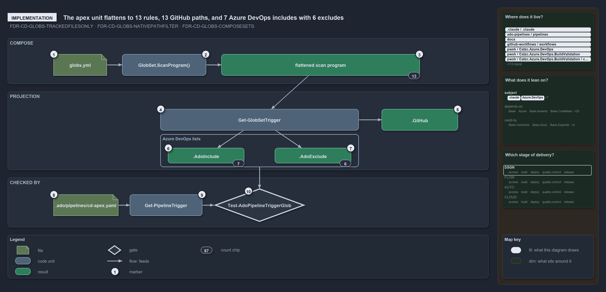

# The apex unit flattens to 13 rules, 13 GitHub paths, and 7 Azure DevOps includes with 6 excludes

```text
The apex unit flattens to 13 rules, 13 GitHub paths, and 7 ADO includes with 6 excludes.

1   globs.yml                    apex: pipeline cd-apex, composes three bases, three own includes
2   GlobSet.ScanProgram()        composed programs first, own rules last, duplicates deduped
3   flattened scan program       13 rules: 4 foundation, 3 discovery, 3 expedition, 3 apex
4   Get-GlobSetTrigger           one pass over the program fills both dialects
5   .GitHub                      the 13 rules in order, each drop as a ! negation
6   .AdoInclude                  7 patterns whose last select is a select
7   .AdoExclude                  6 patterns whose last select is a drop
8   .ado/pipelines/cd-apex.yaml  trigger: and pr: declare the 7 includes and 6 excludes
9   Get-PipelineTrigger          reads the four path-filter lists back from the file
10  Test-AdoPipelineTriggerGlob  compares projection and file as sets; one issue per pipeline

Supports FDR-CD-GLOBS-TRACKEDFILESONLY, FDR-CD-GLOBS-NATIVEPATHFILTER and FDR-CD-GLOBS-COMPOSESETS (implementation lens).
```

The `apex` deployable unit in cats composes three base units and adds three configuration folders of its own, which flattens into a program
of 13 rules. `Get-GlobSetTrigger` walks that program once: the GitHub list is the 13 rules in order, and the Azure DevOps lists collapse the
13 rules to 7 includes and 6 excludes because the same pattern is never selected twice. `.ado/pipelines/cd-apex.yaml` declares exactly those
13 patterns, and `Test-AdoPipelineTriggerGlob` is the quality gate that proves it.

```yml drawio
description:
  The apex unit's glob program flattens to 13 rules; one pass of the trigger projection fills the GitHub list with those 13 rules and the
  Azure DevOps lists with 7 includes and 6 excludes, and the pipeline trigger test compares the projection with cd-apex.yaml.
about:
  adrs: [FDR-CD-GLOBS-TRACKEDFILESONLY, FDR-CD-GLOBS-NATIVEPATHFILTER, FDR-CD-GLOBS-COMPOSESETS]
  lens: implementation
content:
  title: The apex unit flattens to 13 rules, 13 GitHub paths, and 7 Azure DevOps includes with 6 excludes
  kind: explanation
  flow: left-to-right
  relation: feeds
  theme: dark
  bands:
    - { id: band-compose, label: COMPOSE }
    - { id: band-projection, label: PROJECTION }
    - { id: band-checked, label: CHECKED BY }
  groups:
    - { id: grp-ado-lists, label: Azure DevOps lists, in: band-projection }
  glyphs:
    - { id: f-globs, kind: file, label: globs.yml, in: band-compose }
    - { id: g-scan-program, kind: code, label: GlobSet.ScanProgram(), in: band-compose }
    - { id: r-flattened, kind: result, label: flattened scan program, in: band-compose }
    - { id: g-trigger, kind: code, label: Get-GlobSetTrigger, in: band-projection }
    - { id: r-github, kind: result, label: .GitHub, in: band-projection }
    - { id: r-include, kind: result, label: .AdoInclude, in: grp-ado-lists }
    - { id: r-exclude, kind: result, label: .AdoExclude, in: grp-ado-lists }
    - { id: f-cd-apex, kind: file, label: .ado/pipelines/cd-apex.yaml, in: band-checked }
    - { id: g-pipeline-trigger, kind: code, label: Get-PipelineTrigger, in: band-checked }
    - { id: g-test-trigger, kind: gate, label: Test-AdoPipelineTriggerGlob, in: band-checked }
  edges:
    - { from: f-globs, to: g-scan-program, kind: flow, label: "" }
    - { from: g-scan-program, to: r-flattened, kind: flow, label: "" }
    - { from: r-flattened, to: g-trigger, kind: flow, label: "" }
    - { from: g-trigger, to: r-github, kind: flow, label: "" }
    - { from: g-trigger, to: r-include, kind: flow, label: "" }
    - { from: g-trigger, to: r-exclude, kind: flow, label: "" }
    - { from: grp-ado-lists, to: g-test-trigger, kind: flow, label: "" }
    - { from: f-cd-apex, to: g-pipeline-trigger, kind: flow, label: "" }
    - { from: g-pipeline-trigger, to: g-test-trigger, kind: flow, label: "" }
  markers:
    - { at: f-globs, number: 1 }
    - { at: g-scan-program, number: 2 }
    - { at: r-flattened, number: 3 }
    - { at: g-trigger, number: 4 }
    - { at: r-github, number: 5 }
    - { at: r-include, number: 6 }
    - { at: r-exclude, number: 7 }
    - { at: f-cd-apex, number: 8 }
    - { at: g-pipeline-trigger, number: 9 }
    - { at: g-test-trigger, number: 10 }
  chips:
    - { at: r-flattened, kind: count, text: "13" }
    - { at: r-include, kind: count, text: "7" }
    - { at: r-exclude, kind: count, text: "6" }
  legend: auto
  minimaps: [code-locations, module-neighbourhood, axis]
layout:
  band-compose: { x: 20, y: 84, w: 1260, h: 120 }
  band-projection: { x: 20, y: 224, w: 1260, h: 206 }
  band-checked: { x: 20, y: 450, w: 1260, h: 130 }
  f-globs: { x: 140, y: 126, w: 140, h: 56 }
  g-scan-program: { x: 320, y: 126, w: 220, h: 56 }
  r-flattened: { x: 580, y: 126, w: 520, h: 56 }
  g-trigger: { x: 420, y: 270, w: 520, h: 56 }
  r-github: { x: 1000, y: 270, w: 200, h: 56 }
  grp-ado-lists: { x: 420, y: 336, w: 520, h: 86 }
  r-include: { x: 440, y: 372, w: 200, h: 40 }
  r-exclude: { x: 720, y: 372, w: 200, h: 40 }
  f-cd-apex: { x: 140, y: 494, w: 170, h: 56 }
  g-pipeline-trigger: { x: 340, y: 494, w: 190, h: 56 }
  g-test-trigger: { x: 560, y: 478, w: 240, h: 88 }
```



## Walkthrough

1. **globs.yml.** `apex` is a `deployable-unit` with `pipeline: cd-apex`. It composes `template-azure-subscription-foundation`,
   `template-azure-subscription-discovery` and `template-azure-workload-expedition`, and includes
   `infrastructure/templates/<template>/configuration/apex/**` for each of the three templates. The foundation base includes
   `infrastructure/templates/foundation/**` and `infrastructure/modules/**` and excludes the configuration root files and the configuration
   subfolders; discovery composes foundation, and expedition composes discovery.
2. **GlobSet.ScanProgram().** `GlobsConfig` resolves the compose references at load and hands each set its composed sets. `ScanProgram()`
   appends the composed sets' programs first, in compose order and recursively, then the set's own includes as selects and excludes as
   drops, last. Because discovery repeats foundation and expedition repeats both, the raw list carries the foundation rules three times;
   `DedupeKeepingLast` keeps the last occurrence of each identical rule. The program is built once and cached.
3. **Flattened scan program.** For `apex` the result is 13 rules: foundation's two selects and two drops, discovery's select and two drops,
   expedition's select and two drops, then apex's three selects, which re-add the `configuration/apex/**` slices the bases dropped. Over the
   tracked files it selects 32 members.
4. **Get-GlobSetTrigger.** `Get-GlobSetTrigger -Name apex` resolves the set and iterates `ScanProgram()` once. Each rule is appended to the
   GitHub list as it is, and an ordered map records each pattern's last select. `-GlobSet` takes a set object instead, the path a derived
   set and the gates use.
5. **.GitHub.** The 13 rules in order, a drop rendered as `!` before the pattern. GitHub evaluates its paths last-match-wins, so this list
   is the program itself.
6. **.AdoInclude.** The 7 patterns whose last select is a select: the four template and module globs and the three `configuration/apex/**`
   slices.
7. **.AdoExclude.** The 6 patterns whose last select is a drop: each template's `configuration/*.yml` and `configuration/*/**`. Azure DevOps
   keeps the deeper `configuration/apex/**` include over the broader `configuration/*/**` exclude.
8. **.ado/pipelines/cd-apex.yaml.** The root pipeline declares the 7 includes and 6 excludes under both `trigger.paths` and `pr.paths`, as
   the triggers are honoured only at the pipeline root.
9. **Get-PipelineTrigger.** The gate reads the file with `-Vendor Ado` and gets the four lists back: `TriggerInclude`, `TriggerExclude`,
   `PrInclude` and `PrExclude`; a missing section is an empty list.
10. **Test-AdoPipelineTriggerGlob.** For every pipeline-bound set, or the one named, the gate recomputes the projection with
    `Get-GlobSetTrigger -GlobSet`, resolves `.ado/pipelines/<pipeline>.yaml`, and compares each of the four lists with `Test-GlobListEqual`
    as a set, ordinally sorted, because Azure DevOps filters are order-independent. A missing file is one issue, a mismatch is one issue
    naming the filters that differ, and `Write-QualityGateReport` ends the gate. Today it reports 0 issues over 6 pipelines, and the L2
    integrity test requires exactly that.

## Why it holds

- Membership is decided by the ordered scan program, last-match-wins, with the leaf set's includes as selects and its excludes as drops
  (FDR-CD-GLOBS-TRACKEDFILESONLY).
- The native projection renders the flattened program into GitHub's ordered `!` dialect exactly, and into Azure DevOps' order-independent
  include and exclude lists by collapsing each pattern to its last select; the drift quality gate reports one issue per pipeline whose
  declared trigger no longer equals its projection (FDR-CD-GLOBS-NATIVEPATHFILTER).
- A composing set's program is the composed programs first, deepest base first, each once, then its own rules last, so a unit re-adds a
  slice its base dropped; the flattened program is what the projection is computed from (FDR-CD-GLOBS-COMPOSESETS).

## See also

- [Globset triggers](../../drs/flow/durable-sha-globs.md) — the decision this article explains.
- The other lenses on the same projection: [meta](one-program-two-vendor-dialects.md),
  [architecture](globs-projects-and-three-consumers-read.md), [operations](print-projection-then-drift-names-the-filter.md) and
  [governance](drift-is-gated-generation-is-drs-only.md).
- [The flow explanations](index.md) · [How to read the diagrams](../index.md#how-to-read-the-diagrams)
