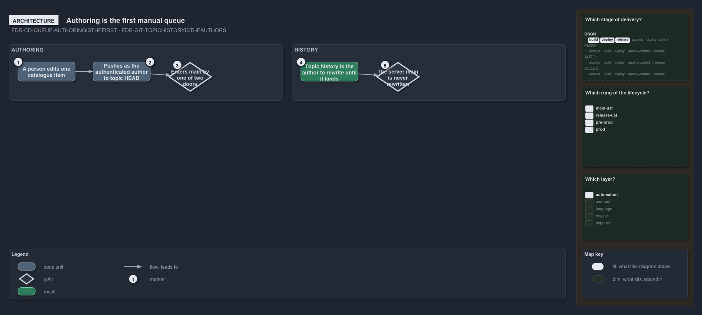

---
catzc:
  warning: "Experimental: this article merges two rules into one and holds nothing beyond what they say"
  edges:
    cites:
      - FDR-CD-QUEUE-AUTHORINGISTHEFIRST
      - FDR-GIT-TOPICHISTORYISTHEAUTHORS
---

# Authoring is the first queue and a topics history is its authors until it lands

This article is one rule: [FDR-CD-QUEUE-AUTHORINGISTHEFIRST](../../drs/flow/manual-queues.md#rule-fdr-cd-queue-authoringisthefirst) and
[FDR-GIT-TOPICHISTORYISTHEAUTHORS](../../drs/flow/git-topic-flow.md#rule-fdr-git-topichistoryistheauthors) merged into one. It holds nothing
beyond what those two rules say.

Authoring is the first manual queue: a person edits one catalogue item, pushes it as the authenticated author to the server's topic HEAD,
and from there the change enters main by exactly one of two doors. A topic's history is its author's to rewrite until it lands: squashing
and rebasing change a topic's commits, and a topic already pushed for a pull request is pushed again over its own earlier state, while the
server's main is never rewritten.

