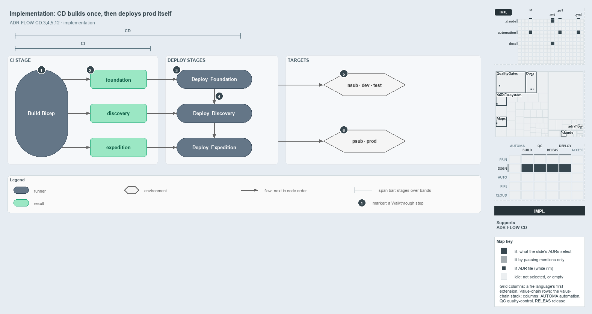

---
catzc:
  derived:
    path: docs/explanation/flow/cd-builds-once-then-deploys-prod-itself.md
    kind: explanation
    language: markdown
    filetype: md
    track: docs
    body_sha: cda664cacc34
    adrs:
      - ADR-FLOW-CD#{3-5,12}
    links:
      - docs/.assets/explanation/adr-flow-cd--cd-builds-once-then-deploys-prod-itself--implementation.drawio.md
      - docs/.assets/explanation/adr-flow-cd--cd-builds-once-then-deploys-prod-itself--implementation.drawio.png
      - docs/adr/flow/cd-discipline-and-promotion-flow.md
      - docs/explanation/flow/a-merge-runs-cd-to-prod.md
      - docs/explanation/flow/ci-budget-is-the-only-quality-gate.md
      - docs/explanation/flow/index.md
      - docs/explanation/flow/one-artifact-climbs-unchanged.md
      - docs/explanation/flow/pipeline-kinds-keyed-by-one-artifact.md
      - docs/explanation/index.md#how-to-read-the-diagrams
---

# The customer CD pipeline builds once, then deploys the prod tier itself

```text
The customer CD pipeline builds once, then deploys the prod tier itself.

1  Build-Bicep                       the CI stage builds each of the three templates once
2  foundation, discovery, expedition the three artifacts it publishes, untagged
3  Deploy_Foundation                 the first of three deploy stages, main only
4  dependsOn                         the chain Foundation -> Discovery -> Expedition
5  nsub, dev, test                   the non-prod targets
6  psub, prod                        the prod-tier targets, deployed in the same run

Supports ADR-FLOW-CD#3, #4, #5 and #12 (implementation lens).
```

Every customer CD pipeline in cats extends one template, `pipelines/extends/cd-customer.yaml`. The thin root pipelines (`cd-apex.yaml`,
`cd-nova.yaml`, `cd-flux.yaml`) supply only the customer key and the per-deployment environment, slot, service connection and subscription
assert. In code order, the template runs one CI stage that builds and publishes three artifacts, then three deploy stages that apply them in
dependency order. In `cd-apex`, each deploy stage reaches the non-prod and the prod tier in the same run.



The diagram is described element by element in
[its asset description](../../.assets/explanation/adr-flow-cd--cd-builds-once-then-deploys-prod-itself--implementation.drawio.md).

## Walkthrough

1. **Build-Bicep.** The `CI` stage, displayed as "CI engine — build & verify", runs `Build-Bicep <template> -Customers <customer>` once for
   each of the three templates, building only that customer's configuration subfolder.
2. **Foundation, discovery, expedition.** After each build the stage publishes `out/template/<template>` as a pipeline artifact of the same
   name. The artifacts are built once and carry no tag.
3. **Deploy_Foundation.** Three deploy stages follow, each running only on `main`. Every deployment job downloads its artifact with
   `download: current` and runs `Deploy-Bicep -Environment <env> -Template <template> -SubscriptionIdAssertIs <guid> -ArtifactsFolder` on
   it, so nothing is rebuilt.
4. **dependsOn.** `Deploy_Foundation`, then `Deploy_Discovery`, then `Deploy_Expedition`: foundation owns the Key Vault the other two read,
   so the stages are chained with `dependsOn`.
5. **Non-prod targets.** Through the `sc-<customer>-nonprod` service connection, foundation and discovery deploy per subscription to `nsub`,
   and the expedition template deploys to `dev`. `cd-apex` also deploys the expedition's special slot `dev-blu`; `cd-nova` carries non-prod
   entries only, and `cd-flux` has no expedition. The standalone `cd-shared.yaml` deploys `shared-nsub`, `shared-dev` and `shared-test`.
6. **Prod-tier targets.** Through the `sc-<customer>-prod` service connection, `cd-apex` deploys foundation and discovery to `psub` and the
   expedition to `prod`, and `cd-shared.yaml` deploys `shared-psub`. The jobs come from `${{ each }}` and share each stage with no order
   between them, so prod-tier jobs run beside the non-prod ones, with no gate between the environments.

## Why it holds

- The CI component builds the artifact once and every downstream deploy consumes it unchanged (ADR-FLOW-CD#3).
- A CD pipeline always contains the CI component and then takes the artifact in a direction (ADR-FLOW-CD#4).
- CD's direction stays entirely within non-prod (ADR-FLOW-CD#5).
- Deploy to prod stages the artifact inactive in pre-prod before activating it live (ADR-FLOW-CD#12).

## Where the code and the ADR differ

- The ADR keeps CD entirely within non-prod and says CD never touches production; `cd-apex.yaml` and `cd-shared.yaml` deploy `psub`, and
  `cd-apex.yaml` deploys the expedition to `prod`, from the CD run.
- The ADR stages the artifact inactive in pre-prod before production; in code no CD pipeline has a pre-prod target, and the prod-tier jobs
  run in the same stages as the non-prod ones.
- No pipeline tags the artifact, and none runs the on-demand L3 environment, main-uat or release-uat by those names, RC, RBC or DEPLOY.

## See also

- [The CI discipline and the promotion flow](../../adr/flow/cd-discipline-and-promotion-flow.md) — the decision this article explains.
- The other lenses on the same flow: [meta](one-artifact-climbs-unchanged.md), [architecture](pipeline-kinds-keyed-by-one-artifact.md),
  [operations](a-merge-runs-cd-to-prod.md) and [governance](ci-budget-is-the-only-quality-gate.md).
- [The flow explanations](index.md) · [How to read the diagrams](../index.md#how-to-read-the-diagrams)
