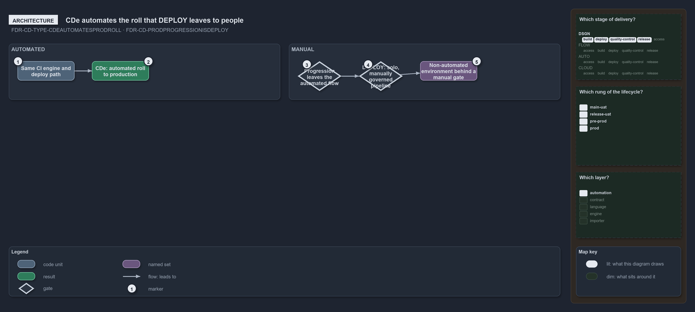

---
catzc:
  warning: "Experimental: this article merges two rules into one and holds nothing beyond what they say"
  edges:
    cites:
      - FDR-CD-TYPE-CDEAUTOMATESPRODROLL
      - FDR-CD-PRODPROGRESSIONISDEPLOY
---

# Cde automates the roll to production while manual progression enters deploy

This article is one rule: [FDR-CD-TYPE-CDEAUTOMATESPRODROLL](../../drs/flow/pipeline-types.md#rule-fdr-cd-type-cdeautomatesprodroll) and
[FDR-CD-PRODPROGRESSIONISDEPLOY](../../drs/flow/cd-discipline-and-promotion-flow.md#rule-fdr-cd-prodprogressionisdeploy) merged into one. It
holds nothing beyond what those two rules say.

CDe is a CD that internalizes and automates the roll to production: it runs the same CI engine and the same deploy-and-verify path as CD,
builds nothing new, and drives the CI engine's tagged, commit-pinned artifact all the way to prod. Progression toward prod otherwise leaves
the automated flow and enters DEPLOY, a solo, manually-governed pipeline that drives the same tagged artifact into a non-automated
environment behind a manual gate.

