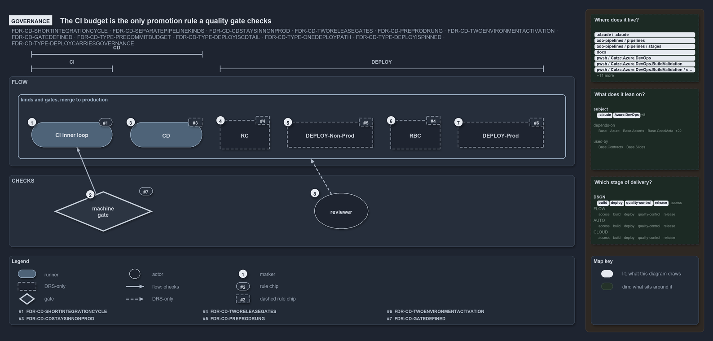

# The CI budget is the only promotion rule a quality gate checks

```text
The CI budget is the only promotion rule a quality gate checks.

1  CI inner loop    build-validation within the 5-10 minute integration cycle (#2)
2  machine gate     Test-Automation -EnforceTimings: per-test limits, Azure DevOps only (#13)
3  CD               the CI component, then non-prod only; build-once is review-checked (#5)
4  RC               the human gate at main-uat (#9)
5  DEPLOY-Non-Prod  the actuator into the non-prod acceptance environments (#11)
6  RBC              the human gate at release-uat (#9)
7  DEPLOY-Prod      stage inactive in pre-prod, then activate live (#12)
8  reviewer         code review, the only enforcer the FDR names for the whole flow

Supports FDR-CD-SHORTINTEGRATIONCYCLE, FDR-CD-SEPARATEPIPELINEKINDS, FDR-CD-CDSTAYSINNONPROD, FDR-CD-TWORELEASEGATES, FDR-CD-PREPRODRUNG,
FDR-CD-TWOENVIRONMENTACTIVATION and FDR-CD-GATEDEFINED, FDR-TYPE-PRECOMMITBUDGET, FDR-TYPE-DEPLOYISCDTAIL,
FDR-TYPE-ONEDEPLOYPATH, FDR-TYPE-DEPLOYISPINNED and FDR-TYPE-DEPLOYCARRIESGOVERNANCE (governance lens).
```

The CI discipline and the promotion flow set a rule for every pipeline kind and gate between a merge and production. Only one of those rules
has a machine check behind it: the quality gate on test timings in the CI inner loop. Every other rule rests on a human reviewer. The flow
reads left to right in one row, each kind or gate beside the rule that governs it, and below the row sit the two things that check it.

```yml drawio
description:
  The promotion flow from the CI inner loop to deploy to prod, with the one rule a quality gate checks (the per-test limits of the CI
  budget) set apart from the rules only a code reviewer enforces, drawn dashed.
about:
  adrs:
    - FDR-CD-SHORTINTEGRATIONCYCLE
    - FDR-CD-SEPARATEPIPELINEKINDS
    - FDR-CD-CDSTAYSINNONPROD
    - FDR-CD-TWORELEASEGATES
    - FDR-CD-PREPRODRUNG
    - FDR-CD-TWOENVIRONMENTACTIVATION
    - FDR-CD-GATEDEFINED
    - FDR-TYPE-PRECOMMITBUDGET
    - FDR-TYPE-DEPLOYISCDTAIL
    - FDR-TYPE-ONEDEPLOYPATH
    - FDR-TYPE-DEPLOYISPINNED
    - FDR-TYPE-DEPLOYCARRIESGOVERNANCE
  lens: governance
content:
  title: The CI budget is the only promotion rule a quality gate checks
  kind: explanation
  flow: left-to-right
  theme: dark
  bands:
    - { id: band-flow, label: FLOW }
    - { id: band-checks, label: CHECKS }
  spans:
    - id: span-ci
      label: CI
      over: [g-inner-loop]
    - id: span-cd
      label: CD
      over: [g-inner-loop, g-cd]
    - id: span-deploy
      label: DEPLOY
      over: [g-rc, g-deploy-non-prod, g-rbc, g-deploy-prod]
  groups:
    - { id: grp-flow, label: "kinds and gates, merge to production", in: band-flow }
  glyphs:
    - { id: g-inner-loop, kind: runner, label: CI inner loop, in: grp-flow }
    - { id: g-cd, kind: runner, label: CD, in: grp-flow }
    - { id: g-rc, kind: drsonly, label: RC, in: grp-flow }
    - { id: g-deploy-non-prod, kind: drsonly, label: DEPLOY-Non-Prod, in: grp-flow }
    - { id: g-rbc, kind: drsonly, label: RBC, in: grp-flow }
    - { id: g-deploy-prod, kind: drsonly, label: DEPLOY-Prod, in: grp-flow }
    - { id: g-machine-gate, kind: gate, label: machine gate, in: band-checks }
    - { id: g-reviewer, kind: actor, label: reviewer, in: band-checks }
  edges:
    - { from: g-machine-gate, to: g-inner-loop, kind: flow, label: calls }
    - { from: g-reviewer, to: grp-flow, kind: adr, label: "" }
  markers:
    - { at: g-inner-loop, number: 1 }
    - { at: g-machine-gate, number: 2 }
    - { at: g-cd, number: 3 }
    - { at: g-rc, number: 4 }
    - { at: g-deploy-non-prod, number: 5 }
    - { at: g-rbc, number: 6 }
    - { at: g-deploy-prod, number: 7 }
    - { at: g-reviewer, number: 8 }
  chips:
    - { at: g-inner-loop, kind: rule, rule: FDR-CD-SHORTINTEGRATIONCYCLE }
    - { at: g-machine-gate, kind: rule, rule: FDR-CD-GATEDEFINED }
    - { at: g-cd, kind: rule, rule: FDR-CD-CDSTAYSINNONPROD, gated: false }
    - { at: g-rc, kind: rule, rule: FDR-CD-TWORELEASEGATES, gated: false }
    - { at: g-deploy-non-prod, kind: rule, rule: FDR-CD-PREPRODRUNG, gated: false }
    - { at: g-rbc, kind: rule, rule: FDR-CD-TWORELEASEGATES, gated: false }
    - { at: g-deploy-prod, kind: rule, rule: FDR-CD-TWOENVIRONMENTACTIVATION, gated: false }
  legend: auto
  minimaps: [code-locations, module-neighbourhood, axis]
layout:
  band-flow: { x: 20, y: 152, w: 1260, h: 200 }
  band-checks: { x: 20, y: 372, w: 1260, h: 160 }
  grp-flow: { x: 40, y: 192, w: 1220, h: 144 }
  g-inner-loop: { x: 70, y: 254, w: 180, h: 56 }
  g-cd: { x: 290, y: 254, w: 160, h: 56 }
  g-rc: { x: 490, y: 250, w: 110, h: 64 }
  g-deploy-non-prod: { x: 640, y: 254, w: 190, h: 56 }
  g-rbc: { x: 870, y: 250, w: 110, h: 64 }
  g-deploy-prod: { x: 1020, y: 254, w: 190, h: 56 }
  g-machine-gate: { x: 120, y: 408, w: 220, h: 90 }
  g-reviewer: { x: 700, y: 412, w: 120, h: 80 }
```



## Walkthrough

1. **CI inner loop.** Getting a change into main must clear its build-validation within a 5–10 minute integration cycle, on a team basis.
   The pipeline-types FDR confines pre-commit validation to that budget.
2. **Quality gate.** `Test-Automation -Level 2 -EnforceTimings` in `ci-pwsh.yaml` fails the run when a passed test exceeds its level's time
   limit (`tests.level_ms` in `timeouts.yml`). It checks per-test limits, not the 5–10 minute cycle: the whole-run budget,
   `tests.run_seconds` (180 seconds by default), is reported and never fails the run. The GitHub mirror runs `Test-Automation -Level 2`
   without `-EnforceTimings`, so the gate binds the Azure DevOps pipeline only.
3. **CD.** CD runs the CI component, then takes the artifact through non-prod and stays there. Code review is meant to check both this and
   build-once. The code keeps both: every deploy job downloads the artifact the CI stage published, and no CD pipeline lists a prod-subscription
   target.
4. **RC.** Release Certification is the manual gate at main-uat, cleared when main-AT is verified. No pipeline or check carries it.
5. **DEPLOY-Non-Prod.** DEPLOY is the actuator that rolls the artifact on once a gate clears; DEPLOY-Non-Prod drives it into the non-prod
   acceptance environments. In the repository, the `release-uat` target of `deploy-apex.yaml` and `deploy-shared.yaml` is that path.
6. **RBC.** Release Branch Certification is the manual gate at release-uat, cleared when release-AT is verified. Only the FDR states it.
7. **DEPLOY-Prod.** DEPLOY-Prod stages the artifact inactive in pre-prod, validates the exact bytes, then activates them live in production.
   The `prod` target of `deploy-apex.yaml` does so; `deploy-shared.yaml` deploys its landing zone at `psub`.
8. **Reviewer.** Code review is the only enforcer the FDR names for the whole flow. No test or analyzer rule in `pwsh/` checks an FDR-CD
   rule; the code cites the FDR only in the DRS registry, two glossary entries and comments.

## Why it holds

- The integration cycle is 5–10 minutes on a team basis; a gate slower than that becomes a queue (FDR-CD-SHORTINTEGRATIONCYCLE,
  FDR-TYPE-PRECOMMITBUDGET).
- Build-once: nothing downstream rebuilds the tagged artifact (FDR-CD-SEPARATEPIPELINEKINDS).
- CD stays entirely within non-prod (FDR-CD-CDSTAYSINNONPROD).
- RC and RBC are the two hands-on release gates, and each is a gate, not a pipeline (FDR-CD-TWORELEASEGATES).
- DEPLOY splits by target into DEPLOY-Non-Prod and DEPLOY-Prod, and acts only once a gate clears (FDR-CD-PREPRODRUNG,
  FDR-TYPE-DEPLOYISCDTAIL–FDR-TYPE-DEPLOYCARRIESGOVERNANCE).
- Deploy to prod stages the artifact inactive in pre-prod, then activates it live (FDR-CD-TWOENVIRONMENTACTIVATION).
- A gate decides by machine, as a quality gate inside the inner CI gate, or by human certification (FDR-CD-GATEDEFINED).

## Where the code and the decision record differ

- The FDR's budget is the 5–10 minute integration cycle; the quality gate enforces per-test level limits instead, and only in the Azure
  DevOps pipeline.
- No pipeline tags the artifact, and no pipeline certifies RC or RBC.

## See also

- [The CI discipline and the promotion flow](../../drs/flow/cd-discipline-and-promotion-flow.md) — the decision this article explains;
  [pipeline types](../../drs/flow/pipeline-types.md) — the taxonomy it rests on.
- The other lenses on the same flow: [meta](one-artifact-climbs-unchanged.md), [architecture](pipeline-kinds-keyed-by-one-artifact.md),
  [implementation](cd-builds-once-then-deploys-non-prod.md) and [operations](a-merge-runs-cd-through-non-prod.md).
- [The flow explanations](index.md) · [How to read the diagrams](../index.md#how-to-read-the-diagrams)
