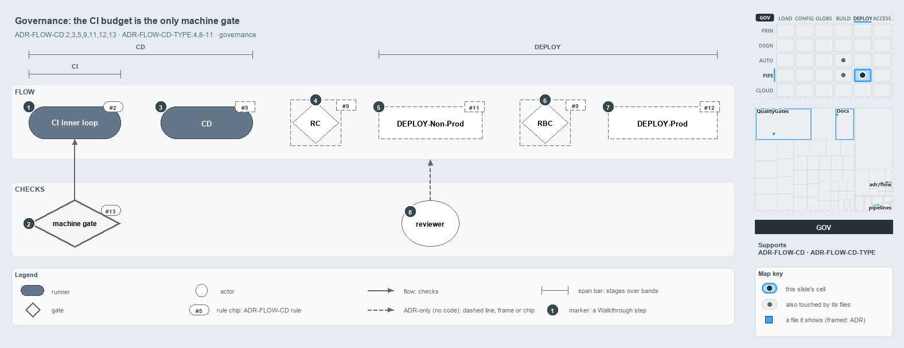

---
catzc:
  derived:
    path: docs/explanation/flow/ci-budget-is-the-only-quality-gate.md
    kind: explanation
    language: markdown
    filekind: md
    track: docs
    body_sha: "4ddf067c9039"
    adrs:
      - ADR-FLOW-CD#{2,3,5,9,11-13}
      - ADR-FLOW-CD-TYPE#{4,8,11}
    links:
      - docs/.assets/explanation/adr-flow-cd--ci-budget-is-the-only-quality-gate--governance.drawio.md
      - docs/.assets/explanation/adr-flow-cd--ci-budget-is-the-only-quality-gate--governance.drawio.png
      - docs/adr/flow/cd-discipline-and-promotion-flow.md
      - docs/adr/flow/pipeline-types.md
      - docs/explanation/flow/a-merge-runs-cd-to-prod.md
      - docs/explanation/flow/cd-builds-once-then-deploys-prod-itself.md
      - docs/explanation/flow/index.md
      - docs/explanation/flow/one-artifact-climbs-unchanged.md
      - docs/explanation/flow/pipeline-kinds-keyed-by-one-artifact.md
      - docs/explanation/index.md#how-to-read-the-diagrams
---

# The CI budget is the only promotion rule a quality gate checks

```text
The CI budget is the only promotion rule a quality gate checks.

1  CI inner loop    build-validation within the 5-10 minute integration cycle (#2)
2  machine gate     Test-Automation -EnforceTimings: per-test limits, Azure DevOps only (#13)
3  CD               the CI component, then non-prod only; build-once is review-checked (#5)
4  RC               the human gate at main-uat (#9)
5  DEPLOY-Non-Prod  the actuator into the non-prod acceptance environments (#11)
6  RBC              the human gate at release-uat (#9)
7  DEPLOY-Prod      stage inactive in pre-prod, then activate live (#12)
8  reviewer         code review, the only enforcer the ADR names for the whole flow

Supports ADR-FLOW-CD#2, #3, #5, #9, #11, #12 and #13 and ADR-FLOW-CD-TYPE#4 and #8 to #11 (governance lens).
```

The CI discipline and the promotion flow set a rule for every pipeline kind and gate between a merge and production. Only one of those rules
has a machine check behind it: the quality gate on test timings in the CI inner loop. Every other rule rests on a human reviewer. The flow
reads left to right in one row, each kind or gate beside the rule that governs it, and below the row sit the two things that check it.



The diagram is described element by element in
[its asset description](../../.assets/explanation/adr-flow-cd--ci-budget-is-the-only-quality-gate--governance.drawio.md).

## Walkthrough

1. **CI inner loop.** Getting a change into main must clear its build-validation within a 5–10 minute integration cycle, on a team basis.
   The pipeline-types ADR confines pre-commit validation to that budget.
2. **Quality gate.** `Test-Automation -Level 2 -EnforceTimings` in `ci-automation.yaml` fails the run when a passed test exceeds its level's
   time limit (`tests.level_ms` in `timeouts.yml`). It checks per-test limits, not the 5–10 minute cycle: the whole-run budget,
   `tests.run_seconds` (180 seconds by default), is reported and never fails the run. The GitHub mirror runs `Test-Automation -Level 2`
   without `-EnforceTimings`, so the gate binds the Azure DevOps pipeline only.
3. **CD.** CD runs the CI component, then takes the artifact through non-prod and stays there. Code review is meant to check both this and
   build-once. The code keeps build-once, since every deploy job downloads the artifact the CI stage published, but the apex and shared CD
   pipelines also deploy the prod tier: `psub`, and for apex the expedition `prod`.
4. **RC.** Release Certification is the manual gate at main-uat, cleared when main-AT is verified. No pipeline or check carries it.
5. **DEPLOY-Non-Prod.** DEPLOY is the actuator that rolls the artifact on once a gate clears; DEPLOY-Non-Prod drives it into the non-prod
   acceptance environments. There is no DEPLOY pipeline in the repository.
6. **RBC.** Release Branch Certification is the manual gate at release-uat, cleared when release-AT is verified. Only the ADR states it.
7. **DEPLOY-Prod.** DEPLOY-Prod stages the artifact inactive in pre-prod, validates the exact bytes, then activates them live in production.
   Only the ADR states it.
8. **Reviewer.** Code review is the only enforcer the ADR names for the whole flow. No test or analyzer rule in `automation/` checks an
   ADR-FLOW-CD rule; the code cites the ADR only in the ADR registry, two glossary entries and comments.

## Why it holds

- The integration cycle is 5–10 minutes on a team basis; a gate slower than that becomes a queue (ADR-FLOW-CD#2, ADR-FLOW-CD-TYPE#4).
- Build-once: nothing downstream rebuilds the tagged artifact (ADR-FLOW-CD#3).
- CD stays entirely within non-prod (ADR-FLOW-CD#5).
- RC and RBC are the two hands-on release gates, and each is a gate, not a pipeline (ADR-FLOW-CD#9).
- DEPLOY splits by target into DEPLOY-Non-Prod and DEPLOY-Prod, and acts only once a gate clears (ADR-FLOW-CD#11,
  ADR-FLOW-CD-TYPE#8–ADR-FLOW-CD-TYPE#11).
- Deploy to prod stages the artifact inactive in pre-prod, then activates it live (ADR-FLOW-CD#12).
- A gate decides by machine, as a quality gate inside the inner CI gate, or by human certification (ADR-FLOW-CD#13).

## Where the code and the ADR differ

- The ADR keeps CD in non-prod, but the apex and shared CD pipelines deploy `psub`, and apex the expedition `prod`, in the same run, with no
  gate.
- The ADR's budget is the 5–10 minute integration cycle; the quality gate enforces per-test level limits instead, and only in the Azure
  DevOps pipeline.
- No pipeline tags the artifact, and no RC, RBC, release-uat, DEPLOY pipeline or pre-prod-first activation exists.

## See also

- [The CI discipline and the promotion flow](../../adr/flow/cd-discipline-and-promotion-flow.md) — the decision this article explains;
  [pipeline types](../../adr/flow/pipeline-types.md) — the taxonomy it rests on.
- The other lenses on the same flow: [meta](one-artifact-climbs-unchanged.md), [architecture](pipeline-kinds-keyed-by-one-artifact.md),
  [implementation](cd-builds-once-then-deploys-prod-itself.md) and [operations](a-merge-runs-cd-to-prod.md).
- [The flow explanations](index.md) · [How to read the diagrams](../index.md#how-to-read-the-diagrams)
