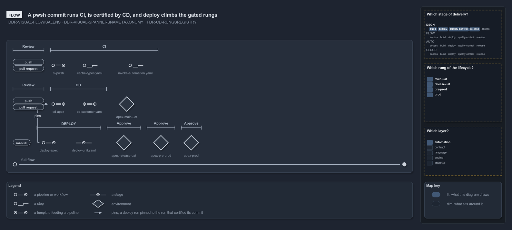

# A pwsh commit runs CI, is certified by CD, and deploy climbs the gated rungs

```text
A pwsh commit runs CI, is certified by CD, and deploy climbs the gated rungs.

1  ci-pwsh       a push or a pull request starts it; a pull request marks it for review
2  cd-apex       certifies the commit on the rungs with no gate
3  deploy-apex   run by hand, pinned to the cd-apex run that certified its commit
4  Approve       each gated rung the deploy climbs, up to prod

Supports DDR-VISUAL-FLOWISALENS, DDR-VISUAL-SPANNERSNAMETAXONOMY and FDR-CD-RUNGSREGISTRY (flow lens).
```

The diagram is drawn from the pipeline files alone. Its declaration names the three files and a title, and every lane, trigger, template and
environment is read from them when the diagram is built
([DDR-VISUAL-FLOWISALENS](../../drs/design/visual-design.md#rule-ddr-visual-flowisalens)). Each lane is one pipeline, read left to right:
the triggers that start it, the pipeline, the templates it references, and the environments it deploys to.

The pipeline type over each lane comes from its file name's prefix, so `ci-`, `cd-` and `deploy-` name CI, CD and DEPLOY. The environments
come from the rungs registry, never from the YAML: the CD lane holds the rungs with no gate, and the deploy lane holds the gated ones, each
with **Approve** over it ([FDR-CD-RUNGSREGISTRY](../../drs/flow/cd-discipline-and-promotion-flow.md#rule-fdr-cd-rungsregistry)). Nothing in
the deploy pipeline's trigger points back to the run that certified its commit, so the reader joins the two by the shared unit name and
draws the edge `pins`.


