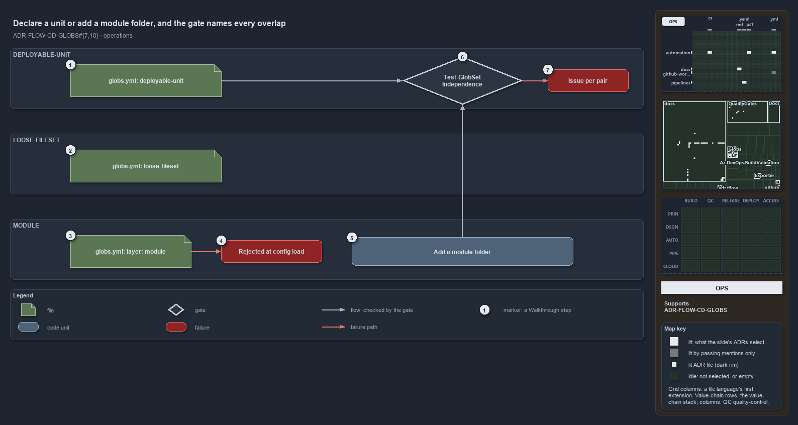

---
catzc:
  immutable:
    repo_status: clean
    path: docs/explanation/flow/declare-or-add-folder-gate-names-overlaps.md
    folder: docs/explanation/flow
    name: declare-or-add-folder-gate-names-overlaps
    filetype: md
    kind: explanation
    language: markdown
    track: docs
    tracktype: documentation
  edges:
    cites:
      - ADR-FLOW-CD-GLOBS#{7,10}
      - ADR-REPO-LINK#5
    links:
      - docs/adr/flow/durable-sha-globs.md
      - docs/explanation/.assets/adr-flow-cd-globs--declare-or-add-folder-gate-names-overlaps--operations.drawio.png
      - docs/explanation/flow/declare-or-add-folder-gate-names-overlaps.drawio.md
      - docs/explanation/flow/independence-check-groups-by-layer.md
      - docs/explanation/flow/index.md
      - docs/explanation/flow/overlap-gated-for-units-and-modules.md
      - docs/explanation/flow/peers-in-a-layer-never-overlap.md
      - docs/explanation/flow/two-declared-layers-one-derived.md
      - docs/explanation/index.md#how-to-read-the-diagrams
---

# Declare a unit or add a module folder, and the gate names every overlap

```text
Declare a unit in globs.yml or add a module folder; one gate run passes or names every overlap.

1  globs.yml: deployable-unit   add or recompose a unit; the gate checks it against its peers
2  globs.yml: loose-fileset     add a cross-cutting surface; never overlap-checked
3  globs.yml: layer: module     a mistake: the folders are the registration
4  Rejected at config load      GlobsConfig rejects a declared module layer or reserved name
5  Add a module folder          nothing to declare; its live and tests sets appear on the next run
6  Test-GlobSetIndependence     the gate you run; passes with zero issues and writes its report
7  Issue per pair               one line per overlapping pair, in one throw

Supports ADR-FLOW-CD-GLOBS#7 and #10 (operations lens).
```

Changing what cats maps takes either an edit to `globs.yml` or a new folder. Deployable-units and loose-filesets are declared in
`automation/Catzc.Base.Globs/configs/globs.yml`; a module is added by adding its folder under `automation/`. One run of
`Test-GlobSetIndependence` then either passes or names every same-layer pair that shares a file.



The diagram is described element by element in [its asset description](declare-or-add-folder-gate-names-overlaps.drawio.md).

## Walkthrough

1. **globs.yml: deployable-unit.** To add or recompose a unit, edit an entry with `layer: deployable-unit`, its `include:` and `exclude:`
   patterns, and optionally `compose:` and `pipeline:`. The gate checks the unit against its peers.
2. **globs.yml: loose-fileset.** To add a cross-cutting surface, declare an entry with `layer: loose-fileset`. It is never overlap-checked,
   so no edge leaves it.
3. **globs.yml: layer: module.** Declaring the module layer is a mistake: the folders are the registration.
4. **Rejected at config load.** `GlobsConfig` rejects the entry when `globs.yml` loads, with an error naming the module layer as
   derived-only. A declared reserved name (`internal`, `vendor`, `compiled`, `scriptanalyzer`) is rejected the same way.
5. **Add a module folder.** Nothing to declare. The folder's `<kebab>-live` and `<kebab>-tests` sets appear on the next run, because
   `Get-ModuleGlobSet` enumerates the folders on every call. A declared name that shadows one of them throws there and names both sides.
6. **Test-GlobSetIndependence.** The entry you run, with `-PassThru` and `-OutputFolder` as options. With zero issues it passes and writes
   its report under `out/test-globset-independence/`, a timestamped folder plus `latest.txt`; today it checks 102 sets over 2003 tracked
   files. The same gate runs as the integrity test `GlobSet-Independence.Tests.ps1`.
7. **Issue per pair.** On a violation the gate throws once, listing one line per overlapping pair in the form
   `<layer>: A <-> B share N file(s), e.g. <up to 5 paths>`. With `-PassThru` it returns the issues instead.

## Why it holds

- Units and loose-filesets are declared, the `module` layer is derived-only, and declaring it is rejected (ADR-FLOW-CD-GLOBS#7).
- Within a layer, no two globsets select a common file on their own contribution, and a violation names both sets and a shared file; the
  `loose-fileset` layer is exempt (ADR-FLOW-CD-GLOBS#10).

## Where the code and the ADR differ

ADR-REPO-PROTGLOB says every shadowing declared name is rejected at load; only the reserved names are, and the other shadows throw in
`Get-ModuleGlobSet`.

## See also

- [Globset triggers](../../adr/flow/durable-sha-globs.md) — the decision this article explains.
- The other lenses on the same layers: [meta](peers-in-a-layer-never-overlap.md), [architecture](two-declared-layers-one-derived.md),
  [implementation](independence-check-groups-by-layer.md) and [governance](overlap-gated-for-units-and-modules.md).
- [The flow explanations](index.md) · [How to read the diagrams](../index.md#how-to-read-the-diagrams)
