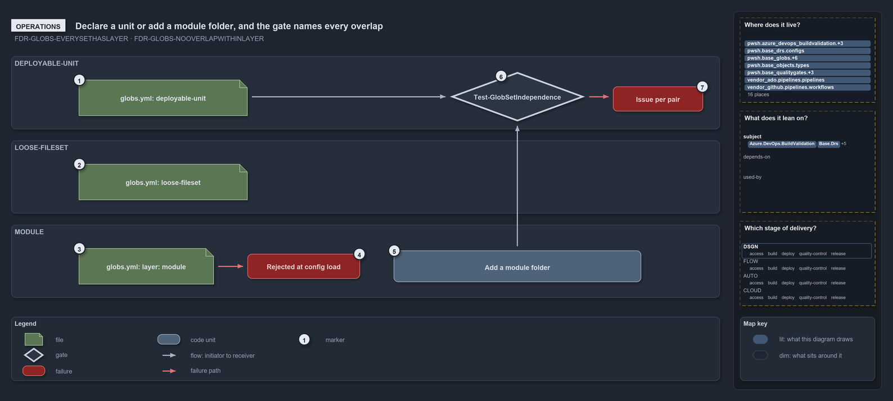

---
catzc:
  warning: "Header is generated by Format-FileMeta via Format-Code; do not change it"
  edges:
    cites:
      - FDR-CD-GLOBS-EVERYSETHASLAYER
      - FDR-CD-GLOBS-NOOVERLAPWITHINLAYER
    drs_total: 2
---

# Declare a unit or add a module folder, and the gate names every overlap

```text
Declare a unit in globs.yml or add a module folder; one gate run passes or names every overlap.

1  globs.yml: deployable-unit   add or recompose a unit; the gate checks it against its peers
2  globs.yml: loose-fileset     add a cross-cutting surface; never overlap-checked
3  globs.yml: layer: module     a mistake: the folders are the registration
4  Rejected at config load      GlobsConfig rejects a declared module layer or reserved name
5  Add a module folder          nothing to declare; its live and tests sets appear on the next run
6  Test-GlobSetIndependence     the gate you run; passes with zero issues and writes its report
7  Issue per pair               one line per overlapping pair, in one throw

Supports FDR-CD-GLOBS-EVERYSETHASLAYER and FDR-CD-GLOBS-NOOVERLAPWITHINLAYER (operations lens).
```

Changing what cats maps takes either an edit to `globs.yml` or a new folder. Deployable-units and loose-filesets are declared in
`pwsh/Catzc.Base.Globs/configs/globs.yml`; a module is added by adding its folder under `pwsh/`. One run of `Test-GlobSetIndependence` then
either passes or names every same-layer pair that shares a file.

```yml drawio
description:
  "Two ways to change what the globs map: edit globs.yml (a deployable-unit is checked against its peers, a loose-fileset never, a declared
  module layer is rejected at config load) or add a module folder; one run of the independence gate passes or names every overlapping pair."
about:
  adrs: [FDR-CD-GLOBS-EVERYSETHASLAYER, FDR-CD-GLOBS-NOOVERLAPWITHINLAYER]
  lens: operations
content:
  title: Declare a unit or add a module folder, and the gate names every overlap
  kind: explanation
  flow: left-to-right
  relation: checked by the gate
  theme: dark
  bands:
    - { id: band-deployable-unit, label: DEPLOYABLE-UNIT }
    - { id: band-loose-fileset, label: LOOSE-FILESET }
    - { id: band-module, label: MODULE }
  glyphs:
    - { id: f-deployable-unit, kind: file, label: "globs.yml: deployable-unit", in: band-deployable-unit }
    - { id: g-independence, kind: gate, label: Test-GlobSetIndependence, in: band-deployable-unit }
    - { id: f-issue-per-pair, kind: failure, label: Issue per pair, in: band-deployable-unit }
    - { id: f-loose-fileset, kind: file, label: "globs.yml: loose-fileset", in: band-loose-fileset }
    - { id: f-layer-module, kind: file, label: "globs.yml: layer: module", in: band-module }
    - { id: f-rejected, kind: failure, label: Rejected at config load, in: band-module }
    - { id: g-add-folder, kind: code, label: Add a module folder, in: band-module }
  edges:
    - { from: f-deployable-unit, to: g-independence, kind: flow, label: "" }
    - { from: g-independence, to: f-issue-per-pair, kind: fail, label: "" }
    - { from: f-layer-module, to: f-rejected, kind: fail, label: "" }
    - { from: g-add-folder, to: g-independence, kind: flow, label: "" }
  markers:
    - { at: f-deployable-unit, number: 1 }
    - { at: f-loose-fileset, number: 2 }
    - { at: f-layer-module, number: 3 }
    - { at: f-rejected, number: 4 }
    - { at: g-add-folder, number: 5 }
    - { at: g-independence, number: 6 }
    - { at: f-issue-per-pair, number: 7 }
  legend: auto
  minimaps:
    code-locations:
      - cell: .claude/.claude/.
        by: [.claude/CLAUDE.md, FDR-CD-GLOBS-EVERYSETHASLAYER, FDR-CD-GLOBS-NOOVERLAPWITHINLAYER]
      - cell: ado-pipelines/pipelines/.
        by:
          - .ado/pipelines/cd-apex.yaml
          - .ado/pipelines/cd-flux.yaml
          - .ado/pipelines/cd-nova.yaml
          - .ado/pipelines/cd-shared.yaml
          - .ado/pipelines/ci-infrastructure.yaml
          - .ado/pipelines/ci-pwsh.yaml
          - FDR-CD-GLOBS-EVERYSETHASLAYER
          - FDR-CD-GLOBS-NOOVERLAPWITHINLAYER
      - cell: docs/-/.
        by:
          - docs/drs/flow/dora-explains.md
          - docs/drs/flow/durable-sha-globs.md
          - docs/drs/index.md
          - docs/how-to/automation/apply-environment-approvals.md
          - docs/how-to/pwsh/manual-test-plan/pipelines-and-globs.md
          - docs/references/ado/pipelines/cd-apex.yaml.md
          - docs/references/ado/pipelines/cd-flux.yaml.md
          - docs/references/ado/pipelines/cd-nova.yaml.md
          - docs/references/ado/pipelines/cd-shared.yaml.md
          - docs/references/ado/pipelines/ci-infrastructure.yaml.md
          - docs/references/ado/pipelines/ci-pwsh.yaml.md
          - docs/references/github/workflows/ci-pwsh.yml.md
          - docs/references/pwsh/catzc-azure-dev-ops-build-validation/Get-AdoBuildValidations.ps1.md
          - docs/references/pwsh/catzc-azure-dev-ops-build-validation/Register-AdoBuildValidation.ps1.md
          - docs/references/pwsh/catzc-azure-dev-ops-build-validation/Unregister-AdoBuildValidation.ps1.md
          - docs/references/pwsh/catzc-azure-dev-ops-build-validation/configs/build-validation.yml.md
          - docs/references/pwsh/catzc-azure-dev-ops-build-validation/private/Get-BuildValidationPathFilter.ps1.md
          - docs/references/pwsh/catzc-azure-dev-ops/Sync-AdoEnvironmentApprovals.ps1.md
          - docs/references/pwsh/catzc-base-drs/types/DrsConfig.cs.md
          - docs/references/pwsh/catzc-base-globs.md
          - docs/references/pwsh/catzc-base-globs/Get-ModuleGlobSet.ps1.md
          - docs/references/pwsh/catzc-base-globs/Test-GlobSetIndependence.ps1.md
          - docs/references/pwsh/catzc-base-globs/configs/globs.yml.md
          - docs/references/pwsh/catzc-base-globs/private/Get-PipelineTrigger.ps1.md
          - docs/references/pwsh/catzc-base-globs/tests/GlobSet-Independence.Tests.ps1.md
          - docs/references/pwsh/catzc-base-globs/tests/Test-GlobSetIndependence.Tests.ps1.md
          - docs/references/pwsh/catzc-base-globs/tests/types/GlobsConfig.Tests.ps1.md
          - docs/references/pwsh/catzc-base-globs/types/DurableHash.cs.md
          - docs/references/pwsh/catzc-base-globs/types/GlobPattern.cs.md
          - docs/references/pwsh/catzc-base-globs/types/GlobSet.cs.md
          - docs/references/pwsh/catzc-base-globs/types/GlobsConfig.cs.md
          - docs/references/pwsh/catzc-base-maps/Get-LifecyclePositionMinimapData.ps1.md
          - docs/references/pwsh/catzc-base-maps/Get-ValueChainHighlight.ps1.md
          - docs/references/pwsh/catzc-base-maps/Get-WorldMapHighlight.ps1.md
          - docs/references/pwsh/catzc-base-quality-gates/Test-Automation.ps1.md
          - docs/references/pwsh/catzc-base-quality-gates/private/Resolve-TestSuite.ps1.md
          - FDR-CD-GLOBS-EVERYSETHASLAYER
          - FDR-CD-GLOBS-NOOVERLAPWITHINLAYER
      - cell: github-workflows/workflows/.
        by: [.github/workflows/ci-pwsh.yml, FDR-CD-GLOBS-EVERYSETHASLAYER, FDR-CD-GLOBS-NOOVERLAPWITHINLAYER]
      - cell: pwsh/Catzc.Azure.DevOps/.
        by: [pwsh/Catzc.Azure.DevOps/Sync-AdoEnvironmentApprovals.ps1, FDR-CD-GLOBS-EVERYSETHASLAYER, FDR-CD-GLOBS-NOOVERLAPWITHINLAYER]
      - cell: pwsh/Catzc.Azure.DevOps.BuildValidation/.
        by:
          - pwsh/Catzc.Azure.DevOps.BuildValidation/Get-AdoBuildValidations.ps1
          - pwsh/Catzc.Azure.DevOps.BuildValidation/Register-AdoBuildValidation.ps1
          - pwsh/Catzc.Azure.DevOps.BuildValidation/Unregister-AdoBuildValidation.ps1
          - FDR-CD-GLOBS-EVERYSETHASLAYER
          - FDR-CD-GLOBS-NOOVERLAPWITHINLAYER
      - cell: pwsh/Catzc.Azure.DevOps.BuildValidation/configs
        by:
          - pwsh/Catzc.Azure.DevOps.BuildValidation/configs/build-validation.yml
          - FDR-CD-GLOBS-EVERYSETHASLAYER
          - FDR-CD-GLOBS-NOOVERLAPWITHINLAYER
      - cell: pwsh/Catzc.Azure.DevOps.BuildValidation/private
        by:
          - pwsh/Catzc.Azure.DevOps.BuildValidation/private/Get-BuildValidationPathFilter.ps1
          - FDR-CD-GLOBS-EVERYSETHASLAYER
          - FDR-CD-GLOBS-NOOVERLAPWITHINLAYER
      - cell: pwsh/Catzc.Base.Drs/configs
        by: [pwsh/Catzc.Base.Drs/configs/drs.yml, FDR-CD-GLOBS-EVERYSETHASLAYER, FDR-CD-GLOBS-NOOVERLAPWITHINLAYER]
      - cell: pwsh/Catzc.Base.Drs/types
        by: [pwsh/Catzc.Base.Drs/types/DrsConfig.cs, FDR-CD-GLOBS-EVERYSETHASLAYER, FDR-CD-GLOBS-NOOVERLAPWITHINLAYER]
      - cell: pwsh/Catzc.Base.Globs/.
        by:
          - pwsh/Catzc.Base.Globs/Get-ModuleGlobSet.ps1
          - pwsh/Catzc.Base.Globs/Test-GlobSetIndependence.ps1
          - FDR-CD-GLOBS-EVERYSETHASLAYER
          - FDR-CD-GLOBS-NOOVERLAPWITHINLAYER
      - cell: pwsh/Catzc.Base.Globs/configs
        by: [pwsh/Catzc.Base.Globs/configs/globs.yml, FDR-CD-GLOBS-EVERYSETHASLAYER, FDR-CD-GLOBS-NOOVERLAPWITHINLAYER]
      - cell: pwsh/Catzc.Base.Globs/private
        by: [pwsh/Catzc.Base.Globs/private/Get-PipelineTrigger.ps1, FDR-CD-GLOBS-EVERYSETHASLAYER, FDR-CD-GLOBS-NOOVERLAPWITHINLAYER]
      - cell: pwsh/Catzc.Base.Globs/tests
        by:
          - pwsh/Catzc.Base.Globs/tests/GlobSet-Independence.Tests.ps1
          - pwsh/Catzc.Base.Globs/tests/Test-GlobSetIndependence.Tests.ps1
          - FDR-CD-GLOBS-NOOVERLAPWITHINLAYER
      - cell: pwsh/Catzc.Base.Globs/tests/types
        by: [pwsh/Catzc.Base.Globs/tests/types/GlobsConfig.Tests.ps1, FDR-CD-GLOBS-EVERYSETHASLAYER]
      - cell: pwsh/Catzc.Base.Globs/types
        by:
          - pwsh/Catzc.Base.Globs/types/DurableHash.cs
          - pwsh/Catzc.Base.Globs/types/GlobPattern.cs
          - pwsh/Catzc.Base.Globs/types/GlobSet.cs
          - pwsh/Catzc.Base.Globs/types/GlobsConfig.cs
          - FDR-CD-GLOBS-EVERYSETHASLAYER
          - FDR-CD-GLOBS-NOOVERLAPWITHINLAYER
      - cell: pwsh/Catzc.Base.Maps/.
        by:
          - pwsh/Catzc.Base.Maps/Get-LifecyclePositionMinimapData.ps1
          - pwsh/Catzc.Base.Maps/Get-ValueChainHighlight.ps1
          - pwsh/Catzc.Base.Maps/Get-WorldMapHighlight.ps1
          - FDR-CD-GLOBS-EVERYSETHASLAYER
          - FDR-CD-GLOBS-NOOVERLAPWITHINLAYER
      - cell: pwsh/Catzc.Base.Maps/tests
        by: [pwsh/Catzc.Base.Maps/tests/Get-WorldMapHighlight.Tests.ps1, FDR-CD-GLOBS-EVERYSETHASLAYER, FDR-CD-GLOBS-NOOVERLAPWITHINLAYER]
      - cell: pwsh/Catzc.Base.QualityGates/.
        by: [pwsh/Catzc.Base.QualityGates/Test-Automation.ps1, FDR-CD-GLOBS-EVERYSETHASLAYER]
      - cell: pwsh/Catzc.Base.QualityGates/configs
        by: [pwsh/Catzc.Base.QualityGates/configs/terminology.yml, FDR-CD-GLOBS-EVERYSETHASLAYER, FDR-CD-GLOBS-NOOVERLAPWITHINLAYER]
      - cell: pwsh/Catzc.Base.QualityGates/private
        by: [pwsh/Catzc.Base.QualityGates/private/Resolve-TestSuite.ps1, FDR-CD-GLOBS-EVERYSETHASLAYER]
    module-neighbourhood:
      - cell: subject/.claude
        by: [.claude/CLAUDE.md, FDR-CD-GLOBS-EVERYSETHASLAYER, FDR-CD-GLOBS-NOOVERLAPWITHINLAYER]
      - cell: subject/Catzc.Azure.DevOps
        by: [pwsh/Catzc.Azure.DevOps/Sync-AdoEnvironmentApprovals.ps1, FDR-CD-GLOBS-EVERYSETHASLAYER, FDR-CD-GLOBS-NOOVERLAPWITHINLAYER]
      - cell: subject/Catzc.Azure.DevOps.BuildValidation
        by:
          - pwsh/Catzc.Azure.DevOps.BuildValidation/Get-AdoBuildValidations.ps1
          - pwsh/Catzc.Azure.DevOps.BuildValidation/Register-AdoBuildValidation.ps1
          - pwsh/Catzc.Azure.DevOps.BuildValidation/Unregister-AdoBuildValidation.ps1
          - pwsh/Catzc.Azure.DevOps.BuildValidation/configs/build-validation.yml
          - pwsh/Catzc.Azure.DevOps.BuildValidation/private/Get-BuildValidationPathFilter.ps1
          - FDR-CD-GLOBS-EVERYSETHASLAYER
          - FDR-CD-GLOBS-NOOVERLAPWITHINLAYER
      - cell: subject/Catzc.Base.Drs
        by:
          - pwsh/Catzc.Base.Drs/configs/drs.yml
          - pwsh/Catzc.Base.Drs/types/DrsConfig.cs
          - FDR-CD-GLOBS-EVERYSETHASLAYER
          - FDR-CD-GLOBS-NOOVERLAPWITHINLAYER
      - cell: subject/Catzc.Base.Globs
        by:
          - pwsh/Catzc.Base.Globs/Get-ModuleGlobSet.ps1
          - pwsh/Catzc.Base.Globs/Test-GlobSetIndependence.ps1
          - pwsh/Catzc.Base.Globs/configs/globs.yml
          - pwsh/Catzc.Base.Globs/private/Get-PipelineTrigger.ps1
          - pwsh/Catzc.Base.Globs/tests/GlobSet-Independence.Tests.ps1
          - pwsh/Catzc.Base.Globs/tests/Test-GlobSetIndependence.Tests.ps1
          - pwsh/Catzc.Base.Globs/tests/types/GlobsConfig.Tests.ps1
          - pwsh/Catzc.Base.Globs/types/DurableHash.cs
          - pwsh/Catzc.Base.Globs/types/GlobPattern.cs
          - pwsh/Catzc.Base.Globs/types/GlobSet.cs
          - pwsh/Catzc.Base.Globs/types/GlobsConfig.cs
          - FDR-CD-GLOBS-EVERYSETHASLAYER
          - FDR-CD-GLOBS-NOOVERLAPWITHINLAYER
      - cell: subject/Catzc.Base.Maps
        by:
          - pwsh/Catzc.Base.Maps/Get-LifecyclePositionMinimapData.ps1
          - pwsh/Catzc.Base.Maps/Get-ValueChainHighlight.ps1
          - pwsh/Catzc.Base.Maps/Get-WorldMapHighlight.ps1
          - pwsh/Catzc.Base.Maps/tests/Get-WorldMapHighlight.Tests.ps1
          - FDR-CD-GLOBS-EVERYSETHASLAYER
          - FDR-CD-GLOBS-NOOVERLAPWITHINLAYER
      - cell: subject/Catzc.Base.QualityGates
        by:
          - pwsh/Catzc.Base.QualityGates/Test-Automation.ps1
          - pwsh/Catzc.Base.QualityGates/configs/terminology.yml
          - pwsh/Catzc.Base.QualityGates/private/Resolve-TestSuite.ps1
          - FDR-CD-GLOBS-EVERYSETHASLAYER
          - FDR-CD-GLOBS-NOOVERLAPWITHINLAYER
      - cell: subject/pipelines
        by:
          - .ado/pipelines/cd-apex.yaml
          - .ado/pipelines/cd-flux.yaml
          - .ado/pipelines/cd-nova.yaml
          - .ado/pipelines/cd-shared.yaml
          - .ado/pipelines/ci-infrastructure.yaml
          - .ado/pipelines/ci-pwsh.yaml
          - FDR-CD-GLOBS-EVERYSETHASLAYER
          - FDR-CD-GLOBS-NOOVERLAPWITHINLAYER
      - cell: subject/workflows
        by: [.github/workflows/ci-pwsh.yml, FDR-CD-GLOBS-EVERYSETHASLAYER, FDR-CD-GLOBS-NOOVERLAPWITHINLAYER]
    axis:
      - cell: DSGN/*
        by: [FDR-CD-GLOBS-EVERYSETHASLAYER, FDR-CD-GLOBS-NOOVERLAPWITHINLAYER]
layout:
  band-deployable-unit: { x: 20, y: 84, w: 1260, h: 130 }
  band-loose-fileset: { x: 20, y: 234, w: 1260, h: 130 }
  band-module: { x: 20, y: 384, w: 1260, h: 130 }
  f-deployable-unit: { x: 140, y: 126, w: 300, h: 64 }
  g-independence: { x: 800, y: 112, w: 240, h: 88 }
  f-issue-per-pair: { x: 1090, y: 138, w: 160, h: 44 }
  f-loose-fileset: { x: 140, y: 276, w: 300, h: 64 }
  f-layer-module: { x: 140, y: 426, w: 240, h: 64 }
  f-rejected: { x: 440, y: 436, w: 200, h: 44 }
  g-add-folder: { x: 700, y: 430, w: 440, h: 56 }
```



## Walkthrough

1. **globs.yml: deployable-unit.** To add or recompose a unit, edit an entry with `layer: deployable-unit`, its `include:` and `exclude:`
   patterns, and optionally `compose:` and `pipeline:`. The gate checks the unit against its peers.
2. **globs.yml: loose-fileset.** To add a cross-cutting surface, declare an entry with `layer: loose-fileset`. It is never overlap-checked,
   so no edge leaves it.
3. **globs.yml: layer: module.** Declaring the module layer is a mistake: the folders are the registration.
4. **Rejected at config load.** `GlobsConfig` rejects the entry when `globs.yml` loads, with an error naming the module layer as
   derived-only. A declared reserved name (`internal`, `vendor`, `compiled`, `scriptanalyzer`) is rejected the same way.
5. **Add a module folder.** Nothing to declare. The folder's `<kebab>-live` and `<kebab>-tests` sets appear on the next run, because
   `Get-ModuleGlobSet` enumerates the folders on every call. A declared name that shadows one of them throws there and names both sides.
6. **Test-GlobSetIndependence.** The entry you run, with `-PassThru` and `-OutputFolder` as options. With zero issues it passes and writes
   its report under `out/test-globset-independence/`, a timestamped folder plus `latest.txt`; today it checks 102 sets over 2003 tracked
   files. The same gate runs as the integrity test `GlobSet-Independence.Tests.ps1`.
7. **Issue per pair.** On a violation the gate throws once, listing one line per overlapping pair in the form
   `<layer>: A <-> B share N file(s), e.g. <up to 5 paths>`. With `-PassThru` it returns the issues instead.

## Why it holds

- Units and loose-filesets are declared, the `module` layer is derived-only, and declaring it is rejected (FDR-CD-GLOBS-EVERYSETHASLAYER).
- Within a layer, no two globsets select a common file on their own contribution, and a violation names both sets and a shared file; the
  `loose-fileset` layer is exempt (FDR-CD-GLOBS-NOOVERLAPWITHINLAYER).

## Where the code and the decision record differ

ADR-REPO-PROTGLOB says every shadowing declared name is rejected at load; only the reserved names are, and the other shadows throw in
`Get-ModuleGlobSet`.

## See also

- [Globset triggers](../../drs/flow/durable-sha-globs.md) — the decision this article explains.
- The other lenses on the same layers: [meta](peers-in-a-layer-never-overlap.md), [architecture](two-declared-layers-one-derived.md),
  [implementation](independence-check-groups-by-layer.md) and [governance](overlap-gated-for-units-and-modules.md).
- [The flow explanations](index.md) · [How to read the diagrams](../index.md#how-to-read-the-diagrams)
