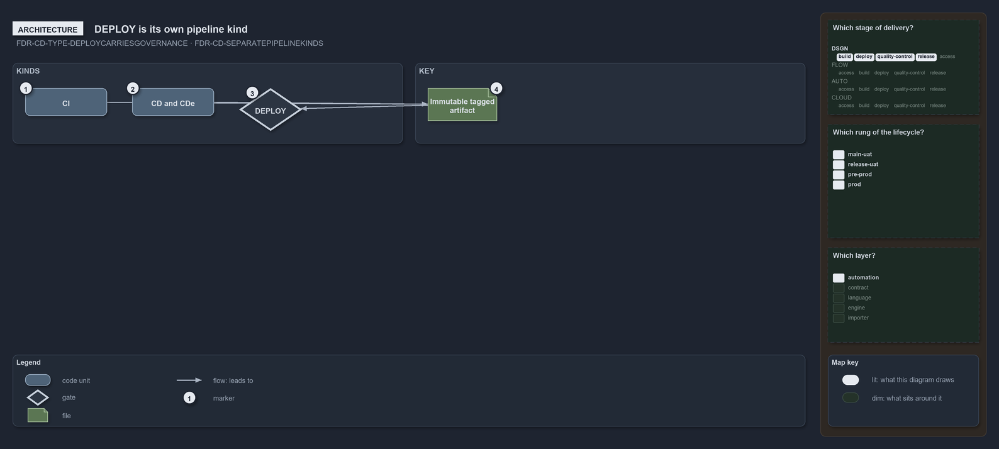

---
catzc:
  warning: "Experimental: this article merges two rules into one and holds nothing beyond what they say"
  edges:
    cites:
      - FDR-CD-TYPE-DEPLOYCARRIESGOVERNANCE
      - FDR-CD-SEPARATEPIPELINEKINDS
---

# Deploy is a pipeline kind of its own keyed to the others by tagged artifact

This article is one rule: [FDR-CD-TYPE-DEPLOYCARRIESGOVERNANCE](../../drs/flow/pipeline-types.md#rule-fdr-cd-type-deploycarriesgovernance)
and [FDR-CD-SEPARATEPIPELINEKINDS](../../drs/flow/cd-discipline-and-promotion-flow.md#rule-fdr-cd-separatepipelinekinds) merged into one. It
holds nothing beyond what those two rules say.

CI, CD, CDe and DEPLOY are separate pipeline kinds keyed together by the tagged artifact, not merged into one construct; each is its own ADO
pipeline with its own trigger, governance and history. DEPLOY exists to make an environment's governance a first-class pipeline construct,
one place for access control, isolation and audit history behind a manual gate, and it splits by target on the one build-once artifact.

