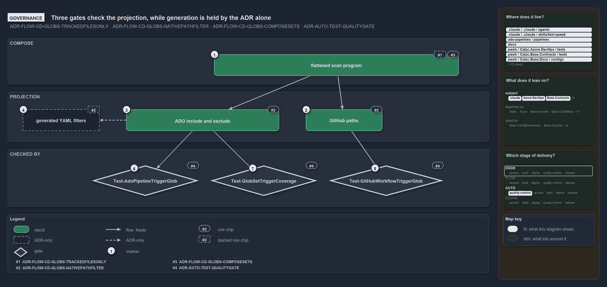

# Three gates check the projection, while generation is held by the ADR alone

```text
Three gates check the projection; generation is ADR-only.

1  flattened scan program         #8 checked at config load; #4 held by no gate
2  GitHub paths                   #6: exact, ordered, ! negation
3  ADO include and exclude        #6: each pattern's last select
4  generated YAML filters         #6 says generated, never hand-authored; no code writes them
5  Test-GitHubWorkflowTriggerGlob quality gate: the workflow's ordered paths equal the projection
6  Test-AdoPipelineTriggerGlob    quality gate: the pipeline's four lists equal the projection
7  Test-GlobSetTriggerCoverage    quality gate: every member hits an ADO include

Supports FDR-CD-GLOBS-TRACKEDFILESONLY, FDR-CD-GLOBS-NATIVEPATHFILTER and FDR-CD-GLOBS-COMPOSESETS, and ADR-AUTO-TEST-QUALITYGATE (governance lens).
```

The projection of a globset into vendor path filters is the stage of the globset rules in cats that quality gates cover best: three gates
check that every bound workflow and pipeline declares its projection and that the Azure DevOps includes cover every member. One thing the
ADR states around the projection has no code behind it: that the YAML filters are generated rather than written by hand. It is worth knowing
before relying on it.



## Walkthrough

1. **Flattened scan program.** Compose puts the base first and the set's own rules last (#8); `GlobsConfig` rejects a self-reference, an
   unknown reference or a cycle when the config loads, a load-time check rather than a quality gate. The last-match-wins evaluation of the
   program (#4) is held by no gate: it is the mechanism every gate relies on.
2. **GitHub paths.** The program in order with `!` negation (#6), exact by construction. The build-validation policy's `filenamePatterns`
   also take this list, anchored with `/`, where the ADR names the Azure DevOps lists.
3. **ADO include and exclude.** Each pattern's last select (#6). The lists lose the order, and the ADR's own safety argument for them is
   that Azure DevOps keeps a deeper-folder include over a broader exclude.
4. **Generated YAML filters.** The ADR says the filters are generated from `globs.yml` into the orchestration YAML and never hand-authored,
   and that a set whose Azure DevOps projection cannot reproduce exact membership is caught at generation time. No code in the tree writes a
   `paths:` filter, and `Get-GlobSetTrigger` defers that case to the coverage check.
5. **Test-GitHubWorkflowTriggerGlob.** A quality gate: it recomputes the ordered GitHub list and compares it element by element with
   `on.push.paths` and `on.pull_request.paths` of the workflow it is given, one issue per drifted or missing workflow.
6. **Test-AdoPipelineTriggerGlob.** A quality gate: for every pipeline-bound set it compares the `trigger:` and `pr:` include and exclude
   lists of `.ado/pipelines/<pipeline>.yaml` with the projection as sets, one issue per drifted or missing pipeline.
7. **Test-GlobSetTriggerCoverage.** A quality gate: every member of a pipeline-bound set matches one of its Azure DevOps include patterns,
   so an include-only trigger is a superset that never under-triggers. It checks includes only, so a set whose root `.yml` an equal-depth
   exclude may drop passes it; `cd-shared.yaml` documents such a set.

The three gates each collect every issue, write a report through `Write-QualityGateReport` and throw once, and an L2 integrity test of each
requires zero issues, so a drifted filter fails `Test-Automation` locally and in CI.

## Why it holds

- Membership is the ordered scan program evaluated last-match-wins, with precedence by position (FDR-CD-GLOBS-TRACKEDFILESONLY).
- A pipeline, workflow or build-validation policy triggers on the native projection, generated from `globs.yml`, and the drift quality gates
  report one issue per pipeline whose declared trigger no longer equals its projection or whose file is missing
  (FDR-CD-GLOBS-NATIVEPATHFILTER).
- A composing set's program is the composed programs first and its own rules last, validated at config load (FDR-CD-GLOBS-COMPOSESETS).
- A quality gate is one `Test-<subject>` function that checks one property of the whole repository, collects every issue, writes its report
  and throws once, and an integrity test runs it at its tier (ADR-AUTO-TEST-QUALITYGATE).

## Where the code and the decision record differ

- The ADR says the projected filters are generated from `globs.yml` into the YAML; nothing in the tree writes them, so they are kept by hand
  and only compared.
- The ADR says a set whose Azure DevOps projection cannot reproduce exact membership is caught at generation time; `Get-GlobSetTrigger`
  defers it to `Test-GlobSetTriggerCoverage`, which checks includes only, and `cd-shared.yaml` documents a set where Azure DevOps may drop a
  root `.yml`.
- The ADR says branch-policy `filenamePatterns` use the Azure DevOps projection; `Get-BuildValidationPathFilter` anchors the GitHub list
  instead.

## See also

- [Globset triggers](../../drs/flow/durable-sha-globs.md) — the decision this article explains, with
  [test automation](../../drs/automation/test-automation.md).
- The other lenses on the same projection: [meta](one-program-two-vendor-dialects.md),
  [architecture](globs-projects-and-three-consumers-read.md), [implementation](apex-thirteen-rules-seven-includes-six-excludes.md) and
  [operations](print-projection-then-drift-names-the-filter.md).
- [The flow explanations](index.md) · [How to read the diagrams](../index.md#how-to-read-the-diagrams)
