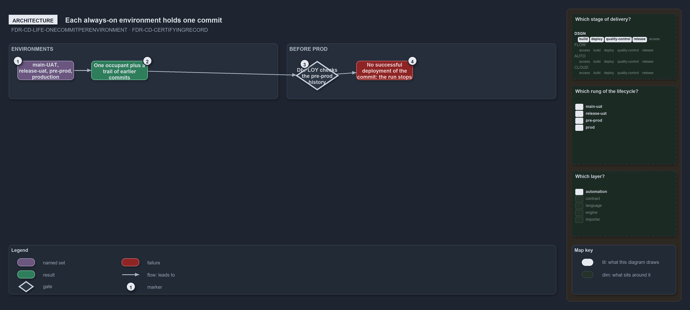

---
catzc:
  warning: "Experimental: this article merges two rules into one and holds nothing beyond what they say"
  edges:
    cites:
      - FDR-CD-LIFE-ONECOMMITPERENVIRONMENT
      - FDR-CD-CERTIFYINGRECORD
---

# Each always on environment holds one commit and its deployment history is the record

This article is one rule: [FDR-CD-LIFE-ONECOMMITPERENVIRONMENT](../../drs/flow/commit-lifecycle.md#rule-fdr-cd-life-onecommitperenvironment)
and [FDR-CD-CERTIFYINGRECORD](../../drs/flow/cd-discipline-and-promotion-flow.md#rule-fdr-cd-certifyingrecord) merged into one. It holds
nothing beyond what those two rules say.

Each always-on environment hosts exactly one commit plus a history: `main-UAT`, `release-uat`, `pre-prod` and `production` are stateful,
each holding one occupant and a trail of the commits it held before. A rung's certifying record is its environment's deployment history:
before a DEPLOY run deploys a prod target, it checks that the history of the unit's pre-prod environment holds a successful deployment of
that commit, or the run stops.

