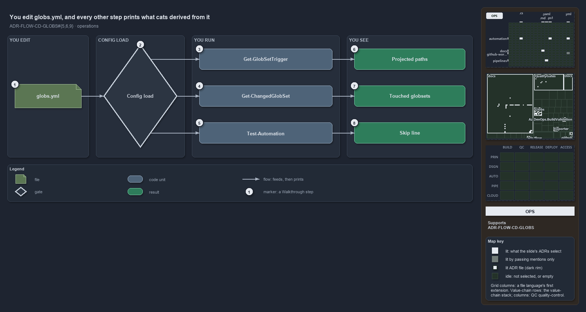

---
catzc:
  immutable:
    repo_status: clean
    path: docs/explanation/flow/edit-globs-yml-then-read-the-output.md
    folder: docs/explanation/flow
    name: edit-globs-yml-then-read-the-output
    filetype: md
    kind: explanation
    language: markdown
    track: docs
    tracktype: documentation
  edges:
    cites:
      - ADR-FLOW-CD-GLOBS#{5,6,9}
    links:
      - docs/adr/flow/durable-sha-globs.md
      - docs/explanation/.assets/adr-flow-cd-globs--edit-globs-yml-then-read-the-output--operations.drawio.png
      - docs/explanation/flow/edit-globs-yml-then-read-the-output.drawio.md
      - docs/explanation/flow/gates-check-source-and-trigger.md
      - docs/explanation/flow/globs-module-owns-config-and-types.md
      - docs/explanation/flow/index.md
      - docs/explanation/flow/one-scan-program-feeds-three-roles.md
      - docs/explanation/flow/three-views-derived-live-from-one-program.md
      - docs/explanation/index.md#how-to-read-the-diagrams
---

# You edit globs.yml, and every other step prints what cats derived from it

```text
You edit globs.yml, and every other step prints what cats derived from it.

1  globs.yml           the only file a person writes to change an area-of-control
2  Config load         every command loads the registry first; a bad registry stops here
3  Get-GlobSetTrigger  prints the projection of one set
4  Get-ChangedGlobSet  lists the globsets a commit range touched
5  Test-Automation     skips modules whose composite identity is unchanged, locally only
6  Projected paths     GitHub, AdoInclude and AdoExclude; the drift gates compare them
7  Touched globsets    the declared sets the diff touched, in registry order
8  Skip line           names the modules skipped as unchanged since their last green run

Supports ADR-FLOW-CD-GLOBS#5, #6 and #9 (operations lens).
```

`globs.yml` is the only file a person writes to change an area-of-control in cats. Every other step is a command that loads the registry and
prints what it derived: a projection, a list of touched sets, or a skip line. Knowing what each command prints lets an operator check a
globset edit before any pipeline runs.



The diagram is described element by element in [its asset description](edit-globs-yml-then-read-the-output.drawio.md).

## Walkthrough

1. **globs.yml.** Add or change a globset. Adding files to a unit, or a whole customer, is a config edit.
2. **Config load.** Every command that reads the registry loads it through `Get-Config` first. A bad pattern or a compose cycle stops right
   there, with every error listed at once.
3. **Get-GlobSetTrigger.** `Get-GlobSetTrigger -Name <set>` prints the projection of one set.
4. **Get-ChangedGlobSet.** `Get-ChangedGlobSet -Range 'HEAD^1..HEAD'` lists the globsets the range touched.
5. **Test-Automation.** Run locally, it skips every module whose composite identity is unchanged since its last green run this session. In a
   pipeline it never skips.
6. **Projected paths.** The output has `GitHub`, `AdoInclude` and `AdoExclude`. When a pipeline's declared filter drifts from it, the gate
   issue reads `<set>: <file> trigger drifted from the globset projection on …`; a missing file is its own issue (`pipeline file not found`
   or `workflow file not found`).
7. **Touched globsets.** The declared sets, in registry order. The same diff answers `Test-GlobSetAffected -Name <set>`, which prints
   `$true` or `$false`, and `$true` on any doubt. No pipeline YAML calls it yet; `cd-shared.yaml` mentions it only in a comment.
8. **Skip line.** `N module(s) skipped (protected — unchanged since their last green run this session): …`.

## Why it holds

- The identity behind the skip is computed live and never committed, so a skip can never rest on a stale record (ADR-FLOW-CD-GLOBS#5).
- Pipelines and workflows trigger on the projection, and the gates on the trigger report every pipeline whose declared trigger no longer
  equals it (ADR-FLOW-CD-GLOBS#6).
- Whether a change touches a set is computed from git at real refs and fails open on doubt (ADR-FLOW-CD-GLOBS#9).

## Where the code and the ADR differ

The ADR calls `Test-GlobSetAffected` "the in-pipeline check", but no pipeline or workflow invokes it.

## See also

- [Globset triggers](../../adr/flow/durable-sha-globs.md) — the decision this article explains.
- The other lenses on the same globset roles: [meta](three-views-derived-live-from-one-program.md),
  [architecture](globs-module-owns-config-and-types.md), [implementation](one-scan-program-feeds-three-roles.md) and
  [governance](gates-check-source-and-trigger.md).
- [The flow explanations](index.md) · [How to read the diagrams](../index.md#how-to-read-the-diagrams)
