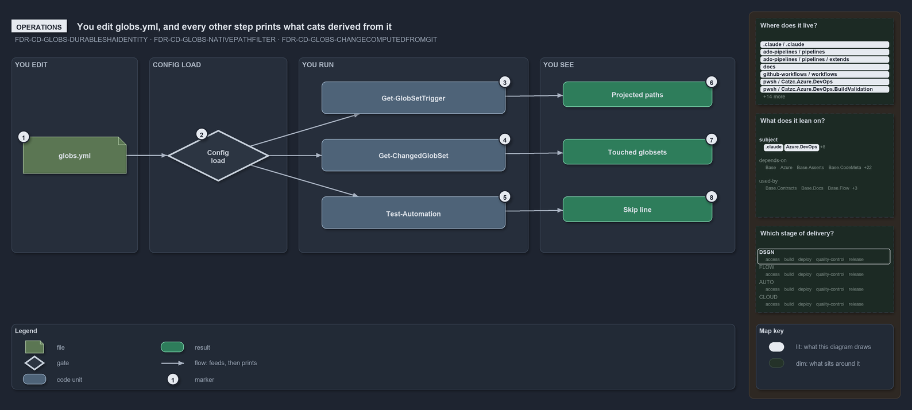

# You edit globs.yml, and every other step prints what cats derived from it

```text
You edit globs.yml, and every other step prints what cats derived from it.

1  globs.yml           the only file a person writes to change an area-of-control
2  Config load         every command loads the registry first; a bad registry stops here
3  Get-GlobSetTrigger  prints the projection of one set
4  Get-ChangedGlobSet  lists the globsets a commit range touched
5  Test-Automation     skips modules whose composite identity is unchanged, locally only
6  Projected paths     GitHub, AdoInclude and AdoExclude; the drift gates compare them
7  Touched globsets    the declared sets the diff touched, in registry order
8  Skip line           names the modules skipped as unchanged since their last green run

Supports FDR-CD-GLOBS-DURABLESHAIDENTITY, FDR-CD-GLOBS-NATIVEPATHFILTER and FDR-CD-GLOBS-CHANGECOMPUTEDFROMGIT (operations lens).
```

`globs.yml` is the only file a person writes to change an area-of-control in cats. Every other step is a command that loads the registry and
prints what it derived: a projection, a list of touched sets, or a skip line. Knowing what each command prints lets an operator check a
globset edit before any pipeline runs.

```yml drawio
description:
  "globs.yml is the only file a person writes; the config load validates it, and three commands then print what was derived from it: the
  projection of one set, the globsets a commit range touched, and the skip line of the test run."
about:
  adrs: [FDR-CD-GLOBS-DURABLESHAIDENTITY, FDR-CD-GLOBS-NATIVEPATHFILTER, FDR-CD-GLOBS-CHANGECOMPUTEDFROMGIT]
  lens: operations
content:
  title: You edit globs.yml, and every other step prints what cats derived from it
  kind: explanation
  flow: left-to-right
  relation: feeds, then prints
  theme: dark
  bands:
    - { id: band-edit, label: YOU EDIT }
    - { id: band-load, label: CONFIG LOAD }
    - { id: band-run, label: YOU RUN }
    - { id: band-see, label: YOU SEE }
  glyphs:
    - { id: f-globs, kind: file, label: globs.yml, in: band-edit }
    - { id: g-config-load, kind: gate, label: Config load, in: band-load }
    - { id: g-trigger, kind: code, label: Get-GlobSetTrigger, in: band-run }
    - { id: g-changed, kind: code, label: Get-ChangedGlobSet, in: band-run }
    - { id: g-automation, kind: code, label: Test-Automation, in: band-run }
    - { id: r-projected, kind: result, label: Projected paths, in: band-see }
    - { id: r-touched, kind: result, label: Touched globsets, in: band-see }
    - { id: r-skip, kind: result, label: Skip line, in: band-see }
  edges:
    - { from: f-globs, to: g-config-load, kind: flow, label: "" }
    - { from: g-config-load, to: g-trigger, kind: flow, label: "" }
    - { from: g-config-load, to: g-changed, kind: flow, label: "" }
    - { from: g-config-load, to: g-automation, kind: flow, label: "" }
    - { from: g-trigger, to: r-projected, kind: flow, label: "" }
    - { from: g-changed, to: r-touched, kind: flow, label: "" }
    - { from: g-automation, to: r-skip, kind: flow, label: "" }
  markers:
    - { at: f-globs, number: 1 }
    - { at: g-config-load, number: 2 }
    - { at: g-trigger, number: 3 }
    - { at: g-changed, number: 4 }
    - { at: g-automation, number: 5 }
    - { at: r-projected, number: 6 }
    - { at: r-touched, number: 7 }
    - { at: r-skip, number: 8 }
  legend: auto
  minimaps:
    code-locations:
      - cell: .claude/.claude/.
        by: [.claude/CLAUDE.md, FDR-CD-GLOBS-CHANGECOMPUTEDFROMGIT, FDR-CD-GLOBS-DURABLESHAIDENTITY, FDR-CD-GLOBS-NATIVEPATHFILTER]
      - cell: ado-pipelines/pipelines/.
        by:
          - .ado/pipelines/cd-apex.yaml
          - .ado/pipelines/cd-flux.yaml
          - .ado/pipelines/cd-nova.yaml
          - .ado/pipelines/cd-shared.yaml
          - .ado/pipelines/ci-infrastructure.yaml
          - .ado/pipelines/ci-pwsh.yaml
          - FDR-CD-GLOBS-CHANGECOMPUTEDFROMGIT
          - FDR-CD-GLOBS-DURABLESHAIDENTITY
          - FDR-CD-GLOBS-NATIVEPATHFILTER
      - cell: ado-pipelines/pipelines/extends
        by: [.ado/pipelines/extends/cd-customer.yaml, FDR-CD-GLOBS-CHANGECOMPUTEDFROMGIT]
      - cell: docs/-/.
        by:
          - docs/drs/flow/dora-explains.md
          - docs/drs/flow/durable-sha-globs.md
          - docs/drs/index.md
          - docs/how-to/automation/apply-environment-approvals.md
          - docs/references/ado/pipelines/cd-apex.yaml.md
          - docs/references/ado/pipelines/cd-flux.yaml.md
          - docs/references/ado/pipelines/cd-nova.yaml.md
          - docs/references/ado/pipelines/cd-shared.yaml.md
          - docs/references/ado/pipelines/ci-infrastructure.yaml.md
          - docs/references/ado/pipelines/ci-pwsh.yaml.md
          - docs/references/github/workflows/ci-pwsh.yml.md
          - docs/references/pwsh/catzc-azure-dev-ops-build-validation/Get-AdoBuildValidations.ps1.md
          - docs/references/pwsh/catzc-azure-dev-ops-build-validation/Register-AdoBuildValidation.ps1.md
          - docs/references/pwsh/catzc-azure-dev-ops-build-validation/Unregister-AdoBuildValidation.ps1.md
          - docs/references/pwsh/catzc-azure-dev-ops-build-validation/configs/build-validation.yml.md
          - docs/references/pwsh/catzc-azure-dev-ops-build-validation/private/Get-BuildValidationPathFilter.ps1.md
          - docs/references/pwsh/catzc-azure-dev-ops/Sync-AdoEnvironmentApprovals.ps1.md
          - docs/references/pwsh/catzc-base-drs/types/DrsConfig.cs.md
          - docs/references/pwsh/catzc-base-exporter/Get-CatzcContentHash.ps1.md
          - docs/references/pwsh/catzc-base-globs/Get-GlobSetChangeRange.ps1.md
          - docs/references/pwsh/catzc-base-globs/Get-GlobSetFile.ps1.md
          - docs/references/pwsh/catzc-base-globs/Get-GlobSetHash.ps1.md
          - docs/references/pwsh/catzc-base-globs/Get-GlobSetTrigger.ps1.md
          - docs/references/pwsh/catzc-base-globs/Test-AdoPipelineTriggerGlob.ps1.md
          - docs/references/pwsh/catzc-base-globs/Test-GitHubWorkflowTriggerGlob.ps1.md
          - docs/references/pwsh/catzc-base-globs/Test-GlobSetAffected.ps1.md
          - docs/references/pwsh/catzc-base-globs/Test-GlobSetTriggerCoverage.ps1.md
          - docs/references/pwsh/catzc-base-globs/configs/globs.yml.md
          - docs/references/pwsh/catzc-base-globs/private/Get-PipelineTrigger.ps1.md
          - docs/references/pwsh/catzc-base-globs/tests/Get-GlobSetFile.Tests.ps1.md
          - docs/references/pwsh/catzc-base-globs/tests/Get-GlobSetHash.Tests.ps1.md
          - docs/references/pwsh/catzc-base-globs/types/DurableHash.cs.md
          - docs/references/pwsh/catzc-base-globs/types/GlobPattern.cs.md
          - docs/references/pwsh/catzc-base-globs/types/GlobSet.cs.md
          - docs/references/pwsh/catzc-base-globs/types/GlobsConfig.cs.md
          - docs/references/pwsh/catzc-base-maps/Get-LifecyclePositionMinimapData.ps1.md
          - docs/references/pwsh/catzc-base-maps/Get-ValueChainHighlight.ps1.md
          - docs/references/pwsh/catzc-base-maps/Get-WorldMapHighlight.ps1.md
          - docs/references/pwsh/catzc-base-quality-gates/private/Get-ModuleProtectionIdentity.ps1.md
          - FDR-CD-GLOBS-CHANGECOMPUTEDFROMGIT
          - FDR-CD-GLOBS-DURABLESHAIDENTITY
          - FDR-CD-GLOBS-NATIVEPATHFILTER
      - cell: github-workflows/workflows/.
        by:
          - .github/workflows/ci-pwsh.yml
          - FDR-CD-GLOBS-CHANGECOMPUTEDFROMGIT
          - FDR-CD-GLOBS-DURABLESHAIDENTITY
          - FDR-CD-GLOBS-NATIVEPATHFILTER
      - cell: pwsh/Catzc.Azure.DevOps/.
        by:
          - pwsh/Catzc.Azure.DevOps/Sync-AdoEnvironmentApprovals.ps1
          - FDR-CD-GLOBS-CHANGECOMPUTEDFROMGIT
          - FDR-CD-GLOBS-DURABLESHAIDENTITY
          - FDR-CD-GLOBS-NATIVEPATHFILTER
      - cell: pwsh/Catzc.Azure.DevOps.BuildValidation/.
        by:
          - pwsh/Catzc.Azure.DevOps.BuildValidation/Get-AdoBuildValidations.ps1
          - pwsh/Catzc.Azure.DevOps.BuildValidation/Register-AdoBuildValidation.ps1
          - pwsh/Catzc.Azure.DevOps.BuildValidation/Unregister-AdoBuildValidation.ps1
          - FDR-CD-GLOBS-CHANGECOMPUTEDFROMGIT
          - FDR-CD-GLOBS-DURABLESHAIDENTITY
          - FDR-CD-GLOBS-NATIVEPATHFILTER
      - cell: pwsh/Catzc.Azure.DevOps.BuildValidation/configs
        by:
          - pwsh/Catzc.Azure.DevOps.BuildValidation/configs/build-validation.yml
          - FDR-CD-GLOBS-CHANGECOMPUTEDFROMGIT
          - FDR-CD-GLOBS-DURABLESHAIDENTITY
          - FDR-CD-GLOBS-NATIVEPATHFILTER
      - cell: pwsh/Catzc.Azure.DevOps.BuildValidation/private
        by:
          - pwsh/Catzc.Azure.DevOps.BuildValidation/private/Get-BuildValidationPathFilter.ps1
          - FDR-CD-GLOBS-CHANGECOMPUTEDFROMGIT
          - FDR-CD-GLOBS-DURABLESHAIDENTITY
          - FDR-CD-GLOBS-NATIVEPATHFILTER
      - cell: pwsh/Catzc.Base.Drs/configs
        by:
          - pwsh/Catzc.Base.Drs/configs/drs.yml
          - FDR-CD-GLOBS-CHANGECOMPUTEDFROMGIT
          - FDR-CD-GLOBS-DURABLESHAIDENTITY
          - FDR-CD-GLOBS-NATIVEPATHFILTER
      - cell: pwsh/Catzc.Base.Drs/types
        by:
          - pwsh/Catzc.Base.Drs/types/DrsConfig.cs
          - FDR-CD-GLOBS-CHANGECOMPUTEDFROMGIT
          - FDR-CD-GLOBS-DURABLESHAIDENTITY
          - FDR-CD-GLOBS-NATIVEPATHFILTER
      - cell: pwsh/Catzc.Base.Exporter/.
        by: [pwsh/Catzc.Base.Exporter/Get-CatzcContentHash.ps1, FDR-CD-GLOBS-DURABLESHAIDENTITY]
      - cell: pwsh/Catzc.Base.Globs/.
        by:
          - pwsh/Catzc.Base.Globs/Get-GlobSetChangeRange.ps1
          - pwsh/Catzc.Base.Globs/Get-GlobSetFile.ps1
          - pwsh/Catzc.Base.Globs/Get-GlobSetHash.ps1
          - pwsh/Catzc.Base.Globs/Get-GlobSetTrigger.ps1
          - pwsh/Catzc.Base.Globs/Test-AdoPipelineTriggerGlob.ps1
          - pwsh/Catzc.Base.Globs/Test-GitHubWorkflowTriggerGlob.ps1
          - pwsh/Catzc.Base.Globs/Test-GlobSetAffected.ps1
          - pwsh/Catzc.Base.Globs/Test-GlobSetTriggerCoverage.ps1
          - FDR-CD-GLOBS-CHANGECOMPUTEDFROMGIT
          - FDR-CD-GLOBS-DURABLESHAIDENTITY
          - FDR-CD-GLOBS-NATIVEPATHFILTER
      - cell: pwsh/Catzc.Base.Globs/configs
        by:
          - pwsh/Catzc.Base.Globs/configs/globs.yml
          - FDR-CD-GLOBS-CHANGECOMPUTEDFROMGIT
          - FDR-CD-GLOBS-DURABLESHAIDENTITY
          - FDR-CD-GLOBS-NATIVEPATHFILTER
      - cell: pwsh/Catzc.Base.Globs/private
        by:
          - pwsh/Catzc.Base.Globs/private/Get-PipelineTrigger.ps1
          - FDR-CD-GLOBS-CHANGECOMPUTEDFROMGIT
          - FDR-CD-GLOBS-DURABLESHAIDENTITY
          - FDR-CD-GLOBS-NATIVEPATHFILTER
      - cell: pwsh/Catzc.Base.Globs/tests
        by:
          - pwsh/Catzc.Base.Globs/tests/Get-GlobSetFile.Tests.ps1
          - pwsh/Catzc.Base.Globs/tests/Get-GlobSetHash.Tests.ps1
          - FDR-CD-GLOBS-DURABLESHAIDENTITY
      - cell: pwsh/Catzc.Base.Globs/types
        by:
          - pwsh/Catzc.Base.Globs/types/DurableHash.cs
          - pwsh/Catzc.Base.Globs/types/GlobPattern.cs
          - pwsh/Catzc.Base.Globs/types/GlobSet.cs
          - pwsh/Catzc.Base.Globs/types/GlobsConfig.cs
          - FDR-CD-GLOBS-CHANGECOMPUTEDFROMGIT
          - FDR-CD-GLOBS-DURABLESHAIDENTITY
          - FDR-CD-GLOBS-NATIVEPATHFILTER
      - cell: pwsh/Catzc.Base.Maps/.
        by:
          - pwsh/Catzc.Base.Maps/Get-LifecyclePositionMinimapData.ps1
          - pwsh/Catzc.Base.Maps/Get-ValueChainHighlight.ps1
          - pwsh/Catzc.Base.Maps/Get-WorldMapHighlight.ps1
          - FDR-CD-GLOBS-CHANGECOMPUTEDFROMGIT
          - FDR-CD-GLOBS-DURABLESHAIDENTITY
          - FDR-CD-GLOBS-NATIVEPATHFILTER
      - cell: pwsh/Catzc.Base.Maps/tests
        by:
          - pwsh/Catzc.Base.Maps/tests/Get-WorldMapHighlight.Tests.ps1
          - FDR-CD-GLOBS-CHANGECOMPUTEDFROMGIT
          - FDR-CD-GLOBS-DURABLESHAIDENTITY
          - FDR-CD-GLOBS-NATIVEPATHFILTER
      - cell: pwsh/Catzc.Base.QualityGates/configs
        by:
          - pwsh/Catzc.Base.QualityGates/configs/terminology.yml
          - FDR-CD-GLOBS-CHANGECOMPUTEDFROMGIT
          - FDR-CD-GLOBS-DURABLESHAIDENTITY
          - FDR-CD-GLOBS-NATIVEPATHFILTER
      - cell: pwsh/Catzc.Base.QualityGates/private
        by: [pwsh/Catzc.Base.QualityGates/private/Get-ModuleProtectionIdentity.ps1, FDR-CD-GLOBS-DURABLESHAIDENTITY]
    module-neighbourhood:
      - cell: subject/.claude
        by: [.claude/CLAUDE.md, FDR-CD-GLOBS-CHANGECOMPUTEDFROMGIT, FDR-CD-GLOBS-DURABLESHAIDENTITY, FDR-CD-GLOBS-NATIVEPATHFILTER]
      - cell: subject/Catzc.Azure.DevOps
        by:
          - pwsh/Catzc.Azure.DevOps/Sync-AdoEnvironmentApprovals.ps1
          - FDR-CD-GLOBS-CHANGECOMPUTEDFROMGIT
          - FDR-CD-GLOBS-DURABLESHAIDENTITY
          - FDR-CD-GLOBS-NATIVEPATHFILTER
      - cell: subject/Catzc.Azure.DevOps.BuildValidation
        by:
          - pwsh/Catzc.Azure.DevOps.BuildValidation/Get-AdoBuildValidations.ps1
          - pwsh/Catzc.Azure.DevOps.BuildValidation/Register-AdoBuildValidation.ps1
          - pwsh/Catzc.Azure.DevOps.BuildValidation/Unregister-AdoBuildValidation.ps1
          - pwsh/Catzc.Azure.DevOps.BuildValidation/configs/build-validation.yml
          - pwsh/Catzc.Azure.DevOps.BuildValidation/private/Get-BuildValidationPathFilter.ps1
          - FDR-CD-GLOBS-CHANGECOMPUTEDFROMGIT
          - FDR-CD-GLOBS-DURABLESHAIDENTITY
          - FDR-CD-GLOBS-NATIVEPATHFILTER
      - cell: subject/Catzc.Base.Drs
        by:
          - pwsh/Catzc.Base.Drs/configs/drs.yml
          - pwsh/Catzc.Base.Drs/types/DrsConfig.cs
          - FDR-CD-GLOBS-CHANGECOMPUTEDFROMGIT
          - FDR-CD-GLOBS-DURABLESHAIDENTITY
          - FDR-CD-GLOBS-NATIVEPATHFILTER
      - cell: subject/Catzc.Base.Exporter
        by: [pwsh/Catzc.Base.Exporter/Get-CatzcContentHash.ps1, FDR-CD-GLOBS-DURABLESHAIDENTITY]
      - cell: subject/Catzc.Base.Globs
        by:
          - pwsh/Catzc.Base.Globs/Get-GlobSetChangeRange.ps1
          - pwsh/Catzc.Base.Globs/Get-GlobSetFile.ps1
          - pwsh/Catzc.Base.Globs/Get-GlobSetHash.ps1
          - pwsh/Catzc.Base.Globs/Get-GlobSetTrigger.ps1
          - pwsh/Catzc.Base.Globs/Test-AdoPipelineTriggerGlob.ps1
          - pwsh/Catzc.Base.Globs/Test-GitHubWorkflowTriggerGlob.ps1
          - pwsh/Catzc.Base.Globs/Test-GlobSetAffected.ps1
          - pwsh/Catzc.Base.Globs/Test-GlobSetTriggerCoverage.ps1
          - pwsh/Catzc.Base.Globs/configs/globs.yml
          - pwsh/Catzc.Base.Globs/private/Get-PipelineTrigger.ps1
          - pwsh/Catzc.Base.Globs/tests/Get-GlobSetFile.Tests.ps1
          - pwsh/Catzc.Base.Globs/tests/Get-GlobSetHash.Tests.ps1
          - pwsh/Catzc.Base.Globs/types/DurableHash.cs
          - pwsh/Catzc.Base.Globs/types/GlobPattern.cs
          - pwsh/Catzc.Base.Globs/types/GlobSet.cs
          - pwsh/Catzc.Base.Globs/types/GlobsConfig.cs
          - FDR-CD-GLOBS-CHANGECOMPUTEDFROMGIT
          - FDR-CD-GLOBS-DURABLESHAIDENTITY
          - FDR-CD-GLOBS-NATIVEPATHFILTER
      - cell: subject/Catzc.Base.Maps
        by:
          - pwsh/Catzc.Base.Maps/Get-LifecyclePositionMinimapData.ps1
          - pwsh/Catzc.Base.Maps/Get-ValueChainHighlight.ps1
          - pwsh/Catzc.Base.Maps/Get-WorldMapHighlight.ps1
          - pwsh/Catzc.Base.Maps/tests/Get-WorldMapHighlight.Tests.ps1
          - FDR-CD-GLOBS-CHANGECOMPUTEDFROMGIT
          - FDR-CD-GLOBS-DURABLESHAIDENTITY
          - FDR-CD-GLOBS-NATIVEPATHFILTER
      - cell: subject/Catzc.Base.QualityGates
        by:
          - pwsh/Catzc.Base.QualityGates/configs/terminology.yml
          - pwsh/Catzc.Base.QualityGates/private/Get-ModuleProtectionIdentity.ps1
          - FDR-CD-GLOBS-CHANGECOMPUTEDFROMGIT
          - FDR-CD-GLOBS-DURABLESHAIDENTITY
          - FDR-CD-GLOBS-NATIVEPATHFILTER
      - cell: subject/pipelines
        by:
          - .ado/pipelines/cd-apex.yaml
          - .ado/pipelines/cd-flux.yaml
          - .ado/pipelines/cd-nova.yaml
          - .ado/pipelines/cd-shared.yaml
          - .ado/pipelines/ci-infrastructure.yaml
          - .ado/pipelines/ci-pwsh.yaml
          - .ado/pipelines/extends/cd-customer.yaml
          - FDR-CD-GLOBS-CHANGECOMPUTEDFROMGIT
          - FDR-CD-GLOBS-DURABLESHAIDENTITY
          - FDR-CD-GLOBS-NATIVEPATHFILTER
      - cell: subject/workflows
        by:
          - .github/workflows/ci-pwsh.yml
          - FDR-CD-GLOBS-CHANGECOMPUTEDFROMGIT
          - FDR-CD-GLOBS-DURABLESHAIDENTITY
          - FDR-CD-GLOBS-NATIVEPATHFILTER
    axis:
      - cell: DSGN/*
        by: [FDR-CD-GLOBS-CHANGECOMPUTEDFROMGIT, FDR-CD-GLOBS-DURABLESHAIDENTITY, FDR-CD-GLOBS-NATIVEPATHFILTER]
layout:
  band-edit: { x: 20, y: 84, w: 220, h: 340 }
  band-load: { x: 260, y: 84, w: 240, h: 340 }
  band-run: { x: 520, y: 84, w: 400, h: 340 }
  band-see: { x: 940, y: 84, w: 340, h: 340 }
  f-globs: { x: 40, y: 222, w: 180, h: 64 }
  g-config-load: { x: 290, y: 210, w: 180, h: 90 }
  g-trigger: { x: 560, y: 126, w: 320, h: 56 }
  g-changed: { x: 560, y: 226, w: 320, h: 56 }
  g-automation: { x: 560, y: 326, w: 320, h: 56 }
  r-projected: { x: 980, y: 126, w: 260, h: 44 }
  r-touched: { x: 980, y: 226, w: 260, h: 44 }
  r-skip: { x: 980, y: 326, w: 260, h: 44 }
```



## Walkthrough

1. **globs.yml.** Add or change a globset. Adding files to a unit, or a whole customer, is a config edit.
2. **Config load.** Every command that reads the registry loads it through `Get-Config` first. A bad pattern or a compose cycle stops right
   there, with every error listed at once.
3. **Get-GlobSetTrigger.** `Get-GlobSetTrigger -Name <set>` prints the projection of one set.
4. **Get-ChangedGlobSet.** `Get-ChangedGlobSet -Range 'HEAD^1..HEAD'` lists the globsets the range touched.
5. **Test-Automation.** Run locally, it skips every module whose composite identity is unchanged since its last green run this session. In a
   pipeline it never skips.
6. **Projected paths.** The output has `GitHub`, `AdoInclude` and `AdoExclude`. When a pipeline's declared filter drifts from it, the gate
   issue reads `<set>: <file> trigger drifted from the globset projection on …`; a missing file is its own issue (`pipeline file not found`
   or `workflow file not found`).
7. **Touched globsets.** The declared sets, in registry order. The same diff answers `Test-GlobSetAffected -Name <set>`, which prints
   `$true` or `$false`, and `$true` on any doubt. No pipeline YAML calls it yet; `cd-shared.yaml` mentions it only in a comment.
8. **Skip line.** `N module(s) skipped (protected — unchanged since their last green run this session): …`.

## Why it holds

- The identity behind the skip is computed live and never committed, so a skip can never rest on a stale record
  (FDR-CD-GLOBS-DURABLESHAIDENTITY).
- Pipelines and workflows trigger on the projection, and the gates on the trigger report every pipeline whose declared trigger no longer
  equals it (FDR-CD-GLOBS-NATIVEPATHFILTER).
- Whether a change touches a set is computed from git at real refs and fails open on doubt (FDR-CD-GLOBS-CHANGECOMPUTEDFROMGIT).

## See also

- [Globset triggers](../../drs/flow/durable-sha-globs.md) — the decision this article explains.
- The other lenses on the same globset roles: [meta](three-views-derived-live-from-one-program.md),
  [architecture](globs-module-owns-config-and-types.md), [implementation](one-scan-program-feeds-three-roles.md) and
  [governance](gates-check-source-and-trigger.md).
- [The flow explanations](index.md) · [How to read the diagrams](../index.md#how-to-read-the-diagrams)
