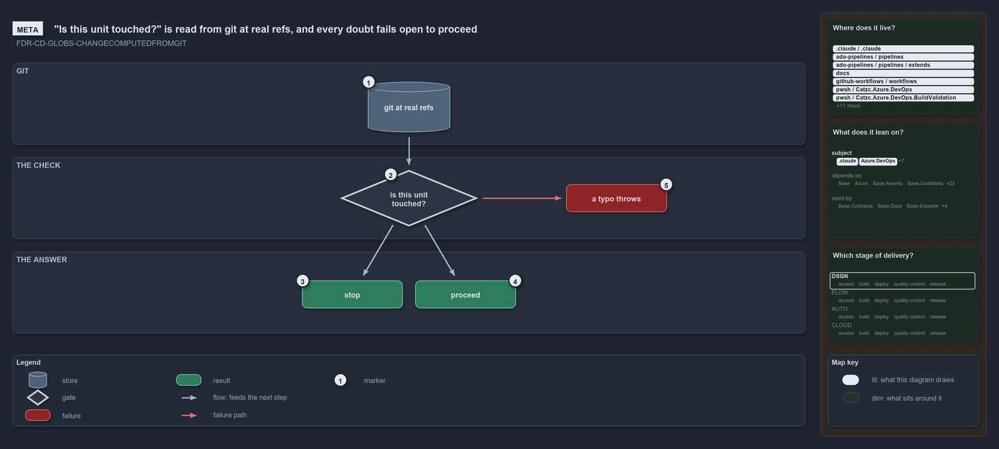

# "Is this unit touched?" is read from git at real refs, and every doubt fails open to proceed

```text
Whether a change touches a unit is read from git at real refs, and every doubt fails open to proceed.

1  git at real refs       the two commits the question is asked between, as they exist after the merge
2  is this unit touched?  the check a deployable unit's pipeline stage asks before it does any work
3  stop                   the one answer that lets the stage return: confirmed untouched
4  proceed                touched, or any doubt about the range or the diff
5  a typo throws          an undeclared unit name is a programming error, never a silent skip

Supports FDR-CD-GLOBS-CHANGECOMPUTEDFROMGIT (meta lens).
```

A deployable unit's pipeline stage has one question to ask before it does any work: did this change touch my area-of-control? In cats the
answer is never read from a hash committed beside the unit. It is computed from git, between two commits that really exist after the merge,
so a squash merge or a concurrent merge can never make it stale. And the answer is shaped by what a wrong answer costs: a redundant run is
safe, a wrong skip is an un-deployed change, so every doubt proceeds.

```yml drawio
description:
  Whether a change touches a deployable unit is asked of git between two commits that exist after the merge; only a confirmed untouched unit
  stops the stage, every doubt proceeds, and an undeclared unit name throws.
about:
  adrs: [FDR-CD-GLOBS-CHANGECOMPUTEDFROMGIT]
  lens: meta
content:
  title: '"Is this unit touched?" is read from git at real refs, and every doubt fails open to proceed'
  kind: explanation
  flow: left-to-right
  relation: feeds the next step
  theme: dark
  bands:
    - { id: band-git, label: GIT }
    - { id: band-check, label: THE CHECK }
    - { id: band-answer, label: THE ANSWER }
  glyphs:
    - { id: s-git, kind: store, label: git at real refs, in: band-git }
    - { id: g-touched, kind: gate, label: "is this unit touched?", in: band-check }
    - { id: f-typo, kind: failure, label: a typo throws, in: band-check }
    - { id: r-stop, kind: result, label: stop, in: band-answer }
    - { id: r-proceed, kind: result, label: proceed, in: band-answer }
  edges:
    - { from: s-git, to: g-touched, kind: flow, label: "" }
    - { from: g-touched, to: r-stop, kind: flow, label: "" }
    - { from: g-touched, to: r-proceed, kind: flow, label: "" }
    - { from: g-touched, to: f-typo, kind: fail, label: "" }
  markers:
    - { at: s-git, number: 1 }
    - { at: g-touched, number: 2 }
    - { at: r-stop, number: 3 }
    - { at: r-proceed, number: 4 }
    - { at: f-typo, number: 5 }
  legend: auto
  minimaps:
    code-locations:
      - cell: .claude/.claude/.
        by: [.claude/CLAUDE.md, FDR-CD-GLOBS-CHANGECOMPUTEDFROMGIT]
      - cell: ado-pipelines/pipelines/.
        by:
          - .ado/pipelines/cd-apex.yaml
          - .ado/pipelines/cd-flux.yaml
          - .ado/pipelines/cd-nova.yaml
          - .ado/pipelines/cd-shared.yaml
          - .ado/pipelines/ci-infrastructure.yaml
          - .ado/pipelines/ci-pwsh.yaml
          - FDR-CD-GLOBS-CHANGECOMPUTEDFROMGIT
      - cell: ado-pipelines/pipelines/extends
        by: [.ado/pipelines/extends/cd-customer.yaml, FDR-CD-GLOBS-CHANGECOMPUTEDFROMGIT]
      - cell: docs/-/.
        by:
          - docs/drs/flow/dora-explains.md
          - docs/drs/flow/durable-sha-globs.md
          - docs/drs/index.md
          - docs/how-to/automation/apply-environment-approvals.md
          - docs/references/ado/pipelines/cd-apex.yaml.md
          - docs/references/ado/pipelines/cd-flux.yaml.md
          - docs/references/ado/pipelines/cd-nova.yaml.md
          - docs/references/ado/pipelines/cd-shared.yaml.md
          - docs/references/ado/pipelines/ci-infrastructure.yaml.md
          - docs/references/ado/pipelines/ci-pwsh.yaml.md
          - docs/references/github/workflows/ci-pwsh.yml.md
          - docs/references/pwsh/catzc-azure-dev-ops-build-validation/Get-AdoBuildValidations.ps1.md
          - docs/references/pwsh/catzc-azure-dev-ops-build-validation/Register-AdoBuildValidation.ps1.md
          - docs/references/pwsh/catzc-azure-dev-ops-build-validation/Unregister-AdoBuildValidation.ps1.md
          - docs/references/pwsh/catzc-azure-dev-ops-build-validation/configs/build-validation.yml.md
          - docs/references/pwsh/catzc-azure-dev-ops-build-validation/private/Get-BuildValidationPathFilter.ps1.md
          - docs/references/pwsh/catzc-azure-dev-ops/Sync-AdoEnvironmentApprovals.ps1.md
          - docs/references/pwsh/catzc-base-drs/types/DrsConfig.cs.md
          - docs/references/pwsh/catzc-base-globs/Get-GlobSetChangeRange.ps1.md
          - docs/references/pwsh/catzc-base-globs/Test-GlobSetAffected.ps1.md
          - docs/references/pwsh/catzc-base-globs/configs/globs.yml.md
          - docs/references/pwsh/catzc-base-globs/private/Get-PipelineTrigger.ps1.md
          - docs/references/pwsh/catzc-base-globs/types/DurableHash.cs.md
          - docs/references/pwsh/catzc-base-globs/types/GlobPattern.cs.md
          - docs/references/pwsh/catzc-base-globs/types/GlobSet.cs.md
          - docs/references/pwsh/catzc-base-globs/types/GlobsConfig.cs.md
          - docs/references/pwsh/catzc-base-maps/Get-LifecyclePositionMinimapData.ps1.md
          - docs/references/pwsh/catzc-base-maps/Get-ValueChainHighlight.ps1.md
          - docs/references/pwsh/catzc-base-maps/Get-WorldMapHighlight.ps1.md
          - FDR-CD-GLOBS-CHANGECOMPUTEDFROMGIT
      - cell: github-workflows/workflows/.
        by: [.github/workflows/ci-pwsh.yml, FDR-CD-GLOBS-CHANGECOMPUTEDFROMGIT]
      - cell: pwsh/Catzc.Azure.DevOps/.
        by: [pwsh/Catzc.Azure.DevOps/Sync-AdoEnvironmentApprovals.ps1, FDR-CD-GLOBS-CHANGECOMPUTEDFROMGIT]
      - cell: pwsh/Catzc.Azure.DevOps.BuildValidation/.
        by:
          - pwsh/Catzc.Azure.DevOps.BuildValidation/Get-AdoBuildValidations.ps1
          - pwsh/Catzc.Azure.DevOps.BuildValidation/Register-AdoBuildValidation.ps1
          - pwsh/Catzc.Azure.DevOps.BuildValidation/Unregister-AdoBuildValidation.ps1
          - FDR-CD-GLOBS-CHANGECOMPUTEDFROMGIT
      - cell: pwsh/Catzc.Azure.DevOps.BuildValidation/configs
        by: [pwsh/Catzc.Azure.DevOps.BuildValidation/configs/build-validation.yml, FDR-CD-GLOBS-CHANGECOMPUTEDFROMGIT]
      - cell: pwsh/Catzc.Azure.DevOps.BuildValidation/private
        by: [pwsh/Catzc.Azure.DevOps.BuildValidation/private/Get-BuildValidationPathFilter.ps1, FDR-CD-GLOBS-CHANGECOMPUTEDFROMGIT]
      - cell: pwsh/Catzc.Base.Drs/configs
        by: [pwsh/Catzc.Base.Drs/configs/drs.yml, FDR-CD-GLOBS-CHANGECOMPUTEDFROMGIT]
      - cell: pwsh/Catzc.Base.Drs/types
        by: [pwsh/Catzc.Base.Drs/types/DrsConfig.cs, FDR-CD-GLOBS-CHANGECOMPUTEDFROMGIT]
      - cell: pwsh/Catzc.Base.Globs/.
        by:
          - pwsh/Catzc.Base.Globs/Get-GlobSetChangeRange.ps1
          - pwsh/Catzc.Base.Globs/Test-GlobSetAffected.ps1
          - FDR-CD-GLOBS-CHANGECOMPUTEDFROMGIT
      - cell: pwsh/Catzc.Base.Globs/configs
        by: [pwsh/Catzc.Base.Globs/configs/globs.yml, FDR-CD-GLOBS-CHANGECOMPUTEDFROMGIT]
      - cell: pwsh/Catzc.Base.Globs/private
        by: [pwsh/Catzc.Base.Globs/private/Get-PipelineTrigger.ps1, FDR-CD-GLOBS-CHANGECOMPUTEDFROMGIT]
      - cell: pwsh/Catzc.Base.Globs/types
        by:
          - pwsh/Catzc.Base.Globs/types/DurableHash.cs
          - pwsh/Catzc.Base.Globs/types/GlobPattern.cs
          - pwsh/Catzc.Base.Globs/types/GlobSet.cs
          - pwsh/Catzc.Base.Globs/types/GlobsConfig.cs
          - FDR-CD-GLOBS-CHANGECOMPUTEDFROMGIT
      - cell: pwsh/Catzc.Base.Maps/.
        by:
          - pwsh/Catzc.Base.Maps/Get-LifecyclePositionMinimapData.ps1
          - pwsh/Catzc.Base.Maps/Get-ValueChainHighlight.ps1
          - pwsh/Catzc.Base.Maps/Get-WorldMapHighlight.ps1
          - FDR-CD-GLOBS-CHANGECOMPUTEDFROMGIT
      - cell: pwsh/Catzc.Base.Maps/tests
        by: [pwsh/Catzc.Base.Maps/tests/Get-WorldMapHighlight.Tests.ps1, FDR-CD-GLOBS-CHANGECOMPUTEDFROMGIT]
      - cell: pwsh/Catzc.Base.QualityGates/configs
        by: [pwsh/Catzc.Base.QualityGates/configs/terminology.yml, FDR-CD-GLOBS-CHANGECOMPUTEDFROMGIT]
    module-neighbourhood:
      - cell: subject/.claude
        by: [.claude/CLAUDE.md, FDR-CD-GLOBS-CHANGECOMPUTEDFROMGIT]
      - cell: subject/Catzc.Azure.DevOps
        by: [pwsh/Catzc.Azure.DevOps/Sync-AdoEnvironmentApprovals.ps1, FDR-CD-GLOBS-CHANGECOMPUTEDFROMGIT]
      - cell: subject/Catzc.Azure.DevOps.BuildValidation
        by:
          - pwsh/Catzc.Azure.DevOps.BuildValidation/Get-AdoBuildValidations.ps1
          - pwsh/Catzc.Azure.DevOps.BuildValidation/Register-AdoBuildValidation.ps1
          - pwsh/Catzc.Azure.DevOps.BuildValidation/Unregister-AdoBuildValidation.ps1
          - pwsh/Catzc.Azure.DevOps.BuildValidation/configs/build-validation.yml
          - pwsh/Catzc.Azure.DevOps.BuildValidation/private/Get-BuildValidationPathFilter.ps1
          - FDR-CD-GLOBS-CHANGECOMPUTEDFROMGIT
      - cell: subject/Catzc.Base.Drs
        by: [pwsh/Catzc.Base.Drs/configs/drs.yml, pwsh/Catzc.Base.Drs/types/DrsConfig.cs, FDR-CD-GLOBS-CHANGECOMPUTEDFROMGIT]
      - cell: subject/Catzc.Base.Globs
        by:
          - pwsh/Catzc.Base.Globs/Get-GlobSetChangeRange.ps1
          - pwsh/Catzc.Base.Globs/Test-GlobSetAffected.ps1
          - pwsh/Catzc.Base.Globs/configs/globs.yml
          - pwsh/Catzc.Base.Globs/private/Get-PipelineTrigger.ps1
          - pwsh/Catzc.Base.Globs/types/DurableHash.cs
          - pwsh/Catzc.Base.Globs/types/GlobPattern.cs
          - pwsh/Catzc.Base.Globs/types/GlobSet.cs
          - pwsh/Catzc.Base.Globs/types/GlobsConfig.cs
          - FDR-CD-GLOBS-CHANGECOMPUTEDFROMGIT
      - cell: subject/Catzc.Base.Maps
        by:
          - pwsh/Catzc.Base.Maps/Get-LifecyclePositionMinimapData.ps1
          - pwsh/Catzc.Base.Maps/Get-ValueChainHighlight.ps1
          - pwsh/Catzc.Base.Maps/Get-WorldMapHighlight.ps1
          - pwsh/Catzc.Base.Maps/tests/Get-WorldMapHighlight.Tests.ps1
          - FDR-CD-GLOBS-CHANGECOMPUTEDFROMGIT
      - cell: subject/Catzc.Base.QualityGates
        by: [pwsh/Catzc.Base.QualityGates/configs/terminology.yml, FDR-CD-GLOBS-CHANGECOMPUTEDFROMGIT]
      - cell: subject/pipelines
        by:
          - .ado/pipelines/cd-apex.yaml
          - .ado/pipelines/cd-flux.yaml
          - .ado/pipelines/cd-nova.yaml
          - .ado/pipelines/cd-shared.yaml
          - .ado/pipelines/ci-infrastructure.yaml
          - .ado/pipelines/ci-pwsh.yaml
          - .ado/pipelines/extends/cd-customer.yaml
          - FDR-CD-GLOBS-CHANGECOMPUTEDFROMGIT
      - cell: subject/workflows
        by: [.github/workflows/ci-pwsh.yml, FDR-CD-GLOBS-CHANGECOMPUTEDFROMGIT]
    axis:
      - cell: DSGN/*
        by: [FDR-CD-GLOBS-CHANGECOMPUTEDFROMGIT]
layout:
  band-git: { x: 20, y: 84, w: 1260, h: 130 }
  band-check: { x: 20, y: 234, w: 1260, h: 130 }
  band-answer: { x: 20, y: 384, w: 1260, h: 130 }
  s-git: { x: 585, y: 114, w: 130, h: 80 }
  g-touched: { x: 540, y: 254, w: 220, h: 90 }
  f-typo: { x: 900, y: 277, w: 160, h: 44 }
  r-stop: { x: 480, y: 430, w: 160, h: 44 }
  r-proceed: { x: 660, y: 430, w: 160, h: 44 }
```



## Walkthrough

1. **Git at real refs.** The question is asked between a reference commit and the commit being built, both read from the repository as it is
   at run time. Nothing per unit is committed, so there is no whole-set hash to go stale.
2. **Is this unit touched?** The check diffs the two commits, matches the changed paths against the globset registry, and reports whether
   the named unit is among the globsets the change touches. A rename is split into both of its paths, so a file moving into or out of a unit
   counts as a change.
3. **Stop.** The check answers that the unit is untouched only when it has positively confirmed it over a range it could resolve. That is
   the one answer that lets a stage return early.
4. **Proceed.** The unit is touched, or the check is in doubt: the reference commit cannot be resolved, or git cannot compute the diff. Both
   proceed, because running a stage that had nothing to do is safe and skipping one that had work is a deploy that never happens.
5. **A typo throws.** A unit name that is not a declared globset is a programming error, not a runtime doubt, so the check throws rather
   than reporting "not affected" and skipping the stage.

## Why it holds

- Whether a change touches a unit is computed from git at real refs, never from a committed hash, and the check fails open on any doubt so a
  wrong skip can never drop a deploy (FDR-CD-GLOBS-CHANGECOMPUTEDFROMGIT).
- The check returns false only when it has positively confirmed the unit is untouched, and throws on an undeclared unit name so a typo never
  silently skips (FDR-CD-GLOBS-CHANGECOMPUTEDFROMGIT).

## See also

- [Globset triggers](../../drs/flow/durable-sha-globs.md) — the decision this article explains.
- The other lenses on the same check: [architecture](globs-asks-loader-for-context-and-git-for-diff.md),
  [implementation](range-per-context-then-diff-and-match.md), [operations](stop-only-on-false-everything-else-proceeds.md) and
  [governance](tests-pin-the-throw-and-fail-open-cd-calls-it.md).
- [The flow explanations](index.md) · [How to read the diagrams](../index.md#how-to-read-the-diagrams)
