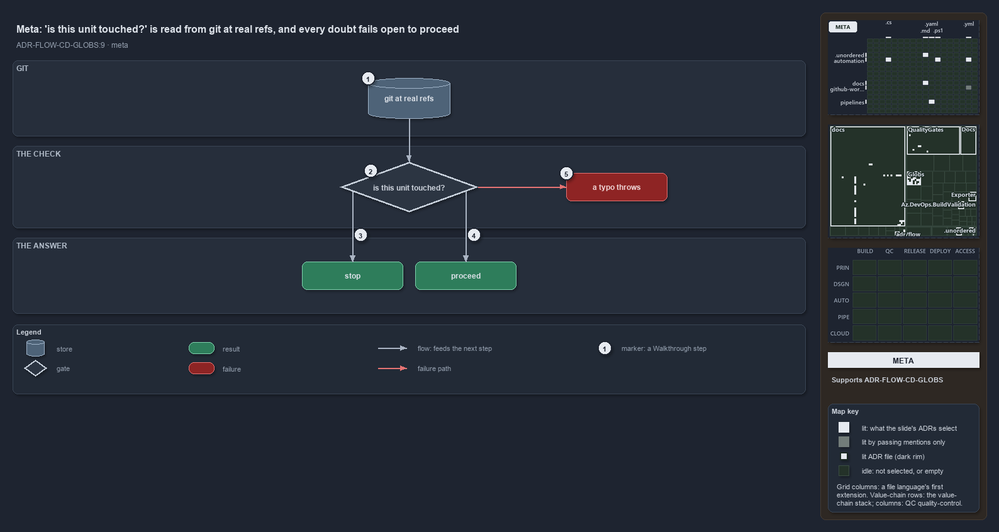

---
catzc:
  immutable:
    with_body_sha: ef6923670aa4
    path: docs/explanation/flow/every-doubt-fails-open-to-proceed.md
    folder: docs/explanation/flow
    name: every-doubt-fails-open-to-proceed
    filetype: md
    kind: explanation
    language: markdown
    track: docs
    tracktype: documentation
  edges:
    cites:
      - ADR-FLOW-CD-GLOBS#9
    links:
      - docs/.assets/explanation/adr-flow-cd-globs--every-doubt-fails-open-to-proceed--meta.drawio.md
      - docs/.assets/explanation/adr-flow-cd-globs--every-doubt-fails-open-to-proceed--meta.drawio.png
      - docs/adr/flow/durable-sha-globs.md
      - docs/explanation/flow/globs-asks-loader-for-context-and-git-for-diff.md
      - docs/explanation/flow/index.md
      - docs/explanation/flow/range-per-context-then-diff-and-match.md
      - docs/explanation/flow/stop-only-on-false-everything-else-proceeds.md
      - docs/explanation/flow/tests-pin-the-throw-and-fail-open-no-caller.md
      - docs/explanation/index.md#how-to-read-the-diagrams
---

# "Is this unit touched?" is read from git at real refs, and every doubt fails open to proceed

```text
Whether a change touches a unit is read from git at real refs, and every doubt fails open to proceed.

1  git at real refs       the two commits the question is asked between, as they exist after the merge
2  is this unit touched?  the check a deployable unit's pipeline stage asks before it does any work
3  stop                   the one answer that lets the stage return: confirmed untouched
4  proceed                touched, or any doubt about the range or the diff
5  a typo throws          an undeclared unit name is a programming error, never a silent skip

Supports ADR-FLOW-CD-GLOBS#9 (meta lens).
```

A deployable unit's pipeline stage has one question to ask before it does any work: did this change touch my area-of-control? In cats the
answer is never read from a hash committed beside the unit. It is computed from git, between two commits that really exist after the merge,
so a squash merge or a concurrent merge can never make it stale. And the answer is shaped by what a wrong answer costs: a redundant run is
safe, a wrong skip is an un-deployed change, so every doubt proceeds.



The diagram is described element by element in
[its asset description](../../.assets/explanation/adr-flow-cd-globs--every-doubt-fails-open-to-proceed--meta.drawio.md).

## Walkthrough

1. **Git at real refs.** The question is asked between a reference commit and the commit being built, both read from the repository as it is
   at run time. Nothing per unit is committed, so there is no whole-set hash to go stale.
2. **Is this unit touched?** The check diffs the two commits, matches the changed paths against the globset registry, and reports whether
   the named unit is among the globsets the change touches. A rename is split into both of its paths, so a file moving into or out of a unit
   counts as a change.
3. **Stop.** The check answers that the unit is untouched only when it has positively confirmed it over a range it could resolve. That is
   the one answer that lets a stage return early.
4. **Proceed.** The unit is touched, or the check is in doubt: the reference commit cannot be resolved, or git cannot compute the diff. Both
   proceed, because running a stage that had nothing to do is safe and skipping one that had work is a deploy that never happens.
5. **A typo throws.** A unit name that is not a declared globset is a programming error, not a runtime doubt, so the check throws rather
   than reporting "not affected" and skipping the stage.

## Why it holds

- Whether a change touches a unit is computed from git at real refs, never from a committed hash, and the check fails open on any doubt so a
  wrong skip can never drop a deploy (ADR-FLOW-CD-GLOBS#9).
- The check returns false only when it has positively confirmed the unit is untouched, and throws on an undeclared unit name so a typo never
  silently skips (ADR-FLOW-CD-GLOBS#9).

## Where the code and the ADR differ

The function help of `Test-GlobSetAffected` and `Get-GlobSetChangeRange` cites the protected-globs rule for the fail-open; that rule governs
the local scan-skip record, where an unknown globset means scan, while this check throws on an unknown name. The fail-open it implements is
the one the globset-trigger decision states.

## See also

- [Globset triggers](../../adr/flow/durable-sha-globs.md) — the decision this article explains.
- The other lenses on the same check: [architecture](globs-asks-loader-for-context-and-git-for-diff.md),
  [implementation](range-per-context-then-diff-and-match.md), [operations](stop-only-on-false-everything-else-proceeds.md) and
  [governance](tests-pin-the-throw-and-fail-open-no-caller.md).
- [The flow explanations](index.md) · [How to read the diagrams](../index.md#how-to-read-the-diagrams)
