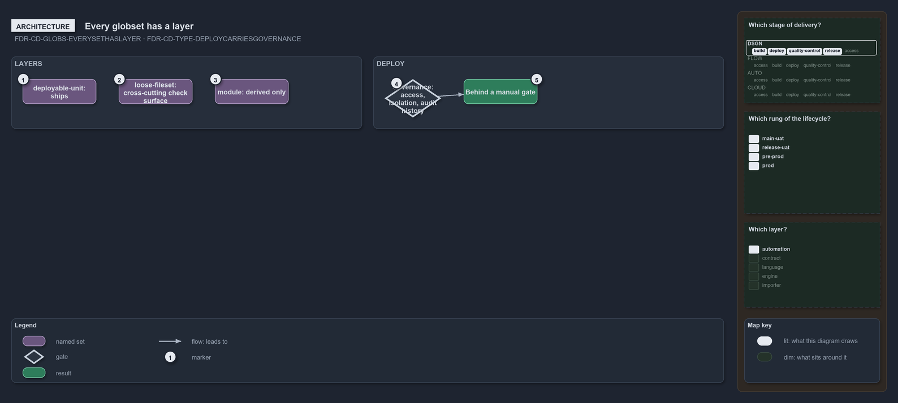

---
catzc:
  warning: "Experimental: this article merges two rules into one and holds nothing beyond what they say"
  edges:
    cites:
      - FDR-CD-GLOBS-EVERYSETHASLAYER
      - FDR-CD-TYPE-DEPLOYCARRIESGOVERNANCE
---

# Every globset has a layer and deploy governs an environment behind a manual gate

This article is one rule: [FDR-CD-GLOBS-EVERYSETHASLAYER](../../drs/flow/durable-sha-globs.md#rule-fdr-cd-globs-everysethaslayer) and
[FDR-CD-TYPE-DEPLOYCARRIESGOVERNANCE](../../drs/flow/pipeline-types.md#rule-fdr-cd-type-deploycarriesgovernance) merged into one. It holds
nothing beyond what those two rules say.

Every globset carries a layer, the kind of thing it maps: `deployable-unit`, a configurable unit that ships, and `loose-fileset`, a
cross-cutting check surface that must earn its place by a demonstrated use. DEPLOY exists to make an environment's governance a first-class
pipeline construct, one place for access control, isolation and audit history over an environment behind a manual gate, splitting by target
on the one build-once artifact.

