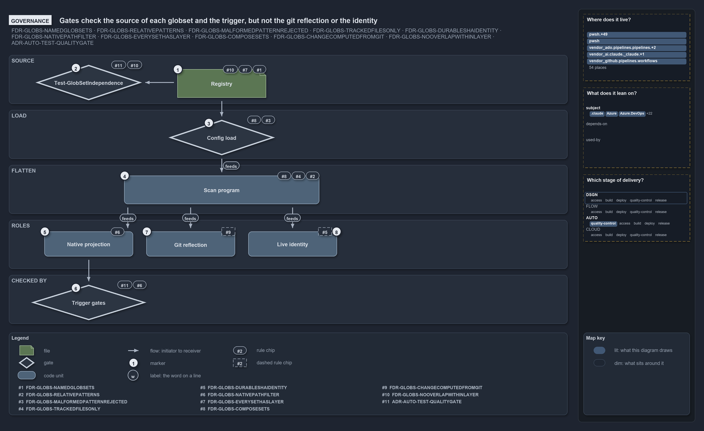

# What the globset gates check

```text
What the globset gates check.

1  Registry                  globs.yml, the one source of truth; every set carries a layer
2  Test-GlobSetIndependence  quality gate: same-layer sets never overlap on own contribution
3  Config load               rejects malformed patterns and bad compose when the config loads
4  Scan program              the dialect, the ordered program, compose with own rules last
5  Native projection         what pipelines, workflows and policies trigger on
6  Trigger gates             three quality gates that check the projection
7  Git reflection            the change check from git at real refs; no gate checks it
8  Live identity             the durable SHA, never committed; no gate checks it

Supports FDR-GLOBS-NAMEDGLOBSETS, FDR-GLOBS-RELATIVEPATTERNS, FDR-GLOBS-MALFORMEDPATTERNREJECTED,
FDR-GLOBS-TRACKEDFILESONLY, FDR-GLOBS-DURABLESHAIDENTITY, FDR-GLOBS-NATIVEPATHFILTER, FDR-GLOBS-EVERYSETHASLAYER,
FDR-GLOBS-COMPOSESETS, FDR-GLOBS-CHANGECOMPUTEDFROMGIT, FDR-GLOBS-NOOVERLAPWITHINLAYER
and ADR-AUTO-TEST-QUALITYGATE (governance lens).
```

The globset rules in cats are checked by four quality gates plus the config load, and those checks reach the registry, the program and the
trigger. Every globset flows from one registry through a validated load into a flattened scan program, and from there into three roles, and
the DRS rules constrain each stage. The git reflection and the live identity are held by DRS rules alone: no gate checks them, which is
worth knowing before relying on either.

```yml drawio
description:
  A globset flows from the registry through the validated config load into the scan program and from there into the native projection, the
  git reflection and the live identity; gates check the source and the trigger projection, while the git reflection and the identity are
  held by the DRS rules alone.
about:
  rules:
    - FDR-GLOBS-NAMEDGLOBSETS
    - FDR-GLOBS-RELATIVEPATTERNS
    - FDR-GLOBS-MALFORMEDPATTERNREJECTED
    - FDR-GLOBS-TRACKEDFILESONLY
    - FDR-GLOBS-DURABLESHAIDENTITY
    - FDR-GLOBS-NATIVEPATHFILTER
    - FDR-GLOBS-EVERYSETHASLAYER
    - FDR-GLOBS-COMPOSESETS
    - FDR-GLOBS-CHANGECOMPUTEDFROMGIT
    - FDR-GLOBS-NOOVERLAPWITHINLAYER
    - ADR-AUTO-TEST-QUALITYGATE
  lens: governance
content:
  title: What the globset gates check
  kind: explanation
  flow: top-to-bottom
  theme: dark
  bands:
    - { id: band-source, label: SOURCE }
    - { id: band-load, label: LOAD }
    - { id: band-flatten, label: FLATTEN }
    - { id: band-roles, label: ROLES }
    - { id: band-checked, label: CHECKED BY }
  glyphs:
    - { id: f-registry, kind: file, label: Registry, in: band-source }
    - { id: g-independence, kind: gate, label: Test-GlobSetIndependence, in: band-source }
    - { id: g-config-load, kind: gate, label: Config load, in: band-load }
    - { id: g-scan-program, kind: code, label: Scan program, in: band-flatten }
    - { id: g-projection, kind: code, label: Native projection, in: band-roles }
    - { id: g-git-reflection, kind: code, label: Git reflection, in: band-roles }
    - { id: g-live-identity, kind: code, label: Live identity, in: band-roles }
    - { id: g-trigger-gates, kind: gate, label: Trigger gates, in: band-checked }
  edges:
    - { from: f-registry, to: g-independence, kind: flow, label: "" }
    - { from: f-registry, to: g-config-load, kind: flow, label: "" }
    - { from: g-config-load, to: g-scan-program, kind: flow, label: then }
    - { from: g-scan-program, to: g-projection, kind: flow, label: then }
    - { from: g-scan-program, to: g-git-reflection, kind: flow, label: then }
    - { from: g-scan-program, to: g-live-identity, kind: flow, label: then }
    - { from: g-projection, to: g-trigger-gates, kind: flow, label: "" }
  markers:
    - { at: f-registry, number: 1 }
    - { at: g-independence, number: 2 }
    - { at: g-config-load, number: 3 }
    - { at: g-scan-program, number: 4 }
    - { at: g-projection, number: 5 }
    - { at: g-trigger-gates, number: 6 }
    - { at: g-git-reflection, number: 7 }
    - { at: g-live-identity, number: 8 }
  chips:
    - { at: f-registry, kind: rule, rule: FDR-GLOBS-NAMEDGLOBSETS }
    - { at: f-registry, kind: rule, rule: FDR-GLOBS-EVERYSETHASLAYER }
    - { at: f-registry, kind: rule, rule: FDR-GLOBS-NOOVERLAPWITHINLAYER }
    - { at: g-independence, kind: rule, rule: FDR-GLOBS-NOOVERLAPWITHINLAYER }
    - { at: g-independence, kind: rule, rule: ADR-AUTO-TEST-QUALITYGATE }
    - { at: g-config-load, kind: rule, rule: FDR-GLOBS-MALFORMEDPATTERNREJECTED }
    - { at: g-config-load, kind: rule, rule: FDR-GLOBS-COMPOSESETS }
    - { at: g-scan-program, kind: rule, rule: FDR-GLOBS-RELATIVEPATTERNS }
    - { at: g-scan-program, kind: rule, rule: FDR-GLOBS-TRACKEDFILESONLY }
    - { at: g-scan-program, kind: rule, rule: FDR-GLOBS-COMPOSESETS }
    - { at: g-projection, kind: rule, rule: FDR-GLOBS-NATIVEPATHFILTER }
    - { at: g-git-reflection, kind: rule, rule: FDR-GLOBS-CHANGECOMPUTEDFROMGIT, gated: false }
    - { at: g-live-identity, kind: rule, rule: FDR-GLOBS-DURABLESHAIDENTITY, gated: false }
    - { at: g-trigger-gates, kind: rule, rule: FDR-GLOBS-NATIVEPATHFILTER }
    - { at: g-trigger-gates, kind: rule, rule: ADR-AUTO-TEST-QUALITYGATE }
  legend: auto
  minimaps: [code-locations, module-neighbourhood, axis]
layout:
  band-source: { x: 20, y: 108, w: 1260, h: 110 }
  band-load: { x: 20, y: 232, w: 1260, h: 110 }
  band-flatten: { x: 20, y: 356, w: 1260, h: 110 }
  band-roles: { x: 20, y: 480, w: 1260, h: 110 }
  band-checked: { x: 20, y: 604, w: 1260, h: 110 }
  g-independence: { x: 80, y: 130, w: 240, h: 80 }
  f-registry: { x: 400, y: 140, w: 200, h: 64 }
  g-config-load: { x: 380, y: 254, w: 240, h: 80 }
  g-scan-program: { x: 280, y: 380, w: 440, h: 64 }
  g-projection: { x: 100, y: 506, w: 200, h: 56 }
  g-git-reflection: { x: 330, y: 506, w: 200, h: 56 }
  g-live-identity: { x: 560, y: 506, w: 200, h: 56 }
  g-trigger-gates: { x: 70, y: 626, w: 260, h: 80 }
```



## Walkthrough

1. **Registry.** `globs.yml` is the one source of truth (#1). Every set carries a layer (#7), and same-layer sets never overlap on their own
   contribution (#10).
2. **Test-GlobSetIndependence.** This quality gate checks #10 over the declared registry and the derived module sets together. A violation
   names both sets and a shared file.
3. **Config load.** `GlobsConfig` rejects malformed patterns (#3) and self-referencing, unknown or cyclic compose (#8) when the config is
   loaded, and throws once with every error. It is a load-time check, not a quality gate.
4. **Scan program.** The dialect (#2), the ordered last-match-wins program over tracked files (#4), and compose with the set's own rules
   last (#8) define what the program is.
5. **Native projection.** Pipelines, workflows and build-validation policies trigger on the projection of the program into each vendor's
   path-filter dialect (#6).
6. **`Trigger gates`.** Three quality gates check the projection: `Test-AdoPipelineTriggerGlob` and `Test-GitHubWorkflowTriggerGlob` report
   one issue per drifted or missing pipeline or workflow, and `Test-GlobSetTriggerCoverage` confirms every member of a pipeline-bound set is
   covered by an ADO include. Their integrity tests require zero issues, so a drifted filter fails `Test-Automation` locally and in CI.
7. **Git reflection.** Whether a change touches a set is computed from git at real refs and fails open on any doubt (#9). No gate checks
   this, and no pipeline calls `Test-GlobSetAffected` today.
8. **Live identity.** The durable SHA is computed live, never committed, and keys the session-memory protection map (#5). No gate checks
   that it stays uncommitted.

## Why it holds

- One registry in `globs.yml` maps every area-of-control, and its three roles are derived (FDR-GLOBS-NAMEDGLOBSETS).
- A pattern is repo-relative and `/`-separated, with `**` as the only cross-segment operator (FDR-GLOBS-RELATIVEPATTERNS), and malformed
  patterns are rejected at config load (FDR-GLOBS-MALFORMEDPATTERNREJECTED).
- Membership is an ordered scan program over tracked files, evaluated last-match-wins (FDR-GLOBS-TRACKEDFILESONLY), and compose puts the
  base first and the set's own rules last (FDR-GLOBS-COMPOSESETS).
- The identity is live and never committed (FDR-GLOBS-DURABLESHAIDENTITY); triggers are the native projection (FDR-GLOBS-NATIVEPATHFILTER);
  the change check reflects git (FDR-GLOBS-CHANGECOMPUTEDFROMGIT).
- Every set carries a layer (FDR-GLOBS-EVERYSETHASLAYER), and sets in one layer never overlap on their own contribution
  (FDR-GLOBS-NOOVERLAPWITHINLAYER).
- A quality gate checks one property of the whole repository, collects every issue and throws once (ADR-AUTO-TEST-QUALITYGATE).
- The projected filters are generated from `globs.yml`, never hand-authored (FDR-GLOBS-NATIVEPATHFILTER); this part is held by the FDR
  alone, since the gates check equality with the projection but nothing writes the YAML.

## Where the code and the decision record differ

The FDR says the filters are generated into the YAML and that an ADO projection that cannot reproduce exact membership is caught at
generation time. No generator writes the YAML, `Get-GlobSetTrigger` defers that case to the superset integrity test, and `cd-shared.yaml`
documents exactly such a case, which `Test-GlobSetTriggerCoverage`, checking ADO includes only, passes.

## See also

- [Globset triggers](../../drs/flow/durable-sha-globs.md) — the decision this article explains, with
  [test automation](../../drs/automation/test-automation.md) and [protected globs](../../drs/repository/protected-globs.md).
- The other lenses on the same globset roles: [meta](three-views-derived-live-from-one-program.md),
  [architecture](globs-module-owns-config-and-types.md), [implementation](one-scan-program-feeds-three-roles.md) and
  [operations](edit-globs-yml-then-read-the-output.md).
- [The flow explanations](index.md) · [How to read the diagrams](../index.md#how-to-read-the-diagrams)
