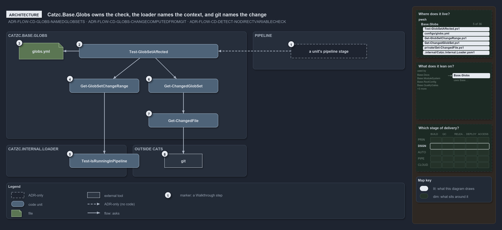

# Catzc.Base.Globs owns the check, the loader names the context, and git names the change

```text
Catzc.Base.Globs owns the touched-unit check; it asks the loader which context it runs in and git which paths changed.

1  a unit's pipeline stage     the caller the ADR describes; no pipeline calls the check
2  Test-GlobSetAffected        the public check: is the named unit among the globsets the change touches?
3  globs.yml                   the globset registry the name must be declared in
4  Get-GlobSetChangeRange      the reference-commit resolver: which two commits, per context
5  Test-IsRunningInPipeline    the one pipeline-detection function, in Catzc.Internal.Loader
6  Get-ChangedGlobSet          the globsets whose scan program selects a changed path
7  Get-ChangedFile             the private diff: the changed paths over the range
8  git                         the vendor tool that answers the diff

Supports ADR-FLOW-CD-GLOBS#1, #9 and ADR-FLOW-CD-DETECT#1 (architecture lens).
```

One module, `Catzc.Base.Globs`, owns everything about globsets: the registry file, the dialect, the native projection and the git-reflection
query that answers whether a change touches a unit. The query itself depends on two things outside the module. It asks the loader which
execution context it runs in, because the reference commit differs between a developer's machine, a post-commit build and a pull request.
And it asks git for the diff, because the changed paths are read from the repository at real refs, never from a committed marker.



The diagram is described element by element in [its asset description](.assets/globs-asks-loader-for-context-and-git-for-diff/diagram.drawio.md).

## Walkthrough

1. **A unit's pipeline stage.** The decision describes the caller: a deployable unit's stage runs the check first and returns when there is
   nothing for it to process. No pipeline or workflow in the repository makes that call; the shared CD pipeline names the check in a comment
   as its exact backstop.
2. **Test-GlobSetAffected.** The public entry of the query. It takes a globset name, typically a deployable unit, and answers one boolean:
   true when the unit is touched or the range is in doubt, false only when the unit is confirmed untouched.
3. **globs.yml.** The one configuration point for every globset. The check reads the registry through `Get-Config` and throws when the name
   is not declared in it.
4. **Get-GlobSetChangeRange.** The reference-commit resolver. It names the git range the context measures a change against, and it is the
   only place that decides between the working tree, the first parent of a squash commit and a pull request's merge base.
5. **Test-IsRunningInPipeline.** The resolver asks the loader's detection function whether it runs in a pipeline. The function lives in
   `Catzc.Internal.Loader`, which both run modes import first and keep loaded, so every module asks the same one.
6. **Get-ChangedGlobSet.** Given the range, it returns every declared globset whose scan program selects at least one changed path. It is
   the same computation that produces the pull-request area-of-control report.
7. **Get-ChangedFile.** The module's private diff. It is the diff counterpart of the tracked-file universe: repo-relative, `/`-separated
   paths, with a rename split into both of its paths.
8. **git.** The diff is delegated to git over the resolved range. A git failure surfaces as a thrown error, which the public check catches
   and turns into a fail-open proceed.

## Why it holds

- The globset is the mechanism and its roles are derived, never committed per set; the area-of-control report is computed from git by
  `Get-ChangedGlobSet` (ADR-FLOW-CD-GLOBS#1).
- Whether a change touches a unit is computed from git at real refs, with `Test-GlobSetAffected` resolving the reference commit per context
  through `Get-GlobSetChangeRange` and failing open on any doubt (ADR-FLOW-CD-GLOBS#9).
- Nothing checks the pipeline-detection variables directly; context detection goes through `Test-IsRunningInPipeline` so the logic stays in
  one place (ADR-FLOW-CD-DETECT#1).

## Where the code and the ADR differ

The decision describes a pipeline stage that runs `Test-GlobSetAffected` first; no pipeline or workflow in the repository calls it.

## See also

- [Globset triggers](../../adr/flow/durable-sha-globs.md) — the decision this article explains.
- [Pipeline detection](../../adr/flow/pipeline-detection.md) — the one detection function the resolver asks.
- The other lenses on the same check: [meta](every-doubt-fails-open-to-proceed.md),
  [implementation](range-per-context-then-diff-and-match.md), [operations](stop-only-on-false-everything-else-proceeds.md) and
  [governance](tests-pin-the-throw-and-fail-open-cd-calls-it.md).
- [The flow explanations](index.md) · [How to read the diagrams](../index.md#how-to-read-the-diagrams)
