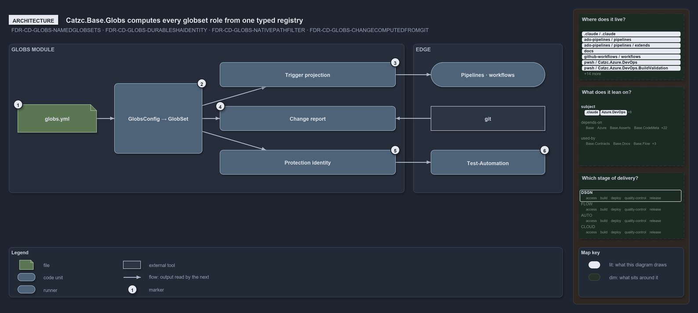

# Catzc.Base.Globs computes every globset role from one typed registry

```text
Catzc.Base.Globs computes every globset role from one typed registry.

1  globs.yml               the registry: 10 declared globsets in the module's configs folder
2  GlobsConfig -> GlobSet  validates the registry at load, then flattens each set's program
3  Trigger projection      Get-GlobSetTrigger: the program in each vendor's path-filter dialect
4  Change report           Get-ChangedGlobSet: the sets a commit range touched, read from git
5  Protection identity     Get-GlobSetHash: the live durable SHA of a set
6  Test-Automation         reads a composite identity per module, never parses globs.yml

Supports FDR-GLOBS-NAMEDGLOBSETS, FDR-GLOBS-DURABLESHAIDENTITY, FDR-GLOBS-NATIVEPATHFILTER
and FDR-GLOBS-CHANGECOMPUTEDFROMGIT (architecture lens).
```

`Catzc.Base.Globs` is the one module that maps every area-of-control in cats, such as a deployable unit, a track or a scan scope, onto its
tracked files through named globsets. It owns the `globs.yml` file, the types that validate and flatten it, and the three roles a globset
plays. Everything outside the module only receives a projection, supplies a diff, or asks for an identity, so a change to an area-of-control
is one config edit in one place.

```yml drawio
description:
  "One typed registry, globs.yml, is validated and flattened by GlobsConfig and GlobSet, and the module computes three roles from it: the
  trigger projection read by pipelines and workflows, the change report built from git, and the protection identity read by the test run."
about:
  adrs: [FDR-GLOBS-NAMEDGLOBSETS, FDR-GLOBS-DURABLESHAIDENTITY, FDR-GLOBS-NATIVEPATHFILTER, FDR-GLOBS-CHANGECOMPUTEDFROMGIT]
  lens: architecture
content:
  title: Catzc.Base.Globs computes every globset role from one typed registry
  kind: explanation
  flow: left-to-right
  theme: dark
  bands:
    - { id: band-module, label: GLOBS MODULE }
    - { id: band-edge, label: EDGE }
  glyphs:
    - { id: f-globs, kind: file, label: globs.yml, in: band-module }
    - { id: g-config, kind: code, label: GlobsConfig → GlobSet, in: band-module }
    - { id: g-trigger, kind: code, label: Trigger projection, in: band-module }
    - { id: g-change-report, kind: code, label: Change report, in: band-module }
    - { id: g-identity, kind: code, label: Protection identity, in: band-module }
    - { id: g-pipelines, kind: runner, label: Pipelines · workflows, in: band-edge }
    - { id: x-git, kind: external, label: git, in: band-edge }
    - { id: g-automation, kind: code, label: Test-Automation, in: band-edge }
  edges:
    - { from: g-config, to: f-globs, kind: flow, label: "" }
    - { from: g-trigger, to: g-config, kind: flow, label: calls }
    - { from: g-change-report, to: g-config, kind: flow, label: calls }
    - { from: g-identity, to: g-config, kind: flow, label: calls }
    - { from: g-pipelines, to: g-trigger, kind: flow, label: calls }
    - { from: g-change-report, to: x-git, kind: flow, label: "" }
    - { from: g-automation, to: g-identity, kind: flow, label: calls }
  markers:
    - { at: f-globs, number: 1 }
    - { at: g-config, number: 2 }
    - { at: g-trigger, number: 3 }
    - { at: g-change-report, number: 4 }
    - { at: g-identity, number: 5 }
    - { at: g-automation, number: 6 }
  legend: auto
  minimaps: [code-locations, module-neighbourhood, axis]
layout:
  band-module: { x: 20, y: 84, w: 900, h: 340 }
  band-edge: { x: 940, y: 84, w: 340, h: 340 }
  f-globs: { x: 40, y: 222, w: 180, h: 64 }
  g-config: { x: 260, y: 174, w: 200, h: 160 }
  g-trigger: { x: 500, y: 126, w: 400, h: 56 }
  g-change-report: { x: 500, y: 226, w: 400, h: 56 }
  g-identity: { x: 500, y: 326, w: 400, h: 56 }
  g-pipelines: { x: 980, y: 126, w: 260, h: 56 }
  x-git: { x: 980, y: 226, w: 260, h: 56 }
  g-automation: { x: 980, y: 326, w: 260, h: 56 }
```



## Walkthrough

1. **globs.yml.** The registry ships in the module's `configs/` folder and holds the declared globsets, 10 of them today: five
   `loose-fileset` sets and five `deployable-unit` sets. It loads through `Get-Config -Config globs`, which `configs.yml` registers to the
   `GlobsConfig` type.
2. **GlobsConfig → GlobSet.** `GlobsConfig` validates the whole registry at load, including keys, patterns, compose references and compose
   cycles, and throws once with every error. Each `GlobSet` then flattens its compose chain into one scan program.
3. **Trigger projection.** `Get-GlobSetTrigger` renders a set's scan program into the vendor path-filter dialects that the Azure DevOps
   pipelines and GitHub workflows declare. `Catzc.Azure.DevOps.BuildValidation` registers a build-validation policy on the same projection.
4. **Change report.** `Get-ChangedGlobSet` reads the files a commit range changed from git, through `Get-ChangedFile`, and names every set
   they touch, at the real refs.
5. **Protection identity.** `Get-GlobSetHash` computes the live durable SHA of a set. It is never committed; it keys the session-memory
   protection map.
6. **Test-Automation.** The local test run in `Catzc.Base.QualityGates` reads identities: per module it folds the module's own derived set,
   its dependency closure, the infra scopes and the runner into one composite identity. Like every other consumer, including
   `Test-Automation -Suite` and `Register-AdoBuildValidation`, it names a globset and never parses `globs.yml` itself.

## Why it holds

- `globs.yml` is the one source of truth, and its three roles (trigger, change report, protection) are all derived, with nothing committed
  per set (FDR-GLOBS-NAMEDGLOBSETS).
- The identity is computed live and never committed, so it cannot go stale on a busy mainline (FDR-GLOBS-DURABLESHAIDENTITY).
- Pipelines, workflows and build-validation policies trigger on the native path-filter projection of a globset, never on a committed marker
  (FDR-GLOBS-NATIVEPATHFILTER).
- Whether a change touches a set is computed from git at real refs (FDR-GLOBS-CHANGECOMPUTEDFROMGIT).

## See also

- [Globset triggers](../../drs/flow/durable-sha-globs.md) — the decision this article explains.
- The other lenses on the same globset roles: [meta](three-views-derived-live-from-one-program.md),
  [implementation](one-scan-program-feeds-three-roles.md), [operations](edit-globs-yml-then-read-the-output.md) and
  [governance](gates-check-source-and-trigger.md).
- [The flow explanations](index.md) · [How to read the diagrams](../index.md#how-to-read-the-diagrams)
