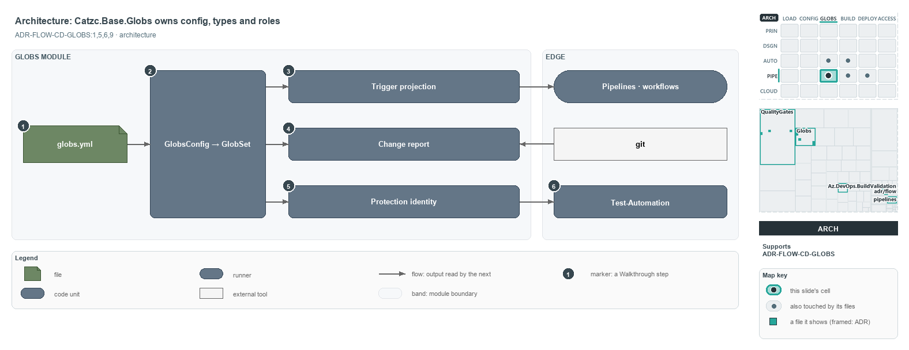

---
catzc:
  derived:
    path: docs/explanation/flow/globs-module-owns-config-and-types.md
    kind: explanation
    body_sha: acff02a4ee86
    adrs:
      - ADR-FLOW-CD-GLOBS#1
      - ADR-FLOW-CD-GLOBS#5
      - ADR-FLOW-CD-GLOBS#6
      - ADR-FLOW-CD-GLOBS#9
    links:
      - docs/.assets/explanation/adr-flow-cd-globs--globs-module-owns-config-and-types--architecture.drawio.md
      - docs/.assets/explanation/adr-flow-cd-globs--globs-module-owns-config-and-types--architecture.drawio.png
      - docs/adr/flow/durable-sha-globs.md
      - docs/explanation/flow/edit-globs-yml-then-read-the-output.md
      - docs/explanation/flow/gates-check-source-and-trigger.md
      - docs/explanation/flow/index.md
      - docs/explanation/flow/one-scan-program-feeds-three-roles.md
      - docs/explanation/flow/three-views-derived-live-from-one-program.md
      - docs/explanation/index.md#how-to-read-the-diagrams
---

# Catzc.Base.Globs computes every globset role from one typed registry

```text
Catzc.Base.Globs computes every globset role from one typed registry.

1  globs.yml               the registry: 10 declared globsets in the module's configs folder
2  GlobsConfig -> GlobSet  validates the registry at load, then flattens each set's program
3  Trigger projection      Get-GlobSetTrigger: the program in each vendor's path-filter dialect
4  Change report           Get-ChangedGlobSet: the sets a commit range touched, read from git
5  Protection identity     Get-GlobSetHash: the live durable SHA of a set
6  Test-Automation         reads a composite identity per module, never parses globs.yml

Supports ADR-FLOW-CD-GLOBS#1, #5, #6 and #9 (architecture lens).
```

`Catzc.Base.Globs` is the one module that maps every area-of-control in cats, such as a deployable unit, a track or a scan scope, onto its
tracked files through named globsets. It owns the `globs.yml` file, the types that validate and flatten it, and the three roles a globset
plays. Everything outside the module only receives a projection, supplies a diff, or asks for an identity, so a change to an area-of-control
is one config edit in one place.



The diagram is described element by element in
[its asset description](../../.assets/explanation/adr-flow-cd-globs--globs-module-owns-config-and-types--architecture.drawio.md).

## Walkthrough

1. **globs.yml.** The registry ships in the module's `configs/` folder and holds the declared globsets, 10 of them today: five
   `loose-fileset` sets and five `deployable-unit` sets. It loads through `Get-Config -Config globs`, which `configs.yml` registers to the
   `GlobsConfig` type.
2. **GlobsConfig → GlobSet.** `GlobsConfig` validates the whole registry at load, including keys, patterns, compose references and compose
   cycles, and throws once with every error. Each `GlobSet` then flattens its compose chain into one scan program.
3. **Trigger projection.** `Get-GlobSetTrigger` renders a set's scan program into the vendor path-filter dialects that the Azure DevOps
   pipelines and GitHub workflows declare. `Catzc.Azure.DevOps.BuildValidation` registers a build-validation policy on the same projection.
4. **Change report.** `Get-ChangedGlobSet` reads the files a commit range changed from git, through `Get-ChangedFile`, and names every set
   they touch, at the real refs.
5. **Protection identity.** `Get-GlobSetHash` computes the live durable SHA of a set. It is never committed; it keys the session-memory
   protection map.
6. **Test-Automation.** The local test run in `Catzc.Base.QualityGates` reads identities: per module it folds the module's own derived set,
   its dependency closure, the infra scopes and the runner into one composite identity. Like every other consumer, including
   `Test-Automation -Suite` and `Register-AdoBuildValidation`, it names a globset and never parses `globs.yml` itself.

## Why it holds

- `globs.yml` is the one source of truth, and its three roles (trigger, change report, protection) are all derived, with nothing committed
  per set (ADR-FLOW-CD-GLOBS#1).
- The identity is computed live and never committed, so it cannot go stale on a busy mainline (ADR-FLOW-CD-GLOBS#5).
- Pipelines, workflows and build-validation policies trigger on the native path-filter projection of a globset, never on a committed marker
  (ADR-FLOW-CD-GLOBS#6).
- Whether a change touches a set is computed from git at real refs (ADR-FLOW-CD-GLOBS#9).

## Where the code and the ADR differ

The ADR says the identity is never committed and there is no marker. The help text of `Get-GlobSetHash` still calls the hash "the marker
file's sha256" and cites rule 9, and the `globs.yml` header says `pipeline` names "the pipeline bound to this set's marker".

## See also

- [Globset triggers](../../adr/flow/durable-sha-globs.md) — the decision this article explains.
- The other lenses on the same globset roles: [meta](three-views-derived-live-from-one-program.md),
  [implementation](one-scan-program-feeds-three-roles.md), [operations](edit-globs-yml-then-read-the-output.md) and
  [governance](gates-check-source-and-trigger.md).
- [The flow explanations](index.md) · [How to read the diagrams](../index.md#how-to-read-the-diagrams)
