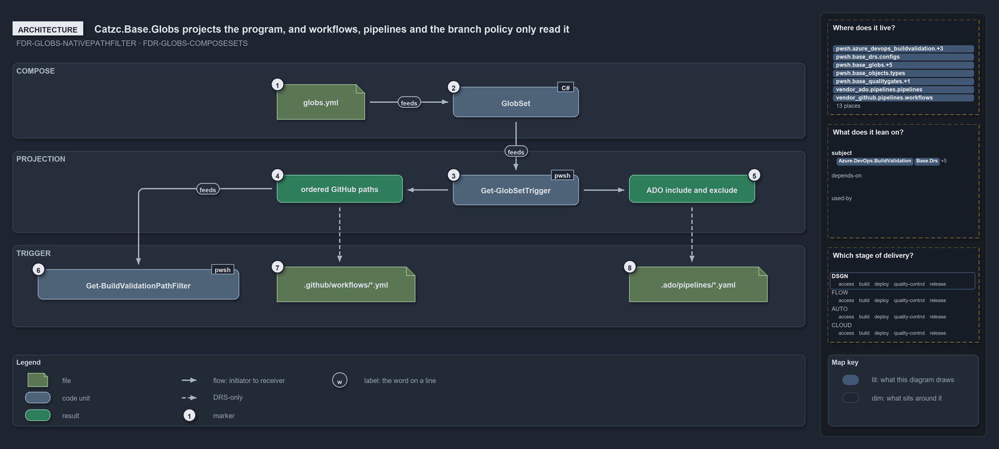

---
catzc:
  warning: "Header is generated by Format-FileMeta via Format-Code; do not change it"
  edges:
    cites:
      - FDR-CD-GLOBS
    drs_total: 3
---

# Catzc.Base.Globs projects the program, and workflows, pipelines and the branch policy only read it

```text
Catzc.Base.Globs projects the program; workflows, pipelines and the branch policy only read it.

1  globs.yml                      the registry: every globset, owned by Catzc.Base.Globs
2  GlobSet                        the typed set; holds the flattened scan program
3  Get-GlobSetTrigger             projects the program into both vendor dialects
4  ordered GitHub paths           the program in order, with ! negation
5  ADO include and exclude        each pattern's last select, as two lists
6  Get-BuildValidationPathFilter  the branch policy: the GitHub list, anchored with /
7  .github/workflows/*.yml        a workflow declares the GitHub list by hand
8  .ado/pipelines/*.yaml          an ado pipeline declares the ADO lists by hand

Supports FDR-CD-GLOBS-NATIVEPATHFILTER and FDR-CD-GLOBS-COMPOSESETS (architecture lens).
```

One module of cats, `Catzc.Base.Globs`, owns the globset registry, the dialect, the flattened scan program and the native projection, and
nothing else parses the registry. Everything that triggers on a globset sits outside that boundary and only reads the projection: the GitHub
workflows, the Azure DevOps pipelines, and the build-validation policy that `Catzc.Azure.DevOps.BuildValidation` registers on the server.
The two YAML consumers are kept in step by hand and checked by quality gates; the branch policy is the one consumer the code fills in
itself, and it reads the GitHub list rather than the Azure DevOps lists.

```yml drawio
description:
  The globs module projects the flattened scan program into a GitHub list and an Azure DevOps include and exclude pair; the branch policy
  reads the GitHub list in code, while workflows and pipelines declare the lists by hand, drawn dashed.
about:
  adrs: [FDR-CD-GLOBS-NATIVEPATHFILTER, FDR-CD-GLOBS-COMPOSESETS]
  lens: architecture
content:
  title: Catzc.Base.Globs projects the program, and workflows, pipelines and the branch policy only read it
  kind: explanation
  flow: left-to-right
  relation: feeds
  theme: dark
  bands:
    - { id: band-compose, label: COMPOSE }
    - { id: band-projection, label: PROJECTION }
    - { id: band-trigger, label: TRIGGER }
  glyphs:
    - { id: f-globs, kind: file, label: globs.yml, in: band-compose }
    - { id: g-globset, kind: code, label: GlobSet, in: band-compose }
    - { id: g-trigger, kind: code, label: Get-GlobSetTrigger, in: band-projection }
    - { id: r-github, kind: result, label: ordered GitHub paths, in: band-projection }
    - { id: r-ado, kind: result, label: ADO include and exclude, in: band-projection }
    - { id: g-path-filter, kind: code, label: Get-BuildValidationPathFilter, in: band-trigger }
    - { id: f-workflows, kind: file, label: .github/workflows/*.yml, in: band-trigger }
    - { id: f-pipelines, kind: file, label: .ado/pipelines/*.yaml, in: band-trigger }
  edges:
    - { from: f-globs, to: g-globset, kind: flow, label: "" }
    - { from: g-globset, to: g-trigger, kind: flow, label: "" }
    - { from: g-trigger, to: r-github, kind: flow, label: "" }
    - { from: g-trigger, to: r-ado, kind: flow, label: "" }
    - { from: r-github, to: g-path-filter, kind: flow, label: "" }
    - { from: r-github, to: f-workflows, kind: adr, label: "" }
    - { from: r-ado, to: f-pipelines, kind: adr, label: "" }
  markers:
    - { at: f-globs, number: 1 }
    - { at: g-globset, number: 2 }
    - { at: g-trigger, number: 3 }
    - { at: r-github, number: 4 }
    - { at: r-ado, number: 5 }
    - { at: g-path-filter, number: 6 }
    - { at: f-workflows, number: 7 }
    - { at: f-pipelines, number: 8 }
  legend: auto
  minimaps:
    code-locations:
      - cell: .claude/.claude/.
        by: [.claude/CLAUDE.md, FDR-CD-GLOBS-COMPOSESETS, FDR-CD-GLOBS-NATIVEPATHFILTER]
      - cell: ado-pipelines/pipelines/.
        by:
          - .ado/pipelines/cd-apex.yaml
          - .ado/pipelines/cd-flux.yaml
          - .ado/pipelines/cd-nova.yaml
          - .ado/pipelines/cd-shared.yaml
          - .ado/pipelines/ci-infrastructure.yaml
          - .ado/pipelines/ci-pwsh.yaml
          - FDR-CD-GLOBS-COMPOSESETS
          - FDR-CD-GLOBS-NATIVEPATHFILTER
      - cell: docs/-/.
        by:
          - docs/drs/flow/dora-explains.md
          - docs/drs/flow/durable-sha-globs.md
          - docs/drs/index.md
          - docs/how-to/automation/apply-environment-approvals.md
          - docs/references/ado/pipelines/cd-apex.yaml.md
          - docs/references/ado/pipelines/cd-flux.yaml.md
          - docs/references/ado/pipelines/cd-nova.yaml.md
          - docs/references/ado/pipelines/cd-shared.yaml.md
          - docs/references/ado/pipelines/ci-infrastructure.yaml.md
          - docs/references/ado/pipelines/ci-pwsh.yaml.md
          - docs/references/github/workflows/ci-pwsh.yml.md
          - docs/references/pwsh/catzc-azure-dev-ops-build-validation/Get-AdoBuildValidations.ps1.md
          - docs/references/pwsh/catzc-azure-dev-ops-build-validation/Register-AdoBuildValidation.ps1.md
          - docs/references/pwsh/catzc-azure-dev-ops-build-validation/Unregister-AdoBuildValidation.ps1.md
          - docs/references/pwsh/catzc-azure-dev-ops-build-validation/configs/build-validation.yml.md
          - docs/references/pwsh/catzc-azure-dev-ops-build-validation/private/Get-BuildValidationPathFilter.ps1.md
          - docs/references/pwsh/catzc-azure-dev-ops/Sync-AdoEnvironmentApprovals.ps1.md
          - docs/references/pwsh/catzc-base-drs/types/DrsConfig.cs.md
          - docs/references/pwsh/catzc-base-globs/Get-GlobSetTrigger.ps1.md
          - docs/references/pwsh/catzc-base-globs/Test-AdoPipelineTriggerGlob.ps1.md
          - docs/references/pwsh/catzc-base-globs/Test-GitHubWorkflowTriggerGlob.ps1.md
          - docs/references/pwsh/catzc-base-globs/Test-GlobSetTriggerCoverage.ps1.md
          - docs/references/pwsh/catzc-base-globs/configs/globs.yml.md
          - docs/references/pwsh/catzc-base-globs/private/Get-PipelineTrigger.ps1.md
          - docs/references/pwsh/catzc-base-globs/tests/types/GlobSet.Tests.ps1.md
          - docs/references/pwsh/catzc-base-globs/tests/types/GlobsConfig.Tests.ps1.md
          - docs/references/pwsh/catzc-base-globs/types/DurableHash.cs.md
          - docs/references/pwsh/catzc-base-globs/types/GlobPattern.cs.md
          - docs/references/pwsh/catzc-base-globs/types/GlobSet.cs.md
          - docs/references/pwsh/catzc-base-globs/types/GlobsConfig.cs.md
          - docs/references/pwsh/catzc-base-maps/Get-LifecyclePositionMinimapData.ps1.md
          - docs/references/pwsh/catzc-base-maps/Get-ValueChainHighlight.ps1.md
          - docs/references/pwsh/catzc-base-maps/Get-WorldMapHighlight.ps1.md
          - FDR-CD-GLOBS-COMPOSESETS
          - FDR-CD-GLOBS-NATIVEPATHFILTER
      - cell: github-workflows/workflows/.
        by: [.github/workflows/ci-pwsh.yml, FDR-CD-GLOBS-COMPOSESETS, FDR-CD-GLOBS-NATIVEPATHFILTER]
      - cell: pwsh/Catzc.Azure.DevOps/.
        by: [pwsh/Catzc.Azure.DevOps/Sync-AdoEnvironmentApprovals.ps1, FDR-CD-GLOBS-COMPOSESETS, FDR-CD-GLOBS-NATIVEPATHFILTER]
      - cell: pwsh/Catzc.Azure.DevOps.BuildValidation/.
        by:
          - pwsh/Catzc.Azure.DevOps.BuildValidation/Get-AdoBuildValidations.ps1
          - pwsh/Catzc.Azure.DevOps.BuildValidation/Register-AdoBuildValidation.ps1
          - pwsh/Catzc.Azure.DevOps.BuildValidation/Unregister-AdoBuildValidation.ps1
          - FDR-CD-GLOBS-COMPOSESETS
          - FDR-CD-GLOBS-NATIVEPATHFILTER
      - cell: pwsh/Catzc.Azure.DevOps.BuildValidation/configs
        by: [pwsh/Catzc.Azure.DevOps.BuildValidation/configs/build-validation.yml, FDR-CD-GLOBS-COMPOSESETS, FDR-CD-GLOBS-NATIVEPATHFILTER]
      - cell: pwsh/Catzc.Azure.DevOps.BuildValidation/private
        by:
          - pwsh/Catzc.Azure.DevOps.BuildValidation/private/Get-BuildValidationPathFilter.ps1
          - FDR-CD-GLOBS-COMPOSESETS
          - FDR-CD-GLOBS-NATIVEPATHFILTER
      - cell: pwsh/Catzc.Base.Drs/configs
        by: [pwsh/Catzc.Base.Drs/configs/drs.yml, FDR-CD-GLOBS-COMPOSESETS, FDR-CD-GLOBS-NATIVEPATHFILTER]
      - cell: pwsh/Catzc.Base.Drs/types
        by: [pwsh/Catzc.Base.Drs/types/DrsConfig.cs, FDR-CD-GLOBS-COMPOSESETS, FDR-CD-GLOBS-NATIVEPATHFILTER]
      - cell: pwsh/Catzc.Base.Globs/.
        by:
          - pwsh/Catzc.Base.Globs/Get-GlobSetTrigger.ps1
          - pwsh/Catzc.Base.Globs/Test-AdoPipelineTriggerGlob.ps1
          - pwsh/Catzc.Base.Globs/Test-GitHubWorkflowTriggerGlob.ps1
          - pwsh/Catzc.Base.Globs/Test-GlobSetTriggerCoverage.ps1
          - FDR-CD-GLOBS-NATIVEPATHFILTER
      - cell: pwsh/Catzc.Base.Globs/configs
        by: [pwsh/Catzc.Base.Globs/configs/globs.yml, FDR-CD-GLOBS-COMPOSESETS, FDR-CD-GLOBS-NATIVEPATHFILTER]
      - cell: pwsh/Catzc.Base.Globs/private
        by: [pwsh/Catzc.Base.Globs/private/Get-PipelineTrigger.ps1, FDR-CD-GLOBS-COMPOSESETS, FDR-CD-GLOBS-NATIVEPATHFILTER]
      - cell: pwsh/Catzc.Base.Globs/tests/types
        by:
          - pwsh/Catzc.Base.Globs/tests/types/GlobSet.Tests.ps1
          - pwsh/Catzc.Base.Globs/tests/types/GlobsConfig.Tests.ps1
          - FDR-CD-GLOBS-COMPOSESETS
      - cell: pwsh/Catzc.Base.Globs/types
        by:
          - pwsh/Catzc.Base.Globs/types/DurableHash.cs
          - pwsh/Catzc.Base.Globs/types/GlobPattern.cs
          - pwsh/Catzc.Base.Globs/types/GlobSet.cs
          - pwsh/Catzc.Base.Globs/types/GlobsConfig.cs
          - FDR-CD-GLOBS-COMPOSESETS
          - FDR-CD-GLOBS-NATIVEPATHFILTER
      - cell: pwsh/Catzc.Base.Maps/.
        by:
          - pwsh/Catzc.Base.Maps/Get-LifecyclePositionMinimapData.ps1
          - pwsh/Catzc.Base.Maps/Get-ValueChainHighlight.ps1
          - pwsh/Catzc.Base.Maps/Get-WorldMapHighlight.ps1
          - FDR-CD-GLOBS-COMPOSESETS
          - FDR-CD-GLOBS-NATIVEPATHFILTER
      - cell: pwsh/Catzc.Base.Maps/tests
        by: [pwsh/Catzc.Base.Maps/tests/Get-WorldMapHighlight.Tests.ps1, FDR-CD-GLOBS-COMPOSESETS, FDR-CD-GLOBS-NATIVEPATHFILTER]
      - cell: pwsh/Catzc.Base.QualityGates/configs
        by: [pwsh/Catzc.Base.QualityGates/configs/terminology.yml, FDR-CD-GLOBS-COMPOSESETS, FDR-CD-GLOBS-NATIVEPATHFILTER]
    module-neighbourhood:
      - cell: subject/.claude
        by: [.claude/CLAUDE.md, FDR-CD-GLOBS-COMPOSESETS, FDR-CD-GLOBS-NATIVEPATHFILTER]
      - cell: subject/Catzc.Azure.DevOps
        by: [pwsh/Catzc.Azure.DevOps/Sync-AdoEnvironmentApprovals.ps1, FDR-CD-GLOBS-COMPOSESETS, FDR-CD-GLOBS-NATIVEPATHFILTER]
      - cell: subject/Catzc.Azure.DevOps.BuildValidation
        by:
          - pwsh/Catzc.Azure.DevOps.BuildValidation/Get-AdoBuildValidations.ps1
          - pwsh/Catzc.Azure.DevOps.BuildValidation/Register-AdoBuildValidation.ps1
          - pwsh/Catzc.Azure.DevOps.BuildValidation/Unregister-AdoBuildValidation.ps1
          - pwsh/Catzc.Azure.DevOps.BuildValidation/configs/build-validation.yml
          - pwsh/Catzc.Azure.DevOps.BuildValidation/private/Get-BuildValidationPathFilter.ps1
          - FDR-CD-GLOBS-COMPOSESETS
          - FDR-CD-GLOBS-NATIVEPATHFILTER
      - cell: subject/Catzc.Base.Drs
        by:
          - pwsh/Catzc.Base.Drs/configs/drs.yml
          - pwsh/Catzc.Base.Drs/types/DrsConfig.cs
          - FDR-CD-GLOBS-COMPOSESETS
          - FDR-CD-GLOBS-NATIVEPATHFILTER
      - cell: subject/Catzc.Base.Globs
        by:
          - pwsh/Catzc.Base.Globs/Get-GlobSetTrigger.ps1
          - pwsh/Catzc.Base.Globs/Test-AdoPipelineTriggerGlob.ps1
          - pwsh/Catzc.Base.Globs/Test-GitHubWorkflowTriggerGlob.ps1
          - pwsh/Catzc.Base.Globs/Test-GlobSetTriggerCoverage.ps1
          - pwsh/Catzc.Base.Globs/configs/globs.yml
          - pwsh/Catzc.Base.Globs/private/Get-PipelineTrigger.ps1
          - pwsh/Catzc.Base.Globs/tests/types/GlobSet.Tests.ps1
          - pwsh/Catzc.Base.Globs/tests/types/GlobsConfig.Tests.ps1
          - pwsh/Catzc.Base.Globs/types/DurableHash.cs
          - pwsh/Catzc.Base.Globs/types/GlobPattern.cs
          - pwsh/Catzc.Base.Globs/types/GlobSet.cs
          - pwsh/Catzc.Base.Globs/types/GlobsConfig.cs
          - FDR-CD-GLOBS-COMPOSESETS
          - FDR-CD-GLOBS-NATIVEPATHFILTER
      - cell: subject/Catzc.Base.Maps
        by:
          - pwsh/Catzc.Base.Maps/Get-LifecyclePositionMinimapData.ps1
          - pwsh/Catzc.Base.Maps/Get-ValueChainHighlight.ps1
          - pwsh/Catzc.Base.Maps/Get-WorldMapHighlight.ps1
          - pwsh/Catzc.Base.Maps/tests/Get-WorldMapHighlight.Tests.ps1
          - FDR-CD-GLOBS-COMPOSESETS
          - FDR-CD-GLOBS-NATIVEPATHFILTER
      - cell: subject/Catzc.Base.QualityGates
        by: [pwsh/Catzc.Base.QualityGates/configs/terminology.yml, FDR-CD-GLOBS-COMPOSESETS, FDR-CD-GLOBS-NATIVEPATHFILTER]
      - cell: subject/pipelines
        by:
          - .ado/pipelines/cd-apex.yaml
          - .ado/pipelines/cd-flux.yaml
          - .ado/pipelines/cd-nova.yaml
          - .ado/pipelines/cd-shared.yaml
          - .ado/pipelines/ci-infrastructure.yaml
          - .ado/pipelines/ci-pwsh.yaml
          - FDR-CD-GLOBS-COMPOSESETS
          - FDR-CD-GLOBS-NATIVEPATHFILTER
      - cell: subject/workflows
        by: [.github/workflows/ci-pwsh.yml, FDR-CD-GLOBS-COMPOSESETS, FDR-CD-GLOBS-NATIVEPATHFILTER]
    axis:
      - cell: DSGN/*
        by: [FDR-CD-GLOBS-COMPOSESETS, FDR-CD-GLOBS-NATIVEPATHFILTER]
layout:
  band-compose: { x: 20, y: 84, w: 1260, h: 120 }
  band-projection: { x: 20, y: 224, w: 1260, h: 130 }
  band-trigger: { x: 20, y: 374, w: 1260, h: 130 }
  f-globs: { x: 440, y: 118, w: 140, h: 56 }
  g-globset: { x: 720, y: 122, w: 200, h: 48 }
  g-trigger: { x: 720, y: 262, w: 200, h: 48 }
  r-github: { x: 440, y: 262, w: 200, h: 44 }
  r-ado: { x: 1000, y: 262, w: 200, h: 44 }
  g-path-filter: { x: 60, y: 412, w: 320, h: 48 }
  f-workflows: { x: 440, y: 408, w: 220, h: 56 }
  f-pipelines: { x: 1000, y: 408, w: 220, h: 56 }
```



## Walkthrough

1. **globs.yml.** The registry holds every globset: its name, layer, `include:` and `exclude:` patterns, optional `compose:` references and,
   on a configured unit, the `pipeline:` it binds. `Catzc.Base.Globs` owns the file, and `GlobsConfig` validates it strictly on load.
2. **GlobSet.** Each entry loads as a typed `GlobSet`. After the loader resolves its compose references, the set holds its flattened scan
   program: the composed sets' rules first, its own rules last, built once and cached.
3. **Get-GlobSetTrigger.** The projection reads the flattened program once and renders it into both vendor dialects, returning one object
   with the `GitHub`, `AdoInclude` and `AdoExclude` lists.
4. **Ordered GitHub paths.** The GitHub list is the program in order, each drop rendered as a `!` negation, so it is exact.
5. **ADO include and exclude.** The Azure DevOps lists collapse each pattern to its last select in the program, because Azure DevOps path
   filters are order-independent.
6. **Get-BuildValidationPathFilter.** The build-validation policy lives server-side. `Register-AdoBuildValidation` fills its
   `filenamePatterns` from this function, which takes the ordered GitHub list and anchors every pattern with a leading `/`.
7. **.github/workflows/\*.yml.** A workflow declares the GitHub list in `on.push.paths` and `on.pull_request.paths`. Today one workflow,
   `ci-pwsh.yml`, binds the `pwsh` set with `pwsh/**`. No code writes the workflow; the pairing is kept by hand.
8. **.ado/pipelines/\*.yaml.** Each pipeline-bound globset names its `.ado/pipelines/<pipeline>.yaml`, whose `trigger:` and `pr:` path
   filters declare the Azure DevOps lists. Six sets bind a pipeline today, and no code writes the pipeline file either.

## Why it holds

- A pipeline, workflow or build-validation policy triggers on the globset's native path-filter projection, rendered by `Get-GlobSetTrigger`
  from the flattened program: exact for GitHub, last select per pattern for Azure DevOps (FDR-CD-GLOBS-NATIVEPATHFILTER).
- The flattened program is what the projection is computed from, with no reference-chasing at trigger time (FDR-CD-GLOBS-COMPOSESETS).
- `Catzc.Base.Globs` owns the file, the dialect, the durable SHA, the native projection and the git-reflection query; nothing else parses
  the config (FDR-CD-GLOBS, "One configuration point").

## Where the code and the decision record differ

- The FDR says branch-policy `filenamePatterns` use the order-independent Azure DevOps projection. `Get-BuildValidationPathFilter` uses the
  ordered GitHub list with `!` negation, anchored with `/`.
- The FDR says the projected filters are generated from `globs.yml` into the orchestration YAML and never hand-authored. No code in the tree
  writes `paths:` into a pipeline or a workflow; the files are kept in step by hand and the drift quality gates compare them.

## See also

- [Globset triggers](../../drs/flow/durable-sha-globs.md) — the decision this article explains.
- The other lenses on the same projection: [meta](one-program-two-vendor-dialects.md),
  [implementation](apex-thirteen-rules-seven-includes-six-excludes.md), [operations](print-projection-then-drift-names-the-filter.md) and
  [governance](drift-is-gated-generation-is-drs-only.md).
- [The flow explanations](index.md) · [How to read the diagrams](../index.md#how-to-read-the-diagrams)
